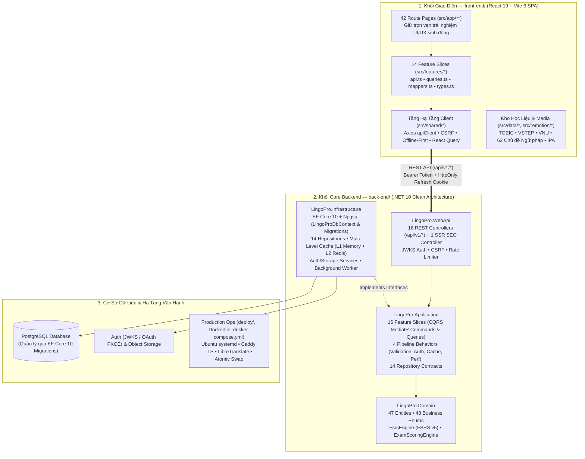

# Tóm Tắt & Phân Tích Toàn Diện Dự Án LingoPro (`Vocab`)

> **Cập nhật theo trạng thái mới nhất trên nhánh `development` (`6438533a` — sau chuỗi PR #26 → PR #40+)**
> **Tên sản phẩm:** LingoPro (`https://lingopro.online`)
> **Mô hình:** Nền tảng EdTech học Tiếng Anh toàn diện (B2C cho học sinh, sinh viên, người đi làm & B2B cho giáo viên, trường học, trung tâm Anh ngữ).

---

## 1. Kiến Trúc Tổng Thể & Cấu Trúc Kho Mã Nguồn (Monorepo)

Dự án **LingoPro** đã hoàn tất quá trình hiện đại hóa kiến trúc từ ứng dụng Next.js Monolith ban đầu sang mô hình **Frontend SPA hiện đại (`front-end/`) + Core Backend `.NET 10` Clean Architecture (`back-end/`)**.

> [!NOTE]
> Thư mục `/supabase` ở gốc repo là tàn dư SQL cũ (legacy) và **không còn được sử dụng**. Toàn bộ lược đồ cơ sở dữ liệu, cấu hình bảng và migrations hiện được quản lý tập trung bằng **EF Core 10 Code-First** ngay trong [`back-end/src/LingoPro.Infrastructure/Persistence/`](file:///home/ngthanhtam/Vocab/back-end/src/LingoPro.Infrastructure/Persistence).



### Bảng Thống Kê Quy Mô Kho Mã Nguồn Hiện Tại

| Thư mục / Khối | Công nghệ cốt lõi | Quy mô thực tế | Vai trò chính |
|---|---|---|---|
| **[`front-end/`](file:///home/ngthanhtam/Vocab/front-end)** | **React 19**, **Vite 6**, TypeScript 5.7, **TailwindCSS v4**, Shadcn/Base UI, **TanStack Query v5**, Zustand v5, React Router v7, Remotion 4, Capacitor (iOS/Android) | **1.610** file trong `src/` + **297** file kiểm thử trong `tests/` (Vitest, Playwright, QA Suites) | Ứng dụng Web/Mobile SPA chính thức dành cho Học viên, Giáo viên và Admin. Đã loại bỏ hoàn toàn các route Next.js cũ (`src/app/api/**`) để gọi qua `.NET 10` API. |
| **[`back-end/`](file:///home/ngthanhtam/Vocab/back-end)** | **.NET 10 (C# 14)**, ASP.NET Core Web API & Razor Views, **EF Core 10** (Npgsql), **MediatR 12**, FluentValidation, StackExchange.Redis, **NUnit 4** | **448** file `.cs` mã nguồn (`src/`) + **52** file `.cs` unit test (`tests/` với **568+** test cases) + **20** file `.cshtml` | Core Backend chuẩn **Clean Architecture 4 tầng + DDD + CQRS**, quản lý toàn bộ nghiệp vụ, xác thực, caching và EF Core Database Migrations. |
| **[`agent/`](file:///home/ngthanhtam/Vocab/agent)** | Markdown, Mermaid Diagrams | **28** file tài liệu kiến trúc & đặc tả | Trung tâm tri thức kiến trúc: gồm **15 file SRS** (`agent/docs/SRS_01` → `SRS_15`), **6 file thiết kế kiến trúc `.NET 10`** (`agent/architect/`) và các báo cáo tổng hợp. |
| **[`docs/`](file:///home/ngthanhtam/Vocab/docs)** | Markdown, JSON, DOCX | **299** file chia theo **22 chuyên mục** | Kho tài liệu vận hành production, bảo mật, kiểm toán UI/UX, nghiên cứu học liệu (62 chủ đề ngữ pháp, từ vựng, VNU Bậc 3, IELTS, Tiếng Trung), chiến dịch marketing & cẩm nang TOEIC. |
| **[`deploy/`](file:///home/ngthanhtam/Vocab/deploy)** | Bash Scripts, PowerShell, Caddy, Docker Compose, GitHub Actions | **10** kịch bản vận hành + [`Dockerfile`](file:///home/ngthanhtam/Vocab/Dockerfile) + [`docker-compose.yml`](file:///home/ngthanhtam/Vocab/docker-compose.yml) | Hạ tầng triển khai Zero-Downtime Atomic Release, cấu hình Caddy TLS reverse proxy và container LibreTranslate. |
| *`supabase/` (Legacy)* | *SQL Files cũ* | *Không còn sử dụng* | *Thư mục chứa các file SQL từ hệ thống cũ trước khi chuyển sang quản lý bằng EF Core 10 trong `back-end/`.* |

---

## 2. 15 Phân Hệ Nghiệp Vụ Cốt Lõi Của LingoPro

Toàn bộ nền tảng được chia thành **15 phân hệ nghiệp vụ** (đặc tả chi tiết trong [`agent/docs/`](file:///home/ngthanhtam/Vocab/agent/docs/README.md)), ánh xạ đồng bộ giữa `front-end/src/features/` và `back-end/src/LingoPro.Application/Features/`:

| # | Phân hệ nghiệp vụ | Mã SRS | Tính năng nổi bật trong dự án |
|:---:|---|---|---|
| **01** | **Xác thực & Quản lý phiên (`Auth & Session`)** | [`SRS_01`](file:///home/ngthanhtam/Vocab/agent/docs/SRS_01_AUTH_SESSION.md) | Đăng nhập/Đăng ký Email, Google OAuth (PKCE), liên kết tài khoản, khôi phục mật khẩu, xác thực **JWKS**, cơ chế **HttpOnly Refresh Cookie** + CSRF protection và chế độ **Offline-First** giữ phiên khi mất mạng. |
| **02** | **Học từ vựng & Thuật toán FSRS v5 (`Vocab & SRS`)** | [`SRS_02`](file:///home/ngthanhtam/Vocab/agent/docs/SRS_02_VOCAB_SRS_FSRS.md) | Học Flashcard đa phương thức, tính toán lịch ôn tập bằng thuật toán **FSRS v5** (`Stability`, `Difficulty`, `Retrievability`, 6 cấp độ nhớ L1–L6), kho từ vựng (Vocab Vault), nhập gói từ vựng mở (`UserVocabPack`), đồng bộ tiến độ giữa sổ từ cá nhân (`__personal__`) và lớp học. |
| **03** | **Lộ trình học đa khóa (`Roadmap / Journey`)** | [`SRS_03`](file:///home/ngthanhtam/Vocab/agent/docs/SRS_03_ROADMAP_JOURNEY.md) | Bài kiểm tra xếp lớp đầu vào (`Placement Test`), lộ trình học theo trạm (Steps & Checkpoints) cho các khóa: **CEFR** (`A0`–`B2`), **THPT Quốc gia** (`Lớp 10`–`Lớp 12`), **TOEIC** (`450`–`800+`), **VSTEP** và **VNU Bậc 3**. |
| **04** | **Sát thủ TOEIC Listening & Phòng thi TOEIC (`TOEIC Arena`)** | [`SRS_04`](file:///home/ngthanhtam/Vocab/agent/docs/SRS_04_TOEIC_LISTENING_EXAM.md) | Luyện nghe chép chính tả từng câu (**Dictation Diff Matcher**), 100 video ngắn giải đề TOEIC Part 1–4 (Remotion), và phòng thi thử **TOEIC Full Test 200 câu** (7 Parts) chấm điểm theo Barem chuẩn ETS (5–495 mỗi kỹ năng). |
| **05** | **AI Coaching & Phân tích câu (`AI Coach & Skills`)** | [`SRS_05`](file:///home/ngthanhtam/Vocab/agent/docs/SRS_05_AI_COACHING_SKILLS.md) | Luyện hội thoại Speaking với AI theo kịch bản, tải file ghi âm lên Object Storage, phân tích cấu trúc câu chuyên sâu (**Sentence Kernel**, mệnh đề chính/phụ, cấp độ mở rộng câu) và quản lý hạn mức AI theo ngày (`AiDailyUsage`). |
| **06** | **Cổng Giáo viên & Quản lý Lớp học (`Teacher Classroom B2B`)** | [`SRS_06`](file:///home/ngthanhtam/Vocab/agent/docs/SRS_06_TEACHER_CLASSROOM.md) | Tạo lớp học, cấp mã mời 6 ký tự, giao bài tập từ vựng/ngữ pháp (`Assign Drill`), bảng điều khiển theo dõi chuyên cần, lỗi sai thường gặp và chỉ số năng lực học sinh (**VMS / LCS Analytics**). |
| **07** | **Thanh toán, Mã giảm giá & Gói VIP (`Billing & Subscription`)** | [`SRS_07`](file:///home/ngthanhtam/Vocab/agent/docs/SRS_07_BILLING_SUBSCRIPTION.md) | Đặt mua gói cá nhân (`Pro`, `Premium`), gói nhóm (`Group Plan`) hoặc đặt cọc thử thách (`Challenge`), kiểm tra mã giảm giá (`Coupon`), thanh toán VietQR / SePay Webhook tự động kích hoạt quyền lợi và ghi lịch sử `SubscriptionHistory`. |
| **08** | **Gamification & Thử thách cam kết (`Gamification & Challenges`)** | [`SRS_08`](file:///home/ngthanhtam/Vocab/agent/docs/SRS_08_GAMIFICATION_CHALLENGES.md) | Tích lũy điểm kinh nghiệm (`XP`), duy trì chuỗi ngày học liên tiếp (`Streak` chuẩn múi giờ GMT+7), mua bảo vệ chuỗi (`Streak Freeze`) và tham gia chiến dịch thử thách học tập cam kết (`Challenge` / `ChallengeParticipant`). |
| **09** | **Hệ thống Ngữ pháp 62 chủ đề (`Grammar System`)** | [`SRS_09`](file:///home/ngthanhtam/Vocab/agent/docs/SRS_09_GRAMMAR_SYSTEM.md) | **62 chủ điểm ngữ pháp chuẩn CEFR (`A0`–`B2`)**, bài giảng lý thuyết trực quan (Golden Sections & Visual Assets), theo dõi tiến độ vi mô (`GrammarMicroProgress`), bài tập 3 dạng và ôn tập ngắt quãng FSRS liên thông với Roadmap. |
| **10** | **Từ điển thông minh, OCR & Mindmap (`Dictionary, OCR & Mindmap`)** | [`SRS_10`](file:///home/ngthanhtam/Vocab/agent/docs/SRS_10_DICTIONARY_OCR_MINDMAP.md) | Tra từ điển toàn cục (`GlobalDictionary`), giải nghĩa cụm từ theo ngữ cảnh bằng AI, quét ảnh sách giáo khoa trích xuất từ vựng (**OCR**), sơ đồ tư duy từ vựng (**Mindmap**) và kết nối Chrome Extension (`ExtensionToken`). |
| **11** | **Luyện đọc hàng ngày & Thư viện đọc CEFR (`Reading Library`)** | [`SRS_11`](file:///home/ngthanhtam/Vocab/agent/docs/SRS_11_READING_PRACTICE_LIBRARY.md) | Sinh bài đọc cá nhân hóa hàng ngày từ các từ vựng đến hạn ôn tập (`DailyReadingExercise`), thư viện **588+ bài đọc phân cấp CEFR (`A1`–`C2`)** giao diện chia đôi màn hình (Split-Pane), tra từ một chạm (Gloss) và truyện chêm (**CodeMix**). |
| **12** | **Khảo thí chuẩn hóa (`VSTEP, VNU Bậc 3 & THPT`)** | [`SRS_12`](file:///home/ngthanhtam/Vocab/agent/docs/SRS_12_VSTEP_VNU_THPT_EXAMS.md) | Phòng thi mô phỏng chuẩn cấu trúc **VSTEP (B1–C1)**, **ĐHQG TP.HCM — VNU-EPT Bậc 3** và **THPT Quốc gia** đủ 4 kỹ năng (Listening, Reading, Writing, Speaking), chấm điểm thang 10 và chấm bài luận Writing theo 4 tiêu chí Rubric. |
| **13** | **Nền tảng Giao tiếp & Ngữ âm IPA (`Speaking Foundation & IPA`)** | [`SRS_13`](file:///home/ngthanhtam/Vocab/agent/docs/SRS_13_SPEAKING_CURRICULUM_FOUNDATION.md) | Bảng **44 âm IPA** kèm hướng dẫn khẩu hình, luyện cặp âm tối thiểu (Minimal Pairs) và thuật toán thăm dò chẩn đoán từ vựng thích ứng (`Diagnostic Probe` dựa trên `UncertaintyScore` & `LearnerLexicalState`). |
| **14** | **Đại sứ Giới thiệu, Nhóm học tập & Phòng tự học (`Social Hub`)** | [`SRS_14`](file:///home/ngthanhtam/Vocab/agent/docs/SRS_14_REFERRAL_GROUPS_HUB.md) | Chương trình Đại sứ / Affiliate 5 bậc (`ReferralCampaign`, `ReferralLink`, `RewardTransaction`, rút tiền `PayoutRequest`), nhóm học tập chia sẻ gói Pro (`StudyGroup`) và phòng tự học trực tuyến (`StudyRoomPresence`). |
| **15** | **Quản trị Admin CRM, Lead Magnet & Tự động hóa (`Admin CRM`)** | [`SRS_15`](file:///home/ngthanhtam/Vocab/agent/docs/SRS_15_ADMIN_CRM_CAMPAIGNS_CRON.md) | Dashboard quản trị doanh thu, đơn hàng, phễu người dùng; thu thập khách hàng tiềm năng (`PilotLead` từ chiến dịch Sát Thủ TOEIC / Giáo viên); thông báo đẩy Web Push (FCM) và Worker tự động quét hạ cấp gói hết hạn / nhắc học từ đến hạn. |

---

## 3. Chi Tiết Kiến Trúc Khối Backend `.NET 10` (`back-end/`)

Khối [`back-end/`](file:///home/ngthanhtam/Vocab/back-end) ([`LingoPro.sln`](file:///home/ngthanhtam/Vocab/back-end/LingoPro.sln)) gồm **4 project nguồn** và **2 project kiểm thử**, tuân thủ nghiêm ngặt quy chuẩn trong [`agent/architect/SKILL.md`](file:///home/ngthanhtam/Vocab/agent/architect/SKILL.md):

### 3.1. `LingoPro.Domain` (Tầng Lõi Nghiệp Vụ — 0 phụ thuộc ngoại lai)
- **Domain Primitives**: `BaseEntity`, `BaseAuditableEntity`, `AggregateRoot`, `ValueObject`, `ISoftDelete`.
- **47 Domain Entities** chia theo 11 nhóm nghiệp vụ (`Auth`, `Vocab`, `Grammar`, `Roadmap`, `Exam`, `Reading`, `Speaking`, `Classroom`, `Billing`, `Gamification`, `Social`, `Admin`).
- **48 Business Enums** đồng bộ 1-1 với PostgreSQL (`CertLevel`, `UserRole`, `SubscriptionPlanType`, `SrsCardState`, `SrsReviewQuality`, `RoadmapTrackType`, `OrderKind`, `OrderStatus`...).
- **Thuật toán miền thuần túy (Pure Domain Engines)**:
  - [`FsrsEngine.cs`](file:///home/ngthanhtam/Vocab/back-end/src/LingoPro.Domain/Services/FsrsEngine.cs): Thuật toán lặp lại ngắt quãng FSRS v5 thuần toán học.
  - [`ExamScoringEngine.cs`](file:///home/ngthanhtam/Vocab/back-end/src/LingoPro.Domain/Services/ExamScoringEngine.cs): Quy đổi điểm chuẩn TOEIC (Listening/Reading 5–495) và VSTEP (thang 10, phân bậc B1/B2/C1).

### 3.2. `LingoPro.Application` (Tầng Ca Sử Dụng & CQRS Pipeline)
- **16 Feature Slices** (`AdminCrm`, `AiCoaching`, `Auth`, `Billing`, `Classrooms`, `Dictionary`, `Exams`, `Gamification`, `Grammar`, `Reading`, `Roadmap`, `Seo`, `Social`, `SpeakingFoundation`, `Toeic`, `Vocab`): Tách biệt rõ `Commands/` (ghi dữ liệu) và `Queries/` (đọc dữ liệu).
- **4 MediatR Pipeline Behaviors**:
  1. `ValidationBehavior`: Tự động chạy FluentValidation (`IValidator<TRequest>`).
  2. `AuthorizationBehavior`: Kiểm tra phân quyền `[Authorize(Roles = ..., Policy = ...)]` (`RequireTeacher`, `RequireAdmin`, `RequireProPlan`) ngay tại tầng Application.
  3. `CachingBehavior`: Tự động đọc/ghi cache cho các Query đánh dấu `ICacheableQuery`.
  4. `PerformanceBehavior`: Giám sát và cảnh báo các truy vấn chạy quá 500ms.
- **14 Repository Interfaces** (`IAuthRepository`, `IVocabRepository`, `IGrammarRepository`, `IBillingRepository`, ...): Đảm bảo các Handler hoàn toàn độc lập với EF Core.
- **Chuẩn phản hồi `ApiResponse<T>`**: Mọi API trả về cấu trúc đồng nhất gồm `StatusCode`, `Success`, `Message`, `Data`, `ErrorCode`, `Errors`, `TimestampUtc`.

### 3.3. `LingoPro.Infrastructure` (Tầng Dữ Liệu, EF Core Migrations, Cache & Dịch Vụ Ngoài)
- **EF Core 10 + PostgreSQL ([`LingoProDbContext.cs`](file:///home/ngthanhtam/Vocab/back-end/src/LingoPro.Infrastructure/Persistence/LingoProDbContext.cs))**:
  - Quản lý toàn bộ schema, Fluent API Configurations (`Persistence/Configurations/*`) và EF Core Migrations (`Persistence/Migrations/*`).
  - Áp dụng `UseSnakeCaseNamingConvention()` và bộ chuyển đổi [`SnakeCaseEnumConverter<TEnum>`](file:///home/ngthanhtam/Vocab/back-end/src/LingoPro.Infrastructure/Persistence/Converters/SnakeCaseEnumConverter.cs) để ánh xạ tự động Enum C# (`PascalCase`) sang chuỗi `snake_case` dưới PostgreSQL.
  - Tự động lọc mềm (`ISoftDelete`) và cập nhật thời gian (`AuditableEntitySaveChangesInterceptor`).
- **14 Concrete Repositories** (`Persistence/Repositories/*Repository.cs`): Chứa toàn bộ truy vấn LINQ tối ưu (`AsNoTracking`, projection, batching).
- **Multi-Level Caching 2 Giai Đoạn (`ICacheService`)**:
  - Phase 1 (`Caching:Mode = "None"`): Dùng `NoOpCacheService` truy vấn thẳng DB không tốn chi phí Redis.
  - Phase 2 (`Caching:Mode = "Hybrid"`): Kích hoạt `HybridMultiLevelCacheService` (L1 `IMemoryCache` + L2 `StackExchange.Redis`) chỉ bằng cấu hình.
- **Background Worker**:
  - `SubscriptionAndReminderWorker`: Tiến trình nền tự động hạ cấp gói VIP hết hạn và gửi thông báo nhắc học.

### 3.4. `LingoPro.WebApi` (Tầng Giao Tiếp HTTP & Bảo Mật)
- **16 REST API Controllers** dưới `/api/v1/*`:
  `AuthController`, `VocabController`, `RoadmapController`, `ReadingController`, `GrammarController`, `DictionaryController`, `ExamsController`, `SpeakingFoundationController`, `AiCoachingController`, `ClassroomsController`, `BillingController`, `ChallengesController`, `SocialHubController`, `AdminCrmController`, `LeadMagnetController`, `SystemEnumsController`.
- **1 SSR Controller (`HomeSeoController`)**: Render Server-Side HTML + OpenGraph + JSON-LD cho các trang SEO đích.
- **Bảo mật cấp Doanh nghiệp**:
  - Xác thực JWT qua **JWKS** (`SupabaseSigningKeyProvider` + `ApplyProfileClaimsAsync` đối chiếu quyền thực tế từ bảng `profiles`).
  - Bảo vệ chống giả mạo request bằng `CookieCsrfMiddleware` (`X-LingoPro-Request: 1`), `ExceptionHandlingMiddleware` và `.NET 10 RateLimiter`.

---

## 4. Chi Tiết Kiến Trúc Khối Frontend (`front-end/`)

Sau chuỗi PR #37 → PR #40, toàn bộ giao diện học tập giàu tính tương tác đã được hợp nhất và tái cấu trúc hoàn chỉnh vào [`front-end/`](file:///home/ngthanhtam/Vocab/front-end) trên nền **React 19 + Vite 6**:

1. **Tổ chức theo Feature-Sliced Architecture (`src/features/<domain>/`)**:
   - Gồm **14 phân hệ**: `auth`, `vocab`, `grammar`, `dictionary`, `reading`, `listening`, `speaking`, `exam`, `roadmap`, `classroom`, `challenge`, `billing`, `social`, `admin`.
   - Mỗi phân hệ được chuẩn hóa gồm: `api.ts` (gọi `.NET 10` API), `queries.ts` (React Query hooks), `mappers.ts` (chuyển đổi DTO ↔ UI model), `types.ts`, `lib/` và `__tests__/`.
2. **Tầng Hạ tầng Dùng chung (`src/shared/`)**:
   - `src/shared/api/client.ts`: Axios singleton tự động gắn Bearer token từ RAM (`TokenStore`), CSRF header, tự động refresh token single-flight qua HttpOnly cookie và hỗ trợ **Offline-First** (không đăng xuất người dùng khi lỗi mạng/5xx).
   - `src/shared/lib/storage.ts`: Quản lý bộ nhớ cục bộ phân tách theo từng người dùng (user-scoped storage), giúp hydrate giao diện tức thì (0ms perceived latency).
3. **42 Route Pages (`src/app/**`) & Đa nền tảng**:
   - Bao phủ toàn bộ hành trình người dùng: `/landing`, `/auth`, `/student` (Dashboard, Profile, Speaking, Dictionary, Reading Library), `/flashcard`, `/grammar`, `/journey`, `/toeic`, `/sat-thu-toeic-listening`, `/vstep`, `/vnu-bac-3`, `/ipa`, `/teacher`, `/admin`, `/challenges`, `/groups`, `/referral`...
   - Tích hợp **Capacitor** (`android/`, `ios/`) để đóng gói ứng dụng di động và **Remotion** (`src/remotion/`) để render tự động chuỗi 100 video học TOEIC TikTok.

---

## 5. Hệ Thống Kiểm Thử & Đảm Bảo Chất Lượng (Testing & QA)

Dự án sở hữu hệ thống kiểm thử tự động nhiều lớp ở cả Backend và Frontend:

- **Backend Unit & Business Rule Tests (`back-end/tests/`)**:
  - **52 file kiểm thử NUnit 4** (`LingoPro.Domain.UnitTests` & `LingoPro.Application.UnitTests`) với **568+ test cases**.
  - Kiểm thử sâu thuật toán FSRS v5, bảng quy đổi điểm TOEIC/VSTEP, phân quyền Teacher/Admin, luồng thanh toán Coupon/Order và đánh dấu rõ các điểm `[Category("KnownDeviation")]` để theo dõi sát sao độ khớp nghiệp vụ.
- **Frontend Unit, Domain QA & E2E Tests (`front-end/tests/` & `front-end/src/**/__tests__/`)**:
  - **297 file kiểm thử** trong `front-end/tests/` chia theo 21 bộ chuyên biệt: `qa`, `offline`, `toeic`, `vstep`, `vnu-bac-3`, `grammar`, `listening`, `speaking`, `pronunciation`, `journey`, `security`, `e2e` (Playwright smoke tests)...
  - Guardrail **ESLint 9** kiểm soát chặt chẽ kiến trúc: cấm tuyệt đối gọi trực tiếp DB client hay `fetch('/api/...')` từ UI component, bắt buộc đi qua tầng Domain Service (`features/*/api.ts`).

---

## 6. Kho Tài Liệu Nghiệp Vụ, Nghiên Cứu & Vận Hành (`/agent` & `/docs`)

Kho lưu trữ tri thức của dự án được tổ chức rất bài bản tại 2 thư mục lớn:

### 6.1. Thư mục [`/agent`](file:///home/ngthanhtam/Vocab/agent/README.md) (Dành cho Kiến trúc sư & AI Agent)
- [`agent/01_PROJECT_OVERVIEW_AND_ARCHITECTURE.md`](file:///home/ngthanhtam/Vocab/agent/01_PROJECT_OVERVIEW_AND_ARCHITECTURE.md): Tổng quan dự án và kiến trúc `.NET 10`.
- [`agent/02_IMPLEMENTATION_PROGRESS_REPORT.md`](file:///home/ngthanhtam/Vocab/agent/02_IMPLEMENTATION_PROGRESS_REPORT.md): Báo cáo tiến độ hiện thực hóa 15 phân hệ.
- [`agent/03_AGENT_DOCS_CURRENT_STATE_ANALYSIS.md`](file:///home/ngthanhtam/Vocab/agent/03_AGENT_DOCS_CURRENT_STATE_ANALYSIS.md): Phân tích 24 tài liệu trong `/agent` và các điểm tiến hóa kiến trúc.
- [`agent/architect/`](file:///home/ngthanhtam/Vocab/agent/architect/README.md): Bộ quy chuẩn code [`SKILL.md`](file:///home/ngthanhtam/Vocab/agent/architect/SKILL.md) và thiết kế chi tiết Clean Architecture, Auth, EF Core PostgreSQL, Module Mapping.
- [`agent/docs/`](file:///home/ngthanhtam/Vocab/agent/docs/README.md): Bộ **15 tài liệu SRS (`SRS_01` → `SRS_15`)** kèm phân tích bảo mật và luồng nghiệp vụ chi tiết.

### 6.2. Thư mục [`/docs`](file:///home/ngthanhtam/Vocab/docs/README.md) (299 files — Vận hành, Học liệu & Kinh doanh)
- **Vận hành & Bảo mật**: [`docs/operations/`](file:///home/ngthanhtam/Vocab/docs/operations) (Runbook deploy production, database migrations, backup, rollback), [`docs/security/`](file:///home/ngthanhtam/Vocab/docs/security) (CSP, kiến trúc xác thực, bảo mật sở hữu trí tuệ), [`docs/architecture/production.md`](file:///home/ngthanhtam/Vocab/docs/architecture/production.md).
- **Học liệu & Sư phạm**: [`docs/grammar/`](file:///home/ngthanhtam/Vocab/docs/grammar) (62 chủ đề ngữ pháp), [`docs/vocab/`](file:///home/ngthanhtam/Vocab/docs/vocab) (Quality gates & kho từ vựng mở), [`docs/vnu-bac-3/`](file:///home/ngthanhtam/Vocab/docs/vnu-bac-3) (Đề án & blueprint VNU-EPT Bậc 3), [`docs/toeic/`](file:///home/ngthanhtam/Vocab/docs/toeic), [`docs/ielts/`](file:///home/ngthanhtam/Vocab/docs/ielts), [`docs/curriculum/`](file:///home/ngthanhtam/Vocab/docs/curriculum), [`docs/pedagogy/`](file:///home/ngthanhtam/Vocab/docs/pedagogy).
- **Kinh doanh & Mở rộng thị trường**: [`docs/business-and-marketing/`](file:///home/ngthanhtam/Vocab/docs/business-and-marketing) (Dự toán chi phí vận hành, sơ đồ giá & marketing), [`docs/campaign/`](file:///home/ngthanhtam/Vocab/docs/campaign), [`docs/chinese-market/`](file:///home/ngthanhtam/Vocab/docs/chinese-market) (Đề án mở rộng sang thị trường Tiếng Trung & hợp tác B2B), [`docs/ui-audit/`](file:///home/ngthanhtam/Vocab/docs/ui-audit).

---

## 7. Hướng Dẫn Khởi Chạy Nhanh (Quick Start)

### 7.1. Chạy Khối Backend (`.NET 10`)
```bash
cd back-end
dotnet restore
dotnet build
dotnet test                                              # Chạy bộ 568+ NUnit tests
dotnet run --project src/LingoPro.WebApi                 # Khởi động API tại http://localhost:5000
```

### 7.2. Chạy Khối Frontend (`React 19 + Vite SPA`)
```bash
cd front-end
npm ci
npm run dev                                              # Khởi động Vite SPA tại http://localhost:5173
npm run check                                            # Chạy typecheck + lint + unit tests (Vitest)
npm run build                                            # Build production bundle
```

---

## 8. Trạng Thái Hiện Tại & Lộ Trình Hoàn Thiện Tiếp Theo

- **Những gì đã hoàn tất**:
  1. Hoàn thiện 100% khung **Clean Architecture `.NET 10`** (`back-end/`) quản lý trực tiếp schema PostgreSQL qua **EF Core 10** (`LingoProDbContext` & `Persistence/Migrations/`).
  2. Hoàn tất chuyển đổi toàn bộ giao diện học tập sang **`front-end/` (React 19 + Vite SPA)** theo kiến trúc Feature-Sliced, xóa bỏ hoàn toàn các route API cũ của Next.js và kết nối trực tiếp vào `.NET 10` API.
  3. Thiết lập đầy đủ guardrail `tsc`, `eslint`, `vitest` (Frontend) và `NUnit` (Backend).
- **Các hạng mục đang tiếp tục hoàn thiện** (chi tiết tại [`front-end/docs/refactor-followups.md`](file:///home/ngthanhtam/Vocab/front-end/docs/refactor-followups.md) và [`agent/02_IMPLEMENTATION_PROGRESS_REPORT.md`](file:///home/ngthanhtam/Vocab/agent/02_IMPLEMENTATION_PROGRESS_REPORT.md)):
  1. **Backend `.NET 10`**: Thay thế các phần đang dùng Stub trong `AiRouterService.cs` (kết nối trực tiếp Gemini / Groq / Zhipu API), bổ sung nốt các endpoint CRUD phụ đang đánh dấu 🟡 trong [`front-end/docs/api-inventory.md`](file:///home/ngthanhtam/Vocab/front-end/docs/api-inventory.md), và xử lý triệt để các test case `[Category("KnownDeviation")]`.
  2. **Frontend SPA**: Chạy kiểm thử E2E Playwright thực tế đối chiếu với `.NET 10` dev server, tách nhỏ thêm các dataset tĩnh lớn để tối ưu hóa kích thước bundle.
