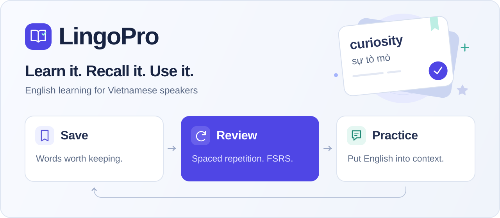

<p align="center">
  
</p>

<p align="center">
  <strong>English learning, built around the words you want to remember.</strong><br />
  Vocabulary capture, spaced repetition, grammar and exam practice for Vietnamese learners.
</p>

<p align="center">
  <a href="https://lingopro.online"><strong>Explore LingoPro ↗</strong></a> ·
  <a href="#what-you-can-do">Features</a> ·
  <a href="docs/development.md">Local setup</a> ·
  <a href="docs/README.md">Documentation</a> ·
  <a href="README.vi.md">Tiếng Việt</a>
</p>

<p align="center">
  <a href="https://nextjs.org"></a>
  <a href="https://www.typescriptlang.org"></a>
  <a href="https://supabase.com"></a>
  <a href="https://github.com/FengProfessor/Vocab/actions/workflows/deploy-server.yml"></a>
</p>

## Why LingoPro

Looking up a word is only the beginning. LingoPro connects discovery to a personal vocabulary collection, schedules reviews with FSRS, and brings those words back through language practice. Vietnamese explanations help learners move from understanding a word to using it.

## What you can do

| Area | Experience |
| --- | --- |
| **Vocabulary** | Look up meanings, IPA and examples; save words to a personal collection. |
| **Spaced repetition** | Review saved words with an FSRS schedule powered by `ts-fsrs`. |
| **Grammar** | Follow a foundation learning path and practise with interactive micro-lessons. |
| **Language skills** | Practise listening, reading, speaking and writing in dedicated learning areas. |
| **Exam preparation** | Access TOEIC, VSTEP and VNU Bậc 3 practice areas. |
| **Learning habits** | Track activity with study progress, streaks and XP. |

### Product preview

<p align="center">
  <a href="https://lingopro.online"></a>
</p>

*Public homepage. Learning areas that save personal progress require an account.*

## Built with

| Layer | Technology |
| --- | --- |
| Web application | Next.js 16 App Router, React 19, TypeScript 5 |
| Interface | Tailwind CSS 4, component primitives, Lucide icons |
| Data and identity | Supabase PostgreSQL, Auth and row-level security; server-side session handling |
| Review engine | `ts-fsrs` |
| AI integrations | Google Gemini with key rotation; additional providers through the AI router |
| Reminders | Firebase Cloud Messaging |
| App delivery | PWA integration; Android and iOS wrappers with Capacitor |
| Production | Next.js standalone on Ubuntu/systemd; GitHub Actions release pipeline |

## Run locally

Use **Node.js 22** and npm, matching CI. Configure a dedicated development backend using the [local setup guide](docs/development.md) before testing account or data flows.

```bash
git clone https://github.com/FengProfessor/Vocab.git
cd Vocab
npm ci
# Configure .env.local using docs/development.md, then:
npm run dev
```

Open [localhost:3000](http://localhost:3000). Backend, AI and notification features depend on their respective configuration; the setup guide distinguishes these requirements.

## Project map

```text
src/app/         Pages, layouts and API routes
src/components/  Shared interface components
src/lib/         Review engine, auth, data and service integrations
src/data/        Learning content and exam datasets
supabase/        Database migrations and supporting SQL
tests/           Feature, security, integration and browser suites
docs/            Development, architecture and operations guides
.github/         Workflows, issue forms and pull request template
```

## Quality and delivery

```bash
npm run lint
npm run typecheck
npm run build
npm run test:e2e:smoke
```

These checks cover different things. The browser smoke suite exercises anonymous journeys; it does not establish authenticated progress persistence. The repository also records existing lint and typecheck debt. Read the [test classification and baseline](docs/testing/test-classification.md) before interpreting results.

Production releases use the canonical GitHub Actions workflow: quality checks → migrations → build of the exact commit → activation → restart → health verification. Production actions require explicit operator approval; see the [deployment runbook](docs/operations/production-deploy.md).

## Documentation and contributions

- [Documentation index](docs/README.md) — find development, architecture and operations guides.
- [Contributing](CONTRIBUTING.md) — scope changes, verify them and open a pull request.
- [Report a bug](https://github.com/FengProfessor/Vocab/issues/new?template=bug_report.yml) — include a reproducible example.
- [Suggest an improvement](https://github.com/FengProfessor/Vocab/issues/new?template=feature_request.yml) — describe the learner problem and desired outcome.

This repository does not currently include a `LICENSE` file. Check with the maintainer before reusing project code or bundled learning materials.
