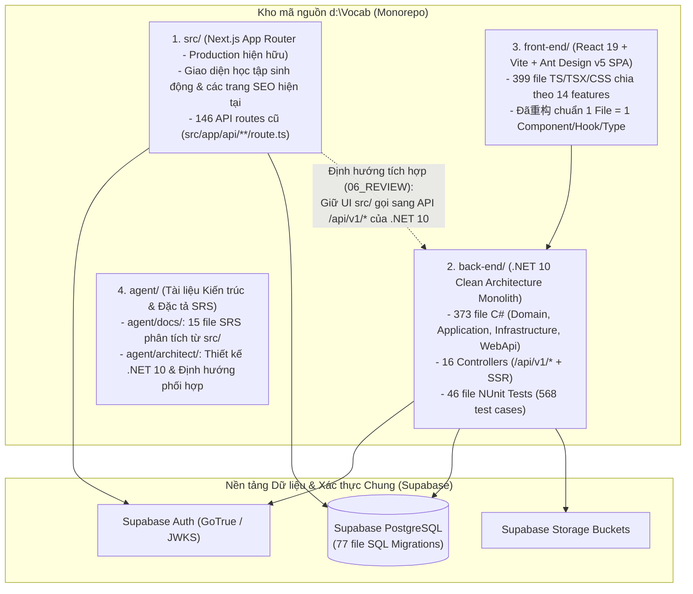

# Phân Tích Tổng Quan Dự Án LingoPro & Kiến Trúc Hệ Thống Thực Tế

Tài liệu này cung cấp cái nhìn toàn diện về dự án **LingoPro**, cấu trúc kho mã nguồn (Monorepo) hiện tại và kiến trúc kỹ thuật thực tế đang vận hành trên nhánh `development`.

---

## 1. Giới Thiệu Tổng Quan Về Dự Án LingoPro

**LingoPro (`lingopro.online`)** là nền tảng công nghệ giáo dục (EdTech) học tiếng Anh toàn diện dành cho học sinh, sinh viên, người đi làm (B2C) và các giáo viên/trung tâm Anh ngữ (B2B).

### 15 Phân Hệ Nghiệp Vụ Cốt Lõi Của Nền Tảng:
1. **Xác thực & Quản lý phiên (`Auth & Session`)**: Đăng nhập Email/Password, Google OAuth (PKCE), liên kết tài khoản, phân quyền `Student` / `Teacher` / `Admin` và gói cước (`Free`, `Pro`, `Premium`, `School`).
2. **Học từ vựng & Thuật toán FSRS v5 (`Vocab & FSRS`)**: Học Flashcard đa phương thức, tính toán chu kỳ nhớ bằng thuật toán **FSRS v5** (`Stability`, `Difficulty`, `Retrievability`), đồng bộ tiến độ giữa sổ từ cá nhân (`__personal__`) và lớp học.
3. **Lộ trình học đa khóa (`Journey / Roadmap Tracks`)**: Kiểm tra đầu vào (Placement Test), lộ trình học theo các track `CEFR` (`A0`–`B2`), `THPT` (`Lớp 10`–`Lớp 12`), `TOEIC` (`450`–`800+`), `VSTEP`, `VNU Bậc 3`.
4. **Sát thủ TOEIC Listening & Full Test (`TOEIC Arena`)**: Luyện nghe chép chính tả (Dictation Diff Matcher) và thi thử Full Test 200 câu (7 Parts) tính điểm theo Barem ETS chuẩn.
5. **AI Coaching & Phân tích câu (`AI Coach`)**: Hội thoại luyện nói với AI, chấm phát âm, phân tích cấu trúc câu chuyên sâu (Main/Secondary Clauses, Sentence Kernel, Build Levels) và quản lý hạn mức AI theo ngày (`ai_daily_usage`).
6. **Cổng Giáo viên & Quản lý Lớp học (`Teacher Classroom B2B`)**: Tạo lớp, mã mời 6 ký tự, giao bài tập (Assign Drill), theo dõi chỉ số chuyên cần và năng lực học sinh (VMS / LCS Analytics).
7. **Thanh toán & Gói cước (`Billing & Subscription`)**: Đặt mua gói cá nhân/nhóm/thử thách, áp mã giảm giá (`coupons`), thanh toán QR chuyển khoản / Webhook tự động kích hoạt quyền lợi.
8. **Gamification & Thử thách cam kết (`Gamification & Challenges`)**: Tích lũy XP theo chất lượng ôn tập, duy trì chuỗi ngày học liên tiếp (`Streak` theo múi giờ GMT+7), mua bảo vệ chuỗi (`Streak Freeze`) và tham gia thử thách đặt cọc hoàn tiền/nhận Pro.
9. **Hệ thống Ngữ pháp 62 chủ đề (`Grammar System`)**: 62 chủ đề ngữ pháp CEFR (`A0`–`B2`), bài học đa tầng (Micro-progress `A0`/`A1`), bài tập 3 dạng và ôn tập ngắt quãng FSRS liên thông với Roadmap.
10. **Từ điển thông minh, OCR & Mindmap (`Dictionary, OCR & Mindmap`)**: Tra từ điển toàn cục (`global_dictionary`), chọn nghĩa theo ngữ cảnh bằng AI, quét ảnh sách giáo khoa (OCR) và trích xuất từ vựng qua Chrome Extension.
11. **Bài đọc hàng ngày & Thư viện đọc CEFR (`Reading Library & Daily Reading`)**: Sinh bài đọc cá nhân hóa từ sổ từ vựng đến hạn, thư viện 588+ bài báo phân cấp `A1`–`C2`, tra từ trực tiếp một chạm (Gloss) và truyện chêm (CodeMix).
12. **Khảo thí chuẩn hóa (`VSTEP, VNU Bậc 3 & THPT`)**: Phòng thi mô phỏng 4 kỹ năng (Listening, Reading, Writing, Speaking), chấm điểm Barem thang 10 (`B1`/`B2`/`C1`) và AI chấm bài luận Writing theo 4 tiêu chí Rubric.
13. **Nền tảng Giao tiếp & Ngữ âm IPA (`Speaking Foundation & IPA`)**: Bảng 44 âm IPA kèm video khẩu hình, luyện cặp âm tối thiểu (Minimal Pairs) và hệ thống thăm dò chẩn đoán từ vựng thích ứng (`Diagnostic Probe` / `Learner Lexical State`).
14. **Giới thiệu Đại sứ, Nhóm học tập & Phòng tự học (`Social, Referral & Study Groups`)**: Hệ thống Affiliate/Referral 5 bậc, rút hoa hồng (`payout_requests`), chia sẻ gói Pro theo nhóm (`groups`) và phòng tự học trực tuyến (`room_presence`).
15. **Quản trị Admin CRM, Lead Magnet & Cron (`Admin CRM & Automation`)**: Thống kê vòng đời người dùng, phễu thu thập khách hàng tiềm năng (`pilot_leads` từ trang Sát Thủ TOEIC / For Teachers) và tiến trình nền nhắc học từ đến hạn / hạ cấp gói hết hạn.

---

## 2. Cấu Trúc Kho Mã Nguồn (Monorepo Layout)

Hiện tại kho mã nguồn `d:\Vocab` gồm **4 thành phần chính** cùng tồn tại và dùng chung cơ sở dữ liệu **Supabase PostgreSQL**:

### Bảng Thống Kê Quy Mô Các Khối Trong Dự Án:

| Khối / Thư mục | Công nghệ sử dụng | Quy mô hiện tại | Vai trò trong dự án |
|---|---|---|---|
| **`src/`** | Next.js (App Router), React, TailwindCSS, TypeScript | **146** API routes + toàn bộ UI học tập/SEO | Đang chạy **Production (`lingopro.online`)**. Sở hữu bộ giao diện học tập giàu tương tác được giữ lại làm UI chính. |
| **`back-end/`** | **.NET 10 (C# 14)**, EF Core 10, MediatR 12, FluentValidation, NUnit 4 | **373** file `.cs` nguồn + **46** file `.cs` test (**568** test cases) + **20** file `.cshtml` | **Core Backend mới** theo chuẩn Clean Architecture 4 tầng, giải quyết triệt để bài toán phân tầng, bảo mật và kiểm thử tự động. |
| **`front-end/`** | **React 19**, Vite, TypeScript, **Ant Design v5**, TanStack Query, Zustand | **399** file (`.ts`, `.tsx`, `.css`) | Bản SPA xây dựng trong quá trình hiện đại hóa (PR #29–#34). Đóng vai trò mẫu chuẩn hóa cấu trúc thư mục (`features/`, `hooks/`, `types/`). |
| **`supabase/`** | PostgreSQL, RLS, PL/pgSQL RPCs, GoTrue Auth | **77** file SQL migrations + `schema.sql` | Nguồn sự thật (Source of Truth) về cấu trúc bảng, khóa ngoại, индексы và ràng buộc dữ liệu. |
| **`agent/`** | Markdown, Mermaid Diagrams | **16** file trong `docs/` + **8** file trong `architect/` + các file tổng hợp | Kho tri thức nghiệp vụ (SRS) và bản thiết kế kiến trúc hệ thống. |

---

## 3. Kiến Trúc Kỹ Thuật Thực Tế Của Khối Backend `.NET 10` (`back-end/`)

Khối `back-end/` (`LingoPro.sln`) được thiết kế theo mô hình **Clean Architecture 4 tầng** kết hợp **CQRS (MediatR)** và tuân thủ nghiêm ngặt quy tắc **`1 File = 1 Class / Record / Interface / Enum`**:

### 3.1. Tầng `LingoPro.Domain` (124 file `.cs` — Không phụ thuộc thư viện ngoài)
- **Common Primitives**: `BaseEntity`, `BaseAuditableEntity`, `AggregateRoot`, `ValueObject`, `ISoftDelete`.
- **Entities (47 thực thể chia theo 11 nhóm nghiệp vụ)**:
  - `Auth`: `Profile`, `UserGamification` (tách riêng khớp bảng `user_gamification`).
  - `Vocab`: `Word`, `SrsProgress`, `SrsReviewEvent`, `UserVocabPack`, `UserVocabPackWord`, `GlobalDictionary`, `TranslationCache`, `QuizResult`.
  - `Grammar`: `GrammarTopic`, `GrammarLesson`, `GrammarExercise`, `GrammarProgress`, `GrammarMicroProgress`, `GrammarResult`, `GrammarQuizCache`.
  - `Roadmap`: `UserRoadmap`, `UserRoadmapStep`, `UserRoadmapAssessment`.
  - `Exam`: `ToeicTestResult`, `UserToeicQuestionHistory`.
  - `Reading`: `DailyReadingExercise`, `DailyReadingCompletion`, `ReadingArticle`, `UserReadingLibraryProgress`.
  - `Speaking`: `FoundationLexicalConcept`, `FoundationRepresentation`, `LearnerLexicalEvidence`, `LearnerLexicalState`.
  - `Classroom`: `ClassroomEntity`, `Enrollment`, `StudentDailyStat`.
  - `Billing`: `Order`, `SubscriptionHistory`, `Coupon`.
  - `Gamification`: `Challenge`, `ChallengeParticipant`, `ChallengeDailyLog`.
  - `Social`: `StudyGroup`, `GroupMember`, `StudyRoomPresence`, `ReferralCampaign`, `ReferralLink`, `ReferralLog`, `RewardTransaction`, `PayoutRequest`.
  - `Admin`: `AiDailyUsage`, `ExtensionToken`, `PilotLead`, `PushSubscriptionEntity`.
- **Business Enums (48 Enums)**: Chuẩn hóa toàn bộ hằng số nghiệp vụ (`CertLevel`, `UserRole`, `SubscriptionPlanType`, `SrsCardState`, `SrsReviewQuality`, `RoadmapTrackType`, `RoadmapLevelId`, `OrderKind`, `OrderStatus`, ...).
- **Pure Domain Algorithms**:
  - `FsrsEngine`: Thuật toán lặp lại ngắt quãng FSRS v5 thuần toán học (không phụ thuộc I/O).
  - `ExamScoringEngine`: Bộ chấm điểm chuẩn hóa cho TOEIC (Listening/Reading Barem 5–495) và VSTEP (thang 10, phân bậc B1/B2/C1).

### 3.2. Tầng `LingoPro.Application` (193 file `.cs` — Use Cases, CQRS Pipelines & Repository Contracts)
- **4 MediatR Pipeline Behaviors** (`LingoPro.Application/Common/Behaviors/`):
  1. `ValidationBehavior`: Tự động chạy toàn bộ `IValidator<TRequest>` (FluentValidation) trước khi vào Handler.
  2. `AuthorizationBehavior`: Kiểm tra `[Authorize(Roles = ..., Policy = ...)]` gắn trực tiếp trên từng Command/Query (`RequireTeacher`, `RequireAdmin`, `RequireProPlan`).
  3. `CachingBehavior`: Chỉ kích hoạt cho các Query thực thi tường minh `ICacheableQuery` (`where TRequest : ICacheableQuery`).
  4. `PerformanceBehavior`: Đo thời gian thực thi và cảnh báo các Request chạy lâu (> 500ms).
- **14 Repository Contracts** (`LingoPro.Application/Common/Interfaces/Repositories/I*Repository.cs`): Định nghĩa hợp đồng truy vấn và thao tác dữ liệu theo từng phân hệ nghiệp vụ (`IAdminCrmRepository`, `IAuthRepository`, `IBillingRepository`, `IClassroomRepository`, `IDictionaryRepository`, `IExamRepository`, `IGamificationRepository`, `IGrammarRepository`, `IReadingRepository`, `IRoadmapRepository`, `ISeoRepository`, `ISocialRepository`, `ISpeakingFoundationRepository`, `IVocabRepository`). Toàn bộ Command/Query Handler chỉ phụ thuộc vào các interface này, tuyệt đối không gọi trực tiếp `Microsoft.EntityFrameworkCore` hay `IApplicationDbContext`.
- **15 Feature Slices** (`Features/AdminCrm`, `AiCoaching`, `Auth`, `Billing`, `Classrooms`, `Dictionary`, `Exams`, `Gamification`, `Grammar`, `Reading`, `Roadmap`, `Seo`, `Social`, `SpeakingFoundation`, `Toeic`, `Vocab`): Mỗi thao tác đọc/ghi được tách bạch thành `Commands/` và `Queries/` độc lập, tuân thủ SOLID (SRP + DIP).
- **Chuẩn hóa phản hồi `ApiResponse<T>`**: Mọi Handler và Controller đều trả về phong bì `ApiResponse<T>` nhất quán có trường `StatusCode` (HTTP status code), `Success`, `Message` (tiếng Anh), `Data`, `ErrorCode`, `Errors`, `TimestampUtc`.

### 3.3. Tầng `LingoPro.Infrastructure` (44 file `.cs` — Persistence, Repositories, Caching, Supabase & Workers)
- **Tầng Repositories (`LingoPro.Infrastructure/Persistence/Repositories/*Repository.cs`)**:
  - Hiện thực hóa 14 Repository cụ thể (`AdminCrmRepository`, `AuthRepository`, `BillingRepository`, `ClassroomRepository`, `DictionaryRepository`, `ExamRepository`, `GamificationRepository`, `GrammarRepository`, `ReadingRepository`, `RoadmapRepository`, `SeoRepository`, `SocialRepository`, `SpeakingFoundationRepository`, `VocabRepository`) chứa toàn bộ truy vấn LINQ/EF Core (`AsNoTracking`, `FirstOrDefaultAsync`, `ToListAsync`, `Add`, `SaveChangesAsync`) và đăng ký Scoped DI trong `DependencyInjection.cs`.
- **EF Core 10 + Npgsql (`LingoProDbContext`)**:
  - Kết nối tới Supabase PostgreSQL với `UseSnakeCaseNamingConvention()`.
  - Bộ chuyển đổi `SnakeCaseEnumConverter<TEnum>` tự động ánh xạ các Enum C# (`PascalCase`) sang chuỗi `snake_case` dưới PostgreSQL.
  - Tự động áp dụng Global Query Filter cho Soft Delete (`ISoftDelete`) và tự động cập nhật `CreatedAt`/`UpdatedAt` qua `AuditableEntitySaveChangesInterceptor`.
- **Chiến lược Cache 2 Giai đoạn (`ICacheService`)**:
  - Chế độ `"None"` (Mặc định Phase 1): Dùng `NoOpCacheService` (0 overhead, truy vấn thẳng DB).
  - Chế độ `"Local"` / `"Redis"` / `"Hybrid"` (Phase 2): Bật `HybridMultiLevelCacheService` kết hợp L1 `IMemoryCache` + L2 `StackExchange.Redis` chỉ bằng cấu hình `appsettings.json`.
- **Tích hợp Supabase Auth & Storage**:
  - `SupabaseAuthService`: Giao tiếp với Supabase GoTrue REST API (`/auth/v1/token`, `/auth/v1/signup`, `/auth/v1/logout`, Google OAuth PKCE & Identity Linking).
  - `SupabaseStorageService`: Tải file âm thanh luyện nói lên Supabase Storage Bucket.
- **Background Worker**: `SubscriptionAndReminderWorker` (`BackgroundService` định kỳ quét hạ cấp gói Pro hết hạn và xử lý nhắc học).

### 3.4. Tầng `LingoPro.WebApi` (38 file `.cs` + 20 file `.cshtml` — REST Host & Security)
- **Xác thực Supabase JWKS (`AuthenticationExtensions.cs` + `SupabaseSigningKeyProvider.cs`)**:
  - Xác thực chữ ký JWT từ Supabase thông qua JWKS endpoint (kèm fallback HS256 `JwtSecret`).
  - Hỗ trợ đọc token từ cả header `Authorization: Bearer <token>` và HttpOnly Cookie (`lp_access_token`).
  - Sự kiện `OnTokenValidated` (`ApplyProfileClaimsAsync`) tự động đối chiếu quyền `Role` và `Plan` từ JWT custom claims hoặc bảng `public.profiles`, chống giả mạo `user_metadata`.
- **16 Controllers**:
  - 15 REST API Controllers tại `/api/v1/*`: `AuthController`, `VocabController`, `RoadmapController`, `ReadingController`, `GrammarController`, `DictionaryController`, `ExamsController`, `SpeakingFoundationController`, `AiCoachingController`, `ClassroomsController`, `BillingController`, `ChallengesController`, `SocialHubController`, `AdminCrmController`, `LeadMagnetController`, `SystemEnumsController`.
  - 1 SSR Controller (`HomeSeoController`) phục vụ các trang Landing SEO (`/`, `/landing`, `/for-teachers`, `/ipa`, `/sat-thu-toeic-listening`).
- **Bảo mật & Chống quá tải**: Tích hợp `CookieCsrfMiddleware`, `ExceptionHandlingMiddleware` và `.NET 10 RateLimiter` (`RateLimitingExtensions.cs`).
