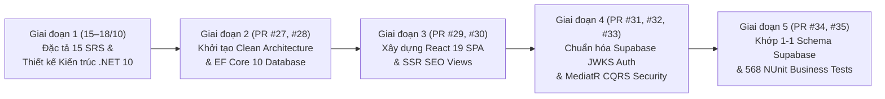

# Báo Cáo Chi Tiết Những Gì Đã Thực Hiện Được (PR #26 → PR #35)

Tài liệu này tổng hợp đầy đủ khối lượng công việc đã hoàn thành trên nhánh `development` (từ ngày 15/10/2026 đến 25/10/2026 qua chuỗi **PR #26 → PR #35**), đánh giá mức độ hoàn thiện của từng phân hệ và liệt kê rõ các hạng mục tiếp theo.

---

## 1. Tóm Tắt Hành Trình Triển Khai Theo Từng Giai Đoạn (Timeline PR #26 → PR #35)

### Chi Tiết Các Mốc Đã Hoàn Thành:
1. **Giai đoạn 1 — Khảo sát ngược (Reverse Engineering) & Đặt nền móng Kiến trúc (15/10 – 18/10)**:
   - Phân tích toàn bộ 146 API routes và luồng nghiệp vụ trong `src/` để viết **15 tài liệu đặc tả ca sử dụng (`agent/docs/SRS_01` → `SRS_15`)**.
   - Phát hiện và lập danh mục các lỗ hổng bảo mật, race condition và lỗi logic trong hệ thống cũ (như leo thang đặc quyền qua lớp `__personal__`, mã giảm giá cứng `'WLU'`, lỗi thanh toán Challenge, mất cache ngữ pháp trên RAM...).
   - Xây dựng bộ quy chuẩn kiến trúc hệ thống tại **`agent/architect/` (`SKILL.md`, `01` → `05`)**.
2. **Giai đoạn 2 — Xây dựng Lõi Backend `.NET 10` & Tầng Dữ liệu EF Core 10 (PR #27, PR #28)**:
   - Khởi tạo Solution `LingoPro.sln` với 4 tầng chuẩn Clean Architecture (`Domain`, `Application`, `Infrastructure`, `WebApi`), áp dụng triệt để nguyên lý **SOLID** và quy tắc **`1 File = 1 Class`**.
   - Cài đặt thuật toán **FSRS v5** (`FsrsEngine.cs`), bộ chấm điểm **TOEIC / VSTEP** (`ExamScoringEngine.cs`), kiến trúc **Multi-Level Caching 2 giai đoạn** (`NoOpCacheService` $\rightarrow$ `HybridMultiLevelCacheService` L1 Memory + L2 Redis) và Rate Limiting.
3. **Giai đoạn 3 — Dựng Frontend React 19 SPA & SSR SEO Pages (PR #29, PR #30)**:
   - Xây dựng ứng dụng `front-end/` (React 19 + TypeScript + Vite + Ant Design v5) với 14 phân hệ chức năng và tách nhỏ toàn bộ Component, Hook, Store, DTO, Enum theo đúng chuẩn `1 File = 1 Type`.
   - Chuyển đổi các trang Marketing/SEO (`/`, `/for-teachers`, `/ipa`, `/sat-thu-toeic-listening`) sang Razor Views (`.cshtml`) trên `HomeSeoController`.
4. **Giai đoạn 4 — Chuẩn hóa Xác thực Supabase JWKS & Bảo mật CQRS (PR #31, PR #32, PR #33)**:
   - **Bước ngoặt quan trọng ở PR #31 & #32**: Loại bỏ cơ chế tự phát hành JWT cục bộ (`JwtTokenService`) và `AuthSsrController` để chuyển sang **xác thực trực tiếp token của Supabase Auth thông qua JWKS (`SupabaseSigningKeyProvider`)**. Nhờ đó, `.NET 10 Backend` và ứng dụng Next.js hiện tại dùng chung 100% phiên đăng nhập Supabase.
   - Tái cấu trúc tầng `Application`: tách rõ thư mục `Commands/` và `Queries/`, đồng thời bổ sung **`AuthorizationBehavior`** để kiểm tra quyền (`RequireTeacher`, `RequireAdmin`, `RequireProPlan`) ngay tại tầng MediatR Pipeline.
5. **Giai đoạn 5 — Đồng bộ 1-1 với Database Thực tế & Kiểm thử Nghiệp vụ Toàn diện (PR #34, PR #35)**:
   - **PR #34 (Schema Alignment)**: Rà soát đối chiếu toàn bộ 77 file SQL trong `supabase/migrations/`, viết `SnakeCaseEnumConverter`, tách bảng `UserGamification`, chuẩn hóa 47 Entities + 48 Business Enums và tạo migration `20261021033656_AlignDomainWithSupabaseSchema`.
   - **PR #35 (Business Unit Testing Suite)**: Xây dựng bộ **46 file kiểm thử NUnit** (tổng cộng **568 `[Test]` / `[TestCase]`**) đối chiếu từng quy tắc nghiệp vụ của `.NET 10` với hệ thống gốc `src/`, đồng thời đánh dấu rõ **80 điểm khác biệt (`[Category("KnownDeviation")]`)** cần tinh chỉnh tiếp.

---

## 2. Bảng Đánh Giá Trạng Thái Hiện Thực Hóa Của 15 Phân Hệ Nghiệp Vụ

Dưới đây là hiện trạng chi tiết của từng phân hệ trong `back-end/` (.NET 10) tính đến hiện tại:

| STT | Phân hệ (SRS) | Controllers & CQRS Handlers (`.NET 10`) | Trạng thái DB & Logic Nghiệp vụ | Kiểm thử NUnit (`tests/`) | Hạng mục cần hoàn thiện tiếp (`KnownDeviation` / Stubs) |
|:---:|---|---|---|---|---|
| **01** | **Auth & Session** (`SRS_01`) | `AuthController` (10 endpoints), `Login`, `Register`, `RefreshToken`, `Logout`, `GoogleOAuth`, `Link/UnlinkGoogle`, `GetCurrentProfile`, `UpdateOnboarding` | **Hoàn thiện cao**: Xác thực thật qua `SupabaseAuthService` + JWKS verification + đồng bộ `Profile` & `UserGamification` + HttpOnly Cookies | Đã có test cho `Profile`, `ProfileSubscriptionEntitlement`, `UserGamification` | Hoàn thiện thêm integration test cho luồng trao đổi PKCE OAuth. |
| **02** | **Vocab & FSRS v5** (`SRS_02`) | `VocabController`, `GetDueWordsQuery`, `SubmitWordReviewCommand` | **Hoàn thiện lõi**: `FsrsEngine` tính toán chuẩn xác Stability/Difficulty/State, ghi `SrsProgress`, `SrsReviewEvent` và cộng XP theo chất lượng thẻ | `FsrsEngineTests`, `FsrsEngineBusinessRulesTests`, `GetDueWordsQueryHandlerTests`, `SubmitWordReviewCommandHandlerTests`, `SubmitWordReviewCommandHandlerP0Tests` | Xử lý 6 `KnownDeviation` (đồng bộ từ vựng chiều Lớp $\rightarrow$ Cá nhân, lọc due words theo lớp, idempotency `ReviewId`). |
| **03** | **Roadmap / Journey** (`SRS_03`) | `RoadmapController`, `GetRoadmapQuery`, `SubmitPlacementCommand`, `CompleteRoadmapStepCommand` | **Đã nối DB EF Core**: Lưu `UserRoadmap`, `UserRoadmapStep`, mở khóa trạm kế tiếp và cộng XP | `CompleteRoadmapStepCommandHandlerTests`, `SubmitPlacementCommandHandlerTests` | Xử lý 8 `KnownDeviation` (kiểm tra quyền Pro cho track `toeic`/`thpt`, chống cộng lặp XP khi hoàn thành lại step cũ). |
| **04** | **TOEIC Listening & Exam** (`SRS_04`) | `ExamsController` (`POST /api/v1/exams/toeic/submit`), `SubmitToeicExamCommand`, `ExamScoringEngine` | **Đã có chấm điểm & lưu lịch sử**: Tính điểm Barem Listening/Reading, lưu `ToeicTestResult` và `UserToeicQuestionHistory` | `ExamScoringEngineTests`, `ExamScoringEngineBusinessRulesTests`, `SubmitToeicExamCommandHandlerTests` | Thêm Query tải đề thi TOEIC từ DB/JSON thật và xử lý 5 `KnownDeviation` về Barem điểm & kiểm tra phiên thi. |
| **05** | **AI Coaching & Skills** (`SRS_05`) | `AiCoachingController`, `AnalyzeSentenceCommand`, `EvaluateSpeakingDialogueCommand`, `UploadSpeakingAudioCommand` | **Đang dùng Heuristic/Stub cho AI**: Kiểm tra & tăng quota `AiDailyUsage` trong DB thật, upload audio qua `SupabaseStorageService`, nhưng `AiRouterService` hiện trả về Golden Sentence / Heuristic fallback | `AiCoachingHandlerTests` | Kết nối HTTP client thật tới Gemini / Groq / Zhipu API trong `AiRouterService.cs` và xử lý 4 `KnownDeviation` về quota theo gói cước. |
| **06** | **Teacher & Classroom** (`SRS_06`) | `ClassroomsController`, `CreateClassroomCommand`, `JoinClassroomCommand`, `AssignDrillCommand`, `GetClassroomsQuery` | **Đã nối DB & phân quyền**: Chặn quyền `RequireTeacher`, tạo lớp kèm mã mời, học sinh tham gia lớp, giáo viên giao bài (`AssignDrill`) | `CreateClassroomCommandHandlerTests`, `JoinClassroomCommandHandlerTests`, `AssignDrillCommandHandlerTests`, `ClassroomQueriesAndValidationTests` | Xử lý 7 `KnownDeviation` (sửa lỗi đếm lặp `Enrollments` khi join lớp, giới hạn 500 học sinh, chặn giáo viên tự join lớp mình, chỉ giao drill cho từ thuộc lớp). |
| **07** | **Billing & VIP Plans** (`SRS_07`) | `BillingController`, `CreateOrderCommand`, `ConfirmOrderPaidCommand`, `ValidateCouponQuery` | **Đã nối DB**: Tạo đơn `Order`, kiểm tra `Coupon`, xác nhận thanh toán nâng cấp `Profile.Plan`, kích hoạt `StudyGroup` / `ChallengeParticipant` và tính hoa hồng `RewardTransaction` | `CreateOrderCommandHandlerTests`, `ConfirmOrderPaidCommandHandlerTests`, `ValidateCouponQueryHandlerTests`, `BillingValidatorsTests` | Xử lý 17 `KnownDeviation` (bảng giá bậc thang theo kỳ hạn/số ghế, ghi `SubscriptionHistory` khi confirm đơn, tăng `Coupon.UsedCount` lúc thanh toán thay vì lúc tạo đơn, cấp Pro cho toàn bộ thành viên nhóm). |
| **08** | **Gamification & Challenges** (`SRS_08`) | `ChallengesController`, `CreateChallengeCommand`, `JoinChallengeCommand`, `GetChallengesQuery`, `GamificationXp` | **Đã nối DB**: Quản lý `UserGamification` (XP, Streak), tạo và tham gia `Challenge` | `CreateChallengeCommandHandlerTests`, `JoinChallengeCommandHandlerTests`, `GetChallengesQueryHandlerTests`, `UserGamificationTests` | Xử lý 8 `KnownDeviation` (trạng thái khởi tạo Challenge `Open` vs `Active`, ẩn `Draft` với học sinh, kiểm tra khung giờ đăng ký và số lượng người tham gia đã thanh toán). |
| **09** | **Grammar System** (`SRS_09`) | `GrammarController`, `GetCanonicalGrammarTopicsQuery` (`ICacheableQuery`), `SubmitGrammarProgressCommand` | **Đã nối DB & FSRS**: Truy vấn 62 chủ đề `GrammarTopic`, tính lịch ôn tập FSRS cho `GrammarProgress` và lưu `GrammarResult` | `GetCanonicalGrammarTopicsQueryHandlerTests`, `SubmitGrammarProgressCommandHandlerTests` | Xử lý 5 `KnownDeviation` (liên thông tiến độ ngữ pháp sang khóa `Roadmap` tương ứng, chuẩn hóa điều kiện đạt Mastered). |
| **10** | **Dictionary & OCR** (`SRS_10`) | `DictionaryController`, `SmartLookupQuery` (`ICacheableQuery`), `ExtractOcrWordsCommand` | **Tra cứu DB thật + Stub OCR**: Tra từ trong bảng `GlobalDictionary` (có `ICacheableQuery`); phần OCR đang gọi `AiRouterService.ExtractWordsFromOcrImageAsync` (stub) | `SmartLookupAndOcrHandlerTests` | Tích hợp Groq Vision thực tế cho OCR và xử lý 1 `KnownDeviation` khi chọn nghĩa theo ngữ cảnh. |
| **11** | **Reading Library & Daily Reading** (`SRS_11`) | `ReadingController`, `GetDailyReadingQuery`, `SubmitDailyReadingCommand`, `GetReadingArticlesQuery` (`ICacheableQuery`) | **Đã nối DB**: Lấy/sinh bài đọc hàng ngày `DailyReadingExercise`, chấm điểm `DailyReadingCompletion`, truy vấn thư viện `ReadingArticle` | `GetDailyReadingQueryHandlerTests`, `SubmitDailyReadingCommandHandlerTests`, `GetReadingArticlesQueryHandlerTests` | Xử lý 5 `KnownDeviation` (lọc bài đọc theo đúng danh sách từ đến hạn của học viên, thưởng XP theo điểm số). |
| **12** | **VSTEP / VNU Exams** (`SRS_12`) | `ExamsController` (`vstep/submit`, `writing/evaluate`), `SubmitVstepExamCommand`, `EvaluateWritingEssayCommand` | **Đã có chấm điểm Barem & lưu kết quả**: Tính điểm VSTEP 4 kỹ năng qua `ExamScoringEngine`, lưu `UserRoadmapAssessment` | `SubmitVstepExamCommandHandlerTests`, `EvaluateWritingEssayCommandHandlerTests` | Nối AI thật cho chấm luận Writing (`EvaluateEssayAsync`) và thêm endpoint tải đề thi VSTEP/VNU. |
| **13** | **Speaking Foundation & IPA** (`SRS_13`) | `SpeakingFoundationController`, `GetNextDiagnosticProbeQuery`, `RecordLexicalEvidenceCommand`, `RecordTeacherLexicalObservationCommand`, `IpaChart` | **Đã nối DB**: Thuật toán chọn từ thăm dò theo `UncertaintyScore`, cập nhật `LearnerLexicalEvidence` & `LearnerLexicalState` (`LexicalStateUpdater`) | `GetNextDiagnosticProbeQueryHandlerTests`, `RecordLexicalEvidenceCommandHandlerTests` | Xử lý 3 `KnownDeviation` trong công thức tính trọng số bằng chứng phát âm. |
| **14** | **Social, Referral & Groups** (`SRS_14`) | `SocialHubController`, `GetReferralHubQuery`, `ClaimReferralCommand`, `JoinStudyGroupCommand` | **Đã nối DB**: Tra cứu thống kê Referral Hub, ghi nhận `ReferralLog`, tham gia nhóm học tập `StudyGroup` / `GroupMember` | `GetReferralHubQueryHandlerTests`, `ClaimReferralCommandHandlerTests`, `JoinStudyGroupCommandHandlerTests` | Xử lý 8 `KnownDeviation` (chặn tự giới thiệu chính mình, kiểm tra hạn nhóm và cấp quyền Pro khi join nhóm). |
| **15** | **Admin CRM, Leads & Cron** (`SRS_15`) | `AdminCrmController`, `LeadMagnetController`, `GetAdminCrmDashboardQuery`, `SubscribePilotLeadCommand`, `SubscriptionAndReminderWorker` | **Đã nối DB**: Thống kê KPI Admin CRM (`[Authorize(Roles = "Admin")]`), thu thập `PilotLead`, tiến trình nền quét gói hết hạn | `GetAdminCrmDashboardQueryHandlerTests`, `SubscribePilotLeadCommandHandlerTests` | Xử lý 2 `KnownDeviation` (chuẩn hóa nguồn `Source` của Lead và bộ lọc thống kê CRM). |

---

## 3. Tổng Kết Các Con Số Đã Đạt Được

- **Tài liệu hóa**: **24 tài liệu** chuyên sâu trong `/agent` (16 file SRS & Audit + 8 file Kiến trúc & Review).
- **Backend `.NET 10` (`back-end/`)**:
  - **373 file `.cs`** mã nguồn sạch, 100% tuân thủ `1 File = 1 Class` và 100% comment tiếng Anh.
  - **47 Domain Entities** & **48 Business Enums** ánh xạ chuẩn xác với 77 file SQL migrations của Supabase.
  - **16 Controllers** cung cấp đầy đủ hệ thống endpoint `/api/v1/*` chuẩn hóa phản hồi `ApiResponse<T>`.
- **Kiểm thử tự động (`back-end/tests/`)**:
  - **46 file Test NUnit** với **568 test cases (`[Test]` / `[TestCase]`)**.
  - Đã rà soát và gắn nhãn **`[Category("KnownDeviation")]` cho 80 test methods** để làm danh sách checklist kỹ thuật rõ ràng cho chặng hoàn thiện tiếp theo.
