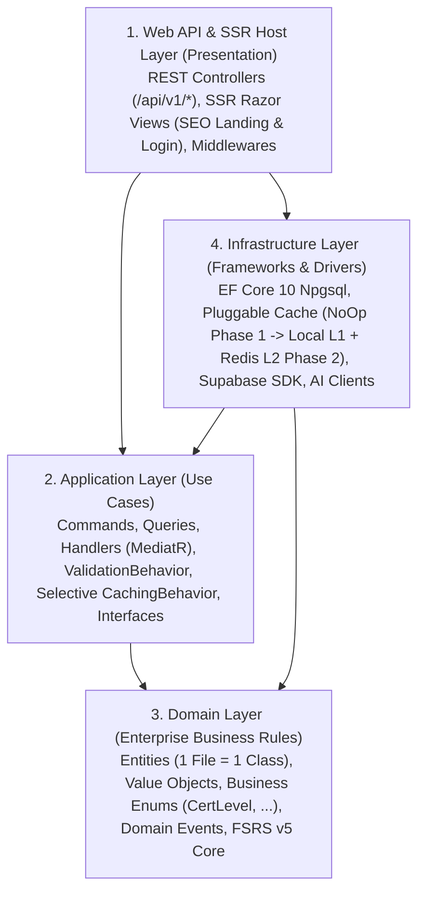

# Đặc Tả Kiến Trúc .NET 10 Clean Architecture (Backend Monolith)

Tài liệu này quy định chi tiết quy chuẩn triển khai Clean Architecture cho khối Backend Monolith trên nền tảng **.NET 10** và **C# 14**, tích hợp **SOLID**, quy tắc **1 File = 1 Class**, **Business Enums (`CertLevel`, ...)**, **Thiết kế Cache Sẵn Sàng Mở Rộng Theo Phase (Local L1 + Redis L2)**, chuẩn phản hồi **`ApiResponse<T>` kèm `StatusCode`** và **NUnit Business Testing**.
*(Lưu ý: Toàn bộ comment trong mã nguồn bắt buộc viết bằng tiếng Anh).*

---

## 1. Nguyên Tắc Phân Tầng Clean Architecture

Kiến trúc tuân thủ **Dependency Inversion Principle** (nguyên lý đảo ngược phụ thuộc):
* Các tầng bên ngoài phụ thuộc vào các tầng bên trong.
* Tầng lõi (`Domain`) không phụ thuộc vào bất kỳ thư viện bên ngoài hay cơ sở dữ liệu nào.
* Tầng nghiệp vụ (`Application`) chỉ phụ thuộc vào `Domain`, định nghĩa các interface trừu tượng (như `IApplicationDbContext`, `ICacheService`, `IJwtTokenService`) cho `Infrastructure` thực thi.



---

## 2. Cấu Trúc Solution & Project Trong .NET 10 (Chuẩn 1 File = 1 Class)

Cấu trúc Solution chuẩn đặt trong thư mục gốc `src/backend/LingoPro.sln`, tuân thủ tuyệt đối nguyên tắc **mỗi file `.cs` chỉ chứa duy nhất 1 class / record / interface / enum** và **mọi comment trong code đều bằng tiếng Anh**:

```text
src/backend/
├── src/
│   ├── LingoPro.Domain/               # Class Library: .NET 10
│   │   ├── Common/                    # BaseEntity.cs, BaseAuditableEntity.cs, AggregateRoot.cs, ValueObject.cs
│   │   ├── Entities/                  # Grouped by Bounded Context (1 Entity = 1 File .cs)
│   │   │   ├── Auth/                  # Profile.cs, FcmToken.cs, ExtensionToken.cs, RefreshSession.cs
│   │   │   ├── Vocab/                 # Word.cs, SrsProgress.cs, SrsReviewEvent.cs, UserVocabPack.cs, UserVocabPackWord.cs, GlobalDictionary.cs, TranslationCache.cs, QuizResult.cs
│   │   │   ├── Grammar/               # GrammarTopic.cs, GrammarLesson.cs, GrammarProgress.cs, GrammarExercise.cs, GrammarResult.cs, GrammarQuizCache.cs, GrammarMicroProgress.cs
│   │   │   ├── Roadmap/               # UserRoadmap.cs, UserRoadmapStep.cs, UserRoadmapAssessment.cs
│   │   │   ├── Exam/                  # UserToeicQuestionHistory.cs
│   │   │   ├── Reading/               # DailyReadingExercise.cs, DailyReadingCompletion.cs, ReadingArticle.cs, UserReadingLibraryProgress.cs
│   │   │   ├── Foundation/            # FoundationLexicalConcept.cs, FoundationRepresentation.cs, LearnerLexicalEvidence.cs, LearnerLexicalState.cs
│   │   │   ├── Classroom/             # Classroom.cs, Enrollment.cs, StudentDailyStat.cs, RoomPresence.cs
│   │   │   ├── Billing/               # Order.cs, SubscriptionHistory.cs, Coupon.cs, StudyGroup.cs, StudyGroupMember.cs, AiDailyUsage.cs
│   │   │   ├── Gamification/          # UserGamification.cs, Challenge.cs, ChallengeParticipant.cs, ChallengeDailyLog.cs, StreakFreezePurchase.cs
│   │   │   └── Referral/              # ReferralCampaign.cs, ReferralLink.cs, ReferralLog.cs, RewardTransaction.cs, PayoutRequest.cs, PilotLead.cs
│   │   ├── Enums/                     # All Business Types (1 Enum = 1 File .cs)
│   │   │   ├── Auth/                  # UserRole.cs, AuthProviderType.cs
│   │   │   ├── Certification/         # CertLevel.cs, RoadmapLevelId.cs, GrammarLevel.cs, GrammarMicroStage.cs
│   │   │   ├── Vocab/                 # SrsCardState.cs, SrsReviewQuality.cs, SrsAlgorithmVersion.cs, PartOfSpeechType.cs, VocabPackStatus.cs, QuizType.cs
│   │   │   ├── Roadmap/               # RoadmapTrackType.cs, RoadmapStepStatus.cs, RoadmapAssessmentTier.cs
│   │   │   ├── Exam/                  # ToeicPart.cs, ExamType.cs
│   │   │   ├── Reading/               # DailyReadingStatus.cs, ReadingArticleSourceType.cs, ReadingArticleStatus.cs, UserReadingProgressStatus.cs
│   │   │   ├── Foundation/            # FoundationModalityType.cs, FoundationClarityRating.cs, LexicalEvidenceSource.cs, LexicalSupportLevel.cs, LexicalStatusBucket.cs
│   │   │   ├── Billing/               # SubscriptionPlanType.cs, OrderKind.cs, PaymentMethodType.cs, OrderStatus.cs, SubscriptionChangeReason.cs, StudyGroupStatus.cs
│   │   │   ├── Gamification/          # ChallengeStatus.cs, ChallengeParticipantStatus.cs, ChallengeRewardChoice.cs
│   │   │   └── Referral/              # ReferralLogStatus.cs, RewardTransactionType.cs, RewardTransactionStatus.cs, PayoutRequestStatus.cs, PilotLeadStatus.cs
│   │   ├── ValueObjects/              # Email.cs, Stability.cs, Difficulty.cs, IntervalDays.cs
│   │   ├── Events/                    # SrsReviewedEvent.cs, OrderPaidEvent.cs, XpAwardedEvent.cs
│   │   ├── Exceptions/                # DomainValidationException.cs, NotFoundException.cs
│   │   └── Algorithms/                # FsrsEngine.cs (Pure FSRS v5 mathematical engine without I/O)
│   │
│   ├── LingoPro.Application/          # Class Library: .NET 10
│   │   ├── Common/
│   │   │   ├── Behaviors/
│   │   │   │   ├── ValidationBehavior.cs
│   │   │   │   ├── CachingBehavior.cs
│   │   │   │   └── PerformanceBehavior.cs
│   │   │   ├── Interfaces/
│   │   │   │   ├── IApplicationDbContext.cs
│   │   │   │   ├── ICurrentUserService.cs
│   │   │   │   ├── IJwtTokenService.cs
│   │   │   │   └── Caching/
│   │   │   │       ├── ICacheService.cs
│   │   │   │       ├── ICacheableQuery.cs
│   │   │   │       └── CacheOptions.cs
│   │   │   ├── Models/                # ApiResponse.cs, PaginatedList.cs
│   │   │   └── Exceptions/            # ForbiddenAccessException.cs, ValidationException.cs
│   │   └── Features/                  # Vertical Slices (1 File = 1 Class/Record)
│   │       ├── Vocab/
│   │       │   ├── Commands/SubmitReview/
│   │       │   │   ├── SubmitWordReviewCommand.cs
│   │       │   │   ├── SubmitWordReviewCommandHandler.cs
│   │       │   │   ├── SubmitWordReviewCommandValidator.cs
│   │       │   │   └── SubmitWordReviewResponseDto.cs
│   │       │   └── Queries/GetDueWords/
│   │       │       ├── GetDueWordsQuery.cs
│   │       │       ├── GetDueWordsQueryHandler.cs
│   │       │       └── DueWordItemDto.cs
│   │       └── ...
│   │
│   ├── LingoPro.Infrastructure/       # Class Library: .NET 10
│   │   ├── Caching/                   # Pluggable Caching (Phase 1: NoOp -> Phase 2: Local L1 + Redis L2)
│   │   │   ├── CacheSettings.cs
│   │   │   ├── NoOpCacheService.cs
│   │   │   ├── LocalMemoryCacheService.cs
│   │   │   ├── RedisDistributedCacheService.cs
│   │   │   └── HybridMultiLevelCacheService.cs
│   │   ├── Persistence/
│   │   │   ├── LingoProDbContext.cs
│   │   │   ├── Configurations/        # 1 EntityTypeConfiguration<T> = 1 File .cs
│   │   │   └── Interceptors/          # AuditableEntitySaveChangesInterceptor.cs
│   │   ├── Identity/
│   │   │   ├── JwtSettings.cs         # AccessToken = 15m, RefreshToken = 30d
│   │   │   ├── JwtTokenService.cs
│   │   │   └── SupabaseAuthAdminClient.cs
│   │   ├── Services/                  # CurrentUserService.cs, SupabaseStorageService.cs, AiRouterService.cs
│   │   └── BackgroundJobs/            # EmailDueJob.cs, ChallengeSettlementJob.cs
│   │
│   └── LingoPro.WebApi/               # ASP.NET Core 10 Host (REST API + SSR Views for SEO & Login)
│       ├── Controllers/
│       │   ├── Api/                   # REST API returning ApiResponse<T> with StatusCode
│       │   │   ├── VocabController.cs
│       │   │   ├── RoadmapController.cs
│       │   │   └── BillingController.cs
│       │   └── Ssr/                   # Server-Side Rendering Controllers for SEO & Login
│       │       ├── HomeSeoController.cs
│       │       └── AuthSsrController.cs
│       ├── Views/                     # Razor Views for SSR SEO & Server-Side Login
│       │   ├── Home/Index.cshtml
│       │   └── Auth/Login.cshtml
│       ├── Middlewares/               # ExceptionHandlingMiddleware.cs
│       ├── Extensions/                # CachingExtensions.cs, AuthenticationExtensions.cs, RateLimitingExtensions.cs
│       ├── Program.cs
│       └── appsettings.json
│
└── tests/
    ├── LingoPro.Domain.UnitTests/     # NUnit 4: Test FSRS v5 Engine, Entities, Domain Business Rules
    ├── LingoPro.Application.UnitTests/# NUnit 4 + NSubstitute: Test MediatR Handlers & Validators
    └── LingoPro.IntegrationTests/     # NUnit 4 + Testcontainers PostgreSQL & Redis
```

---

## 3. Các Nguyên Tắc Thiết Kế & Lập Trình Bắt Buộc

### 3.1 Áp Dụng Triệt Để Nguyên Lý SOLID & Comment Tiếng Anh
1. **Single Responsibility Principle (SRP)**:
   * Mỗi class chỉ có **duy nhất một lý do để thay đổi**.
   * `Controller` chỉ nhận HTTP Request và gửi lệnh qua `ISender` (MediatR).
   * `CommandHandler` / `QueryHandler` chỉ điều phối đúng một Use Case nghiệp vụ.
2. **Open/Closed Principle (OCP)**:
   * Thiết kế sẵn sàng mở rộng cho các Phase tiếp theo (ví dụ: ở Phase hiện tại chưa bật Cache thực tế, nhưng sang Phase sau chỉ cần cắm `HybridMultiLevelCacheService` gồm cả **Local Cache L1 + Redis L2** vào `ICacheService` mà không phải sửa code của bất kỳ Handler nào).
3. **Liskov Substitution Principle (LSP)**:
   * Mọi bản cài đặt của `ICacheService` (`NoOpCacheService`, `LocalMemoryCacheService`, `RedisDistributedCacheService`, `HybridMultiLevelCacheService`) thay thế hoàn toàn cho nhau mà không làm thay đổi hành vi đúng đắn của ứng dụng.
4. **Interface Segregation Principle (ISP)**:
   * Tách nhỏ Interface theo đúng vai trò tiêu thụ: chỉ những Query thực sự cần đọc từ Cache ở Phase sau mới implement `ICacheableQuery`.
5. **Dependency Inversion Principle (DIP)**:
   * `LingoPro.Application` và `LingoPro.Domain` chỉ phụ thuộc vào Abstraction (Interface).
6. **Quy chuẩn ngôn ngữ Comment**:
   * **100% XML Documentation Comments (`/// <summary>`) và Inline Comments (`// ...`) trong mã nguồn phải được viết bằng tiếng Anh.**

---

### 3.2 Quy Tắc "1 File = 1 Class / Type" (One Class Per File)
* **Nghiêm cấm đặt nhiều class, record, interface hoặc enum trong cùng một file `.cs`**.
* Mỗi Use Case trong CQRS bắt buộc tách thành các file riêng biệt:
  * `SubmitWordReviewCommand.cs`
  * `SubmitWordReviewCommandValidator.cs`
  * `SubmitWordReviewCommandHandler.cs`
  * `SubmitWordReviewResponseDto.cs`

---

### 3.3 Định Nghĩa Đầy Đủ Enum Cho Các Business Types (`CertLevel`, `SrsCardState`, ...)
* **Cấm sử dụng chuỗi cứng (magic strings)** trong Entity, DTO hay logic nghiệp vụ.
* Tất cả các loại hình và cấp độ chứng chỉ nghiệp vụ đều được định nghĩa thành Enum tại `LingoPro.Domain/Enums` (1 file = 1 Enum), gắn `[Display(Name = "...")]` (`System.ComponentModel.DataAnnotations`) trực tiếp trên từng phần tử để đồng bộ tên định danh chuỗi với Frontend:

```csharp
// LingoPro.Domain/Enums/CertLevel.cs
using System.ComponentModel.DataAnnotations;

namespace LingoPro.Domain.Enums;

/// <summary>
/// Represents standardized certification proficiency levels (CEFR A0-C2) mapped from database migrations.
/// </summary>
public enum CertLevel
{
    [Display(Name = "A0")]
    A0,
    [Display(Name = "A1")]
    A1,
    [Display(Name = "A2")]
    A2,
    [Display(Name = "B1")]
    B1,
    [Display(Name = "B2")]
    B2,
    [Display(Name = "C1")]
    C1,
    [Display(Name = "C2")]
    C2,
}
```

```csharp
// LingoPro.Domain/Enums/SrsCardState.cs
using System.ComponentModel.DataAnnotations;

namespace LingoPro.Domain.Enums;

/// <summary>
/// Defines the FSRS v5 scheduling state of a vocabulary or grammar card.
/// </summary>
public enum SrsCardState
{
    [Display(Name = "New")]
    New,
    [Display(Name = "Learning")]
    Learning,
    [Display(Name = "Review")]
    Review,
    [Display(Name = "Relearning")]
    Relearning,
}
```

---

### 3.4 Thiết Kế Kiến Trúc Cache Theo Lộ Trình Phase (Phase 1: Ready-to-Plug $\rightarrow$ Phase 2: Local L1 + Redis L2)

#### A. Định hướng triển khai theo Phase
* **Phase 1 (Hiện tại — Xây dựng Core Nghiệp Vụ & Sẵn Sàng Mở Rộng)**:
  * Trong giai đoạn viết code hiện tại, **chưa kích hoạt việc đọc/ghi cache thực tế** để tập trung hoàn thiện và kiểm thử chuẩn xác toàn bộ luồng nghiệp vụ với Database.
  * Tuy nhiên, hệ thống **bắt buộc định nghĩa sẵn kiến trúc `ICacheService` và `ICacheableQuery`**, mặc định chạy với `NoOpCacheService` (hoặc `"Caching:Enabled": false`) để đảm bảo khi bước sang **Phase 2**, ta có thể bật đồng thời cả 2 loại cache (**Local Memory Cache L1 + Redis Distributed Cache L2**) mà **không phải viết lại hay sửa đổi bất kỳ dòng code Business Handler nào**.
* **Phase 2 (Kích hoạt Selective Multi-Level Cache: Local L1 + Redis L2)**:
  * Khi bước sang Phase 2, chỉ áp dụng đọc/ghi cache cho các Query có tần suất đọc cao và dữ liệu dùng chung (thông qua việc gắn marker interface `ICacheableQuery`).

#### B. Phân Loại & Đánh Giá Chi Tiết: Các Phần KHÔNG Áp Dụng Cache vs ĐƯỢC Áp Dụng Cache

> **Nguyên tắc cốt lõi**: Tuyệt đối **KHÔNG** áp dụng cache tràn lan cho mọi Query. Chỉ những Query thực thi `ICacheableQuery` mới đi qua tầng đọc/ghi cache.

| Phân nhóm dữ liệu / Truy vấn | Quyết định Cache | Lý do kỹ thuật & Nghiệp vụ |
|---|---|---|
| **1. Hồ sơ cá nhân & Phiên (`Profile`, `AuthSession`, `ExtensionTokens`)** | **KHÔNG CACHE** | Tần suất đọc thấp (chỉ gọi khi khởi tạo phiên hoặc vào trang cài đặt) và đòi hỏi phản ánh tức thời 100% khi nâng cấp gói `Plan` (`Free` $\rightarrow$ `Pro`) hoặc đổi `Role`. |
| **2. Lịch sử học tập & Hàng đợi ôn tập cá nhân (`srs_progress`, `srs_review_events`, `GetDueWordsQuery`, `quiz_results`, `grammar_results`, `user_toeic_question_history`, `daily_reading_completions`)** | **KHÔNG CACHE** | Dữ liệu riêng biệt của từng user, thay đổi liên tục sau mỗi thẻ từ vựng hoặc mỗi câu trắc nghiệm. Nếu cache sẽ dẫn đến hiển thị lại từ vừa ôn xong hoặc lệch điểm số. |
| **3. Tiến độ Lộ trình & Chẩn đoán cá nhân (`user_roadmap`, `user_roadmap_steps`, `user_roadmap_assessments`, `learner_lexical_state`, `learner_lexical_evidence`, `user_vocab_packs`)** | **KHÔNG CACHE** | Trạng thái mở khóa bài học và điểm chẩn đoán cá nhân cần tính đúng đắn tức thời ngay sau khi hoàn thành mỗi step. |
| **4. Đơn hàng, Thanh toán, Gói nhóm & Ví Hoa hồng (`orders`, `subscription_history`, `groups`, `reward_transactions`, `payout_requests`, `streak_freeze_purchases`)** | **KHÔNG CACHE** | Dữ liệu tài chính và giao dịch bắt buộc đọc trực tiếp từ PostgreSQL (ACID) để tránh race condition, double-spend hoặc hiển thị sai trạng thái thanh toán. |
| **5. Dữ liệu Realtime & Quota theo ngày (`room_presence`, `challenge_daily_log`, `ai_daily_usage`, `user_gamification`)** | **KHÔNG CACHE** | Thay đổi liên tục theo từng nhịp heartbeat hoặc mỗi lượt gọi AI/cộng XP. |
| **6. Từ điển toàn cục & Bản dịch (`global_dictionary`, `translations`)** | **ÁP DỤNG CACHE (Phase 2)** | Dữ liệu tĩnh, dùng chung cho toàn bộ học viên với tần suất tra cứu cực lớn $\rightarrow$ Kết hợp **L1 Local Cache (10m) + L2 Redis (24h)**. |
| **7. Danh mục 62 chủ đề & Bài giảng Ngữ pháp (`grammar_topics`, `grammar_lessons`, `grammar_quiz_cache`)** | **ÁP DỤNG CACHE (Phase 2)** | Nội dung giáo trình chuẩn hóa ít biến động, hàng nghìn học viên cùng truy cập $\rightarrow$ Kết hợp **L1 Local Cache (15m) + L2 Redis (6h)**. |
| **8. Kho bài đọc CEFR, Đề thi gốc & Khái niệm Foundation (`reading_articles`, `foundation_lexical_concepts`, `foundation_representations`)** | **ÁP DỤNG CACHE (Phase 2)** | Nội dung bài đọc và đề thi chuẩn hóa dùng chung $\rightarrow$ Kết hợp **L1 Local Cache (10m) + L2 Redis (2h)**. |
| **9. Dữ liệu SEO Trang chủ, Chiến dịch Thử thách & Bảng giá công khai (`LandingPageSeo`, `challenges`, `referral_campaigns`)** | **ÁP DỤNG CACHE (Phase 2)** | Được đọc liên tục bởi khách truy cập trang chủ SSR và bot tìm kiếm $\rightarrow$ Kết hợp **L1 Local Cache (5m) + L2 Redis (30m)**. |

#### C. Thiết Kế Các Interface Trừu Tượng Cho Cache (`LingoPro.Application` — 1 File = 1 Interface)

```csharp
// LingoPro.Application/Common/Interfaces/Caching/CacheOptions.cs
namespace LingoPro.Application.Common.Interfaces.Caching;

/// <summary>
/// Defines expiration settings for L1 (Local Memory) and L2 (Redis Distributed) caches.
/// </summary>
public record CacheOptions(
    TimeSpan? LocalExpiration = null,
    TimeSpan? DistributedExpiration = null
);
```

```csharp
// LingoPro.Application/Common/Interfaces/Caching/ICacheService.cs
namespace LingoPro.Application.Common.Interfaces.Caching;

/// <summary>
/// Abstraction for multi-level caching (Local Memory L1 + Redis Distributed L2).
/// In Phase 1, bound to NoOpCacheService; in Phase 2, bound to HybridMultiLevelCacheService.
/// </summary>
public interface ICacheService
{
    Task<T?> GetAsync<T>(string key, CancellationToken cancellationToken = default);

    Task SetAsync<T>(
        string key,
        T value,
        CacheOptions? options = null,
        CancellationToken cancellationToken = default);

    Task<T> GetOrCreateAsync<T>(
        string key,
        Func<CancellationToken, Task<T>> factory,
        CacheOptions? options = null,
        CancellationToken cancellationToken = default);

    Task RemoveAsync(string key, CancellationToken cancellationToken = default);
}
```

```csharp
// LingoPro.Application/Common/Interfaces/Caching/ICacheableQuery.cs
namespace LingoPro.Application.Common.Interfaces.Caching;

/// <summary>
/// Marker interface applied ONLY to high-frequency, shared read queries that opt into caching.
/// Queries for user profile, study history, or financial records MUST NOT implement this interface.
/// </summary>
public interface ICacheableQuery
{
    string CacheKey { get; }
    TimeSpan? LocalExpiration => TimeSpan.FromMinutes(5);
    TimeSpan? DistributedExpiration => TimeSpan.FromMinutes(30);
}
```

#### D. `CachingBehavior` Chỉ Áp Dụng Cho Các Query Thực Thi `ICacheableQuery`

Nhờ ràng buộc generic `where TRequest : ICacheableQuery`, MediatR **chỉ kích hoạt đọc/ghi cache đối với những Query được gắn `ICacheableQuery`**. Các Query thông thường (như `GetProfileQuery`, `GetDueWordsQuery`, `GetStudyHistoryQuery`) hoàn toàn đi thẳng qua Handler mà không tốn bất kỳ chi phí kiểm tra cache nào:

```csharp
// LingoPro.Application/Common/Behaviors/CachingBehavior.cs
namespace LingoPro.Application.Common.Behaviors;

/// <summary>
/// MediatR pipeline behavior that intercepts ONLY queries implementing ICacheableQuery.
/// Non-cacheable queries (e.g., Profile, Study History, Orders) bypass this behavior completely.
/// </summary>
public class CachingBehavior<TRequest, TResponse>(
    ICacheService cacheService,
    ILogger<CachingBehavior<TRequest, TResponse>> logger)
    : IPipelineBehavior<TRequest, TResponse>
    where TRequest : ICacheableQuery
{
    public async Task<TResponse> Handle(
        TRequest request,
        RequestHandlerDelegate<TResponse> next,
        CancellationToken cancellationToken)
    {
        var cachedValue = await cacheService.GetAsync<TResponse>(request.CacheKey, cancellationToken);
        if (cachedValue is not null)
        {
            logger.LogDebug("Cache HIT for key: {CacheKey}", request.CacheKey);
            return cachedValue;
        }

        var response = await next();

        if (response is not null)
        {
            await cacheService.SetAsync(
                request.CacheKey,
                response,
                new CacheOptions(request.LocalExpiration, request.DistributedExpiration),
                cancellationToken);
        }

        return response;
    }
}
```

#### E. Cài Đặt Sẵn Cả `NoOpCacheService` (Phase 1) & `HybridMultiLevelCacheService` (Phase 2: Local + Redis)

```csharp
// LingoPro.Infrastructure/Caching/NoOpCacheService.cs
namespace LingoPro.Infrastructure.Caching;

/// <summary>
/// Default cache implementation for Phase 1.
/// Executes the data source factory directly without storing or reading any cache state.
/// </summary>
public class NoOpCacheService : ICacheService
{
    public Task<T?> GetAsync<T>(string key, CancellationToken cancellationToken = default) =>
        Task.FromResult<T?>(default);

    public Task SetAsync<T>(string key, T value, CacheOptions? options = null, CancellationToken cancellationToken = default) =>
        Task.CompletedTask;

    public Task<T> GetOrCreateAsync<T>(
        string key,
        Func<CancellationToken, Task<T>> factory,
        CacheOptions? options = null,
        CancellationToken cancellationToken = default) =>
        factory(cancellationToken);

    public Task RemoveAsync(string key, CancellationToken cancellationToken = default) =>
        Task.CompletedTask;
}
```

```csharp
// LingoPro.Infrastructure/Caching/HybridMultiLevelCacheService.cs
namespace LingoPro.Infrastructure.Caching;

/// <summary>
/// Multi-level cache implementation for Phase 2 combining both L1 (Local IMemoryCache) and L2 (Redis IDistributedCache).
/// </summary>
public class HybridMultiLevelCacheService(
    IMemoryCache localCache,
    IDistributedCache redisCache,
    ILogger<HybridMultiLevelCacheService> logger) : ICacheService
{
    private static readonly TimeSpan DefaultLocalTtl = TimeSpan.FromMinutes(5);
    private static readonly TimeSpan DefaultRedisTtl = TimeSpan.FromMinutes(30);

    public async Task<T?> GetAsync<T>(string key, CancellationToken cancellationToken = default)
    {
        // Step 1: Check L1 Local In-Memory Cache first
        if (localCache.TryGetValue(key, out T? localValue) && localValue is not null)
        {
            return localValue;
        }

        // Step 2: Check L2 Redis Distributed Cache
        try
        {
            var redisBytes = await redisCache.GetAsync(key, cancellationToken);
            if (redisBytes is not null)
            {
                var redisValue = JsonSerializer.Deserialize<T>(redisBytes);
                if (redisValue is not null)
                {
                    // Populate L1 Local Cache from L2 Redis hit
                    localCache.Set(key, redisValue, DefaultLocalTtl);
                    return redisValue;
                }
            }
        }
        catch (Exception ex)
        {
            // Graceful degradation: fall back to database if Redis is temporarily unreachable
            logger.LogWarning(ex, "Redis L2 cache read failed for key {Key}. Falling back to database.", key);
        }

        return default;
    }

    public async Task SetAsync<T>(
        string key,
        T value,
        CacheOptions? options = null,
        CancellationToken cancellationToken = default)
    {
        var localTtl = options?.LocalExpiration ?? DefaultLocalTtl;
        var redisTtl = options?.DistributedExpiration ?? DefaultRedisTtl;

        // Write to L1 Local Cache
        localCache.Set(key, value, localTtl);

        // Write to L2 Redis Cache
        try
        {
            var bytes = JsonSerializer.SerializeToUtf8Bytes(value);
            await redisCache.SetAsync(
                key,
                bytes,
                new DistributedCacheEntryOptions { AbsoluteExpirationRelativeToNow = redisTtl },
                cancellationToken);
        }
        catch (Exception ex)
        {
            logger.LogWarning(ex, "Redis L2 cache write failed for key {Key}.", key);
        }
    }

    public async Task<T> GetOrCreateAsync<T>(
        string key,
        Func<CancellationToken, Task<T>> factory,
        CacheOptions? options = null,
        CancellationToken cancellationToken = default)
    {
        var existing = await GetAsync<T>(key, cancellationToken);
        if (existing is not null) return existing;

        var created = await factory(cancellationToken);
        await SetAsync(key, created, options, cancellationToken);
        return created;
    }

    public async Task RemoveAsync(string key, CancellationToken cancellationToken = default)
    {
        localCache.Remove(key);
        try
        {
            await redisCache.RemoveAsync(key, cancellationToken);
        }
        catch (Exception ex)
        {
            logger.LogWarning(ex, "Redis L2 cache remove failed for key {Key}.", key);
        }
    }
}
```

```csharp
// LingoPro.WebApi/Extensions/CachingExtensions.cs
namespace LingoPro.WebApi.Extensions;

/// <summary>
/// Registers caching services. Defaults to NoOpCacheService in Phase 1;
/// can be switched to Hybrid (Local L1 + Redis L2) in Phase 2 via configuration.
/// </summary>
public static class CachingExtensions
{
    public static IServiceCollection AddAppCaching(
        this IServiceCollection services,
        IConfiguration configuration)
    {
        var isEnabled = configuration.GetValue<bool>("Caching:Enabled", defaultValue: false);
        if (!isEnabled)
        {
            // Phase 1 default: Caching is disabled; all queries read directly from Database
            services.AddSingleton<ICacheService, NoOpCacheService>();
            return services;
        }

        // Phase 2: Enable both L1 Local Memory Cache and L2 Redis Distributed Cache
        services.AddMemoryCache();
        var redisConn = configuration["Caching:RedisConnectionString"]
            ?? throw new InvalidOperationException("Caching:RedisConnectionString is required when Caching is enabled.");

        services.AddStackExchangeRedisCache(options =>
        {
            options.Configuration = redisConn;
            options.InstanceName = "LingoPro:";
        });

        services.AddSingleton<ICacheService, HybridMultiLevelCacheService>();
        return services;
    }
}
```

---

### 3.5 Presentation: Web API, Rate Limiting & Chuẩn Hóa Phản Hồi (`ApiResponse<T>` Có `StatusCode`)

Theo quy chuẩn kiến trúc, **toàn bộ request kết nối từ FE đều nhận về cùng một bộ cấu trúc phản hồi chuẩn hóa duy nhất (`ApiResponse<T>`)** bắt buộc bao gồm **`StatusCode` (HTTP Status Code)** và toàn bộ `Message` phản hồi bằng **tiếng Anh (English)**.

#### A. Cấu Trúc Khung Phản Hồi Chuẩn Hóa (`ApiResponse<T>`)
```csharp
// LingoPro.Application/Common/Models/ApiResponse.cs
namespace LingoPro.Application.Common.Models;

/// <summary>
/// Standardized API response envelope returned by all REST endpoints.
/// </summary>
public class ApiResponse<T>
{
    public int StatusCode { get; set; } = StatusCodes.Status200OK;
    public bool Success { get; set; }
    public string Message { get; set; } = string.Empty;
    public T? Data { get; set; }
    public IDictionary<string, string[]>? Errors { get; set; }
    public string? ErrorCode { get; set; }
    public DateTime Timestamp { get; set; } = DateTime.UtcNow;

    public static ApiResponse<T> Ok(
        T data,
        string message = "Request processed successfully.",
        int statusCode = StatusCodes.Status200OK) =>
        new()
        {
            StatusCode = statusCode,
            Success = true,
            Message = message,
            Data = data
        };

    public static ApiResponse<T> Created(
        T data,
        string message = "Resource created successfully.") =>
        new()
        {
            StatusCode = StatusCodes.Status201Created,
            Success = true,
            Message = message,
            Data = data
        };

    public static ApiResponse<T> Fail(
        string message,
        int statusCode = StatusCodes.Status400BadRequest,
        string? errorCode = null,
        IDictionary<string, string[]>? errors = null) =>
        new()
        {
            StatusCode = statusCode,
            Success = false,
            Message = message,
            ErrorCode = errorCode,
            Errors = errors,
            Data = default
        };
}
```

#### B. Global Exception Handling Middleware Đồng Bộ `StatusCode`
```csharp
// LingoPro.WebApi/Middlewares/ExceptionHandlingMiddleware.cs
namespace LingoPro.WebApi.Middlewares;

/// <summary>
/// Global middleware that catches unhandled exceptions and converts them into a standardized ApiResponse with StatusCode.
/// </summary>
public class ExceptionHandlingMiddleware(RequestDelegate next, ILogger<ExceptionHandlingMiddleware> logger)
{
    public async Task InvokeAsync(HttpContext context)
    {
        try
        {
            await next(context);
        }
        catch (FluentValidation.ValidationException ex)
        {
            logger.LogWarning(ex, "Request validation failed.");
            context.Response.StatusCode = StatusCodes.Status400BadRequest;
            context.Response.ContentType = "application/json";

            var errors = ex.Errors
                .GroupBy(e => JsonNamingPolicy.CamelCase.ConvertName(e.PropertyName))
                .ToDictionary(g => g.Key, g => g.Select(e => e.ErrorMessage).ToArray());

            var response = ApiResponse<object>.Fail(
                message: "Validation failed for one or more fields.",
                statusCode: StatusCodes.Status400BadRequest,
                errorCode: "VALIDATION_ERROR",
                errors: errors
            );

            await context.Response.WriteAsJsonAsync(response);
        }
        catch (UnauthorizedAccessException ex)
        {
            logger.LogWarning(ex, "Unauthorized access attempt.");
            context.Response.StatusCode = StatusCodes.Status401Unauthorized;
            context.Response.ContentType = "application/json";

            var response = ApiResponse<object>.Fail(
                message: string.IsNullOrWhiteSpace(ex.Message)
                    ? "Authentication credentials are invalid or missing."
                    : ex.Message,
                statusCode: StatusCodes.Status401Unauthorized,
                errorCode: "UNAUTHORIZED"
            );

            await context.Response.WriteAsJsonAsync(response);
        }
        catch (NotFoundException ex)
        {
            context.Response.StatusCode = StatusCodes.Status404NotFound;
            context.Response.ContentType = "application/json";

            var response = ApiResponse<object>.Fail(
                message: ex.Message,
                statusCode: StatusCodes.Status404NotFound,
                errorCode: "RESOURCE_NOT_FOUND"
            );

            await context.Response.WriteAsJsonAsync(response);
        }
        catch (Exception ex)
        {
            logger.LogError(ex, "An unhandled exception occurred while processing request.");
            context.Response.StatusCode = StatusCodes.Status500InternalServerError;
            context.Response.ContentType = "application/json";

            var response = ApiResponse<object>.Fail(
                message: "An internal server error occurred. Please try again later.",
                statusCode: StatusCodes.Status500InternalServerError,
                errorCode: "INTERNAL_SERVER_ERROR"
            );

            await context.Response.WriteAsJsonAsync(response);
        }
    }
}
```

---

## 4. Kiểm Thử Nghiệp Vụ Toàn Diện Với NUnit (Business Unit Testing)

Toàn bộ logic nghiệp vụ ở tầng `Domain` và `Application` bắt buộc phải được viết Unit Test bằng **NUnit 4** (`NUnit`, `NUnit3TestAdapter`, `NSubstitute`) tuân thủ quy tắc **1 File Test = 1 Class Test** và comment bằng tiếng Anh.

### 4.1 Kiểm Thử Domain Business Logic Với NUnit (`LingoPro.Domain.UnitTests`)

```csharp
// tests/LingoPro.Domain.UnitTests/Algorithms/FsrsEngineTests.cs
using NUnit.Framework;
using LingoPro.Domain.Algorithms;
using LingoPro.Domain.Enums.Vocab;

namespace LingoPro.Domain.UnitTests.Algorithms;

[TestFixture]
public class FsrsEngineTests
{
    private DateTime _reviewTimeUtc;

    [SetUp]
    public void SetUp()
    {
        _reviewTimeUtc = new DateTime(2026, 10, 17, 9, 0, 0, DateTimeKind.Utc);
    }

    [Test]
    public void ScheduleNext_WhenNewCardRatedGood_ShouldTransitionToLearningOrReviewWithPositiveStability()
    {
        // Arrange
        var initialState = SrsState.CreateNew();

        // Act
        var result = FsrsEngine.ScheduleNext(initialState, SrsReviewQuality.Good, _reviewTimeUtc);

        // Assert
        Assert.Multiple(() =>
        {
            Assert.That(result.Stability, Is.GreaterThan(0));
            Assert.That(result.Difficulty, Is.InRange(1.0, 10.0));
            Assert.That(result.ReviewCount, Is.EqualTo(1));
            Assert.That(result.Lapses, Is.EqualTo(0));
            Assert.That(result.NextReviewDate, Is.GreaterThan(_reviewTimeUtc));
        });
    }

    [TestCase(SrsReviewQuality.Again, SrsCardState.Relearning, 1)]
    [TestCase(SrsReviewQuality.Good, SrsCardState.Review, 0)]
    [TestCase(SrsReviewQuality.Easy, SrsCardState.Review, 0)]
    public void ScheduleNext_WhenReviewCardReviewed_ShouldUpdateStateAndLapsesCorrectly(
        SrsReviewQuality quality,
        SrsCardState expectedState,
        int expectedLapseIncrement)
    {
        // Arrange
        var reviewCardState = new SrsState(
            Stability: 10.5,
            Difficulty: 5.0,
            IntervalDays: 10,
            ReviewCount: 4,
            Lapses: 1,
            LearningSteps: 0,
            State: SrsCardState.Review,
            LastReviewedAt: _reviewTimeUtc.AddDays(-10)
        );

        // Act
        var next = FsrsEngine.ScheduleNext(reviewCardState, quality, _reviewTimeUtc);

        // Assert
        Assert.Multiple(() =>
        {
            Assert.That(next.State, Is.EqualTo(expectedState));
            Assert.That(next.Lapses, Is.EqualTo(reviewCardState.Lapses + expectedLapseIncrement));
            Assert.That(next.ReviewCount, Is.EqualTo(5));
        });
    }
}
```

### 4.2 Kiểm Thử Application Use Case Handler Với NUnit & NSubstitute (`LingoPro.Application.UnitTests`)

```csharp
// tests/LingoPro.Application.UnitTests/Features/Vocab/Commands/SubmitWordReviewCommandHandlerTests.cs
using NUnit.Framework;
using NSubstitute;
using LingoPro.Application.Common.Interfaces;
using LingoPro.Application.Features.Vocab.Commands.SubmitReview;
using LingoPro.Domain.Enums.Vocab;

namespace LingoPro.Application.UnitTests.Features.Vocab.Commands;

[TestFixture]
public class SubmitWordReviewCommandHandlerTests
{
    private IApplicationDbContext _dbContext = null!;
    private ICurrentUserService _currentUserService = null!;
    private SubmitWordReviewCommandHandler _handler = null!;

    [SetUp]
    public void SetUp()
    {
        _dbContext = Substitute.For<IApplicationDbContext>();
        _currentUserService = Substitute.For<ICurrentUserService>();

        _handler = new SubmitWordReviewCommandHandler(
            _dbContext,
            _currentUserService);
    }

    [Test]
    public void Handle_WhenUserIsUnauthenticated_ShouldThrowUnauthorizedAccessException()
    {
        // Arrange
        _currentUserService.UserId.Returns((Guid?)null);
        var command = new SubmitWordReviewCommand(
            WordId: Guid.NewGuid(),
            ReviewId: Guid.NewGuid(),
            Quality: SrsReviewQuality.Good);

        // Act & Assert
        Assert.ThrowsAsync<UnauthorizedAccessException>(
            async () => await _handler.Handle(command, CancellationToken.None));
    }
}
```
