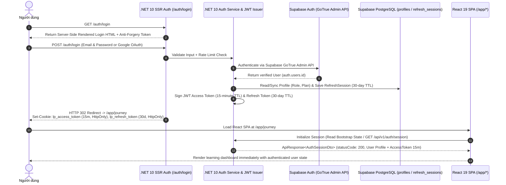

# Chiến Lược Xác Thực & Phân Quyền: Server-Side Login (SSR) $\rightarrow$ React SPA & JWT (15m / 30d)

Tài liệu này đặc tả cơ chế xác thực kết hợp **Server-Side Rendering (SSR) cho cổng Đăng nhập/Đăng ký trên .NET 10**, bàn giao phiên sang **React SPA**, quản lý vòng đời **JWT (Access Token 15 phút, Refresh Token 30 ngày)**, tích hợp **Supabase Auth (GoTrue)** và **Ma trận phân quyền chi tiết cho Teacher (`RequireTeacher`)**.
*(Lưu ý: Toàn bộ comment trong mã nguồn bắt buộc viết bằng tiếng Anh).*

---

## 1. Kiến Trúc Đăng Nhập Server-Side (SSR Login) Chuyển Tiếp Sang React SPA

Theo yêu cầu kiến trúc:
1. **Trang Đăng nhập / Đăng ký (`/auth/login`, `/auth/register`) được render Server-Side (SSR)** trực tiếp từ Backend `.NET 10` (Razor Views / MVC Controller).
2. Khi người dùng submit form đăng nhập hoặc bấm đăng nhập Google SSO, **request gọi thẳng đến Server `.NET 10`**.
3. Chỉ khi **Server xác thực thành công**, Server mới phát hành cặp Token (**Access Token 15 phút**, **Refresh Token 30 ngày**), thiết lập phiên đăng nhập và **chuyển hướng (Redirect) sang ứng dụng React SPA (`/app/journey`)** kèm đầy đủ thông tin đăng nhập của người dùng.



---

## 2. Cấu Hình Thời Hạn JWT: Access Token 15 Phút & Refresh Token 30 Ngày

### 2.1 Cấu hình `appsettings.json`
```json
{
  "JwtSettings": {
    "Issuer": "https://lingopro.online",
    "Audience": "lingopro-client",
    "SecretKey": "your-256-bit-production-jwt-secret-key-at-least-32-bytes",
    "AccessTokenExpirationMinutes": 15,
    "RefreshTokenExpirationDays": 30
  },
  "Supabase": {
    "Url": "https://your-project.supabase.co",
    "ServiceRoleKey": "eyJhbGciOi..."
  }
}
```

### 2.2 Class Cấu Hình `JwtSettings.cs` (1 File = 1 Class)
```csharp
// LingoPro.Infrastructure/Identity/JwtSettings.cs
namespace LingoPro.Infrastructure.Identity;

/// <summary>
/// Configuration options for JWT issuance and validation.
/// </summary>
public class JwtSettings
{
    public const string SectionName = "JwtSettings";

    public string Issuer { get; init; } = string.Empty;
    public string Audience { get; init; } = string.Empty;
    public string SecretKey { get; init; } = string.Empty;

    /// <summary>
    /// Access token lifetime in minutes (mandated: 15 minutes).
    /// </summary>
    public int AccessTokenExpirationMinutes { get; init; } = 15;

    /// <summary>
    /// Refresh token lifetime in days (mandated: 30 days).
    /// </summary>
    public int RefreshTokenExpirationDays { get; init; } = 30;
}
```

### 2.3 Dịch Vụ Cấp Phát Token `JwtTokenService.cs` (1 File = 1 Class)
```csharp
// LingoPro.Application/Common/Interfaces/IJwtTokenService.cs
namespace LingoPro.Application.Common.Interfaces;

/// <summary>
/// Contract for generating short-lived JWT access tokens and long-lived refresh tokens.
/// </summary>
public interface IJwtTokenService
{
    string GenerateAccessToken(Profile profile, out DateTime expiresAtUtc);
    string GenerateRefreshToken(out DateTime expiresAtUtc);
}
```

```csharp
// LingoPro.Infrastructure/Identity/JwtTokenService.cs
namespace LingoPro.Infrastructure.Identity;

/// <summary>
/// Issues HMAC-SHA256 JWT access tokens (15-minute expiry) and cryptographic refresh tokens (30-day expiry).
/// </summary>
public class JwtTokenService(IOptions<JwtSettings> jwtOptions) : IJwtTokenService
{
    private readonly JwtSettings _settings = jwtOptions.Value;

    public string GenerateAccessToken(Profile profile, out DateTime expiresAtUtc)
    {
        var now = DateTime.UtcNow;
        // Access token expires strictly after 15 minutes
        expiresAtUtc = now.AddMinutes(_settings.AccessTokenExpirationMinutes);

        var claims = new List<Claim>
        {
            new(JwtRegisteredClaimNames.Sub, profile.Id.ToString()),
            new(ClaimTypes.NameIdentifier, profile.Id.ToString()),
            new(JwtRegisteredClaimNames.Email, profile.Email),
            new(ClaimTypes.Name, profile.FullName ?? string.Empty),
            new(ClaimTypes.Role, profile.Role.ToString()),
            new("plan", profile.Plan.ToString()),
            new(JwtRegisteredClaimNames.Jti, Guid.NewGuid().ToString())
        };

        if (profile.PlanExpiresAt.HasValue)
        {
            claims.Add(new Claim("plan_expires_at", profile.PlanExpiresAt.Value.ToString("O")));
        }

        var key = new SymmetricSecurityKey(Encoding.UTF8.GetBytes(_settings.SecretKey));
        var creds = new SigningCredentials(key, SecurityAlgorithms.HmacSha256);

        var token = new JwtSecurityToken(
            issuer: _settings.Issuer,
            audience: _settings.Audience,
            claims: claims,
            notBefore: now,
            expires: expiresAtUtc,
            signingCredentials: creds);

        return new JwtSecurityTokenHandler().WriteToken(token);
    }

    public string GenerateRefreshToken(out DateTime expiresAtUtc)
    {
        // Refresh token expires strictly after 30 days
        expiresAtUtc = DateTime.UtcNow.AddDays(_settings.RefreshTokenExpirationDays);
        var randomBytes = RandomNumberGenerator.GetBytes(64);
        return Convert.ToBase64String(randomBytes);
    }
}
```

---

## 3. Cài Đặt Server-Side Login Controller (`AuthSsrController.cs`)

Controller này xử lý việc hiển thị form đăng nhập bằng Server-Side Rendering và nhận `POST` trực tiếp từ trình duyệt. Khi đăng nhập thành công, nó ghi Cookie phiên (`15 phút` cho Access Token, `30 ngày` cho Refresh Token) và chuyển hướng người dùng sang ứng dụng React SPA (`/app/journey`):

```csharp
// LingoPro.WebApi/Controllers/Ssr/AuthSsrController.cs
namespace LingoPro.WebApi.Controllers.Ssr;

/// <summary>
/// Handles server-side rendered login and registration flows before handing off authenticated sessions to the React SPA.
/// </summary>
[Route("auth")]
public class AuthSsrController(ISender sender) : Controller
{
    [HttpGet("login")]
    public IActionResult Login([FromQuery] string? returnUrl = "/app/journey")
    {
        // Redirect directly to React SPA if user already has an active authenticated session
        if (User.Identity?.IsAuthenticated == true)
        {
            return LocalRedirect(returnUrl ?? "/app/journey");
        }

        ViewData["ReturnUrl"] = returnUrl;
        return View("~/Views/Auth/Login.cshtml");
    }

    [HttpPost("login")]
    [ValidateAntiForgeryToken]
    public async Task<IActionResult> LoginSubmit(
        [FromForm] ServerLoginRequestViewModel model,
        CancellationToken cancellationToken)
    {
        if (!ModelState.IsValid)
        {
            return View("~/Views/Auth/Login.cshtml", model);
        }

        var result = await sender.Send(
            new AuthenticateUserCommand(model.Email, model.Password),
            cancellationToken);

        if (!result.Succeeded || result.Session is null)
        {
            ModelState.AddModelError(string.Empty, result.ErrorMessage ?? "Invalid email or password.");
            return View("~/Views/Auth/Login.cshtml", model);
        }

        // 1. Store Access Token in HttpOnly Cookie (15-minute expiration)
        Response.Cookies.Append("lp_access_token", result.Session.AccessToken, new CookieOptions
        {
            HttpOnly = true,
            Secure = true,
            SameSite = SameSiteMode.Lax,
            Expires = DateTimeOffset.UtcNow.AddMinutes(15)
        });

        // 2. Store Refresh Token in HttpOnly Cookie (30-day expiration)
        Response.Cookies.Append("lp_refresh_token", result.Session.RefreshToken, new CookieOptions
        {
            HttpOnly = true,
            Secure = true,
            SameSite = SameSiteMode.Lax,
            Path = "/api/v1/auth",
            Expires = DateTimeOffset.UtcNow.AddDays(30)
        });

        // 3. Redirect to the React SPA upon successful server-side authentication
        var targetUrl = !string.IsNullOrWhiteSpace(model.ReturnUrl) && Url.IsLocalUrl(model.ReturnUrl)
            ? model.ReturnUrl
            : "/app/journey";

        return LocalRedirect(targetUrl);
    }
}
```

---

## 4. Đăng Ký JWT Bearer Middleware & Ma Trận Phân Quyền (`RequireTeacher`, `RequireAdmin`, `RequireStudent`)

### 4.1 Cấu Hình Policies Trong `AuthenticationExtensions.cs`

```csharp
// LingoPro.WebApi/Extensions/AuthenticationExtensions.cs
namespace LingoPro.WebApi.Extensions;

/// <summary>
/// Configures JWT Bearer authentication and role-based authorization policies.
/// </summary>
public static class AuthenticationExtensions
{
    public static IServiceCollection AddAppAuthentication(
        this IServiceCollection services,
        IConfiguration configuration)
    {
        services.Configure<JwtSettings>(configuration.GetSection(JwtSettings.SectionName));
        var jwtSettings = configuration.GetSection(JwtSettings.SectionName).Get<JwtSettings>()
            ?? throw new InvalidOperationException("JwtSettings is missing.");

        var keyBytes = Encoding.UTF8.GetBytes(jwtSettings.SecretKey);

        services.AddAuthentication(JwtBearerDefaults.AuthenticationScheme)
            .AddJwtBearer(options =>
            {
                options.RequireHttpsMetadata = true;
                options.SaveToken = true;
                options.TokenValidationParameters = new TokenValidationParameters
                {
                    ValidateIssuerSigningKey = true,
                    IssuerSigningKey = new SymmetricSecurityKey(keyBytes),
                    ValidateIssuer = true,
                    ValidIssuer = jwtSettings.Issuer,
                    ValidateAudience = true,
                    ValidAudience = jwtSettings.Audience,
                    ValidateLifetime = true,
                    // Allow minimal clock skew (30 seconds) for 15-minute access tokens
                    ClockSkew = TimeSpan.FromSeconds(30)
                };

                options.Events = new JwtBearerEvents
                {
                    OnMessageReceived = context =>
                    {
                        // Fallback to HttpOnly cookie if Authorization header is not present
                        if (string.IsNullOrEmpty(context.Token) &&
                            context.Request.Cookies.TryGetValue("lp_access_token", out var cookieToken))
                        {
                            context.Token = cookieToken;
                        }
                        return Task.CompletedTask;
                    }
                };
            });

        services.AddAuthorizationBuilder()
            .AddPolicy("RequireStudent", policy => policy.RequireRole(
                nameof(UserRole.Student), nameof(UserRole.Teacher), nameof(UserRole.Admin)))
            .AddPolicy("RequireTeacher", policy => policy.RequireRole(
                nameof(UserRole.Teacher), nameof(UserRole.Admin)))
            .AddPolicy("RequireAdmin", policy => policy.RequireRole(
                nameof(UserRole.Admin)))
            .AddPolicy("RequireProPlan", policy => policy.RequireAssertion(ctx =>
            {
                var plan = ctx.User.FindFirstValue("plan");
                return plan is nameof(SubscriptionPlanType.Pro)
                            or nameof(SubscriptionPlanType.Premium)
                            or nameof(SubscriptionPlanType.School);
            }));

        return services;
    }
}
```

### 4.2 Danh Mục Đánh Dấu Chi Tiết Các Phần CHỈ Teacher Được Truy Cập (`[Authorize(Policy = "RequireTeacher")]`)

Dựa trên các chính sách bảo mật trong `supabase/schema.sql` và `supabase/migrations/`, bảng dưới đây quy định rõ các tính năng, bảng dữ liệu và API Endpoint **bắt buộc phải gắn `[Authorize(Policy = "RequireTeacher")]`** (chỉ `UserRole.Teacher` — cùng `Admin` — được phép truy cập, kèm kiểm tra quyền sở hữu `classroom.teacher_id == currentUser.UserId`):

| STT | Nhóm Nghiệp Vụ | Bảng Dữ Liệu Liên Quan | Các Thao Tác & API Endpoint CHỈ Teacher Được Truy Cập (`RequireTeacher`) | Điều Kiện Kiểm Tra Quyền Sở Hữu (Ownership Guard) |
|:---:|---|---|---|---|
| **1** | **Quản lý Lớp học (Classroom CRUD)** | `public.classrooms` | • `POST /api/v1/classrooms` (Tạo lớp học mới)<br/>• `PUT /api/v1/classrooms/{id}` (Cập nhật tên/mô tả lớp)<br/>• `DELETE /api/v1/classrooms/{id}` (Xóa lớp học)<br/>• `POST /api/v1/classrooms/{id}/regenerate-invite` (Đổi mã mời `invite_code`) | `classroom.TeacherId == currentUser.UserId` (Cấm thao tác trên lớp `__personal__` của người khác) |
| **2** | **Quản lý Danh sách Học viên trong Lớp** | `public.enrollments`, `public.profiles` | • `GET /api/v1/classrooms/{id}/students` (Xem danh sách & thông tin học viên đã tham gia lớp)<br/>• `DELETE /api/v1/classrooms/{id}/students/{studentId}` (Mời học viên ra khỏi lớp) | `classroom.TeacherId == currentUser.UserId` |
| **3** | **Báo cáo Phân tích VMS & LCS của Học viên** | `public.student_progress` (View), `public.student_daily_stats` | • `GET /api/v1/classrooms/{id}/analytics` (Xem chỉ số VMS - Vocabulary Mastery Score & LCS - Learning Consistency Score của cả lớp)<br/>• `GET /api/v1/classrooms/{id}/students/{studentId}/trends` (Xem lịch sử tiến bộ hàng ngày `student_daily_stats`) | `classroom.TeacherId == currentUser.UserId` |
| **4** | **Quản lý Kho Từ vựng của Lớp học** | `public.words`, `public.srs_progress` | • `POST /api/v1/classrooms/{id}/words` (Thêm từ vựng chuẩn vào lớp học)<br/>• `PUT /api/v1/classrooms/{id}/words/{wordId}` (Chỉnh sửa nghĩa, IPA, ví dụ của từ trong lớp)<br/>• `DELETE /api/v1/classrooms/{id}/words/{wordId}` (Xóa từ khỏi lớp)<br/>• `GET /api/v1/classrooms/{id}/srs-progress` (Xem tiến độ ôn tập SRS của học viên trong lớp) | `classroom.TeacherId == currentUser.UserId` |
| **5** | **Giao Bài tập & Xem Kết quả Quiz / Ngữ pháp trong Lớp** | `public.grammar_exercises`, `public.grammar_results`, `public.quiz_results`, `public.grammar_progress` | • `POST /api/v1/classrooms/{id}/grammar-exercises` (Tạo bài tập ngữ pháp cho lớp)<br/>• `PUT / DELETE /api/v1/classrooms/{id}/grammar-exercises/{exerciseId}`<br/>• `GET /api/v1/classrooms/{id}/quiz-results` (Xem điểm kiểm tra từ vựng/ngữ pháp của học viên)<br/>• `GET /api/v1/classrooms/{id}/grammar-progress` (Xem mức độ thành thạo ngữ pháp của học viên) | `classroom.TeacherId == currentUser.UserId` |
| **6** | **Biên soạn Chủ đề & Bài giảng Ngữ pháp Hệ thống** | `public.grammar_topics`, `public.grammar_lessons` | • `POST / PUT / DELETE /api/v1/grammar/topics` (Tạo/Sửa chủ đề ngữ pháp)<br/>• `POST / PUT / DELETE /api/v1/grammar/lessons` (Biên soạn nội dung lý thuyết & ví dụ ngữ pháp)<br/>*(Khớp với RLS `"Teachers manage grammar topics/lessons"` trong `20260519_grammar_lessons.sql`)* | Yêu cầu `Role == UserRole.Teacher` hoặc `UserRole.Admin` |
| **7** | **Quản lý Bài đọc Hàng ngày của Lớp (Daily Reading)** | `public.daily_reading_exercises`, `public.daily_reading_completions` | • `POST / PUT / DELETE /api/v1/classrooms/{id}/daily-readings` (Khởi tạo hoặc chỉnh sửa bài đọc AI theo từ vựng của lớp)<br/>• `GET /api/v1/classrooms/{id}/daily-readings/{exerciseId}/completions` (Xem điểm đọc hiểu MCQ & Cloze của học viên trong lớp) | `classroom.TeacherId == currentUser.UserId` |
| **8** | **Chấm điểm & Ghi nhận Quan sát Chẩn đoán Foundation (Lớp 6)** | `public.learner_lexical_evidence`, `public.learner_lexical_state` | • `POST /api/v1/foundation/teacher-observations` (Ghi nhận minh chứng phát âm/từ vựng trực tiếp với `EvidenceSource = LexicalEvidenceSource.Teacher`)<br/>• `GET /api/v1/classrooms/{id}/foundation-gap-map` (Xem bản đồ lỗ hổng từ vựng của học viên trong lớp) | Học viên `learnerId` phải đang enrolled trong lớp do `currentUser.UserId` làm giáo viên chủ nhiệm |

### 4.3 Ví Dụ Áp Dụng `[Authorize(Policy = "RequireTeacher")]` Trên Controller (`TeacherClassroomsController.cs`)

```csharp
// LingoPro.WebApi/Controllers/Api/TeacherClassroomsController.cs
namespace LingoPro.WebApi.Controllers.Api;

/// <summary>
/// Teacher-only endpoints for managing classrooms, curating class vocabulary, and viewing student VMS/LCS analytics.
/// </summary>
[ApiController]
[Route("api/v1/teacher/classrooms")]
[Authorize(Policy = "RequireTeacher")]
public class TeacherClassroomsController(ISender sender) : ControllerBase
{
    [HttpPost]
    public async Task<ActionResult<ApiResponse<ClassroomDto>>> CreateClassroom(
        [FromBody] CreateClassroomCommand command,
        CancellationToken cancellationToken)
    {
        var result = await sender.Send(command, cancellationToken);
        return StatusCode(StatusCodes.Status201Created, ApiResponse<ClassroomDto>.Created(result));
    }

    [HttpGet("{classroomId:guid}/analytics")]
    public async Task<ActionResult<ApiResponse<ClassroomAnalyticsDto>>> GetClassroomAnalytics(
        Guid classroomId,
        CancellationToken cancellationToken)
    {
        var result = await sender.Send(new GetClassroomAnalyticsQuery(classroomId), cancellationToken);
        return Ok(ApiResponse<ClassroomAnalyticsDto>.Ok(result));
    }
}
```

---

## 5. Quản Lý Current User Context Trong Tầng Application (Chuẩn Business Enums)

```csharp
// LingoPro.Application/Common/Interfaces/ICurrentUserService.cs
namespace LingoPro.Application.Common.Interfaces;

/// <summary>
/// Provides access to the currently authenticated user's identity, role, and subscription plan.
/// </summary>
public interface ICurrentUserService
{
    Guid? UserId { get; }
    string? Email { get; }
    UserRole Role { get; }
    SubscriptionPlanType Plan { get; }
    bool IsAuthenticated { get; }
    bool IsTeacher { get; }
    bool IsAdmin { get; }
    bool IsPro { get; }
}
```

```csharp
// LingoPro.Infrastructure/Services/CurrentUserService.cs
namespace LingoPro.Infrastructure.Services;

/// <summary>
/// Extracts current user claims from the active HTTP context.
/// </summary>
public class CurrentUserService(IHttpContextAccessor httpContextAccessor) : ICurrentUserService
{
    private ClaimsPrincipal? User => httpContextAccessor.HttpContext?.User;

    public Guid? UserId
    {
        get
        {
            var sub = User?.FindFirstValue(ClaimTypes.NameIdentifier) ?? User?.FindFirstValue("sub");
            return Guid.TryParse(sub, out var guid) ? guid : null;
        }
    }

    public string? Email => User?.FindFirstValue(ClaimTypes.Email) ?? User?.FindFirstValue("email");

    public UserRole Role =>
        Enum.TryParse<UserRole>(User?.FindFirstValue(ClaimTypes.Role), ignoreCase: true, out var role)
            ? role
            : UserRole.Student;

    public SubscriptionPlanType Plan =>
        Enum.TryParse<SubscriptionPlanType>(User?.FindFirstValue("plan"), ignoreCase: true, out var plan)
            ? plan
            : SubscriptionPlanType.Free;

    public bool IsAuthenticated => User?.Identity?.IsAuthenticated ?? false;
    public bool IsTeacher => Role is UserRole.Teacher or UserRole.Admin;
    public bool IsAdmin => Role == UserRole.Admin;
    public bool IsPro => Plan is SubscriptionPlanType.Pro or SubscriptionPlanType.Premium or SubscriptionPlanType.School;
}
```

---

## 6. Đăng Nhập Đơn Điểm (SSO) & Liên Kết Tài Khoản Google (Account Linking)

1. **SSO Đăng nhập bằng Google (Server-Side Callback)**:
   * Tại trang SSR `/auth/login`, người dùng bấm `"Tiếp tục với Google"` $\rightarrow$ điều hướng tới `GET /auth/google-login`.
   * Backend `.NET 10` chuyển hướng sang Google OAuth Consent Screen và nhận kết quả tại `GET /auth/callback/google`.
   * Sau khi đổi code lấy thông tin Google User và đồng bộ `public.profiles`, Server cấp **Access Token (15 phút)** + **Refresh Token (30 ngày)** vào Cookie và redirect thẳng sang ứng dụng React SPA (`/app/journey`).
2. **Account Linking khi đã đăng nhập trong React SPA**:
   * Học viên đang ở trong React SPA (`/app/profile`) có thể bấm liên kết thêm tài khoản Google qua `POST /api/v1/auth/identities/link/google`, giữ nguyên `profiles.id` và toàn bộ lịch sử học tập.
