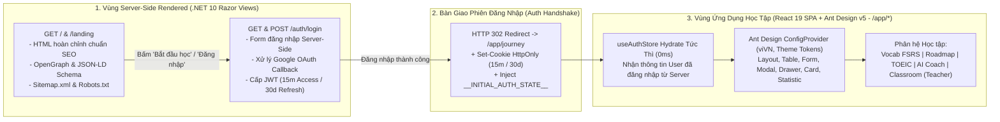

# Kiến Trúc Tầng Giao Diện: Hybrid SSR (Trang Chủ SEO + Server-Side Login) & React 19 SPA (Ant Design v5)

Tài liệu này đặc tả kiến trúc giao diện kết hợp (**Hybrid Rendering Architecture**) giữa:
1. **Server-Side Rendering (SSR) trên .NET 10**: Phục vụ **Trang Chủ / Landing Page tối ưu SEO 100%** (`/`, `/landing`, `/pricing`) và **Cổng Đăng Nhập / Đăng Ký Server-Side** (`/auth/login`, `/auth/register`).
2. **React 19 Single Page Application (SPA) sử dụng Ant Design (`antd` v5)**: Phục vụ toàn bộ không gian học tập tương tác cao, cổng Giáo viên và Admin CRM (`/app/*`) sau khi người dùng đã đăng nhập thành công từ Server.

---

## 1. Sơ Đồ Phân Vùng Giữa Server-Side Rendering (SSR) & React SPA (Ant Design)



---

## 2. Thiết Kế Server-Side Rendering (SSR) Cho Trang Chủ Tối Ưu SEO & Cổng Đăng Nhập

### 2.1 Trang Chủ & Landing Page Chuẩn SEO (`HomeSeoController.cs` & `Index.cshtml`)
* Toàn bộ nội dung giới thiệu khóa học, lộ trình `CertLevel` (`A0` $\rightarrow$ `C2`), luyện thi TOEIC/VSTEP, bảng giá và câu hỏi thường gặp (FAQ) được render trực tiếp thành HTML tĩnh/động ngay từ Server `.NET 10`.
* **Tối ưu SEO toàn diện**:
  * Đầy đủ thẻ `<title>`, `<meta name="description">`, `<link rel="canonical">`, OpenGraph (`og:title`, `og:description`, `og:image`, `og:url`).
  * Tích hợp **JSON-LD Structured Data** (`EducationalOrganization`, `Course`, `FAQPage`, `SoftwareApplication`) giúp Google hiển thị Rich Snippets.
  * Tốc độ **First Contentful Paint (FCP) < 200ms** do trình duyệt không phải tải bundle JavaScript của React mới thấy nội dung trang chủ.

```csharp
// LingoPro.WebApi/Controllers/Ssr/HomeSeoController.cs
namespace LingoPro.WebApi.Controllers.Ssr;

public class HomeSeoController(ICacheService cacheService, ISender sender) : Controller
{
    [HttpGet("/")]
    [HttpGet("/landing")]
    public async Task<IActionResult> Index(CancellationToken cancellationToken)
    {
        // Phase 1: NoOpCacheService executes the factory directly against the database.
        // Phase 2: HybridMultiLevelCacheService serves from L1 Local Memory + L2 Redis without modifying this controller.
        var seoModel = await cacheService.GetOrCreateAsync(
            key: "seo:home-landing-v1",
            factory: ct => sender.Send(new GetLandingPageSeoDataQuery(), ct),
            options: new CacheOptions(
                LocalExpiration: TimeSpan.FromMinutes(10),
                DistributedExpiration: TimeSpan.FromHours(1)),
            cancellationToken: cancellationToken);

        return View("~/Views/Home/Index.cshtml", seoModel);
    }
}
```

### 2.2 Luồng Đăng Nhập Server-Side & Chuyển Giao Thông Tin Sang React SPA
1. Khi người dùng truy cập `/auth/login`, Server trả về HTML form đăng nhập được render sẵn.
2. Người dùng nhập tài khoản và bấm Đăng nhập $\rightarrow$ trình duyệt gửi `POST /auth/login` trực tiếp lên Server `.NET 10`.
3. Khi xác thực thành công:
   * Server tạo **Access Token (hết hạn sau 15 phút)** và **Refresh Token (hết hạn sau 30 ngày)**.
   * Server ghi Cookie bảo mật (`lp_access_token` 15 phút, `lp_refresh_token` 30 ngày) và chuyển hướng người dùng sang `/app/journey`.
   * Khi phục vụ file entry của React SPA (`/app/*`), Server nhúng sẵn thông tin phiên đăng nhập vào `window.__INITIAL_AUTH_STATE__` (hoặc React SPA đọc từ `/api/v1/auth/session` ở lần khởi tạo đầu tiên) để `useAuthStore` trong React có ngay thông tin `user` (bao gồm `role`: `Student` | `Teacher` | `Admin`) và `accessToken` mà không bị nháy màn hình (0ms perceived latency).

---

## 3. Cấu Trúc Dự Án React 19 SPA Với Ant Design v5 (`src/frontend` — Chuẩn 1 File = 1 Component/Type/Enum)

### 3.1 Cấu Trúc Thư Mục Chuẩn Hóa
Dự án React SPA phục vụ các route sau đăng nhập (`/app/*`), sử dụng **Ant Design (`antd` v5)** + **`@ant-design/icons`** và tuân thủ nghiêm ngặt quy tắc **SOLID**, **1 File = 1 Component / Hook / Store / Enum** cùng **100% comment trong code bằng tiếng Anh**:

```text
src/frontend/
├── src/
│   ├── app/                    # Routing & App Providers (Base path: /app)
│   │   ├── AppRouter.tsx
│   │   └── AppProviders.tsx    # Wraps Ant Design ConfigProvider, AntdApp, and QueryClientProvider
│   │
│   ├── theme/                  # Ant Design v5 Design Tokens (1 File = 1 Config)
│   │   └── lingoProTheme.ts    # Centralized ThemeConfig (Primary colors, border radius, typography)
│   │
│   ├── components/             # Reusable Ant Design Wrapper Components (1 Component = 1 File .tsx)
│   │   ├── layout/             # AppShellLayout.tsx (Antd Layout, Sider, Header, Content), TopHeaderBar.tsx
│   │   ├── audio/              # WaveformPlayer.tsx, AudioRecorder.tsx
│   │   └── common/             # CertLevelTag.tsx (Antd Tag), PageHeaderCard.tsx, ErrorBoundary.tsx
│   │
│   ├── features/               # Feature-based modules built with Ant Design (1 File = 1 Component)
│   │   ├── auth/               # AccountLinkingModal.tsx (Antd Modal), ProtectedRoute.tsx, TeacherRouteGuard.tsx
│   │   ├── vocab/              # FlashcardDeck.tsx (Antd Card/Progress), FsrsReviewQueue.tsx, VocabPackCard.tsx
│   │   ├── roadmap/            # JourneyMap.tsx (Antd Steps/Timeline), UnitStation.tsx, PlacementModal.tsx
│   │   ├── toeic/              # AudioProxyPlayer.tsx, ToeicExamGrid.tsx, PartDictation.tsx
│   │   ├── ai-coach/           # VoiceDialogueTutor.tsx, SentenceKernelTree.tsx (Antd Tree/Descriptions)
│   │   ├── teacher/            # [Teacher Only] ClassroomDashboard.tsx (Antd Table/Statistic), StudentDetailDrawer.tsx (Antd Drawer), TeacherVocabFormModal.tsx (Antd Form/Modal)
│   │   ├── billing/            # PricingCards.tsx, OrderModal.tsx, QrPaymentDialog.tsx
│   │   └── challenges/         # LeaderboardTable.tsx (Antd Table), StreakCounter.tsx, ChallengeCard.tsx
│   │
│   ├── lib/                    # Clients & Utilities
│   │   ├── apiClient.ts        # Axios instance handling ApiResponse<T> with statusCode & 15m/30d token refresh
│   │   ├── listeningUtils.ts   # Client-side dictation diff matcher
│   │   └── storage.ts          # Typed LocalStorage / SessionStorage wrappers
│   │
│   ├── stores/                 # Zustand Stores (1 Store = 1 File .ts)
│   │   ├── useAuthStore.ts     # Hydrates auth session from SSR server, manages 15m/30d tokens & role guards
│   │   ├── useStudyStore.ts    # Active flashcard and review queue state
│   │   └── useExamStore.ts     # Exam countdown timer and user answer sheet
│   │
│   ├── types/                  # TypeScript DTOs & Business Enums (1 File = 1 Type/Enum)
│   │   ├── api/
│   │   │   ├── ApiResponse.ts  # Standardized envelope with statusCode: number
│   │   │   └── PaginatedList.ts
│   │   ├── enums/              # 100% synchronized with LingoPro.Domain/Enums and supabase/migrations
│   │   │   ├── CertLevel.ts
│   │   │   ├── RoadmapLevelId.ts
│   │   │   ├── RoadmapTrackType.ts
│   │   │   ├── UserRole.ts
│   │   │   ├── SubscriptionPlanType.ts
│   │   │   ├── OrderStatus.ts
│   │   │   ├── SrsCardState.ts
│   │   │   ├── SrsReviewQuality.ts
│   │   │   └── VocabPackStatus.ts
│   │   ├── vocab/
│   │   └── exam/
│   │
│   ├── App.tsx
│   └── main.tsx
```

### 3.2 Quy Chuẩn Sử Dụng Ant Design v5 (`antd` + `@ant-design/icons`)
* **Quản lý Theme Token tập trung (`lingoProTheme.ts`)**: Không hardcode mã màu rời rạc trong từng component. Toàn bộ màu sắc thương hiệu, bo góc (`borderRadius`), font chữ và kích thước component được định nghĩa qua `ThemeConfig` của Ant Design v5.
* **Sử dụng Context-Aware Feedback (`App.useApp()`)**: Luôn bọc ứng dụng trong `<AntdApp>` và gọi `const { message, notification, modal } = App.useApp()` thay vì gọi hàm tĩnh `message.error(...)` để đảm bảo nhận đầy đủ Design Tokens và ngữ cảnh React 19.
* **Chuẩn hóa Form & Bảng Dữ Liệu**:
  * Các màn hình nhập liệu (Tạo lớp học, Thêm từ vựng của Giáo viên, Thanh toán, Đổi mật khẩu) sử dụng `<Form layout="vertical">` của Ant Design kết hợp rule validation đồng bộ với `FluentValidation` phía Backend.
  * Các màn hình danh sách (Quản lý học sinh trong lớp, Bảng xếp hạng Challenge, Lịch sử đơn hàng, Admin CRM) sử dụng `<Table>` của Ant Design với phân trang chuẩn hóa theo `PaginatedList<T>`.

```typescript
// src/frontend/src/theme/lingoProTheme.ts
import type { ThemeConfig } from 'antd';

/**
 * Centralized Ant Design v5 theme token configuration for the LingoPro SPA.
 */
export const lingoProTheme: ThemeConfig = {
  token: {
    colorPrimary: '#2563eb',
    colorSuccess: '#16a34a',
    colorWarning: '#d97706',
    colorError: '#dc2626',
    borderRadius: 10,
    fontFamily: "'Inter', -apple-system, BlinkMacSystemFont, 'Segoe UI', Roboto, sans-serif",
  },
  components: {
    Button: {
      controlHeight: 40,
      fontWeight: 600,
    },
    Card: {
      borderRadiusLG: 14,
    },
    Table: {
      borderRadius: 12,
    },
  },
};
```

```tsx
// src/frontend/src/app/AppProviders.tsx
import React, { type PropsWithChildren } from 'react';
import { ConfigProvider, App as AntdApp } from 'antd';
import viVN from 'antd/locale/vi_VN';
import { QueryClient, QueryClientProvider } from '@tanstack/react-query';
import { lingoProTheme } from '../theme/lingoProTheme';

const queryClient = new QueryClient({
  defaultOptions: {
    queries: {
      staleTime: 60_000,
      retry: 1,
      refetchOnWindowFocus: false,
    },
  },
});

/**
 * Root application provider configuring Ant Design v5 theme tokens, Vietnamese locale, and TanStack Query.
 */
export const AppProviders: React.FC<PropsWithChildren> = ({ children }) => {
  return (
    <ConfigProvider locale={viVN} theme={lingoProTheme}>
      <AntdApp>
        <QueryClientProvider client={queryClient}>
          {children}
        </QueryClientProvider>
      </AntdApp>
    </ConfigProvider>
  );
};
```

---

## 4. Đồng Bộ Business Enums & Chuẩn `ApiResponse<T>` Có `statusCode`

### 4.1 Định Nghĩa `ApiResponse.ts` Kèm `statusCode` (1 File = 1 Interface)
```typescript
// src/frontend/src/types/api/ApiResponse.ts

/**
 * Standardized API response envelope returned by all LingoPro .NET 10 endpoints.
 */
export interface ApiResponse<T = unknown> {
  statusCode: number;
  success: boolean;
  message: string;
  data: T | null;
  errors: Record<string, string[]> | null;
  errorCode: string | null;
  timestamp: string;
}
```

### 4.2 Định Nghĩa Business Enums Đồng Bộ Với `supabase/migrations` (1 File = 1 Enum)
```typescript
// src/frontend/src/types/enums/CertLevel.ts

/**
 * Represents standardized certification proficiency levels (CEFR A0-C2) mapped from database migrations.
 */
export enum CertLevel {
  A0 = 'A0',
  A1 = 'A1',
  A2 = 'A2',
  B1 = 'B1',
  B2 = 'B2',
  C1 = 'C1',
  C2 = 'C2',
}
```

```typescript
// src/frontend/src/types/enums/SrsCardState.ts

/**
 * Represents the FSRS v5 scheduling state of a vocabulary flashcard.
 */
export enum SrsCardState {
  New = 'New',
  Learning = 'Learning',
  Review = 'Review',
  Relearning = 'Relearning',
}
```

---

## 5. Quản Lý Phiên Đăng Nhập Từ Server & Tự Động Gia Hạn Token (15 Phút / 30 Ngày)

Khi Access Token hết hạn sau **15 phút**, `apiClient` tự động gọi `POST /api/v1/auth/refresh` (sử dụng Refresh Token có hạn **30 ngày** trong HttpOnly Cookie) để lấy Access Token mới. Nếu người dùng chưa đăng nhập hoặc Refresh Token 30 ngày đã hết hạn, trình duyệt điều hướng về trang Server-Side Login (`/auth/login`):

```typescript
// src/frontend/src/lib/apiClient.ts
import axios, { AxiosError } from 'axios';
import { useAuthStore } from '../stores/useAuthStore';
import type { ApiResponse } from '../types/api/ApiResponse';

export const apiClient = axios.create({
  baseURL: import.meta.env.VITE_API_BASE_URL || '/api/v1',
  // Send HttpOnly cookies (lp_access_token 15m, lp_refresh_token 30d) with every request
  withCredentials: true,
  headers: {
    'Content-Type': 'application/json',
  },
  timeout: 15000,
});

apiClient.interceptors.request.use((config) => {
  const token = useAuthStore.getState().accessToken;
  if (token) {
    config.headers.Authorization = `Bearer ${token}`;
  }
  return config;
});

apiClient.interceptors.response.use(
  (response) => response,
  async (error: AxiosError<ApiResponse>) => {
    const originalRequest = error.config as any;

    // When the 15-minute Access Token expires, refresh silently using the 30-day Refresh Token cookie
    if (error.response?.status === 401 && !originalRequest._retry) {
      originalRequest._retry = true;
      try {
        const refreshRes = await axios.post<ApiResponse<{ accessToken: string; expiresAtUtc: string }>>(
          `${apiClient.defaults.baseURL}/auth/refresh`,
          {},
          { withCredentials: true }
        );

        if (refreshRes.data.statusCode === 200 && refreshRes.data.success && refreshRes.data.data) {
          const { accessToken } = refreshRes.data.data;
          useAuthStore.getState().setAccessToken(accessToken);
          originalRequest.headers.Authorization = `Bearer ${accessToken}`;
          return apiClient(originalRequest);
        }
      } catch (refreshErr) {
        useAuthStore.getState().clearSession();
        // Redirect back to the Server-Side Rendered (SSR) login page
        window.location.href = `/auth/login?returnUrl=${encodeURIComponent(window.location.pathname)}`;
        return Promise.reject(refreshErr);
      }
    }

    // Preserve local session state during temporary network outages (Offline-First Authentication)
    if (!error.response && error.code === 'ERR_NETWORK') {
      useAuthStore.getState().setOfflineMode(true);
    }

    return Promise.reject(error);
  }
);
```
