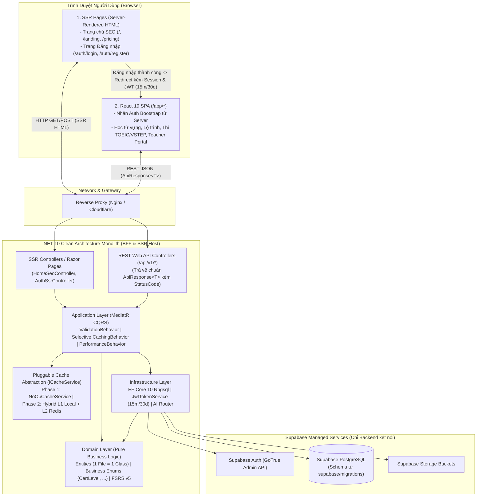

# Tổng Quan Kiến Trúc Hệ Thống (System Architecture Overview)
## Dự án: LingoPro Platform (Monolith Modernization)

Tài liệu này định hình kiến trúc tổng thể, ngăn xếp công nghệ (tech stack), nguyên tắc thiết kế và cấu trúc phân tầng giải pháp khi chuyển dịch và chuẩn hóa toàn bộ nền tảng **LingoPro** sang mô hình kiến trúc sạch (**Clean Architecture Monolith**) với **.NET 10**, **Server-Side Rendering (SEO & Auth)**, **React 19 SPA** và **Supabase PostgreSQL**.

---

## 1. Mục Tiêu & Định Hướng Kiến Trúc

1. **Monolithic Clean Architecture (.NET 10 BFF)**: Xây dựng backend dạng Modular Monolith trên nền tảng **.NET 10** (C# 14), áp dụng triệt để nguyên lý Clean Architecture và **SOLID**, tách biệt rõ ràng `Domain`, `Application`, `Infrastructure` và `WebApi`.
2. **Hybrid Server-Side Rendering (SSR) + React SPA**:
   * **Trang Chủ & Các Trang SEO Public (`/`, `/landing`, `/pricing`, `/courses`)**: Render trực tiếp **Server-Side (SSR)** bằng `.NET 10 Razor Pages / Views`, cung cấp HTML hoàn chỉnh, chuẩn OpenGraph, JSON-LD Structured Data và Sitemap tối ưu 100% cho **SEO**.
   * **Trang Đăng Nhập / Đăng Ký Server-Side (`/auth/login`, `/auth/register`, `/auth/callback/google`)**: Xử lý xác thực và render trực tiếp từ phía Server. Khi đăng nhập thành công, Server phát hành phiên (**Access Token 15 phút**, **Refresh Token 30 ngày**) rồi mới **chuyển hướng (redirect) người dùng vào ứng dụng React SPA** kèm theo thông tin đăng nhập đã được xác thực.
   * **Ứng Dụng Học Tập (React 19 SPA tại `/app/*`)**: Sau khi đăng nhập, toàn bộ trải nghiệm học từ vựng FSRS, làm bài thi TOEIC/VSTEP, lộ trình học, AI Coaching và Quản lý Lớp học (Teacher Dashboard) hoạt động mượt mà với độ trễ 0ms trên React SPA.
3. **Chiến Lược Cache 2 Giai Đoạn Có Chọn Lọc (Phased & Selective Multi-Level Caching: Local L1 + Redis L2)**:
   * **Giai đoạn 1 (Hiện tại — Chưa áp dụng Cache)**: Sử dụng `NoOpCacheService` làm implementation mặc định cho `ICacheService`. Codebase đã có sẵn toàn bộ cấu trúc abstraction nhưng chưa lưu cache thực tế để ưu tiên tính chính xác tuyệt đối.
   * **Giai đoạn 2 (Bật đồng thời L1 Local `IMemoryCache` + L2 `Redis`)**: Chuyển cấu hình `Caching:Mode = "Hybrid"` để kích hoạt `HybridMultiLevelCacheService` (phối hợp cả Local Memory Cache L1 và Redis Distributed Cache L2) mà không phải sửa bất kỳ dòng code nghiệp vụ nào.
   * **Cache Có Chọn Lọc (Selective Opt-In)**: `CachingBehavior` chỉ xử lý các Query thực thi tường minh `ICacheableQuery` (như Từ điển toàn cục `global_dictionary`, 62 chủ đề ngữ pháp, thư viện bài đọc CEFR, dữ liệu SEO). Tuyệt đối không cache dữ liệu lịch sử học tập, hàng đợi ôn tập FSRS, đơn hàng thanh toán hoặc bảng điểm lớp học thời gian thực.
4. **Chuẩn Hóa Phản Hồi API (`ApiResponse<T>` Kèm `StatusCode`)**:
   * Mọi phản hồi REST API từ Backend về React SPA đều tuân theo cấu trúc `ApiResponse<T>` duy nhất, bao gồm **`StatusCode` (HTTP status code)**, `Success`, `Message` (tiếng Anh), `Data`, `ErrorCode`, `Errors` và `Timestamp`.
5. **Data Access Layer Đồng Bộ 100% Với `supabase/migrations` & Phân Quyền Giáo Viên (`RequireTeacher`)**:
   * Sử dụng **Entity Framework Core 10 (EF Core 10)** kết hợp `Npgsql`, ánh xạ toàn bộ các bảng, views, RPC và chuẩn hóa toàn bộ ràng buộc `CHECK` trong `supabase/migrations/` thành hệ thống **Business Enums** (như `CertLevel`, `RoadmapTrackType`, `SrsCardState`, `OrderStatus`, ...).
   * Phân định rõ các nghiệp vụ và bảng dữ liệu dành riêng cho **Giáo viên (`[Authorize(Policy = "RequireTeacher")]`)**.
6. **Kiểm Thử Nghiệp Vụ Toàn Diện Với NUnit**:
   * Toàn bộ Domain Business Logic (FSRS v5 Engine, Entities, Value Objects) và Application Business Handlers đều được kiểm thử tự động bằng **NUnit 4** + **NSubstitute**.

---

## 2. Ngăn Xếp Công Nghệ (Tech Stack Matrix)

| Tầng | Công nghệ / Thư viện | Vai trò & Mục đích |
|---|---|---|
| **SSR (SEO & Auth)** | **ASP.NET Core 10 Razor Pages / MVC Views** | Render Server-Side cho Trang chủ SEO (`/`, `/landing`) và cổng Đăng nhập (`/auth/login`) |
| **Frontend App (SPA)** | **React 19** + **TypeScript** + **Vite** | Ứng dụng học tập tương tác cao sau khi đã đăng nhập (`/app/*`) |
| | **TailwindCSS** + **Shadcn/UI** | Hệ thống Design System đồng nhất giữa SSR và React SPA |
| | **TanStack Query** + **Zustand** | Client-side Caching, SWR, 0ms Hydration & nhận thông tin Auth từ Server |
| **Backend Core** | **.NET 10** (C# 14) Web API & BFF | Monolithic Service xử lý toàn bộ Business Logic & điều phối Auth/API |
| **Architectural Style** | **Clean Architecture** + **SOLID** | Tách biệt Core Domain khỏi Framework, 1 File = 1 Class, Business Enums |
| **Patterns** | **CQRS** (MediatR), **Strategy / Decorator** | Tách luồng Read/Write, Pipeline Validation, Logging, Selective Caching |
| **Authentication & JWT** | **ASP.NET Core JWT Bearer** + **Supabase Auth** | Access Token hết hạn **15 phút**, Refresh Token hết hạn **30 ngày**, Policy `RequireTeacher` |
| **Caching Layer** | **Phase 1: `NoOpCacheService`** $\rightarrow$ **Phase 2: `HybridMultiLevelCacheService` (L1 `IMemoryCache` + L2 `Redis`)** | Thiết kế `ICacheService` sẵn sàng bật đồng thời Local Cache + Redis ở Giai đoạn 2 cho các `ICacheableQuery` |
| **ORM & Database** | **EF Core 10** + **Npgsql** (Supabase PostgreSQL) | Mapping toàn bộ schema từ `supabase/migrations` & Optimistic Concurrency |
| **Testing Framework** | **NUnit 4** + **NSubstitute** + **Testcontainers** | Unit Test cho Domain/Application Business Logic & Integration Test |
| **Background Tasks** | **Quartz.NET** / **BackgroundService (.NET)** | Cron gửi thông báo từ đến hạn, quyết toán Challenge, đồng bộ CRM |
| **AI Integration** | **Semantic Kernel** / Strategy HTTP Client Pool | Điều phối đa mô hình AI (Gemini, Groq, Zhipu) |

---

## 3. Sơ Đồ Kiến Trúc Tổng Thể (Hybrid SSR + React SPA + .NET 10 BFF)

---

## 4. Quy Chuẩn Lập Trình Cốt Lõi (Core Coding Standards)

Toàn bộ mã nguồn Backend (.NET 10) và Frontend (React TypeScript) bắt buộc tuân thủ các nguyên tắc nền tảng sau (chi tiết tại [SKILL.md](./SKILL.md)):

1. **Tuân thủ triệt để nguyên lý SOLID**:
   * **S (Single Responsibility)**: Mỗi class/handler/service chỉ đảm nhận đúng một trách nhiệm duy nhất.
   * **O (Open/Closed)**: Dễ dàng mở rộng tính năng mới (`NoOpCacheService` $\rightarrow$ `HybridMultiLevelCacheService` kết hợp Local Cache + Redis Cache, AI Provider, Payment Gateway) qua Interface/Strategy/Pipeline mà không sửa đổi code nghiệp vụ hiện có.
   * **L (Liskov Substitution)**: Các lớp thực thi (`NoOpCacheService`, `HybridMultiLevelCacheService`) thay thế hoàn toàn cho nhau qua `ICacheService`.
   * **I (Interface Segregation)**: Chia nhỏ Interface theo đúng mục đích nghiệp vụ chuyên biệt (`ICacheableQuery` chỉ gắn cho các truy vấn được phép cache).
   * **D (Dependency Inversion)**: Tầng `Domain` và `Application` chỉ phụ thuộc vào Abstraction (Interface).
2. **Quy tắc 1 File = 1 Class / Type & 100% Comment Trong Code Bằng Tiếng Anh**:
   * Mỗi file mã nguồn (`.cs`, `.ts`, `.tsx`) chỉ chứa **duy nhất 1 class, record, interface, enum hoặc component**.
   * Toàn bộ comment bên trong code (`/// 
` và `// ...`) đều viết bằng **tiếng Anh**.
3. **Định nghĩa đầy đủ Enum cho tất cả các Business Types (Từ `supabase/migrations`)**:
   * Không dùng magic strings; chuẩn hóa toàn bộ các loại hình và cấp độ nghiệp vụ thành Enum (`CertLevel`, `RoadmapLevelId`, `RoadmapTrackType`, `SrsCardState`, `OrderStatus`, `ChallengeStatus`, ...).
4. **Mọi phản hồi API đều có `StatusCode` trong `ApiResponse<T>`**:
   * Cấu trúc trả về luôn bao gồm `statusCode` (`200`, `201`, `400`, `401`, `403`, `404`, `429`, `500`) cùng `message` tiếng Anh.
5. **Kiểm thử nghiệp vụ (Business Unit Tests) bằng NUnit**:
   * Viết Unit Test bằng **NUnit** cho cả tầng `Domain` và `Application`.

---

## 5. Cấu Trúc Thư Mục Tài Liệu Kiến Trúc

0. **[SKILL.md](./SKILL.md)**: Định nghĩa Skill Kiến trúc hệ thống & Quy tắc Coding Standards bắt buộc.
1. **[01_CLEAN_ARCHITECTURE_DOTNET10.md](./01_CLEAN_ARCHITECTURE_DOTNET10.md)**: Thiết kế phân tầng Clean Architecture, SOLID, 1 File = 1 Class, 100% English Code Comments, Phased Selective Multi-Level Caching (`NoOpCacheService` $\rightarrow$ `HybridMultiLevelCacheService` Local + Redis), NUnit Business Testing và chuẩn `ApiResponse<T>` có `StatusCode`.
2. **[02_AUTHENTICATION_SUPABASE_INTEGRATION.md](./02_AUTHENTICATION_SUPABASE_INTEGRATION.md)**: Luồng đăng nhập Server-Side (SSR) bàn giao phiên sang React SPA, cấu hình JWT (**Access Token 15 phút**, **Refresh Token 30 ngày**), ma trận phân quyền Giáo viên (`RequireTeacher`), Google SSO & Account Linking.
3. **[03_DATABASE_EFCORE_POSTGRESQL.md](./03_DATABASE_EFCORE_POSTGRESQL.md)**: Thiết kế toàn bộ Entities & Business Enums (`CertLevel`, ...) đọc trực tiếp từ `supabase/schema.sql` và `supabase/migrations/` với EF Core 10.
4. **[04_FRONTEND_REACT_ARCHITECTURE.md](./04_FRONTEND_REACT_ARCHITECTURE.md)**: Kiến trúc Hybrid SSR (Trang chủ chuẩn SEO + Trang Login Server-Side) kết hợp React 19 SPA, đồng bộ Business Enums (`CertLevel`) và `ApiResponse<T>`.
5. **[05_MODULE_MAPPING_SRS.md](./05_MODULE_MAPPING_SRS.md)**: Bản đồ ánh xạ toàn bộ 15 phân hệ chức năng từ `agent/docs/SRS_01` $\rightarrow$ `SRS_15` vào Clean Architecture, bảng Database, phân quyền `RequireTeacher`, phân loại Selective Cache và NUnit Tests.
