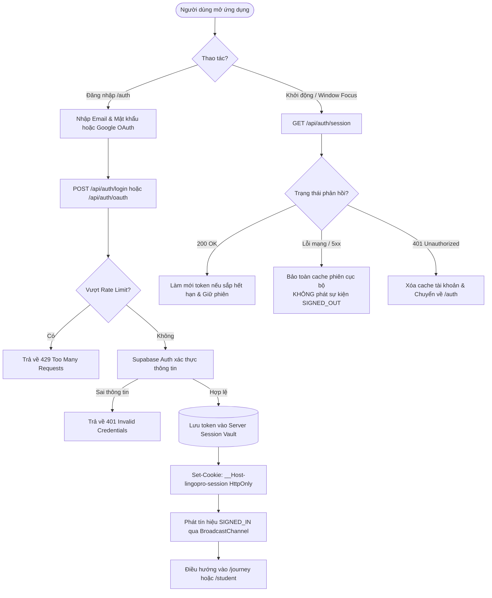
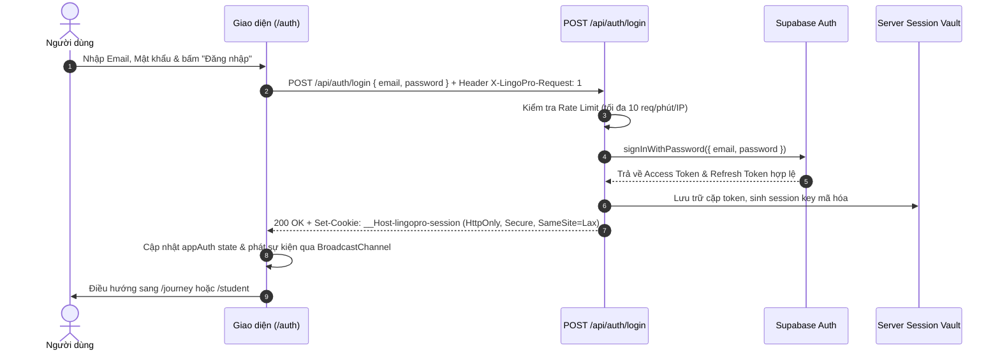

# Tài liệu Đặc tả Ca sử dụng (Use Case Specification)
## Tính năng: Xác thực & Quản lý Phiên (Authentication & Session Management)
**Mã tài liệu:** `UC-AUTH-01`  
**File lưu trữ:** `agent/docs/SRS_01_AUTH_SESSION.md`

---

### 1. Thông tin chung
* **Actor / Role thực hiện:**
  * `Guest` (Khách vãng lai chưa đăng nhập).
  * `User` (Học viên / Giáo viên / Quản trị viên đã có tài khoản).
* **Mô tả tóm tắt:** Cho phép người dùng đăng ký tài khoản mới, đăng nhập qua Email/Mật khẩu hoặc Google OAuth, khôi phục mật khẩu, duy trì phiên an toàn với kiến trúc BFF HttpOnly Cookie (`__Host-lingopro-session`), đồng bộ phiên đa tab và bảo toàn phiên khi mất kết nối mạng (Offline-First Session Resiliency).
* **Tiền điều kiện (Pre-conditions):**
  * Thiết bị kết nối được Internet (đối với đăng nhập/đăng ký lần đầu).
* **Hậu điều kiện (Post-conditions):**
  * Tạo phiên hợp lệ trong Server Session Vault.
  * Trình duyệt nhận HttpOnly Cookie (`__Host-lingopro-session`).
  * Giao diện người dùng khởi tạo nhanh (Frame-0 Snapshot Hydration) và chuyển về màn hình chính phù hợp vai trò.

---

### 2. Danh sách API liên quan
| Phương thức | Endpoint | Chức năng | Quyền hạn |
|---|---|---|---|
| `POST` | `/api/auth/login` | Đăng nhập bằng Email & Mật khẩu | Public (Rate limit 10 req/min/IP) |
| `POST` | `/api/auth/register` | Đăng ký tài khoản mới (có honeypot `website` & fail-closed auto-confirm) | Public (Rate limit 8 req/min/IP) |
| `POST` | `/api/auth/oauth` | Khởi tạo luồng đăng nhập Google OAuth PKCE (`__Host-lingopro-auth-flow`) | Public (Rate limit 20 req/min/IP) |
| `GET` | `/auth/callback` | Callback xác thực Google OAuth PKCE & xác nhận Email đăng ký (`signup`) | Public (Đọc PKCE Cookie 10 phút) |
| `GET` | `/api/auth/session` | Kiểm tra tính hợp lệ, xác thực thế hệ phiên (`userGeneration`) và làm mới phiên hiện tại | Public (Đọc HttpOnly Cookie) |
| `PATCH` | `/api/auth/user` | Cập nhật metadata onboarding của người dùng (`onboarding_completed`, `learning_goal`, `daily_target_mins`, `full_name`) | User đã đăng nhập |
| `POST` | `/api/auth/recovery/request` | Yêu cầu gửi email khôi phục mật khẩu (khởi tạo PKCE cookie `__Host-lingopro-recovery-flow`) | Public (Rate limit 5 req/min/IP) |
| `GET` | `/auth/recovery/callback` | Đổi mã PKCE recovery từ email thành cookie đặt lại mật khẩu ngắn hạn (`__Host-lingopro-recovery`) | Public (Cùng trình duyệt yêu cầu) |
| `GET` / `POST` | `/api/auth/recovery` | Kiểm tra trạng thái recovery (`GET`) và đặt lại mật khẩu mới + thu hồi toàn bộ phiên cũ (`POST`) | Public (Có Recovery Cookie) |
| `POST` | `/api/auth/logout` | Đăng xuất, hủy session trong Server Vault và xóa cookie | User đã đăng nhập |
| `GET` / `HEAD` / `POST` / `PATCH` / `DELETE` | `/api/auth/data/[...path]` | BFF PostgREST & RPC Proxy chuyển tiếp tới `/rest/v1/*` cho 10 bảng (`ALLOWED_DATA_TABLES`) và 2 RPC (`claim_teacher_role`, `claim_onboarding_xp`) bằng JWT của User (hoặc `anonKey` cho `GET`/`HEAD` khi chưa đăng nhập) | User đã đăng nhập (`GET`/`HEAD` cho phép Guest qua RLS) |

---

### 3. Kịch bản chính (Main Flow) & Sơ đồ Luồng hoạt động

#### 3.1 Sơ đồ luồng tổng quan Xác thực & Duy trì phiên (Activity Flowchart)

#### Ca sử dụng 1: Đăng nhập bằng Email & Mật khẩu (UC-AUTH-01.1)

1. **Bước 1 (User):** Người dùng truy cập trang `/auth`, nhập địa chỉ Email và Mật khẩu, bấm nút **"Đăng nhập"**.
2. **Bước 2 (Frontend):** Trình duyệt gửi request `POST /api/auth/login` kèm payload `{ email, password }` và header chống CSRF `X-LingoPro-Request: 1`.
3. **Bước 3 (Backend):** Hệ thống kiểm tra Rate Limit (IP không vượt quá 10 request/phút).
4. **Bước 4 (Backend):** Gọi Supabase Auth `signInWithPassword({ email, password })`. Supabase trả về Session hợp lệ.
5. **Bước 5 (Backend):** Hệ thống tạo bản ghi trong Server Session Vault lưu trữ access token & refresh token, sinh ra session key mã hóa.
6. **Bước 6 (Backend):** Trả về HTTP 200 kèm header `Set-Cookie: __Host-lingopro-session={key}; Path=/; HttpOnly; SameSite=Lax; Secure`.
7. **Bước 7 (Frontend):** Client Auth wrapper (`appAuth`) cập nhật trạng thái `SIGNED_IN`, lưu snapshot hồ sơ và phát tín hiệu đồng bộ qua `BroadcastChannel`.
8. **Bước 8 (Frontend):** Ứng dụng tự động điều hướng người dùng sang trang `/journey` hoặc `/student`.

#### Ca sử dụng 2: Tự động duy trì phiên (Session Check) (UC-AUTH-01.2)
1. **Bước 1 (Frontend):** Khi khởi động ứng dụng hoặc khi người dùng quay lại tab (window focus), `appAuth.getSession()` được kích hoạt.
2. **Bước 2 (Frontend):** Gửi request `GET /api/auth/session` (trình duyệt tự động đính kèm HttpOnly Cookie).
3. **Bước 3 (Backend):** Server đọc Session Vault theo Cookie key. Nếu access token sắp hết hạn, server tự động dùng `refresh_token` lấy token mới với Supabase và cập nhật lại Vault.
4. **Bước 4 (Backend):** Trả về HTTP 200 kèm thông tin user `{ id, email, role, plan }`.
5. **Bước 5 (Frontend):** Duy trì trạng thái đăng nhập liền mạch cho người dùng mà không cần reload trang.

#### Ca sử dụng 3: Đăng xuất (Logout) (UC-AUTH-01.3)
1. **Bước 1 (User):** Người dùng bấm nút **"Đăng xuất"** trên thanh menu người dùng.
2. **Bước 2 (Frontend):** Gửi request `POST /api/auth/logout`.
3. **Bước 3 (Backend):** Thu hồi session trong Server Session Vault, trả về `Set-Cookie` với `Max-Age=0` để trình duyệt xóa cookie.
4. **Bước 4 (Frontend):** Xóa cache cục bộ (`clearAccountCache`), phát thông báo qua `BroadcastChannel` để mọi tab khác cùng đăng xuất và chuyển hướng về `/auth`.

---

### 4. Kịch bản ngoại lệ (Alternative & Exception Flows)

* **E1: Sai email hoặc mật khẩu (Invalid Credentials)**
  * *Tại Bước 4 của UC-AUTH-01.1:* Supabase trả về lỗi không khớp thông tin.
  * *Xử lý:* Backend trả về HTTP 401 với thông báo: *"Email hoặc mật khẩu không đúng, hoặc email chưa xác minh."* Giao diện hiển thị cảnh báo đỏ, không tạo session cookie.
* **E2: Quá số lần đăng nhập cho phép (Rate Limit Exceeded)**
  * *Tại Bước 3 của UC-AUTH-01.1:* Địa chỉ IP gửi quá 10 request trong 1 phút.
  * *Xử lý:* Backend chặn ngay lập tức, trả về HTTP 429: *"Thử lại sau một phút."*
* **E3: Mất kết nối mạng khi đang sử dụng (Offline-First Graceful Degradation)**
  * *Tại Bước 2 của UC-AUTH-01.2:* Thiết bị mất mạng hoặc máy chủ gặp lỗi 5xx tạm thời, request `GET /api/auth/session` thất bại.
  * *Xử lý:* `appAuth` **tuyệt đối không** phát sự kiện `SIGNED_OUT`, không xóa cache tài khoản. Hệ thống trả về phiên đã lưu trong bộ nhớ cục bộ để học viên tiếp tục học offline bình thường.
* **E4: Cookie bị can thiệp trái phép hoặc hết hạn hoàn toàn**
  * *Tại Bước 3 của UC-AUTH-01.2:* Key trong cookie không tồn tại trong Session Vault hoặc phiên đã quá hạn không thể refresh.
  * *Xử lý:* Backend trả về HTTP 401. Client xóa cache tài khoản và chuyển hướng về trang `/auth`.

---

### 5. Điểm hạn chế, Rủi ro & Nút thắt trong Luồng hiện tại (Current Limitations & Architectural Bottlenecks)

1. **Chi phí 6 lượt gọi mạng (Network Round-Trips) trên mỗi Request xác thực phiên (`verifiedAppSession` trong `src/lib/server-auth-session.ts`):**
   * *Hiện trạng:* Mỗi lệnh gọi `getAuthUser()` / `getWebUser()` hoặc `/api/auth/session` thực hiện tuần tự: (1) 2 lệnh HTTP tới Upstash Redis trong `readSessionVault` (`get(sessionKey)` + `get(userGeneration)`), (2) 1 lệnh HTTP tới Supabase Auth `/auth/v1/user`, (3) 1 lệnh RPC Postgres `is_app_auth_session_active(p_session_id, p_user_id)` trong `verifiedProviderUser`, và (4) gọi lại `readSessionVault` lần thứ hai ở cuối hàm (thêm 2 lệnh HTTP Upstash Redis nữa) để kiểm tra race condition thu hồi phiên.
   * *Hệ quả:* Tổng cộng **6 network round-trips** (4 Redis + 1 Supabase Auth + 1 Postgres RPC) cho mỗi API request cần xác thực. Đồng thời, `fetchUpstash` đặt timeout cứng `1500ms`; nếu Upstash Redis chập chờn quá 1.5s, `SessionStoreUnavailableError` sẽ làm toàn bộ API trả về `503 Service Unavailable`.
2. **Ràng buộc cứng PKCE Cookie 10 phút trên cùng 1 trình duyệt (`__Host-lingopro-auth-flow` & `__Host-lingopro-recovery-flow`):**
   * *Hiện trạng:* Cả luồng xác nhận email đăng ký (`/api/auth/register` $\rightarrow$ `/auth/callback`) lẫn khôi phục mật khẩu (`/api/auth/recovery/request` $\rightarrow$ `/auth/recovery/callback`) đều lưu `codeVerifier` PKCE trong HttpOnly Cookie có TTL chỉ **600 giây (10 phút)** gắn chặt với trình duyệt phát sinh yêu cầu.
   * *Hệ quả:* Nếu người dùng đăng ký/quên mật khẩu trên máy tính (hoặc trong In-App WebView của Zalo/Facebook) rồi mở link email trong ứng dụng Gmail trên điện thoại (hoặc mở email sau 10 phút), trình duyệt đích không có cookie PKCE nên quá trình xác nhận/khôi phục thất bại hoàn toàn (`?error=oauth_relogin` hoặc `/auth/reset-password?invalid=1`).
3. **Cơ chế Spin-Wait Polling khi nhiều request cùng làm mới Token (`src/lib/server-auth-session.ts` dòng 182–207):**
   * *Hiện trạng:* Khi access token hết hạn và nhiều request đến đồng thời (ví dụ trang Dashboard gọi 5 API song song), các request không giành được `acquireRefreshLease` sẽ chạy vòng lặp `for (let i = 0; i < 20; i++) { await sleep(100); await readSessionVault(sessionId); }`.
   * *Hệ quả:* Mỗi request chờ phát sinh tối đa 40 lệnh gọi HTTP tới Upstash Redis trong 2 giây, dễ gây nghẽn băng thông Redis và tăng độ trễ đuôi (tail latency).
4. **Trải nghiệm gián đoạn sau khi xác nhận Email đăng ký (`/auth/callback` dòng 71–85) & Rủi ro xóa tài khoản tại `/api/auth/register` (`src/app/api/auth/register/route.ts` dòng 101–109):**
   * *Hiện trạng:*
     * Tại `/api/auth/register`, nếu Supabase trả về `data.session` hoặc `data.user.email_confirmed_at` khác rỗng (cấu hình auto-confirm bật), server lập tức gọi `admin.auth.admin.deleteUser(data.user.id)` để xóa tài khoản vừa tạo và trả về `503 Service Unavailable (verification_misconfigured)`.
     * Tại `/auth/callback`, khi `flow.kind === 'signup'`, sau khi `exchangeCodeForSession` thành công, server chủ động gọi `await supabase.auth.signOut()` trên client xác thực và ép điều hướng về `/auth?confirmed=1` thay vì khởi tạo luôn Session Vault.
   * *Hệ quả:* Người dùng vừa bấm xác nhận email xong vẫn phải nhập lại email và mật khẩu để đăng nhập thủ công thay vì được vào thẳng ứng dụng.

