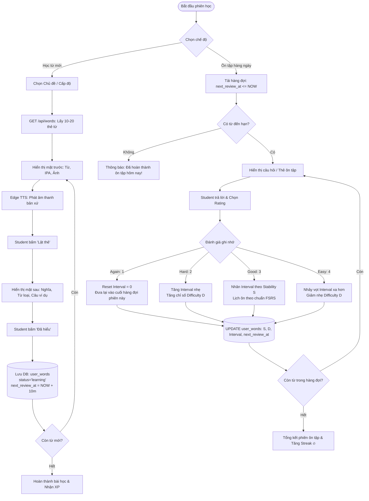
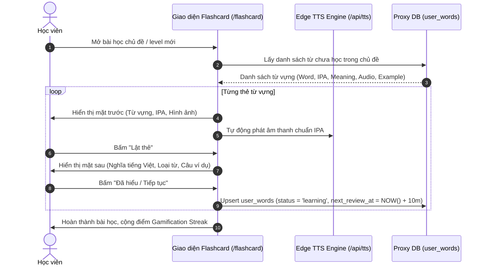
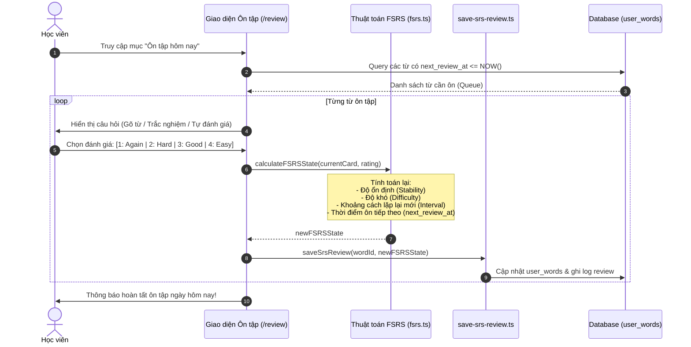

# Tài liệu Đặc tả Ca sử dụng (Use Case Specification)
## Tính năng: Học Từ Vựng & Lặp lại Ngắt quãng FSRS (Vocabulary & Spaced Repetition)
**Mã tài liệu:** `UC-VOCAB-02`  
**File lưu trữ:** `agent/docs/SRS_02_VOCAB_SRS_FSRS.md`

---

### 1. Thông tin chung
* **Actor / Role thực hiện:**
  * `Student` (Học viên).
* **Mô tả tóm tắt:** Cho phép học viên học từ mới qua thẻ Flashcard đa tương tác và thực hiện các phiên ôn tập thông minh hàng ngày dựa trên thuật toán FSRS (Free Spaced Repetition Scheduler).
* **Tiền điều kiện (Pre-conditions):**
  * Học viên đã đăng nhập vào hệ thống.
  * Có danh sách từ vựng thuộc cấp độ/chủ đề hoặc có từ đến hạn ôn tập (`next_review_at <= NOW()`).
* **Hậu điều kiện (Post-conditions):**
  * Trạng thái FSRS (Stability, Difficulty, Interval) của từng từ vựng được tính toán lại và cập nhật vào cơ sở dữ liệu.
  * Lịch sử ôn tập được ghi nhận; điểm XP và Streak được kích hoạt.

---

### 2. Danh sách API liên quan
| Phương thức | Endpoint | Chức năng | Quyền hạn |
|---|---|---|---|
| `GET` | `/api/words?limit=...&offset=...&scope=...` | Lấy danh sách từ vựng theo chủ đề/cấp độ | User đã đăng nhập |
| `GET` | `/api/practice/review-queue` (hoặc proxy `/api/auth/data/user_words`) | Lấy danh sách từ đến hạn cần ôn tập hôm nay | User đã đăng nhập |
| `POST` | `/api/practice/review` (hoặc proxy `/api/auth/data/user_words`) | Ghi nhận kết quả trả lời và cập nhật trạng thái FSRS | User đã đăng nhập |
| `GET` | `/api/tts?text=...&voice=...` | Lấy luồng âm thanh phát âm bản xứ của từ vựng | Public / User |

---

### 3. Kịch bản chính (Main Flow) & Sơ đồ Luồng hoạt động

#### 3.1 Sơ đồ luồng tổng quan tính năng Học & Ôn tập (Activity Flowchart)

#### Ca sử dụng 1: Học từ mới bằng Flashcard (UC-VOCAB-02.1)

1. **Bước 1 (Student):** Học viên chọn một chủ đề từ vựng (Topic) và bấm **"Bắt đầu học"**.
2. **Bước 2 (Frontend):** Gọi `GET /api/words` lấy danh sách 10 - 20 thẻ từ vựng mới.
3. **Bước 3 (Frontend):** Hiển thị mặt trước thẻ (Từ vựng, phiên âm IPA, hình ảnh minh họa). Hệ thống tự động kích hoạt audio phát âm chuẩn.
4. **Bước 4 (Student):** Học viên nhẩm theo và bấm nút **"Lật thẻ"** (hoặc nhấn phím Space).
5. **Bước 5 (Frontend):** Thẻ xoay sang mặt sau, hiển thị nghĩa tiếng Việt, từ loại, câu ví dụ song ngữ và cụm Collocations liên quan.
6. **Bước 6 (Student):** Bấm **"Đã hiểu / Tiếp tục"**.
7. **Bước 7 (Frontend):** Gửi yêu cầu lưu từ vào sổ từ: khởi tạo bản ghi trong `user_words` với trạng thái `learning` và hẹn giờ ôn tập đầu tiên sau 10 phút.
8. **Bước 8 (Frontend):** Lặp lại từ Bước 3 đến Bước 7 cho đến hết thẻ. Hiển thị màn hình chúc mừng và cộng XP.

#### Ca sử dụng 2: Ôn tập thông minh hàng ngày bằng FSRS (UC-VOCAB-02.2)

1. **Bước 1 (Student):** Tại màn hình chính, học viên thấy huy hiệu *"Có 15 từ cần ôn tập hôm nay"* và bấm **"Ôn tập ngay"**.
2. **Bước 2 (Frontend):** Tải danh sách các từ có `next_review_at <= NOW()` từ bảng `user_words`.
3. **Bước 3 (Frontend):** Hiển thị câu hỏi ôn tập (dạng lật thẻ tự đánh giá hoặc trắc nghiệm 4 đáp án).
4. **Bước 4 (Student):** Học viên trả lời và chọn 1 trong 4 nút đánh giá mức độ ghi nhớ:
   * **1: Again** (Quên hoàn toàn)
   * **2: Hard** (Nhớ nhưng rất khó khăn)
   * **3: Good** (Nhớ chuẩn xác với nỗ lực vừa phải)
   * **4: Easy** (Nhớ ngay lập tức, cực kỳ dễ)
5. **Bước 5 (Frontend/Engine):** Hàm `calculateFSRSState(currentCard, rating)` tính toán ra bộ tham số mới:
   * $S$ (Stability - độ bền trí nhớ)
   * $D$ (Difficulty - độ khó của từ)
   * $I$ (Interval - số ngày đến lần ôn tập tiếp theo)
   * $T_{next}$ (`next_review_at = NOW() + I ngày`)
6. **Bước 6 (Backend/DB):** Cập nhật bản ghi `user_words` của từ đó với giá trị $S, D, I, T_{next}$ mới.
7. **Bước 7 (Frontend):** Lặp lại cho đến khi hoàn thành toàn bộ hàng đợi ôn tập.

---

### 4. Kịch bản ngoại lệ (Alternative & Exception Flows)

* **E1: Không có kết nối mạng khi đang lật thẻ ôn tập (Offline Review)**
  * *Tại Bước 6 của UC-VOCAB-02.2:* Thiết bị mất sóng Wi-Fi/4G.
  * *Xử lý:* Giao diện không báo lỗi đứt quãng. Kết quả chấm FSRS được lưu tạm vào hàng đợi `IndexedDB / localStorage` của trình duyệt. Khi có mạng trở lại, hệ thống chạy background sync đẩy toàn bộ lượt ôn tập lên cơ sở dữ liệu.
* **E2: Học viên bấm "Again" (Quên từ)**
  * *Tại Bước 4 của UC-VOCAB-02.2:* Học viên chọn mức 1 (Again).
  * *Xử lý:* Thuật toán reset Interval về 0. Thẻ từ này sẽ được đưa ngược lại vào cuối danh sách ôn tập của phiên hiện tại để học viên buộc phải học lại trước khi kết thúc buổi ôn.
* **E3: Lỗi dịch vụ âm thanh phát âm (TTS Service Failure)**
  * *Tại Bước 3 của UC-VOCAB-02.1:* API âm thanh trả về lỗi 503 hoặc timeout.
  * *Xử lý:* Hệ thống hiển thị ký hiệu cảnh báo nhỏ bên cạnh nút loa, giao diện vẫn cho phép học sinh đọc phiên âm IPA bình thường mà không làm đứng màn hình học.
