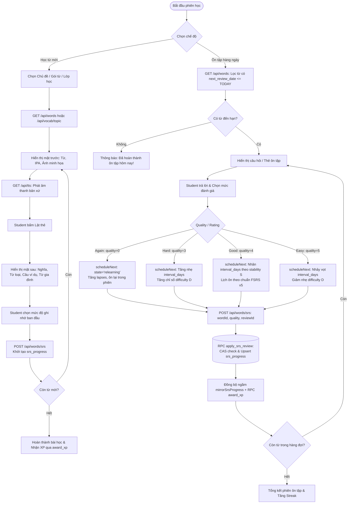
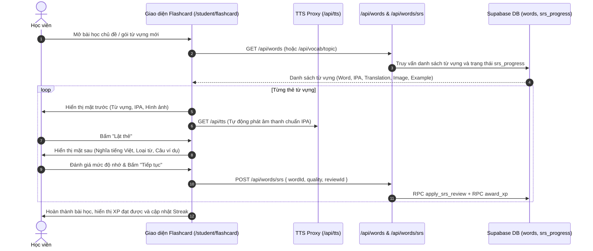
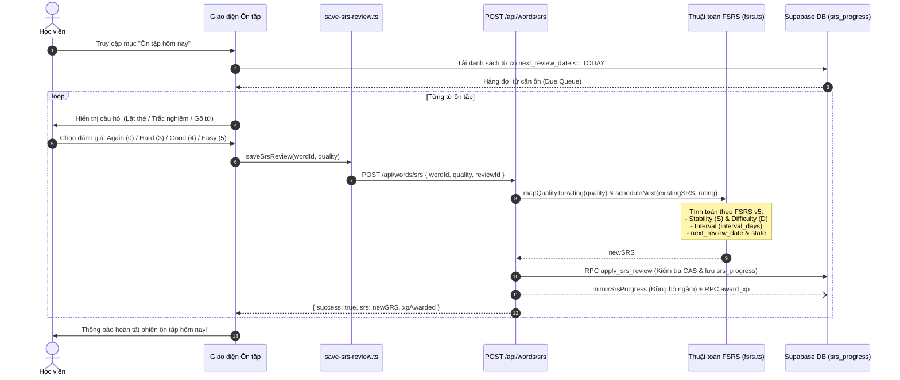

# Tài liệu Đặc tả Ca sử dụng (Use Case Specification)
## Tính năng: Học Từ Vựng & Lặp lại Ngắt quãng FSRS (Vocabulary & Spaced Repetition)
**Mã tài liệu:** `UC-VOCAB-02`  
**File lưu trữ:** `agent/docs/SRS_02_VOCAB_SRS_FSRS.md`

---

### 1. Thông tin chung
* **Actor / Role thực hiện:**
  * `Student` (Học viên).
* **Mô tả tóm tắt:** Cho phép học viên học từ mới qua thẻ Flashcard đa tương tác và thực hiện các phiên ôn tập thông minh hàng ngày dựa trên thuật toán FSRS v5 (Free Spaced Repetition Scheduler - `src/lib/fsrs.ts`), chống xung đột ghi đồng thời (CAS) và tự động đồng bộ tiến độ sang các lớp học liên kết.
* **Tiền điều kiện (Pre-conditions):**
  * Học viên đã đăng nhập vào hệ thống.
  * Có danh sách từ vựng thuộc cấp độ/chủ đề/lớp học hoặc có từ đến hạn ôn tập (`next_review_date <= TODAY`).
* **Hậu điều kiện (Post-conditions):**
  * Trạng thái FSRS (`stability`, `difficulty`, `interval_days`, `state`, `lapses`, `next_review_date`) của từng từ vựng được tính toán qua `scheduleNext()` và cập nhật vào bảng `srs_progress` thông qua RPC `apply_srs_review`.
  * Tiến độ được đồng bộ ngầm (`mirrorSrsProgress`) sang sổ từ cá nhân (`__personal__`) và các lớp học đã ghi danh; điểm XP và Streak được cộng qua RPC `award_xp`.

---

### 2. Danh sách API liên quan
| Phương thức | Endpoint | Chức năng | Quyền hạn |
|---|---|---|---|
| `GET` | `/api/words?classroomId=...&summary=1&limit=...&offset=...` | Lấy danh sách từ vựng (có SWR Server Cache cho summary) và tiến độ SRS theo lớp/sổ từ cá nhân | User đã đăng nhập |
| `POST` | `/api/words` | Thêm từ vựng mới (kiểm tra hạn mức gói Free 200 từ/tháng, làm giàu ngầm 3 tầng: `global_dictionary` $\rightarrow$ peer `words` $\rightarrow$ `dict.minhqnd.com` $\rightarrow$ AI) | User đã đăng nhập |
| `PUT` | `/api/words` | Chỉnh sửa thủ công thông tin từ vựng (nghĩa, IPA, từ loại, câu ví dụ, ảnh, collocations) | Chủ sở hữu từ / Giáo viên lớp |
| `DELETE` | `/api/words` | Xóa 1 hoặc nhiều từ vựng (`wordId` hoặc `wordIds`) | Chủ sở hữu từ / Giáo viên lớp |
| `POST` | `/api/words/srs` | Chấm điểm lượt ôn tập (`quality: 0 \| 3 \| 4 \| 5`), tính lịch FSRS v5 và lưu qua RPC `apply_srs_review` | User đã đăng nhập |
| `POST` | `/api/words/refresh` | Làm giàu lại hàng loạt bằng AI cho các từ bị lỗi/thiếu dữ liệu (tối đa 60 từ/lần) | User đã đăng nhập (Rate limit 3 req/min) |
| `POST` | `/api/words/refresh-image` & `/api/words/verify-image` | Tìm mới và kiểm duyệt độ phù hợp của ảnh minh họa từ vựng qua Pixabay/Pexels/AI | User đã đăng nhập |
| `GET` | `/api/image-proxy?url=...` | Proxy tải ảnh từ vựng ngoại vi tránh lỗi CORS/Hotlink | Public / User |
| `PATCH` | `/api/words/[id]/status` | Duyệt hoặc từ chối từ vựng do học viên đóng góp vào lớp học (`approved` / `rejected`) | Teacher sở hữu lớp |
| `POST` | `/api/quiz/save` | Lưu kết quả bài kiểm tra từ vựng (`quiz_results`) và cộng XP qua RPC `award_xp` | User đã đăng nhập |
| `GET` / `PATCH` | `/api/vocab/packs` & `GET /api/vocab/topic` | Lấy danh mục gói từ vựng (`GET`), đặt lại tiến độ gói từ (`PATCH /api/vocab/packs`) và lấy từ vựng theo chủ đề (`GET /api/vocab/topic`) | User đã đăng nhập |
| `GET` / `POST` | `GET /api/tts?q=...&lang=...` & `POST /api/translate` | Phát âm thanh qua proxy Google Translate / Youdao TTS (`GET /api/tts`) và dịch nhanh nghĩa tiếng Việt (`POST /api/translate`) | Public / User |

---

### 3. Kịch bản chính (Main Flow) & Sơ đồ Luồng hoạt động

#### 3.1 Sơ đồ luồng tổng quan tính năng Học & Ôn tập (Activity Flowchart)

#### Ca sử dụng 1: Học từ mới bằng Flashcard (UC-VOCAB-02.1)

1. **Bước 1 (Student):** Học viên chọn một gói từ vựng hoặc chủ đề (Topic) và bấm **"Bắt đầu học"**.
2. **Bước 2 (Frontend):** Gọi `GET /api/words` (hoặc `/api/vocab/topic`) để lấy danh sách thẻ từ vựng cần học.
3. **Bước 3 (Frontend):** Hiển thị mặt trước thẻ (Từ vựng, phiên âm IPA, hình ảnh minh họa). Hệ thống tự động gọi `/api/tts` phát âm chuẩn bản xứ.
4. **Bước 4 (Student):** Học viên nhẩm theo và bấm nút **"Lật thẻ"** (hoặc nhấn phím Space).
5. **Bước 5 (Frontend):** Thẻ xoay sang mặt sau, hiển thị nghĩa tiếng Việt, từ loại, câu ví dụ song ngữ và từ đồng nghĩa/trái nghĩa.
6. **Bước 6 (Student):** Chọn mức đánh giá ghi nhớ để chuyển sang thẻ tiếp theo.
7. **Bước 7 (Frontend/Backend):** Gọi `POST /api/words/srs` kèm `{ wordId, quality, reviewId }` (thông qua helper `save-srs-review.ts`) để khởi tạo bản ghi trong bảng `srs_progress`.
8. **Bước 8 (Frontend):** Lặp lại từ Bước 3 đến Bước 7 cho đến hết thẻ. Hiển thị màn hình chúc mừng và cộng XP.

#### Ca sử dụng 2: Ôn tập thông minh hàng ngày bằng FSRS (UC-VOCAB-02.2)

1. **Bước 1 (Student):** Tại màn hình chính, học viên thấy thông báo số từ đến hạn cần ôn và bấm **"Ôn tập ngay"**.
2. **Bước 2 (Frontend):** Tải danh sách các từ có `next_review_date <= TODAY` từ dữ liệu `srs_progress`.
3. **Bước 3 (Frontend):** Hiển thị câu hỏi ôn tập (dạng lật thẻ tự đánh giá, điền từ hoặc trắc nghiệm 4 đáp án).
4. **Bước 4 (Student):** Học viên trả lời và chọn 1 trong 4 mức đánh giá (`quality` ánh xạ sang FSRS Rating):
   * **Again (`quality = 0` $\rightarrow$ Rating 1):** Quên hoàn toàn (+2 XP).
   * **Hard (`quality = 3` $\rightarrow$ Rating 2):** Nhớ nhưng rất khó khăn (+5 XP).
   * **Good (`quality = 4` $\rightarrow$ Rating 3):** Nhớ chuẩn xác với nỗ lực vừa phải (+10 XP).
   * **Easy (`quality = 5` $\rightarrow$ Rating 4):** Nhớ ngay lập tức, cực kỳ dễ (+15 XP).
5. **Bước 5 (Backend/Engine):** Tuyến `POST /api/words/srs` gọi `scheduleNext(existingSRS, rating)` trong `src/lib/fsrs.ts` để tính toán bộ tham số mới:
   * $S$ (`stability` - độ bền trí nhớ).
   * $D$ (`difficulty` - độ khó của từ).
   * $I$ (`interval_days` - số ngày đến lần ôn tập tiếp theo).
   * $T_{next}$ (`next_review_date`).
6. **Bước 6 (Backend/DB):** Thực thi RPC `apply_srs_review` với cơ chế **Compare-And-Swap (CAS)** (`p_expected_last_reviewed_at`) tối đa 3 lần thử để chống xung đột ghi đè, đồng thời chạy bất đồng bộ `mirrorSrsProgress`, `award_xp` và `refresh_vocab_pack_progress`.
7. **Bước 7 (Frontend):** Lặp lại cho đến khi hoàn thành toàn bộ hàng đợi ôn tập.

---

### 4. Kịch bản ngoại lệ (Alternative & Exception Flows)

* **E1: Không có kết nối mạng khi đang lật thẻ ôn tập (Offline Review Queue)**
  * *Tại Bước 5 của UC-VOCAB-02.2:* Thiết bị mất sóng Wi-Fi/4G khi gọi `POST /api/words/srs`.
  * *Xử lý:* `save-srs-review.ts` giữ nguyên `reviewId` (UUID) và lưu tạm lượt chấm vào hàng đợi ngoại tuyến trên trình duyệt. Khi có mạng trở lại, hệ thống tự động đồng bộ lại; nhờ `reviewId` idempotent, server nhận diện `applyStatus === 'duplicate'` và không cộng trùng XP hay nhân đôi lượt ôn.
* **E2: Xung đột chấm điểm đồng thời trên nhiều tab/thiết bị (Concurrent Review Conflict)**
  * *Tại Bước 6 của UC-VOCAB-02.2:* Hai request ôn tập cho cùng một từ gửi đến cùng lúc.
  * *Xử lý:* Cơ chế CAS trong `/api/words/srs` tự động đọc lại trạng thái mới nhất và tính lại FSRS (tối đa 3 lần). Nếu vẫn xung đột, trả về HTTP 409 Conflict để client thử lại an toàn.
* **E3: Học viên bấm "Again" (Quên từ)**
  * *Tại Bước 4 của UC-VOCAB-02.2:* Học viên chọn mức `Again` (`quality = 0`).
  * *Xử lý:* Thuật toán FSRS tăng chỉ số `lapses`, chuyển trạng thái sang `relearning` và đưa thẻ từ này quay lại cuối hàng đợi của phiên hiện tại để học viên ôn lại ngay trong buổi học.
* **E4: Lỗi dịch vụ âm thanh phát âm (TTS Service Failure)**
  * *Tại Bước 3 của UC-VOCAB-02.1:* API âm thanh `/api/tts` trả về lỗi hoặc timeout.
  * *Xử lý:* Giao diện fallback sang Web Speech Synthesis của trình duyệt hoặc cho phép học viên tiếp tục xem phiên âm IPA mà không làm gián đoạn luồng lật thẻ.

---

### 5. Điểm hạn chế, Rủi ro & Nút thắt trong Luồng hiện tại (Current Limitations & Architectural Bottlenecks)

1. **Lỗi đồng bộ ngược làm bẩn dữ liệu lớp học của Giáo viên & Bỏ sót chiều Lớp học $\rightarrow$ Sổ cá nhân trong `mirrorSrsProgress` (`src/app/api/words/srs/route.ts` dòng 47–162):**
   * *Hiện trạng:*
     * **Chiều Cá nhân $\rightarrow$ Lớp học (dòng 60–98):** Khi học viên ôn tập **bất kỳ từ vựng nào** (bao gồm cả từ cá nhân tự lưu trong `__personal__`), hàm `mirrorSrsProgress()` lấy danh sách tất cả các lớp học (`enrollments`) mà học viên đó đang tham gia. Nếu từ vừa ôn chưa tồn tại trong lớp học của giáo viên (`!targetWordId`), hàm này tự động thực hiện lệnh `INSERT INTO words` vào thẳng `classroom_id` của giáo viên với `added_by: classTeacherId`!
     * **Chiều Lớp học $\rightarrow$ Cá nhân (`__personal__`, dòng 135–162):** Ngược lại, khi học viên ôn một từ thuộc lớp học của giáo viên (`word.classroom_id !== personalClassroom.id`), nếu từ đó chưa từng được học viên lưu thủ công vào `__personal__` (`!personalWordId`), hàm này **bỏ qua không tạo bản ghi từ trong `__personal__`** khiến từ đã học ở lớp không xuất hiện trong sổ từ cá nhân của học viên.
   * *Hệ quả:* Mọi từ vựng cá nhân do học viên tự thêm và ôn tập đều bị tự động bơm ngược vào danh sách từ vựng chính thức của tất cả các lớp học mà học viên đó tham gia (làm hỏng giáo án của giáo viên), trong khi từ vựng học trên lớp lại không được tự động sao lưu về sổ từ cá nhân `__personal__`.
2. **Các tác vụ chạy ngầm không chờ (`void` Fire-and-Forget) dễ bị rơi rụng (`src/app/api/words/route.ts` & `src/app/api/words/srs/route.ts`):**
   * *Hiện trạng:* Quá trình làm giàu từ vựng (`void enrichWord(...)`), đồng bộ SRS liên lớp (`void mirrorSrsProgress(...)`), cộng XP (`void supabase.rpc('award_xp', ...)`), và cập nhật tiến độ gói từ (`void supabase.rpc('refresh_vocab_pack_progress', ...)`) đều được gọi dạng fire-and-forget sau khi trả response HTTP.
   * *Hệ quả:* Nếu tiến trình Node.js restart khi deploy hoặc AI provider timeout ngầm, từ vựng bị kẹt vĩnh viễn ở trạng thái `⏳ Analyzing...` hoặc `❌ Analysis failed - click Retry`, và tiến độ Vocab Pack/XP có thể bị lệch mà client không nhận được cảnh báo.
3. **Lệch trạng thái FSRS cục bộ (Optimistic Local WAL Divergence trong `src/lib/save-srs-review.ts`):**
   * *Hiện trạng:* Hàm `saveSrsReview()` gọi `updateOfflineWordSrs(wordId, quality)` để tính và ghi đè trạng thái FSRS vào IndexedDB trên trình duyệt **trước khi** gọi `POST /api/words/srs`. Nếu server trả về lỗi `409 Conflict` (do CAS thất bại sau 3 lần thử) hoặc `500`, client chỉ đẩy bản ghi vào `enqueueWal()` mà không rollback trạng thái IndexedDB vừa tính.
   * *Hệ quả:* Khi WAL replay lại request đó sau vài phút, `scheduleNext` trên server sẽ tính dựa trên thời điểm và trạng thái của server, dẫn đến `next_review_date` và `stability` giữa IndexedDB cục bộ và Supabase DB bị lệch nhau cho đến lần full sync tiếp theo.
4. **Mất mát tính đa nghĩa (Polysemy Loss) khi kế thừa từ `global_dictionary` hoặc Peer Words (`src/app/api/words/route.ts` dòng 120–167):**
   * *Hiện trạng:* Ở Tầng 1 (`global_dictionary`), hệ thống chỉ lấy phần tử đầu tiên `meanings[0]`; ở Tầng 2 (`words` của người dùng khác), hệ thống lấy `.limit(1)` bản ghi bất kỳ có cùng chuỗi `word` mà không xét ngữ cảnh câu (`contextSentence`) của học viên.
   * *Hệ quả:* Các từ đa nghĩa phổ biến (ví dụ: *bank*, *book*, *run*, *issue*) khi lưu không kèm nghĩa tự nhập sẽ luôn nhận nghĩa mặc định đầu tiên dù học viên lưu từ đó trong ngữ cảnh chuyên ngành khác.

