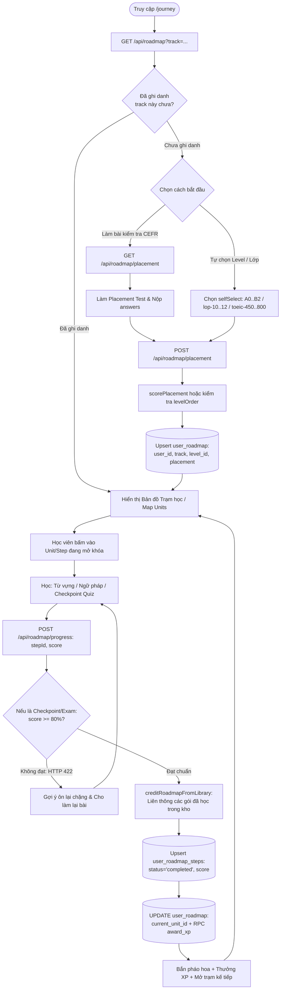
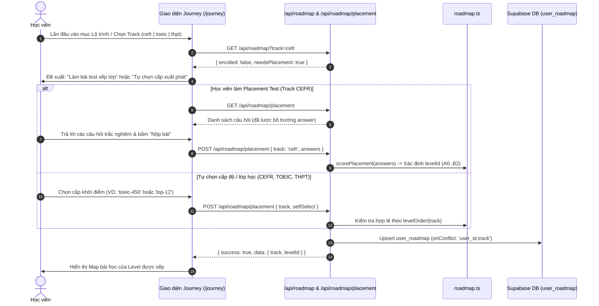
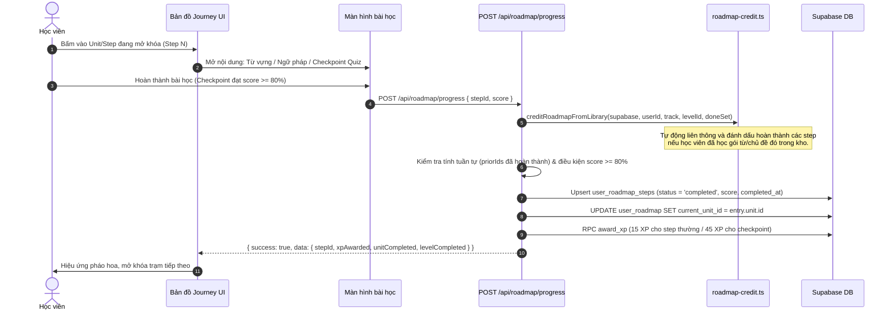

# Tài liệu Đặc tả Ca sử dụng (Use Case Specification)
## Tính năng: Lộ trình Học tập theo Khóa (Roadmap & Journey Learning)
**Mã tài liệu:** `UC-ROADMAP-03`  
**File lưu trữ:** `agent/docs/SRS_03_ROADMAP_JOURNEY.md`

---

### 1. Thông tin chung
* **Actor / Role thực hiện:**
  * `Student` (Học viên).
* **Mô tả tóm tắt:** Cho phép học viên tham gia bài kiểm tra phân loại trình độ (Placement Test) hoặc tự chọn cấp độ xuất phát, ghi danh vào các lộ trình chuẩn hóa đa khóa (CEFR, TOEIC, THPT Quốc Gia), theo dõi bản đồ học tập dạng cây trạm học (gamified map), tự động liên thông tín chỉ từ kho từ vựng và mở khóa tuần tự các trạm bài học.
* **Tiền điều kiện (Pre-conditions):**
  * Học viên đã đăng nhập tài khoản.
* **Hậu điều kiện (Post-conditions):**
  * Ghi danh bản ghi lộ trình theo từng track `(user_id, track)` trong bảng `user_roadmap`.
  * Trạng thái bài học trong `user_roadmap_steps` chuyển sang `completed`, cập nhật `current_unit_id` và cộng điểm XP qua RPC `award_xp`.

---

### 2. Danh sách API liên quan
| Phương thức | Endpoint | Chức năng | Quyền hạn |
|---|---|---|---|
| `GET` | `/api/roadmap?track=cefr\|toeic\|thpt` | Lấy thông tin lộ trình, các track đã ghi danh, tự động liên thông kho từ vựng (`creditAllEnrolledTracksFromLibrary`) và tiến độ các step | User đã đăng nhập |
| `GET` | `/api/roadmap/placement` | Lấy bộ câu hỏi kiểm tra năng lực đầu vào (đã lược bỏ đáp án đúng) | User đã đăng nhập |
| `POST` | `/api/roadmap/placement` | Chấm bài Placement Test (`answers`) hoặc tự chọn cấp độ (`selfSelect`) để ghi danh vào 1 track | User đã đăng nhập |
| `GET` | `/api/roadmap/checkpoint?unit=...&track=...` | Lấy đề kiểm tra vượt chặng (Checkpoint Quiz) của Unit theo track (`cefr` \| `thpt` \| `toeic`) | User đã đăng nhập |
| `GET` / `POST` | `/api/roadmap/assessment` | Lấy lịch sử (`GET`) hoặc lưu kết quả bài kiểm tra chẩn đoán/tổng kết cấp độ (`POST` ghi vào bảng `user_roadmap_assessments`, chưa tự động nâng `user_roadmap.level_id`) | User đã đăng nhập |
| `POST` | `/api/roadmap/progress` | Ghi nhận hoàn thành 1 step (`{ stepId, score? }`), kiểm tra điểm chuẩn $\ge 80\%$ và mở khóa trạm kế tiếp | User đã đăng nhập |

---

### 3. Kịch bản chính (Main Flow) & Sơ đồ Luồng hoạt động

#### 3.1 Sơ đồ luồng tổng quan Lộ trình học (Roadmap Activity Flowchart)

#### Ca sử dụng 1: Kiểm tra xếp lớp & Ghi danh lộ trình (UC-ROADMAP-03.1)

1. **Bước 1 (Student):** Học viên truy cập trang `/journey` và chọn lộ trình mục tiêu (`cefr`, `toeic`, hoặc `thpt`).
2. **Bước 2 (Frontend):** Gọi `GET /api/roadmap?track=...`. Backend nhận thấy học viên chưa ghi danh track này (`enrolled: false, needsPlacement: true`).
3. **Bước 3 (Frontend):** Hiển thị màn hình khởi tạo lộ trình với 2 phương thức: *"Làm bài kiểm tra xếp lớp"* (cho CEFR) hoặc *"Tự chọn cấp xuất phát"*.
4. **Bước 4 (Student & Frontend):**
   * **Trường hợp A (Làm bài test xếp lớp):** Frontend gọi `GET /api/roadmap/placement` lấy bộ câu hỏi (không kèm đáp án). Học viên hoàn thành bài làm và gửi `POST /api/roadmap/placement` với payload `{ track: 'cefr', answers: Record<string, string> }`. Hàm `scorePlacement(answers)` chấm điểm và xác định `levelId` phù hợp.
   * **Trường hợp B (Tự chọn cấp xuất phát):** Học viên chọn trực tiếp cấp/lớp mong muốn và gửi `POST /api/roadmap/placement` với payload `{ track: 'thpt' | 'toeic' | 'cefr', selfSelect: string }` (ví dụ: `lop-10`, `toeic-450`, `A1`).
5. **Bước 5 (Backend):** Upsert bản ghi vào bảng `user_roadmap` theo khóa phức hợp `(user_id, track)`, đảm bảo việc ghi danh track mới không ghi đè tiến độ của track khác.
6. **Bước 6 (Frontend):** Hiển thị bản đồ lộ trình học tập trực quan tương ứng với `levelId` đã ghi danh.

#### Ca sử dụng 2: Học trạm bài học & Mở khóa bước tiếp theo (UC-ROADMAP-03.2)

1. **Bước 1 (Student):** Trên bản đồ Journey, học viên bấm vào trạm học đang mở (Step N).
2. **Bước 2 (Frontend):** Mở giao diện bài học tương ứng (Từ vựng chủ đề, Ngữ pháp hoặc Bài kiểm tra Checkpoint `/api/roadmap/checkpoint`).
3. **Bước 3 (Student):** Học viên hoàn thành nội dung của trạm (đối với bài `checkpoint`, `exam` hoặc `toeic-mini-test`, điểm số phải đạt $\ge 80\%$).
4. **Bước 4 (Frontend):** Gửi `POST /api/roadmap/progress` với payload `{ stepId: string, score?: number }`.
5. **Bước 5 (Backend):** Kiểm tra quyền truy cập cấp độ (`checkRoadmapLevelAccess` đối với track CEFR) và kiểm tra điểm đạt chuẩn (`score >= 80`).
6. **Bước 6 (Backend):** Gọi `creditRoadmapFromLibrary()` (`src/lib/roadmap-credit.ts`) để tự động liên thông tín chỉ các gói từ vựng/chủ đề mà học viên đã hoàn thành ở ngoài lộ trình, sau đó xác thực tính tuần tự của các bước trước đó (`priorIds`).
7. **Bước 7 (Backend):** Upsert trạng thái `completed` vào bảng `user_roadmap_steps`, cập nhật `current_unit_id` trong `user_roadmap` và gọi RPC `award_xp` để thưởng XP (+15 XP cho bước thường, +45 XP cho Checkpoint/Exam).
8. **Bước 8 (Frontend):** Hiển thị hoạt ảnh pháo hoa chúc mừng và mở khóa trạm kế tiếp trên bản đồ.

---

### 4. Kịch bản ngoại lệ (Alternative & Exception Flows)

* **E1: Điểm bài kiểm tra vượt chặng không đạt chuẩn (< 80%)**
  * *Tại Bước 5 của UC-ROADMAP-03.2:* Học viên nộp bài `checkpoint` / `exam` / `toeic-mini-test` với `score < 80`.
  * *Xử lý:* Tuyến `POST /api/roadmap/progress` trả về HTTP 422 Unprocessable Entity: *"Bài kiểm tra cần đạt ≥80% (hiện tại X%). Ôn lại chặng rồi thử lại nhé!"* và không ghi nhận `completed`. Frontend hiển thị phân tích câu sai để học viên ôn lại.
* **E2: Học viên nhảy cóc qua trạm chưa mở khóa (Sequential Validation Error)**
  * *Tại Bước 6 của UC-ROADMAP-03.2:* Học viên gửi `stepId` khi các bước bắt buộc đứng trước (`priorIds`) chưa hoàn thành.
  * *Xử lý:* Backend trả về HTTP 400 kèm danh sách `missingSteps`, nhắc học viên hoàn thành các bước trước đó.
* **E3: Chạm giới hạn gói Free ở các cấp độ nâng cao (Level Gate 403)**
  * *Tại Bước 5 của UC-ROADMAP-03.2:* Tài khoản gói Free cố gắng hoàn thành step thuộc cấp độ `A2 -> B2` trên lộ trình CEFR.
  * *Xử lý:* Backend trả về HTTP 403 Forbidden kèm `{ upgradeTo: 'pro' }`. Giao diện hiển thị modal mời nâng cấp gói Pro.
* **E4: Học viên chuyển đổi qua lại giữa các track (Multi-track Switching)**
  * *Tại Bước 1 của UC-ROADMAP-03.1:* Học viên đang học Track CEFR nhưng chuyển sang tab Track TOEIC hoặc THPT.
  * *Xử lý:* Nhờ khóa chính phức hợp `(user_id, track)` trong `user_roadmap`, tiến độ và vị trí trạm học của từng track được lưu trữ độc lập và bảo toàn toàn vẹn.

---

### 5. Điểm hạn chế, Rủi ro & Nút thắt trong Luồng hiện tại (Current Limitations & Architectural Bottlenecks)

1. **Lộ toàn bộ đáp án đúng (`answer`) và thiếu kiểm tra gói Pro trong API Checkpoint (`src/app/api/roadmap/checkpoint/route.ts` dòng 14–58):**
   * *Hiện trạng:* Khác với `/api/roadmap/placement` (vốn chủ động xóa trường `answer` trước khi trả về client), tuyến `GET /api/roadmap/checkpoint?unit=...&track=...` trả nguyên mảng `CheckpointQuestion[]` bao gồm cả `answer` (đáp án đúng) và `explanation` trong JSON response, đồng thời **không kiểm tra `checkRoadmapLevelAccess`** cho bất kỳ cấp độ nào.
   * *Hệ quả:* Người dùng gói Free có thể tải toàn bộ đề kiểm tra của các cấp độ Pro (A2–B2) và xem sẵn đáp án trong DevTools Network tab trước khi nộp bài.
2. **Tin tưởng hoàn toàn điểm số từ Client, Cày XP vô hạn & Thiếu nâng cấp Level khi đậu `exit_exam` (`POST /api/roadmap/progress` & `POST /api/roadmap/assessment`):**
   * *Hiện trạng:*
     * `POST /api/roadmap/progress` (`src/app/api/roadmap/progress/route.ts` dòng 24, 129–154) nhận trực tiếp `{ stepId, score }` từ client mà không chấm điểm lại trên server, đồng thời **luôn luôn gọi `supabase.rpc('award_xp', { p_xp: 15 | 45 })`** mỗi khi API được gọi mà không kiểm tra xem `stepId` đó đã `completed` từ trước hay chưa!
     * `POST /api/roadmap/assessment` (`src/app/api/roadmap/assessment/route.ts` dòng 65–138) nhận trực tiếp `{ score, passed, tier: 'exit_exam', targetId }` từ client, nhưng chỉ `INSERT` vào `user_roadmap_assessments` mà **không hề cập nhật `user_roadmap.level_id`** lên cấp độ tiếp theo và không cộng XP; nếu lệnh ghi DB lỗi, API vẫn trả về `200 OK` (`fallback: true, id: "local_..."`).
   * *Hệ quả:* Một học viên hoặc script có thể gửi lặp lại `POST /api/roadmap/progress { stepId, score: 100 }` cho cùng 1 step đã hoàn thành để cày +45 XP/request không giới hạn; trong khi học viên thi đậu bài kiểm tra cuối cấp (`exit_exam`) lại không được tự động thăng cấp trong `user_roadmap`.
3. **Thiếu kiểm soát gói Pro (Entitlement Gate) cho các khóa `toeic` và `thpt` (`src/app/api/roadmap/progress/route.ts` dòng 58–70):**
   * *Hiện trạng:* Điều kiện kiểm tra gói cước `if (track === 'cefr') { checkRoadmapLevelAccess(...) }` chỉ được áp dụng cho track `cefr` (chặn A2–B2 với gói Free), nhưng hoàn toàn bỏ ngỏ khi `track === 'toeic'` (ví dụ `toeic-650`, `toeic-800`) hoặc `track === 'thpt'`.
   * *Hệ quả:* Người dùng gói Free có thể học và hoàn thành toàn bộ các chặng nâng cao của lộ trình TOEIC 800+ và THPT mà không bị kiểm tra quyền lợi gói Pro.
4. **Lỗi ánh xạ sai Track làm mất liên thông Ngữ pháp sang lộ trình `toeic` & Chi phí truy vấn đồng bộ (`src/lib/roadmap-credit.ts` dòng 88–103, 331):**
   * *Hiện trạng:*
     * Trong hàm `creditGrammarLessonToRoadmap()` (dòng 331), câu lệnh `const t: RoadmapTrack = en.track === 'thpt' ? 'thpt' : 'cefr'` ép mọi bản ghi không phải `'thpt'` (bao gồm cả `'toeic'`) về `'cefr'`, khiến học viên hoàn thành bài học ngữ pháp không bao giờ được tự động mở khóa step ngữ pháp tương ứng trên lộ trình `toeic`.
     * Mỗi khi người dùng mở `/journey` (`GET /api/roadmap`), server chạy đồng bộ `await creditAllEnrolledTracksFromLibrary()` đọc toàn bộ `user_vocab_packs`, `words` trong `__personal__`, `srs_progress`, `grammar_topics`, `grammar_lessons`, `grammar_progress` và upsert lại `user_roadmap_steps` trước khi trả kết quả, làm tăng độ trễ theo kích thước sổ từ.

