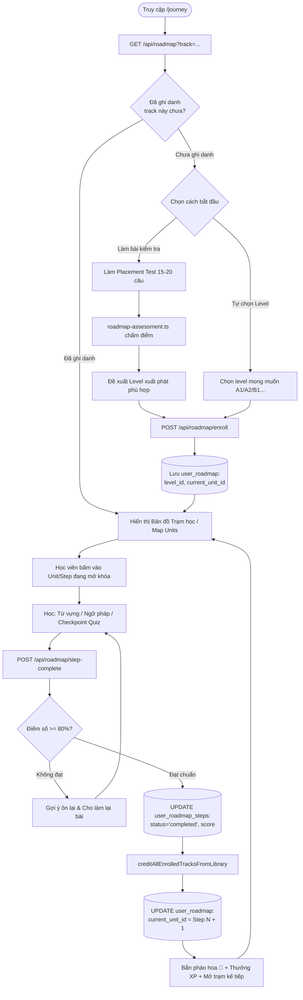
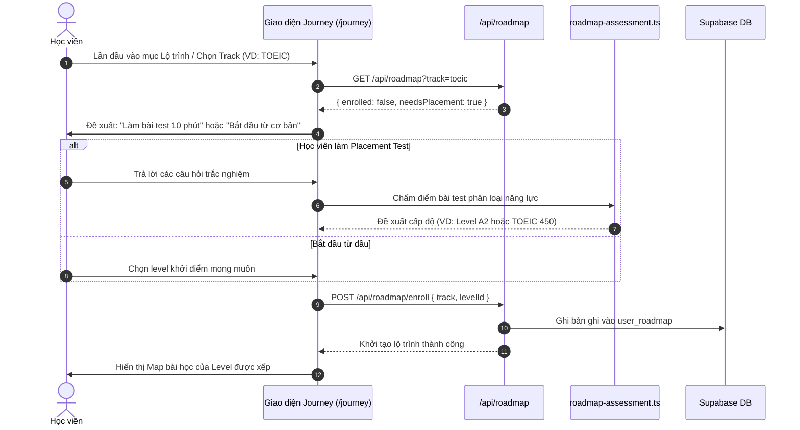
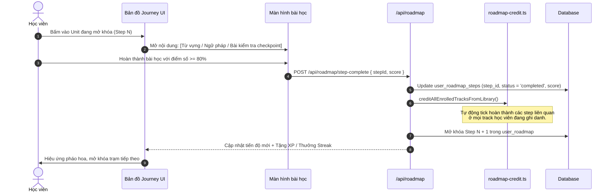

# Tài liệu Đặc tả Ca sử dụng (Use Case Specification)
## Tính năng: Lộ trình Học tập theo Khóa (Roadmap & Journey Learning)
**Mã tài liệu:** `UC-ROADMAP-03`  
**File lưu trữ:** `agent/docs/SRS_03_ROADMAP_JOURNEY.md`

---

### 1. Thông tin chung
* **Actor / Role thực hiện:**
  * `Student` (Học viên).
* **Mô tả tóm tắt:** Cho phép học viên tham gia bài kiểm tra phân loại trình độ (Placement Test), ghi danh vào các lộ trình chuẩn hóa (CEFR, TOEIC, THPT Quốc Gia), theo dõi bản đồ học tập dạng cây trạm học (gamified map) và tự động mở khóa các trạm bài học.
* **Tiền điều kiện (Pre-conditions):**
  * Học viên đã đăng nhập tài khoản.
* **Hậu điều kiện (Post-conditions):**
  * Ghi danh bản ghi lộ trình trong `user_roadmap`.
  * Trạng thái bài học trong `user_roadmap_steps` chuyển sang `completed`, trạm học tiếp theo được mở khóa.

---

### 2. Danh sách API liên quan
| Phương thức | Endpoint | Chức năng | Quyền hạn |
|---|---|---|---|
| `GET` | `/api/roadmap?track=cefr\|toeic\|thpt` | Lấy thông tin lộ trình, các track đã enroll, tiến độ các step | User đã đăng nhập |
| `POST` | `/api/roadmap/enroll` | Ghi danh học viên vào một track cụ thể kèm level xuất phát | User đã đăng nhập |
| `POST` | `/api/roadmap/step-complete` | Ghi nhận hoàn thành 1 step (Unit), cập nhật điểm và mở step kế | User đã đăng nhập |
| `GET` | `/api/roadmap/placement` | Lấy bộ câu hỏi kiểm tra năng lực đầu vào | User đã đăng nhập |

---

### 3. Kịch bản chính (Main Flow) & Sơ đồ Luồng hoạt động

#### 3.1 Sơ đồ luồng tổng quan Lộ trình học (Roadmap Activity Flowchart)

#### Ca sử dụng 1: Kiểm tra xếp lớp & Ghi danh lộ trình (UC-ROADMAP-03.1)

1. **Bước 1 (Student):** Học viên truy cập trang `/journey` và chọn mục tiêu học tập (ví dụ: TOEIC hoặc Khung CEFR).
2. **Bước 2 (Frontend):** Gọi `GET /api/roadmap?track=toeic`. Backend nhận thấy học viên chưa ghi danh track này (`enrolled: false, needsPlacement: true`).
3. **Bước 3 (Frontend):** Hiển thị màn hình chào mừng kèm 2 lựa chọn: *"Làm bài test 10 phút để xếp lớp"* hoặc *"Bắt đầu từ vạch xuất phát"*.
4. **Bước 4 (Student):** Học viên chọn làm bài kiểm tra xếp lớp (Placement Test).
5. **Bước 5 (Frontend):** Hiển thị 15-20 câu hỏi trắc nghiệm đánh giá từ vựng & ngữ pháp theo độ khó tăng dần.
6. **Bước 6 (Student):** Hoàn thành bài thi và bấm **"Nộp bài"**.
7. **Bước 7 (Backend):** Module `roadmap-assessment.ts` chấm điểm, đối chiếu chuẩn đầu ra và xác định level phù hợp (ví dụ: Level A2 hoặc TOEIC 450).
8. **Bước 8 (Frontend):** Gửi `POST /api/roadmap/enroll` với `{ track: 'toeic', levelId: 'toeic_450' }`.
9. **Bước 9 (Backend):** Lưu bản ghi vào `user_roadmap`, thiết lập unit bắt đầu.
10. **Bước 10 (Frontend):** Hiển thị bản đồ lộ trình học tập trực quan tương ứng với level được xếp.

#### Ca sử dụng 2: Học trạm bài học & Mở khóa bước tiếp theo (UC-ROADMAP-03.2)

1. **Bước 1 (Student):** Trên bản đồ Journey, học viên bấm vào trạm học đang mở (Step N).
2. **Bước 2 (Frontend):** Mở giao diện bài học tương ứng (Từ vựng chủ đề, Ngữ pháp hoặc Bài mini-quiz ôn tập).
3. **Bước 3 (Student):** Học viên hoàn thành tất cả các nội dung học của trạm với điểm số $\ge 80\%$.
4. **Bước 4 (Frontend):** Gửi `POST /api/roadmap/step-complete` với `{ stepId, score }`.
5. **Bước 5 (Backend):** Ghi nhận hoàn thành vào bảng `user_roadmap_steps`.
6. **Bước 6 (Backend):** Gọi hàm `creditAllEnrolledTracksFromLibrary()`: Tự động kiểm tra và đánh dấu hoàn thành nếu nội dung bài này cũng thuộc các track khác mà học viên đang đồng thời theo học.
7. **Bước 7 (Backend):** Cập nhật `current_unit_id` trong `user_roadmap` sang trạm tiếp theo (Step N + 1).
8. **Bước 8 (Frontend):** Hiển thị hoạt ảnh pháo hoa chúc mừng, mở khóa trạm kế tiếp trên bản đồ.

---

### 4. Kịch bản ngoại lệ (Alternative & Exception Flows)

* **E1: Điểm làm bài không đạt chuẩn mở khóa (< 80%)**
  * *Tại Bước 3 của UC-ROADMAP-03.2:* Học viên chỉ đạt 60% số câu hỏi của trạm.
  * *Xử lý:* Backend không ghi nhận trạng thái `completed`. Frontend hiển thị bảng phân tích lỗi sai và đề xuất học sinh bấm *"Ôn lại bài"* để làm lại trước khi được mở khóa trạm tiếp theo.
* **E2: Học viên chuyển đổi qua lại giữa các track (Multi-track Switching)**
  * *Tại Bước 1 của UC-ROADMAP-03.1:* Học viên đang học Track CEFR nhưng muốn chuyển qua xem Track THPT.
  * *Xử lý:* Hệ thống lưu độc lập tiến độ của từng track trong cơ sở dữ liệu. Khi đổi tab, frontend chỉ cần truyền tham số `?track=thpt`, tiến độ và vị trí trạm học của từng track được bảo lưu toàn vẹn.
* **E3: Mất kết nối khi đang gửi kết quả bài học**
  * *Tại Bước 4 của UC-ROADMAP-03.2:* Request hoàn thành step thất bại do mất mạng.
  * *Xử lý:* Trình duyệt lưu `stepId` và kết quả thi vào hàng đợi offline. Khi mạng phục hồi, tự động thử lại request (retry) để bảo đảm quyền lợi điểm số của học sinh.
