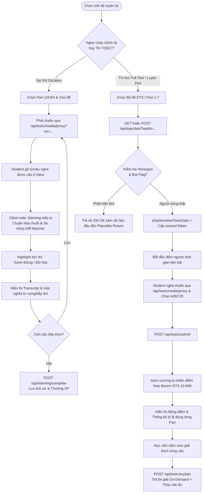
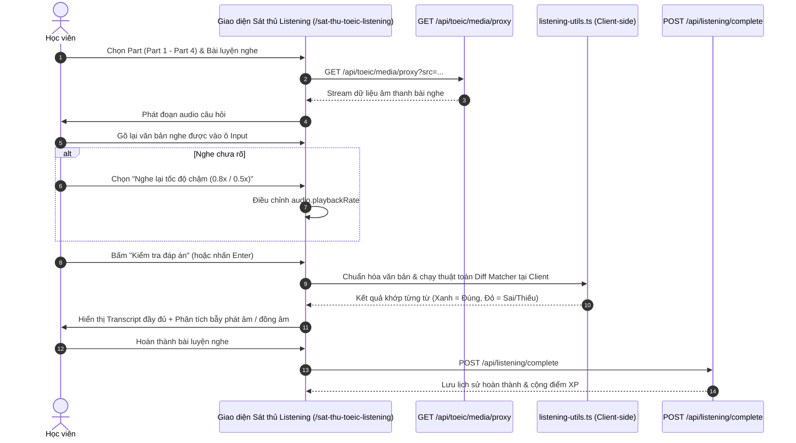
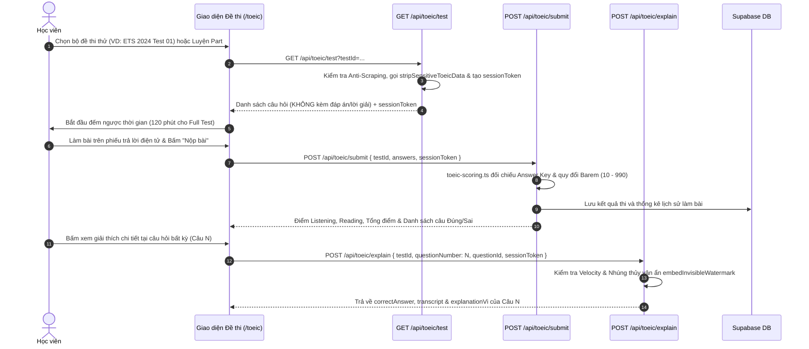

# Tài liệu Đặc tả Ca sử dụng (Use Case Specification)
## Tính năng: Sát Thủ TOEIC Listening & Luyện Thi Thử (TOEIC Listening & Exam Practice)
**Mã tài liệu:** `UC-TOEIC-04`  
**File lưu trữ:** `agent/docs/SRS_04_TOEIC_LISTENING_EXAM.md`

---

### 1. Thông tin chung
* **Actor / Role thực hiện:**
  * `Student` (Học viên luyện thi TOEIC).
* **Mô tả tóm tắt:** Cho phép học viên luyện nghe chuyên sâu từ Part 1 đến Part 4 bằng phương pháp nghe chép chính tả (Dictation so khớp trực tiếp tại Client) và thi thử các bộ đề TOEIC hoàn chỉnh (Full Test / Mini Test / Luyện từng Part) có bấm giờ, chấm điểm tự động theo barem chuẩn ETS kèm cơ chế phòng thủ chủ động chống cào dữ liệu (Active Cyber Defense).
* **Tiền điều kiện (Pre-conditions):**
  * Học viên truy cập hệ thống (đăng nhập để lưu lịch sử làm bài và thống kê điểm số).
* **Hậu điều kiện (Post-conditions):**
  * Kết quả bài thi thử được chấm theo barem 10–990 và lưu vào cơ sở dữ liệu.
  * Tiến độ nghe chép chính tả và thống kê điểm yếu từng Part được ghi nhận.

---

### 2. Danh sách API liên quan
| Phương thức | Endpoint | Chức năng | Quyền hạn |
|---|---|---|---|
| `GET` / `POST` | `/api/toeic/test?testId=...` | Tải đề thi TOEIC hoặc bài luyện theo Part (đã lược bỏ đáp án đúng, giải thích và transcript để chống lộ đề hàng loạt) | Public / User (Rate limit 60/min + Anti-Scraping) |
| `GET` | `/api/toeic/media/proxy?src=...` | Stream và proxy file âm thanh/hình ảnh bài thi TOEIC an toàn, bảo vệ nguồn media | Public / User |
| `POST` | `/api/toeic/submit` | Nộp bài làm trắc nghiệm, chấm điểm trên bộ nhớ theo bảng barem ETS (10–990) và trả kết quả tổng hợp (việc lưu DB thực hiện phía client qua Data Proxy) | Public / User (Rate limit 20/min + Anti-Scraping) |
| `POST` | `/api/toeic/explain` | Lấy đáp án đúng, transcript và lời giải chi tiết cho **từng câu hỏi (On-Demand)** kèm thủy vân ẩn (Invisible Watermark) | Public / User (Rate limit 60/min + Velocity Check) |
| `GET` | `/api/listening/video?id=...` | Lấy danh sách hoặc chi tiết bài luyện nghe video từ kho JSON tĩnh (`src/data/listening/details/*.json`, cache RAM 30 phút) kèm `cloze_blanks` và `comprehension_questions` | Public (Không kiểm tra Auth) |
| `POST` | `/api/listening/complete` | Ghi nhận hoàn thành bài luyện nghe (`videoId`, `clozeScore`, `quizScore`) và cộng +50 XP qua RPC `award_xp` (tiến độ xem lưu tại `localStorage`) | User đã đăng nhập |
| `GET` / `POST` | `/api/auth/data/user_toeic_question_history` & `/api/roadmap/assessment` | Đồng bộ lịch sử câu hỏi TOEIC đã làm (`unseen` / `mistakes`) và lưu kết quả thi thử qua BFF Data Proxy / Assessment API | User đã đăng nhập |

> **Lưu ý kiến trúc (Client-side Dictation Check):** Hoạt động chuẩn hóa chuỗi ký tự và so khớp từng từ trong chế độ **Nghe chép chính tả (Dictation)** được thực thi hoàn toàn tại trình duyệt thông qua thư viện `src/lib/listening-utils.ts` (không phát sinh request chấm điểm từng câu về server), giúp đạt độ trễ phản hồi 0ms khi gõ phím.

---

### 3. Kịch bản chính (Main Flow) & Sơ đồ Luồng hoạt động

#### 3.1 Sơ đồ luồng tổng quan Luyện Nghe & Thi Thử TOEIC (Activity Flowchart)

#### Ca sử dụng 1: Luyện nghe chép chính tả Sát thủ (UC-TOEIC-04.1)

1. **Bước 1 (Student):** Học viên truy cập `/sat-thu-toeic-listening`, chọn Part cần luyện (ví dụ: Part 2 - Hỏi đáp phản xạ) và bài luyện.
2. **Bước 2 (Frontend):** Tải luồng âm thanh qua Media Proxy `GET /api/toeic/media/proxy?src=...` và tự động phát câu nghe.
3. **Bước 3 (Student):** Học viên gõ lại các từ hoặc toàn bộ câu nghe được vào ô nhập liệu.
4. **Bước 4 (Student):** Học viên bấm nút **"Kiểm tra đáp án"** (hoặc nhấn phím Enter).
5. **Bước 5 (Frontend - Client-side):** Module `src/lib/listening-utils.ts` thực hiện chuẩn hóa chuỗi (bỏ dấu câu thừa, chuẩn hóa viết tắt) và so khớp trực tiếp ngay trên trình duyệt với độ trễ 0ms:
   * Tô màu **Xanh lá**: Từ gõ đúng hoàn toàn.
   * Tô màu **Đỏ gạch**: Từ gõ sai chính tả hoặc còn thiếu.
6. **Bước 6 (Frontend):** Hiển thị câu transcript đầy đủ, giải nghĩa từ vựng trọng tâm và chỉ rõ các bẫy âm thanh (nối âm, nuốt âm, từ đồng âm).
7. **Bước 7 (Frontend/Backend):** Khi hoàn tất bài luyện, giao diện đồng bộ tiến độ học tập qua `POST /api/listening/complete` để lưu lịch sử và nhận thưởng XP.

#### Ca sử dụng 2: Thi thử đề TOEIC & Xem giải thích On-Demand (UC-TOEIC-04.2)

1. **Bước 1 (Student):** Học viên truy cập `/toeic`, chọn bộ đề thi thử (Full Test 200 câu hoặc Luyện theo Part kèm bộ lọc câu chưa làm `unseen` / câu hay sai `mistakes`) và bấm **"Bắt đầu làm bài"**.
2. **Bước 2 (Frontend):** Gửi `GET /api/toeic/test?testId=...` (hoặc `POST /api/toeic/test` khi gửi danh sách `excludedIds`/`mistakeIds` lớn).
3. **Bước 3 (Backend):** Tuyến `/api/toeic/test` kiểm tra Rate Limit (60 req/phút/IP), gọi `stripSensitiveToeicData()` để loại bỏ hoàn toàn `correctAnswer`, `explanationVi`, `transcript` khỏi payload, đồng thời cấp `sessionToken` ký HMAC gắn với IP hash.
4. **Bước 4 (Frontend):** Kích hoạt đồng hồ đếm ngược. Học viên nghe audio qua `/api/toeic/media/proxy?src=...` và chọn đáp án A, B, C, D trên phiếu trả lời điện tử.
5. **Bước 5 (Frontend):** Khi bấm **"Nộp bài thi"** (hoặc hết giờ), gửi mảng câu trả lời lên `POST /api/toeic/submit`.
6. **Bước 6 (Backend):** Module `toeic-scoring.ts` đối chiếu với Answer Key trên server, quy đổi số câu đúng sang thang điểm chuẩn ETS (5–495 cho từng kỹ năng, tổng 10–990) và trả về bảng kết quả.
7. **Bước 7 (Student & Frontend):** Khi ôn tập lại các câu sai sau khi nộp bài (hoặc trong chế độ luyện tập), học viên bấm xem giải thích của một câu hỏi. Frontend gọi `POST /api/toeic/explain` với `{ testId, questionNumber, questionId, sessionToken }`.
8. **Bước 8 (Backend):** Tuyến `/api/toeic/explain` kiểm tra tốc độ đọc (`checkReadingVelocity`), nhúng thủy vân ký tự độ rộng bằng không (`embedInvisibleWatermark`) chứa mã định danh IP + thời gian vào lời giải, và trả về `correctAnswer`, `transcript`, `explanationVi` cho đúng câu hỏi đó.

---

### 4. Kịch bản ngoại lệ (Alternative & Exception Flows)

* **E1: Hết giờ làm bài khi chưa bấm Nộp bài (Time-out Auto-submit)**
  * *Tại Bước 4 của UC-TOEIC-04.2:* Đồng hồ đếm ngược chạm mốc `00:00:00`.
  * *Xử lý:* Giao diện khóa thao tác chọn đáp án, tự động đóng gói các câu trả lời đã tích và gửi request lên `POST /api/toeic/submit`.
* **E2: Phát hiện bot cào dữ liệu đề thi & lời giải (Active Cyber Defense & Data Poisoning)**
  * *Tại Bước 3 hoặc Bước 8 của UC-TOEIC-04.2:* Client truy cập vào Honeypot (`isHoneypotTestId`, tham số bẫy `include_answers`, `_hp_author_trap`) hoặc bị gắn cờ bot (`isClientFlaggedAsBot`).
  * *Xử lý:* Hệ thống **không trả lỗi 403** để tránh lộ cơ chế chặn, mà âm thầm trả về HTTP 200 OK kèm dữ liệu đã bị đầu độc hợp lý (`poisonUnifiedQuestion` / `createPoisonedQuestionBank` trong `src/lib/toeic-anti-scraping.ts`) nhằm vô hiệu hóa cơ sở dữ liệu của trình cào.
* **E3: Vượt ngưỡng tần suất tải đề hoặc xem giải thích (Rate Limit Exceeded)**
  * *Tại Bước 3 hoặc Bước 8 của UC-TOEIC-04.2:* Một IP gửi quá 60 request/phút tới `/api/toeic/test` hoặc `/api/toeic/explain`.
  * *Xử lý:* Backend trả về HTTP 429 Too Many Requests (`tooManyRequests()`).
* **E4: Mất kết nối audio khi đang làm phần thi Listening**
  * *Tại Bước 4 của UC-TOEIC-04.2:* Mạng chập chờn khiến luồng âm thanh từ `/api/toeic/media/proxy` bị ngắt quãng.
  * *Xử lý:* Trình phát audio tự động thử kết nối lại (retry stream) từ vị trí giây hiện tại mà không làm mất các đáp án học viên đã chọn trên phiếu làm bài.

---

### 5. Điểm hạn chế, Rủi ro & Nút thắt trong Luồng hiện tại (Current Limitations & Architectural Bottlenecks)

1. **Cửa hậu tự gỡ cờ Bot công khai (`?unban=1`) trong `/api/toeic/test` và `/api/toeic/explain` (`src/app/api/toeic/test/route.ts` dòng 322, 365 & `src/app/api/toeic/explain/route.ts` dòng 49):**
   * *Hiện trạng:* Cả 2 route đều chứa đoạn mã: `if (isWhitelistedIp(ip) || req.nextUrl.searchParams.get('unban') === '1') { clearBotFlag(ip); }`.
   * *Hệ quả:* Bất kỳ bot scraper nào bị dính bẫy Honeypot hoặc bị gắn cờ tốc độ cao (`checkReadingVelocity`) chỉ cần truyền thêm query param `?unban=1` vào URL là tự động xóa sạch cờ bot của chính mình mà không cần quyền Admin.
2. **Lộ toàn bộ đáp án & lời giải 200 câu qua 1 lệnh `POST /api/toeic/submit` (`src/app/api/toeic/submit/route.ts` dòng 96–151):**
   * *Hiện trạng:* Mặc dù `/api/toeic/test` áp dụng Zero Bulk Leaks và `/api/toeic/explain` giới hạn lấy từng câu, nhưng `POST /api/toeic/submit` lại: (a) **không bắt buộc xác thực `sessionToken`** và (b) trả về mảng `reviewQuestions` chứa toàn bộ 200 câu hỏi kèm `correctAnswer`, `explanationVi`, `transcript` trong 1 response duy nhất. Hơn nữa, điều kiện phát hiện nộp bài siêu tốc `if (answeredCount >= 50 && timeSpentSeconds > 0 && timeSpentSeconds < 5)` dựa hoàn toàn vào biến `timeSpentSeconds` do client tự gửi lên.
   * *Hệ quả:* Kẻ cào dữ liệu chỉ cần gửi 1 request `POST /api/toeic/submit` với `{ testId, answers: {}, timeSpentSeconds: 3600 }` (hoặc `timeSpentSeconds: 0`) là lấy trọn bộ đáp án, lời giải và transcript của cả đề 200 câu mà không cần gọi `/api/toeic/explain` 200 lần.
3. **Lỗ hổng cày XP không giới hạn tại `POST /api/listening/complete` (`src/app/api/listening/complete/route.ts` dòng 12–43):**
   * *Hiện trạng:* Endpoint này không áp dụng Rate Limit, không kiểm tra `videoId` có tồn tại trong bảng `listening_videos` hay không, không lưu bảng lịch sử hoàn thành để chống trùng lặp, và vẫn thưởng cứng `+50 XP` ngay cả khi `clozeScore = 0` và `quizScore = 0`.
   * *Hệ quả:* Người dùng có thể gọi lặp lại `POST /api/listening/complete` để cày hàng nghìn XP trong vài giây.
4. **Cờ Bot (`flaggedBots`) và Velocity Tracker lưu trong RAM cục bộ (`src/lib/toeic-anti-scraping.ts`):**
   * *Hiện trạng:* `flaggedBots` và `velocityMap` là các `Map` trong bộ nhớ tiến trình Node.js, không đồng bộ qua Redis và sẽ bị xóa sạch mỗi khi server khởi động lại.

