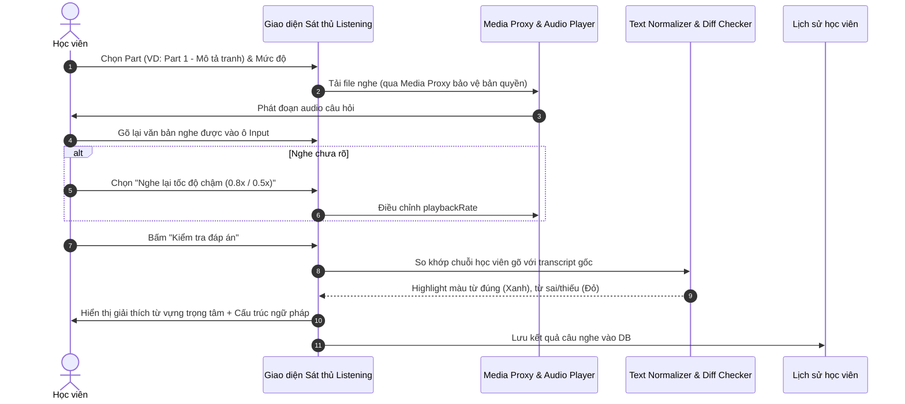
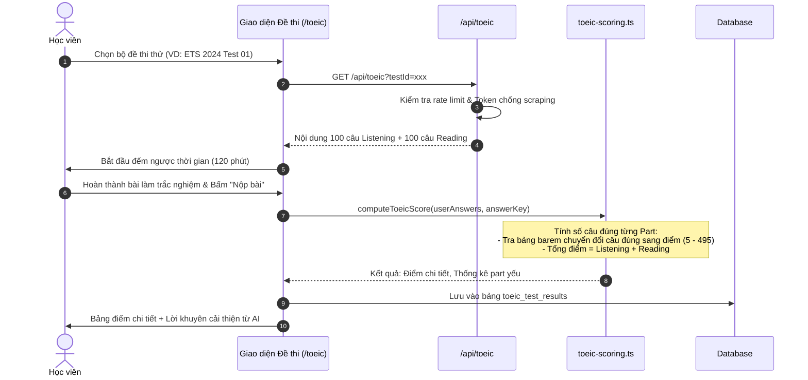

# Tài liệu Đặc tả Ca sử dụng (Use Case Specification)
## Tính năng: Sát Thủ TOEIC Listening & Luyện Thi Thử (TOEIC Listening & Exam Practice)
**Mã tài liệu:** `UC-TOEIC-04`  
**File lưu trữ:** `agent/docs/SRS_04_TOEIC_LISTENING_EXAM.md`

---

### 1. Thông tin chung
* **Actor / Role thực hiện:**
  * `Student` (Học viên luyện thi TOEIC).
* **Mô tả tóm tắt:** Cho phép học viên luyện nghe chuyên sâu từ Part 1 đến Part 4 bằng phương pháp nghe chép chính tả (Dictation) và thi thử các bộ đề TOEIC hoàn chỉnh (Full Test / Mini Test) có bấm giờ, chấm điểm tự động theo barem quốc tế kèm cơ chế bảo mật chống cào đề.
* **Tiền điều kiện (Pre-conditions):**
  * Học viên đã đăng nhập tài khoản.
  * Có quyền truy cập gói tương ứng (Gói Free: giới hạn số đề/ngày; Gói Pro: không giới hạn).
* **Hậu điều kiện (Post-conditions):**
  * Kết quả bài thi được lưu vào `toeic_test_results`.
  * Thống kê điểm yếu từng Part và lịch sử luyện nghe được ghi nhận.

---

### 2. Danh sách API liên quan
| Phương thức | Endpoint | Chức năng | Quyền hạn |
|---|---|---|---|
| `GET` | `/api/toeic?testId=...` | Tải dữ liệu đề thi trắc nghiệm TOEIC | User (Có Anti-Scraping check) |
| `GET` | `/api/listening/stream?id=...&token=...` | Stream file audio bài nghe qua Media Proxy | User (Có Signed Token) |
| `POST` | `/api/toeic/submit` | Nộp bài làm trắc nghiệm, chấm điểm và trả transcript/đáp án | User đã đăng nhập |
| `POST` | `/api/listening/dictation-check` | Kiểm tra kết quả nghe chép chính tả từng câu | User đã đăng nhập |

---

### 3. Kịch bản chính (Main Flow) & Sơ đồ Luồng hoạt động

#### 3.1 Sơ đồ luồng tổng quan Luyện Nghe & Thi Thử TOEIC (Activity Flowchart)
```mermaid
flowchart TD
    Start([Chọn chế độ luyện thi]) --> Mode{Nghe chép chính tả<br/>hay Thi Full Test?}
    
    %% Nhánh Dictation
    Mode -->|Sát thủ Dictation| PickPart[Chọn Part 1/2/3/4 & Level]
    PickPart --> GetSentence[Tải Audio Stream an toàn qua Proxy]
    GetSentence --> PlayAudio[Phát đoạn âm thanh người bản xứ]
    PlayAudio --> StudentType[Student gõ từ/câu vào Input]
    StudentType --> CheckDictation[So khớp Diff Checker từng ký tự]
    CheckDictation --> ResultColor[Highlight Xanh=Đúng / Đỏ=Sai]
    ResultColor --> ShowExplanation[Hiện Transcript, Phân tích bẫy đề thi]
    ShowExplanation --> SaveHist[(Lưu user_listening_history)]
    SaveHist --> NextQuestion{Còn câu tiếp theo?}
    NextQuestion -->|Còn| GetSentence
    NextQuestion -->|Hết| FinishDictation[Hoàn thành bài luyện nghe]

    %% Nhánh Full Test
    Mode -->|Thi thử Full Test| SelectTest[Chọn Bộ đề ETS/Hacker]
    SelectTest --> CheckScraping[Kiểm tra Anti-Scraping Token]
    CheckScraping --> FetchQuestions[Tải 200 câu hỏi: 100 LC + 100 RC<br/>(Không kèm đáp án đúng)]
    FetchQuestions --> StartTimer[Bắt đầu đếm ngược 120 phút]
    StartTimer --> AnswerExam[Student làm bài & Tô phiếu trả lời điện tử]
    AnswerExam --> SubmitCheck{Hết 120p hoặc<br/>Bấm Nộp bài?}
    SubmitCheck -->|Chưa & Còn giờ| AnswerExam
    SubmitCheck -->|Nộp bài| SubmitExam[POST /api/toeic/submit]
    
    SubmitExam --> BaremGrading[toeic-scoring.ts tra bảng Barem chuẩn ETS]
    BaremGrading --> SaveResult[(Lưu toeic_test_results:<br/>Điểm LC, RC, Total 10-990)]
    SaveResult --> ReturnDetail[Trả về Transcript + Lời giải chi tiết]
    ReturnDetail --> ViewDashboard[Hiển thị Bảng điểm & Thống kê điểm yếu từng Part]
```

#### Ca sử dụng 1: Luyện nghe chép chính tả Sát thủ (UC-TOEIC-04.1)


1. **Bước 1 (Student):** Học viên truy cập `/sat-thu-toeic-listening`, chọn Part cần luyện (ví dụ: Part 2 - Hỏi đáp phản xạ) và chủ đề.
2. **Bước 2 (Frontend):** Gọi API tải câu luyện nghe kèm đường dẫn stream audio từ `toeic-media-proxy.ts`.
3. **Bước 3 (Frontend):** Tự động phát đoạn âm thanh câu nói.
4. **Bước 4 (Student):** Học viên gõ lại các từ hoặc toàn bộ câu nghe được vào ô nhập liệu.
5. **Bước 5 (Frontend):** Học viên bấm nút **"Kiểm tra đáp án"** (hoặc nhấn phím Enter).
6. **Bước 6 (Frontend):** Thuật toán chuẩn hóa chuỗi (normalizer) và so khớp văn bản:
   * Tô màu **Xanh lá**: Từ gõ đúng hoàn toàn.
   * Tô màu **Đỏ gạch**: Từ gõ sai chính tả hoặc thiếu từ.
7. **Bước 7 (Frontend):** Hiển thị câu transcript đầy đủ, giải nghĩa từ vựng trọng tâm trong câu và cấu trúc bẫy thường gặp.
8. **Bước 8 (Frontend):** Lưu lại lịch sử câu vừa luyện vào cơ sở dữ liệu để đưa vào danh mục ôn tập nếu làm sai.

#### Ca sử dụng 2: Thi thử đề TOEIC Full Test bấm giờ (UC-TOEIC-04.2)


1. **Bước 1 (Student):** Học viên truy cập `/toeic`, chọn bộ đề thi thử (ví dụ: ETS 2024 Test 01) và bấm **"Bắt đầu làm bài"**.
2. **Bước 2 (Frontend):** Gửi `GET /api/toeic?testId=ets_2024_01`. Server kiểm tra tính hợp lệ và trả về 200 câu hỏi (100 câu Listening + 100 câu Reading), **không trả kèm đáp án đúng hoặc transcript**.
3. **Bước 3 (Frontend):** Kích hoạt đồng hồ đếm ngược 120 phút. Học viên lần lượt nghe và chọn đáp án trắc nghiệm A, B, C, D trên phiếu trả lời điện tử.
4. **Bước 4 (Student):** Học viên bấm nút **"Nộp bài thi"** (hoặc hệ thống tự động thu bài khi hết 120 phút).
5. **Bước 5 (Frontend):** Gửi mảng câu trả lời `answers: { [qId]: 'A' }` lên `POST /api/toeic/submit`.
6. **Bước 6 (Backend):** Module `toeic-scoring.ts` đối chiếu đáp án với Answer Key được bảo mật trên server:
   * Đếm số câu đúng của Listening và Reading.
   * Tra cứu bảng barem (`toeic-barem.ts`) để quy đổi sang thang điểm 5 - 495 cho từng phần.
   * Tính tổng điểm: $Score_{total} = Score_{listening} + Score_{reading}$ (Thang 10 - 990).
7. **Bước 7 (Backend):** Lưu kết quả vào bảng `toeic_test_results`, sau đó trả về điểm số chi tiết kèm toàn bộ Transcript và Giải thích chi tiết từng câu.
8. **Bước 8 (Frontend):** Hiển thị Dashboard phân tích bài thi: Báo cáo tỷ lệ đúng theo từng Part (Part 1 đến Part 7) và gợi ý lộ trình cải thiện.

---

### 4. Kịch bản ngoại lệ (Alternative & Exception Flows)

* **E1: Hết giờ làm bài khi chưa bấm Nộp bài (Time-out Auto-submit)**
  * *Tại Bước 3 của UC-TOEIC-04.2:* Đồng hồ đếm ngược chạm mốc `00:00:00`.
  * *Xử lý:* Giao diện khóa toàn bộ thao tác chọn đáp án, tự động đóng gói các câu trả lời đã tích và gửi request nộp bài lên server.
* **E2: Phát hiện hành vi cào đề thi trái phép (Anti-Scraping Block)**
  * *Tại Bước 2 của UC-TOEIC-04.2:* Người dùng hoặc tool bot gọi request tải hàng chục đề thi liên tiếp trong vài giây.
  * *Xử lý:* `toeic-anti-scraping.ts` phát hiện bất thường, từ chối cấp đề bài và trả về HTTP 403 Forbidden.
* **E3: Mất kết nối audio khi đang làm phần thi Listening**
  * *Tại Bước 3 của UC-TOEIC-04.2:* Mạng chập chờn khiến file âm thanh bị dừng giữa chừng.
  * *Xử lý:* Hệ thống tạm dừng đồng hồ đếm ngược trong tối đa 30 giây để tiến hành tải lại (retry audio stream) từ Media Proxy. Nếu không tải được, hiển thị thông báo để học viên làm tiếp phần Reading trước.
