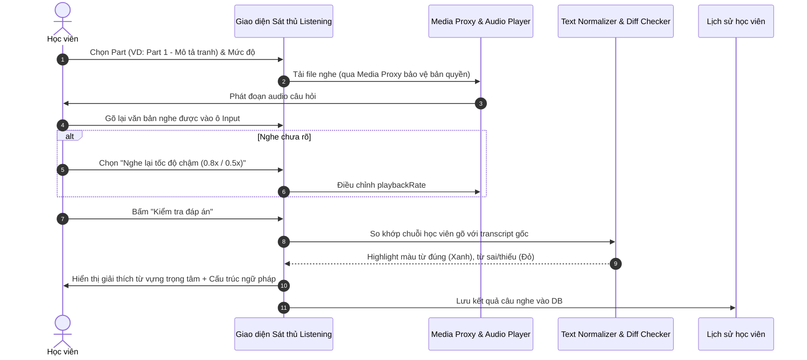
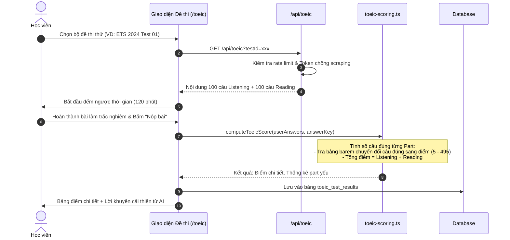

# Tài liệu Đặc tả Ca sử dụng (Use Case Specification)
## Tính năng: Sát Thủ TOEIC Listening & Luyện Thi Thử (TOEIC Listening & Exam Practice)
**Mã tài liệu:** `UC-TOEIC-04`  
**File lưu trữ:** `agent/docs/SRS_04_TOEIC_LISTENING_EXAM.md`

---

### 1. Thông tin chung
* **Actor / Role thực hiện:**
  * `Student` (Học viên luyện thi TOEIC).
* **Mô tả tóm tắt:** Cho phép học viên luyện nghe chuyên sâu từ Part 1 đến Part 4 bằng phương pháp nghe chép chính tả (Dictation so khớp trực tiếp tại Client) và thi thử các bộ đề TOEIC hoàn chỉnh (Full Test / Mini Test / Luyện từng Part) có bấm giờ, chấm điểm tự động theo barem chuẩn ETS kèm cơ chế phòng thủ chủ động chống cào dữ liệu (Active Cyber Defense).
* **Tiền điều kiện (Pre-conditions):**
  * Học viên truy cập hệ thống (đăng nhập để lưu lịch sử làm bài và thống kê điểm số).
* **Hậu điều kiện (Post-conditions):**
  * Kết quả bài thi thử được chấm theo barem 10–990 và lưu vào cơ sở dữ liệu.
  * Tiến độ nghe chép chính tả và thống kê điểm yếu từng Part được ghi nhận.

---

### 2. Danh sách API liên quan
| Phương thức | Endpoint | Chức năng | Quyền hạn |
|---|---|---|---|
| `GET` / `POST` | `/api/toeic/test?testId=...` | Tải đề thi TOEIC hoặc bài luyện theo Part (đã lược bỏ đáp án đúng, giải thích và transcript để chống lộ đề hàng loạt) | Public / User (Rate limit 60/min + Anti-Scraping) |
| `GET` | `/api/toeic/media/proxy?src=...` | Stream và proxy file âm thanh/hình ảnh bài thi TOEIC an toàn, bảo vệ nguồn media | Public / User |
| `POST` | `/api/toeic/submit` | Nộp bài làm trắc nghiệm, chấm điểm trên bộ nhớ theo bảng barem ETS (10–990) và trả kết quả tổng hợp (việc lưu DB thực hiện phía client qua Data Proxy) | Public / User (Rate limit 20/min + Anti-Scraping) |
| `POST` | `/api/toeic/explain` | Lấy đáp án đúng, transcript và lời giải chi tiết cho **từng câu hỏi (On-Demand)** kèm thủy vân ẩn (Invisible Watermark) | Public / User (Rate limit 60/min + Velocity Check) |
| `GET` | `/api/listening/video?id=...` | Lấy danh sách hoặc chi tiết bài luyện nghe video từ kho JSON tĩnh (`src/data/listening/details/*.json`, cache RAM 30 phút) kèm `cloze_blanks` và `comprehension_questions` | Public (Không kiểm tra Auth) |
| `POST` | `/api/listening/complete` | Ghi nhận hoàn thành bài luyện nghe (`videoId`, `clozeScore`, `quizScore`) và cộng +50 XP qua RPC `award_xp` (tiến độ xem lưu tại `localStorage`) | User đã đăng nhập |
| `GET` / `POST` | `/api/auth/data/user_toeic_question_history` & `/api/roadmap/assessment` | Đồng bộ lịch sử câu hỏi TOEIC đã làm (`unseen` / `mistakes`) và lưu kết quả thi thử qua BFF Data Proxy / Assessment API | User đã đăng nhập |

> **Lưu ý kiến trúc (Client-side Dictation Check):** Hoạt động chuẩn hóa chuỗi ký tự và so khớp từng từ trong chế độ **Nghe chép chính tả (Dictation)** được thực thi hoàn toàn tại trình duyệt thông qua thư viện `src/lib/listening-utils.ts` (không phát sinh request chấm điểm từng câu về server), giúp đạt độ trễ phản hồi 0ms khi gõ phím.

---

### 3. Kịch bản chính (Main Flow) & Sơ đồ Luồng hoạt động

#### 3.1 Sơ đồ luồng tổng quan Luyện Nghe & Thi Thử TOEIC (Activity Flowchart)

#### Ca sử dụng 1: Luyện nghe chép chính tả Sát thủ (UC-TOEIC-04.1)

1. **Bước 1 (Student):** Học viên truy cập `/sat-thu-toeic-listening`, chọn Part cần luyện (ví dụ: Part 2 - Hỏi đáp phản xạ) và chủ đề.
2. **Bước 2 (Frontend):** Gọi API tải câu luyện nghe kèm đường dẫn stream audio từ `toeic-media-proxy.ts`.
3. **Bước 3 (Frontend):** Tự động phát đoạn âm thanh câu nói.
4. **Bước 4 (Student):** Học viên gõ lại các từ hoặc toàn bộ câu nghe được vào ô nhập liệu.
5. **Bước 5 (Frontend):** Học viên bấm nút **"Kiểm tra đáp án"** (hoặc nhấn phím Enter).
6. **Bước 6 (Frontend):** Thuật toán chuẩn hóa chuỗi (normalizer) và so khớp văn bản:
   * Tô màu **Xanh lá**: Từ gõ đúng hoàn toàn.
   * Tô màu **Đỏ gạch**: Từ gõ sai chính tả hoặc thiếu từ.
7. **Bước 7 (Frontend):** Hiển thị câu transcript đầy đủ, giải nghĩa từ vựng trọng tâm trong câu và cấu trúc bẫy thường gặp.
8. **Bước 8 (Frontend):** Lưu lại lịch sử câu vừa luyện vào cơ sở dữ liệu để đưa vào danh mục ôn tập nếu làm sai.

#### Ca sử dụng 2: Thi thử đề TOEIC Full Test bấm giờ (UC-TOEIC-04.2)

1. **Bước 1 (Student):** Học viên truy cập `/toeic`, chọn bộ đề thi thử (ví dụ: ETS 2024 Test 01) và bấm **"Bắt đầu làm bài"**.
2. **Bước 2 (Frontend):** Gửi `GET /api/toeic?testId=ets_2024_01`. Server kiểm tra tính hợp lệ và trả về 200 câu hỏi (100 câu Listening + 100 câu Reading), **không trả kèm đáp án đúng hoặc transcript**.
3. **Bước 3 (Frontend):** Kích hoạt đồng hồ đếm ngược 120 phút. Học viên lần lượt nghe và chọn đáp án trắc nghiệm A, B, C, D trên phiếu trả lời điện tử.
4. **Bước 4 (Student):** Học viên bấm nút **"Nộp bài thi"** (hoặc hệ thống tự động thu bài khi hết 120 phút).
5. **Bước 5 (Frontend):** Gửi mảng câu trả lời `answers: { [qId]: 'A' }` lên `POST /api/toeic/submit`.
6. **Bước 6 (Backend):** Module `toeic-scoring.ts` đối chiếu đáp án với Answer Key được bảo mật trên server:
   * Đếm số câu đúng của Listening và Reading.
   * Tra cứu bảng barem (`toeic-barem.ts`) để quy đổi sang thang điểm 5 - 495 cho từng phần.
   * Tính tổng điểm: $Score_{total} = Score_{listening} + Score_{reading}$ (Thang 10 - 990).
7. **Bước 7 (Backend):** Lưu kết quả vào bảng `toeic_test_results`, sau đó trả về điểm số chi tiết kèm toàn bộ Transcript và Giải thích chi tiết từng câu.
8. **Bước 8 (Frontend):** Hiển thị Dashboard phân tích bài thi: Báo cáo tỷ lệ đúng theo từng Part (Part 1 đến Part 7) và gợi ý lộ trình cải thiện.

---

### 4. Kịch bản ngoại lệ (Alternative & Exception Flows)

* **E1: Hết giờ làm bài khi chưa bấm Nộp bài (Time-out Auto-submit)**
  * *Tại Bước 3 của UC-TOEIC-04.2:* Đồng hồ đếm ngược chạm mốc `00:00:00`.
  * *Xử lý:* Giao diện khóa toàn bộ thao tác chọn đáp án, tự động đóng gói các câu trả lời đã tích và gửi request nộp bài lên server.
* **E2: Phát hiện hành vi cào đề thi trái phép (Anti-Scraping Block)**
  * *Tại Bước 2 của UC-TOEIC-04.2:* Người dùng hoặc tool bot gọi request tải hàng chục đề thi liên tiếp trong vài giây.
  * *Xử lý:* `toeic-anti-scraping.ts` phát hiện bất thường, từ chối cấp đề bài và trả về HTTP 403 Forbidden.
* **E3: Mất kết nối audio khi đang làm phần thi Listening**
  * *Tại Bước 3 của UC-TOEIC-04.2:* Mạng chập chờn khiến file âm thanh bị dừng giữa chừng.
  * *Xử lý:* Hệ thống tạm dừng đồng hồ đếm ngược trong tối đa 30 giây để tiến hành tải lại (retry audio stream) từ Media Proxy. Nếu không tải được, hiển thị thông báo để học viên làm tiếp phần Reading trước.

---

### 5. Điểm hạn chế, Rủi ro & Nút thắt trong Luồng hiện tại (Current Limitations & Architectural Bottlenecks)

1. **Backdoor công khai `?unban=1` và Lộ toàn bộ 200 đáp án qua `POST /api/toeic/submit` (`src/app/api/toeic/submit/route.ts` & `src/lib/toeic-anti-scraping.ts`):**
   * *Hiện trạng:*
     * Tham số query `?unban=1` trên các endpoint `/api/toeic/*` cho phép bot hoặc người dùng tự xóa cờ vi phạm scraping trong `toeic-anti-scraping.ts`, vô hiệu hóa cơ chế phòng thủ chủ động Active Cyber Defense.
     * Tuyến `POST /api/toeic/submit` không kiểm tra `sessionToken` đã cấp lúc tải đề, đồng thời trả về toàn bộ 200 câu hỏi kèm đáp án đúng và lời giải chi tiết ngay trong response nộp bài, tạo điều kiện cho bot cào trọn bộ đề ETS chỉ bằng 1 request submit giả lập.
   * *Hệ quả:* Nguy cơ thất thoát kho đề thi bản quyền và phá vỡ cơ chế cấp lời giải On-Demand có gắn thủy vân (`POST /api/toeic/explain`).
2. **Cày XP vô hạn và Thiếu bảo vệ chống replay trên `POST /api/listening/complete` (`src/app/api/listening/complete/route.ts`):**
   * *Hiện trạng:* Endpoint `/api/listening/complete` nhận `videoId` và gọi RPC `award_xp` (+50 XP) mà không kiểm tra xem học viên đã từng hoàn thành bài nghe video này trước đó hay chưa (chỉ lưu tiến độ tại `localStorage` phía client).
   * *Hệ quả:* Bất kỳ tài khoản nào cũng có thể gửi lặp lại request nộp bài nhiều lần liên tiếp để cày điểm kinh nghiệm và thăng hạng ảo trên bảng xếp hạng Leaderboard.
3. **Phụ thuộc hoàn toàn vào tính trung thực của Client trong chế độ Nghe chép chính tả Dictation (`src/lib/listening-utils.ts`):**
   * *Hiện trạng:* Toàn bộ thuật toán chuẩn hóa xâu ký tự và đối khớp sai khác (Diff Matcher) chạy trên trình duyệt client để đạt 0ms độ trễ, không có xác thực độc lập trên server.
   * *Hệ quả:* Người dùng kỹ thuật có thể inspect mã nguồn client để lấy transcript gốc và vượt qua bài luyện mà không cần thực sự nghe.
