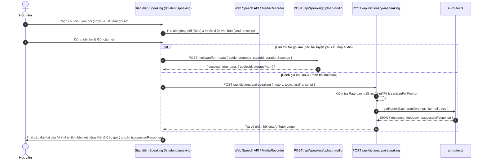
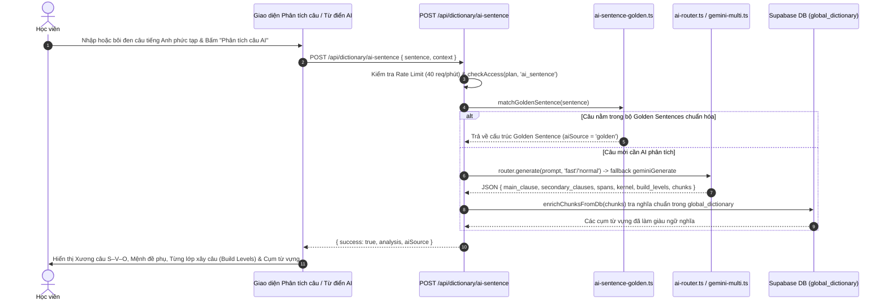

# Tài liệu Đặc tả Ca sử dụng (Use Case Specification)
## Tính năng: AI Coaching Luyện Nói, Phân tích Câu & Chữa Bài Viết (AI Speaking, Sentence Analysis & Writing Coach)
**Mã tài liệu:** `UC-AI-05`  
**File lưu trữ:** `agent/docs/SRS_05_AI_COACHING_SKILLS.md`

---

### 1. Thông tin chung
* **Actor / Role thực hiện:**
  * `Student` (Học viên).
* **Mô tả tóm tắt:** Sử dụng hệ thống điều phối đa mô hình AI (`AIRouter`: Groq, Zhipu, Google Gemini Multi-Key Pool) kết hợp kho dữ liệu chuẩn hóa để: (1) Luyện hội thoại & phản hồi phát âm/ngữ pháp qua giọng nói (`/api/dictionary/ai-speaking`) và lưu trữ file ghi âm (`/api/speaking/upload-audio`); (2) Phân tích cấu trúc câu chuyên sâu, bóc tách hạt nhân S–V–O và đối khớp "Câu văn vàng" (`matchGoldenSentence` tại `/api/dictionary/ai-sentence`); (3) Chấm và sửa bài viết học thuật theo khung chuẩn khảo thí.
* **Tiền điều kiện (Pre-conditions):**
  * Học viên đã đăng nhập tài khoản.
  * Thiết bị có microphone hoạt động (đối với tính năng Speaking).
  * Tài khoản có quyền truy cập tính năng theo gói (`checkAccess(plan, 'ai_sentence')`) và nằm trong ngưỡng Rate Limit cho phép.
* **Hậu điều kiện (Post-conditions):**
  * Kết quả nhận xét hội thoại, phân tích cấu trúc câu (Main/Secondary Clauses, Spans, Kernel, Chunks) hoặc bản ghi âm (`speaking-recordings`) được lưu trữ và hiển thị trực quan cho học viên.

---

### 2. Danh sách API liên quan
| Phương thức | Endpoint | Chức năng | Quyền hạn |
|---|---|---|---|
| `POST` | `/api/dictionary/ai-speaking` | Đánh giá câu nói hội thoại của học viên, sửa lỗi ngữ pháp/từ vựng và sinh câu phản hồi tiếp nối của AI Tutor (`response`, `feedback`, `suggestedResponse`) | User đã đăng nhập (Rate limit 15 req/min/IP; chưa chặn gói Free) |
| `POST` | `/api/speaking/upload-audio` | Tải file ghi âm giọng nói (`webm`, `mp4`, `wav`, `aac`, `ogg`, `m4a` $\le 10\text{MB}$) lên Supabase Storage bucket `speaking-recordings` | User đã đăng nhập |
| `POST` | `/api/dictionary/ai-sentence` | Phân tích cấu trúc câu S–V–O, mệnh đề phụ, bóc tách cụm từ vựng (Chunks) và đối khớp Golden Sentences (`matchGoldenSentence`) | User gói Pro (`checkAccess: 'ai_sentence'`, Rate limit 40 req/min) |
| `POST` | `/api/vstep/writing-eval` & `/api/vnu-bac-3/writing-eval` | Chấm điểm và sửa bài viết luận (Writing Task) chi tiết theo tiêu chí khảo thí | Public (Hiện thiếu kiểm tra Auth & Rate Limit) |
| `GET` | `/api/ai-router/stats` | Xem thống kê trạng thái hoạt động và điều phối của các provider trong AI Router | Public (Hiện thiếu kiểm tra Admin Auth) |

---

### 3. Kịch bản chính (Main Flow) & Sơ đồ Luồng hoạt động

#### 3.1 Sơ đồ luồng tổng quan AI Coaching & Skills (Activity Flowchart)
```mermaid
flowchart TD
    Start([Chọn kỹ năng AI Coaching]) --> Choice{Speaking hay<br/>Phân tích Câu / Writing?}
    
    %% Nhánh Speaking
    Choice -->|Luyện Speaking| ShowTarget[Chọn chủ đề hội thoại / Bài học Speaking]
    ShowTarget --> MicRec[Thu âm giọng nói qua Mic & Trích xuất Transcript]
    MicRec --> UploadAudio[POST /api/speaking/upload-audio<br/>Lưu file ghi âm vào bucket speaking-recordings]
    UploadAudio --> CallSpeakingAPI[POST /api/dictionary/ai-speaking<br/>{ history, topic, lastTranscript }]
    CallSpeakingAPI --> CheckSpeakingRL{Vượt Rate Limit<br/>15 req/phút?}
    CheckSpeakingRL -->|Vượt ngưỡng| RateLimit429[Trả về 429 Too Many Requests + Retry-After]
    CheckSpeakingRL -->|Hợp lệ| DispatchAISpeak[getRouter.generate gọi AI Tutor Lingo]
    DispatchAISpeak --> ReturnSpeakingJSON[Trả về JSON: response, feedback, suggestedResponse]
    ReturnSpeakingJSON --> RenderSpeechUI[Hiển thị lời khuyên tiếng Việt + Câu gợi ý chuẩn hóa]

    %% Nhánh Phân tích Câu & Golden Sentences
    Choice -->|Phân tích Câu & Golden Sentences| InputSentence[Nhập câu tiếng Anh cần phân tích / nâng cấp]
    InputSentence --> SubmitSentence[POST /api/dictionary/ai-sentence { sentence, context }]
    SubmitSentence --> CheckProAccess{Kiểm tra quyền<br/>checkAccess ai_sentence?}
    CheckProAccess -->|Gói Free: 403| UpgradeNotice[Thông báo PRO_REQUIRED & Đề xuất nâng cấp VIP]
    CheckProAccess -->|Gói Pro| CheckGolden{Khớp kho câu chuẩn<br/>matchGoldenSentence?}
    CheckGolden -->|Khớp Golden| ReturnGolden[Trả về tức thì dữ liệu Golden Sentence chuẩn hóa]
    CheckGolden -->|Chưa có trong kho| CallAIRouter[AIRouter fast/normal -> Fallback geminiGenerate]
    CallAIRouter --> EnrichDB[enrichChunksFromDb từ bảng global_dictionary]
    EnrichDB --> ReturnAnalysis[Trả về Main Clause, Secondary Clauses, Kernel S-V-O, Build Levels & Chunks]
```

#### Ca sử dụng 1: Luyện nói hội thoại & Ghi âm cùng AI Tutor (UC-AI-05.1)


1. **Bước 1 (Student):** Học viên truy cập phân hệ luyện nói (`/student/speaking`), chọn chủ đề hội thoại hoặc bài học phát âm theo lộ trình.
2. **Bước 2 (Student & Frontend):** Học viên bấm nút Microphone và nói câu tiếng Anh. Trình duyệt ghi âm qua `MediaRecorder` và trích xuất văn bản qua Web Speech API (`lastTranscript`).
3. **Bước 3 (Frontend -> Upload Audio):** Khi cần lưu trữ bản ghi âm để nghe lại hoặc chấm điểm, Frontend gửi `POST /api/speaking/upload-audio` (`multipart/form-data`). Server kiểm tra định dạng MIME hợp lệ (`webm`, `mp4`, `wav`, `aac`, `ogg`, `m4a`), dung lượng $\le 10\text{MB}$ và tải lên Supabase Storage bucket `speaking-recordings`.
4. **Bước 4 (Frontend -> AI Speaking):** Gửi `POST /api/dictionary/ai-speaking` kèm `{ history, topic, lastTranscript }`.
5. **Bước 5 (Backend):** Kiểm tra Rate Limit (15 request/phút/IP), làm sạch đầu vào (`sanitizeForPrompt`) và gọi `getRouter().generate(prompt, "normal", true)`.
6. **Bước 6 (Backend):** AI Tutor phân tích câu nói của học viên và trả về cấu trúc JSON:
   * `response`: Câu phản hồi hội thoại tự nhiên (1–2 câu kèm câu hỏi gợi mở tiếp theo).
   * `feedback`: Nhận xét ngắn gọn bằng tiếng Việt về lỗi ngữ pháp hoặc cách dùng từ.
   * `suggestedResponse`: Câu tiếng Anh chuẩn xác và tự nhiên hơn mà học viên nên dùng.
7. **Bước 7 (Frontend):** Hiển thị câu trả lời của AI, lời khuyên sửa lỗi và câu mẫu nâng cấp cho học viên.

#### Ca sử dụng 2: Phân tích cấu trúc câu, Chữa câu & Golden Sentences (UC-AI-05.2)


1. **Bước 1 (Student):** Học viên nhập một câu tiếng Anh dài/phức tạp vào công cụ phân tích câu hoặc bấm phân tích câu trong bài đọc/bài viết.
2. **Bước 2 (Frontend):** Gửi request `POST /api/dictionary/ai-sentence` với payload `{ sentence, context }`.
3. **Bước 3 (Backend):** Kiểm tra tần suất gọi (40 req/phút/user), kiểm tra câu có từ 2 từ trở lên (`isMultiWord`) và xác thực quyền truy cập gói Pro (`checkAccess(plan, 'ai_sentence')`).
4. **Bước 4 (Backend - Golden Sentence Matching):** Gọi hàm `matchGoldenSentence(sentence)` (`src/lib/ai-sentence-golden.ts`). Nếu câu thuộc tập Golden Sentences mẫu, hệ thống trả về ngay lập tức kết quả phân tích chuẩn 100% với `aiSource: 'golden'`.
5. **Bước 5 (Backend - Multi-Provider AI & Heuristic Fallback):** Nếu không thuộc tập Golden:
   * Gọi `AIRouter` ở chế độ `fast`, nếu lỗi tự động thử lại chế độ `normal`, và nếu vẫn lỗi sẽ chuyển tiếp sang `geminiGenerate` (`src/lib/gemini-multi.ts`).
   * Nếu toàn bộ các provider AI đều quá tải, hệ thống tự động kích hoạt bộ phân tích cú pháp nội bộ `advancedHeuristicAnalysis(sentence)` (`src/lib/sentence-parser-utils.ts`) để đảm bảo **không bao giờ trả lỗi 500** cho người dùng.
6. **Bước 6 (Backend):** Làm giàu nghĩa tiếng Việt của các cụm từ (`enrichChunksFromDb`) từ bảng `global_dictionary`.
7. **Bước 7 (Frontend):** Hiển thị trực quan hóa câu theo phương pháp LingoPro:
   * **Kernel (Xương câu S–V–O):** Chủ ngữ chính, Động từ chính (kèm thì), Tân ngữ chính.
   * **Secondary Clauses:** Mệnh đề quan hệ, mệnh đề phân từ chỉ kết quả, mệnh đề trạng ngữ.
   * **Build Levels:** Các bước lắp ghép từ xương câu đơn giản đến câu học thuật hoàn chỉnh.
   * **Vocabulary Chunks:** Các cụm collocations rút ra từ câu để lưu vào sổ từ FSRS.

---

### 4. Kịch bản ngoại lệ (Alternative & Exception Flows)

* **E1: Tài khoản gói Free gọi tính năng Phân tích câu chuyên sâu (Pro Entitlement Gate)**
  * *Tại Bước 3 của UC-AI-05.2:* Người dùng gói Free gọi `POST /api/dictionary/ai-sentence`.
  * *Xử lý:* Backend trả về HTTP 403 với `{ code: 'PRO_REQUIRED', upgradeTo: 'pro' }`. Giao diện hiển thị popup giới thiệu quyền lợi gói Pro VIP.
* **E2: Model AI chính bị nghẽn hoặc lỗi định dạng JSON (Multi-Tier Fallback)**
  * *Tại Bước 5 của UC-AI-05.2:* Provider đầu tiên trả lỗi 429 hoặc phản hồi chậm.
  * *Xử lý:* Hệ thống tự động xoay vòng qua chuỗi dự phòng: `AIRouter (fast)` $\rightarrow$ `AIRouter (normal)` $\rightarrow$ `geminiGenerate (Multi-Key Pool)` $\rightarrow$ `advancedHeuristicAnalysis (Local Parser)`, đảm bảo trả về kết quả phân tích hợp lệ 100% thời gian.
* **E3: File ghi âm tải lên không hợp lệ hoặc quá dung lượng**
  * *Tại Bước 3 của UC-AI-05.1:* File âm thanh rỗng (0 bytes), vượt quá 10MB hoặc sai định dạng MIME.
  * *Xử lý:* Tuyến `/api/speaking/upload-audio` chặn sớm và trả về mã lỗi chuẩn: HTTP 400 (rỗng), HTTP 413 (quá 10MB) hoặc HTTP 415 (Unsupported Media Type).
* **E4: Quyền truy cập Microphone bị từ chối trên trình duyệt**
  * *Tại Bước 2 của UC-AI-05.1:* Người dùng chặn quyền truy cập Mic.
  * *Xử lý:* Frontend bắt ngoại lệ `NotAllowedError`, hiển thị hướng dẫn bật quyền Microphone trên thanh địa chỉ trình duyệt.

---

### 5. Điểm hạn chế, Rủi ro & Nút thắt trong Luồng hiện tại (Current Limitations & Architectural Bottlenecks)

1. **Đánh giá phát âm chỉ dựa trên văn bản STT (`lastTranscript`), thiếu API `/api/speaking/stt-whisper` và trả về Transcript giả (`src/app/api/dictionary/ai-speaking/route.ts` & `src/lib/speaking/stt/whisper-provider.ts`):**
   * *Hiện trạng:*
     * Tuyến `/api/dictionary/ai-speaking` chỉ nhận chuỗi văn bản `lastTranscript` do Web Speech API của trình duyệt chuyển đổi từ giọng nói, hoàn toàn không nhận file audio hay điểm phoneme/prosody/word-level confidence.
     * На trình duyệt không hỗ trợ Web Speech API (hoặc khi chuyển sang `WhisperProvider` trong `src/lib/speaking/stt/whisper-provider.ts` dòng 25), client gọi tới `/api/speaking/stt-whisper` — nhưng **endpoint này không tồn tại trong `src/app/api/`**, khiến `WhisperProvider` âm thầm rơi vào nhánh catch và trả về ngẫu nhiên một câu văn cứng trong `MOCK_FALLBACK_TRANSCRIPTS`!
   * *Hệ quả:* Nếu trình duyệt tự động sửa lỗi chính tả khi nhận diện giọng nói hoặc rơi vào fallback `WhisperProvider`, hệ thống sẽ chấm điểm dựa trên văn bản giả định không liên quan đến giọng nói thật của học viên.
2. **Fallback trả về URL giả (`isMock: true`) và thiếu Rate Limit trên `/api/speaking/upload-audio` (`src/app/api/speaking/upload-audio/route.ts` dòng 89–120):**
   * *Hiện trạng:* Endpoint tải file âm thanh 10MB không gọi `checkRateLimitAsync()`. Đặc biệt, nếu bucket `speaking-recordings` trên Supabase Storage chưa được tạo hoặc lỗi mạng khi upload, API vẫn trả về `HTTP 200 OK` kèm URL giả định không tồn tại `https://storage.lingopro.online/recordings/...` (`isMock: true`).
   * *Hệ quả:* Nếu lưu `audioUrl` này vào hồ sơ bài làm, học viên hoặc giáo viên bấm nghe lại sau đó sẽ gặp lỗi `404 Dead Link` mà không hề biết quá trình tải lên thực chất đã thất bại.
3. **Cộng dồn độ trễ (Timeout Stacking) và thiếu lớp Cache cho các câu không thuộc Golden (`src/app/api/dictionary/ai-sentence/route.ts` dòng 83–104):**
   * *Hiện trạng:* Với các câu không nằm trong tập tĩnh `matchGoldenSentence`, hệ thống gọi tuần tự `router.generate(..., 'fast')` $\rightarrow$ `router.generate(..., 'normal')` $\rightarrow$ `geminiGenerate(...)`. Ngoài ra, kết quả phân tích của các câu ngoài tập Golden không được lưu cache vào Redis hoặc bảng DB.
   * *Hệ quả:* Khi các provider AI đầu tiên bị nghẽn, thời gian chờ của các tầng thử lại bị cộng dồn khiến người dùng phải đợi 15–25 giây; đồng thời nếu nhiều học viên cùng bấm phân tích một câu trong cùng bài báo/đề thi (nhưng câu đó chưa đưa vào `ai-sentence-golden.ts`), server phải gọi lại LLM lặp đi lặp lại.
4. **Thiếu kiểm tra gói Pro trên `/api/dictionary/ai-speaking`, thiếu Auth trên API chấm viết AI (`/api/vstep/writing-eval`, `/api/vnu-bac-3/writing-eval`) và lộ công khai `/api/ai-router/stats`:**
   * *Hiện trạng:*
     * `/api/dictionary/ai-speaking` không gọi `checkAccess(plan, ...)` và chỉ giới hạn tốc độ theo IP (`15 req/phút/IP`), cho phép người dùng gói Free sử dụng không giới hạn.
     * `/api/vstep/writing-eval` và `/api/vnu-bac-3/writing-eval` không kiểm tra phiên đăng nhập (`getAuthUser`) và không có Rate Limit (`checkRateLimitAsync`).
     * `GET /api/ai-router/stats` (`src/app/api/ai-router/stats/route.ts`) không kiểm tra quyền Admin, cho phép bất kỳ ai xem trạng thái nội bộ và tỷ lệ lỗi của các AI provider.


