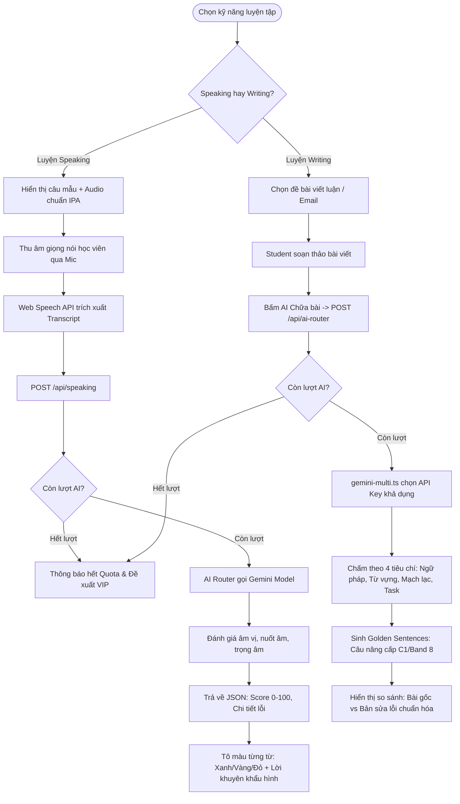
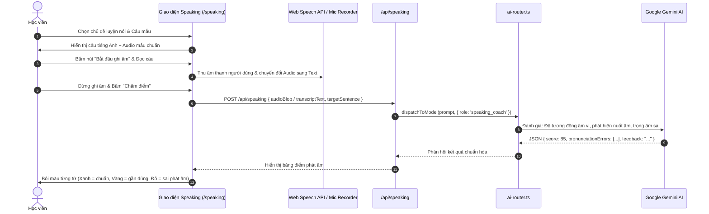
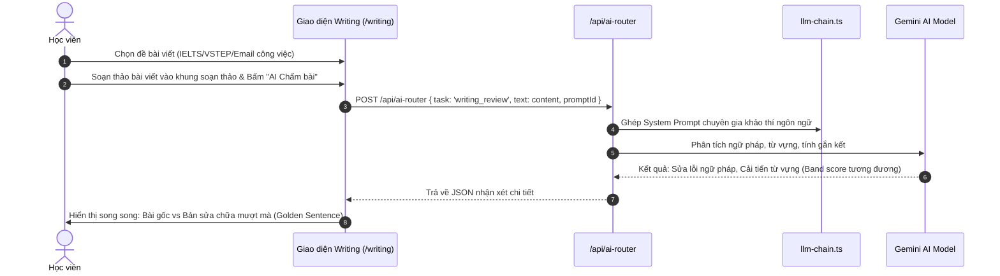

# Tài liệu Đặc tả Ca sử dụng (Use Case Specification)
## Tính năng: AI Coaching Luyện Nói & Viết (AI Speaking, Writing & Smart Tutor)
**Mã tài liệu:** `UC-AI-05`  
**File lưu trữ:** `agent/docs/SRS_05_AI_COACHING_SKILLS.md`

---

### 1. Thông tin chung
* **Actor / Role thực hiện:**
  * `Student` (Học viên).
* **Mô tả tóm tắt:** Sử dụng Trí tuệ Nhân tạo (Google Gemini, Groq) để chấm điểm phát âm tiếng Anh qua microphone, nhận xét chi tiết bài nói/bài viết, sửa lỗi ngữ pháp và đề xuất viết lại câu tự nhiên (Golden Sentences).
* **Tiền điều kiện (Pre-conditions):**
  * Học viên đã đăng nhập tài khoản.
  * Thiết bị có microphone hoạt động (đối với tính năng Speaking).
  * Học viên còn lượt sử dụng AI trong ngày (User Free: 10 lượt/ngày; User Pro: Không giới hạn).
* **Hậu điều kiện (Post-conditions):**
  * Kết quả chấm điểm và phản hồi của AI được hiển thị cho học viên và ghi nhận vào cơ sở dữ liệu.

---

### 2. Danh sách API liên quan
| Phương thức | Endpoint | Chức năng | Quyền hạn |
|---|---|---|---|
| `POST` | `/api/speaking` | Gửi audio/text câu nói để AI chấm phát âm và ngữ điệu | User đã đăng nhập |
| `POST` | `/api/ai-router` | Điều phối yêu cầu chữa bài viết hoặc giải thích ngữ pháp | User đã đăng nhập |
| `GET` | `/api/profile/ai-quota` | Kiểm tra số lượt sử dụng AI còn lại trong ngày | User đã đăng nhập |

---

### 3. Kịch bản chính (Main Flow) & Sơ đồ Luồng hoạt động

#### 3.1 Sơ đồ luồng tổng quan AI Coaching & Skills (Activity Flowchart)

#### Ca sử dụng 1: Luyện phát âm & Chấm điểm Speaking qua AI (UC-AI-05.1)

1. **Bước 1 (Student):** Học viên truy cập `/speaking` hoặc `/pronunciation`, chọn câu mẫu muốn luyện đọc.
2. **Bước 2 (Frontend):** Hiển thị câu tiếng Anh, phiên âm IPA từng từ và nút nghe phát âm mẫu bản xứ.
3. **Bước 3 (Student):** Học viên bấm biểu tượng Microphone và bắt đầu đọc to câu tiếng Anh.
4. **Bước 4 (Frontend):** Trình duyệt sử dụng Web Speech API để thu âm và trích xuất transcript văn bản thời gian thực.
5. **Bước 5 (Student):** Học viên bấm nút **"Dừng & Chấm điểm"**.
6. **Bước 6 (Frontend):** Gửi `POST /api/speaking` kèm chuỗi âm thanh / văn bản đã thu và câu gốc chuẩn.
7. **Bước 7 (Backend):** Module `ai-router.ts` chuyển tiếp prompt đến model Google Gemini với cấu hình JSON Schema nghiêm ngặt.
8. **Bước 8 (Backend):** AI phân tích và trả về cấu trúc:
   * Điểm tổng thể (Overall Score: 0 - 100).
   * Đánh giá chi tiết từng từ: Chuẩn xác, Nuốt âm, Trọng âm sai, Âm cuối (Ending sounds) bị thiếu.
   * Lời khuyên khẩu hình miệng để phát âm chuẩn hơn.
9. **Bước 9 (Frontend):** Hiển thị câu với các màu sắc trực quan (Xanh lá = đúng, Vàng = chấp nhận được, Đỏ = phát âm sai) và điểm số đạt được.

#### Ca sử dụng 2: Chữa bài luận Writing & Đề xuất Golden Sentences (UC-AI-05.2)

1. **Bước 1 (Student):** Học viên truy cập `/writing`, chọn đề bài viết (ví dụ: Viết email công việc hoặc luận VSTEP Task 2).
2. **Bước 2 (Student):** Soạn thảo bài viết vào khung soạn thảo và bấm nút **"AI Chữa bài"**.
3. **Bước 3 (Frontend):** Gửi request `POST /api/ai-router` với `{ task: 'writing_review', text: content, promptId: 'academic_review' }`.
4. **Bước 4 (Backend):** Kiểm tra hạn ngạch sử dụng của người dùng.
5. **Bước 5 (Backend):** Hệ thống ghép System Prompt chuyên gia chấm thi và gọi model Gemini qua `gemini-multi.ts`.
6. **Bước 6 (Backend):** AI phân tích bài viết theo 4 tiêu chí chuẩn:
   * Grammatical Range & Accuracy (Ngữ pháp).
   * Lexical Resource (Từ vựng học thuật).
   * Coherence & Cohesion (Độ mạch lạc, liên kết).
   * Task Achievement (Mức độ hoàn thành yêu cầu đề bài).
7. **Bước 7 (Backend):** Sinh ra các "Golden Sentences" (câu viết lại nâng cấp từ vựng sang chuẩn C1/Band 7.5+).
8. **Bước 8 (Frontend):** Hiển thị giao diện so sánh song song: Bài viết gốc của học viên vs Bản sửa lỗi chi tiết và danh sách câu vàng được gợi ý.

---

### 4. Kịch bản ngoại lệ (Alternative & Exception Flows)

* **E1: Hết hạn ngạch lượt gọi AI trong ngày (Quota Limit Exceeded)**
  * *Tại Bước 4 của UC-AI-05.2:* Tài khoản Free đã dùng hết 10 lượt AI trong ngày.
  * *Xử lý:* Backend từ chối xử lý, trả về HTTP 403 với thông báo: *"Bạn đã sử dụng hết 10 lượt AI miễn phí hôm nay."* Frontend hiển thị popup đề xuất nâng cấp lên gói Pro không giới hạn.
* **E2: Model AI chính bị nghẽn (Gemini API 429 Too Many Requests)**
  * *Tại Bước 5 của UC-AI-05.2:* API Key hiện tại bị chạm ngưỡng Rate Limit của Google.
  * *Xử lý:* `gemini-multi.ts` tự động phát hiện mã lỗi 429 và đổi sang API Key dự phòng (Fallback Pool) ngay lập tức mà không làm gián đoạn request của người dùng.
* **E3: Quyền truy cập Microphone bị từ chối**
  * *Tại Bước 3 của UC-AI-05.1:* Người dùng không cấp quyền truy cập Mic trên trình duyệt.
  * *Xử lý:* Frontend bắt sự kiện `NotAllowedError`, hiển thị thông báo hướng dẫn học viên bấm vào biểu tượng ổ khóa trên thanh địa chỉ trình duyệt để cấp quyền micro.
