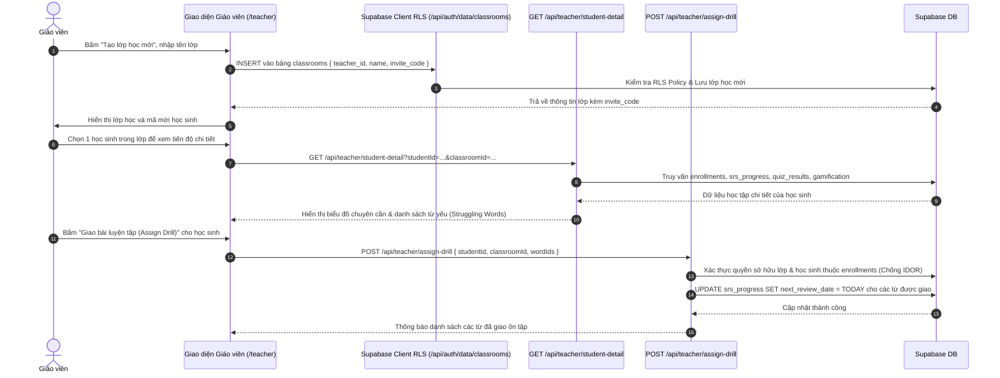
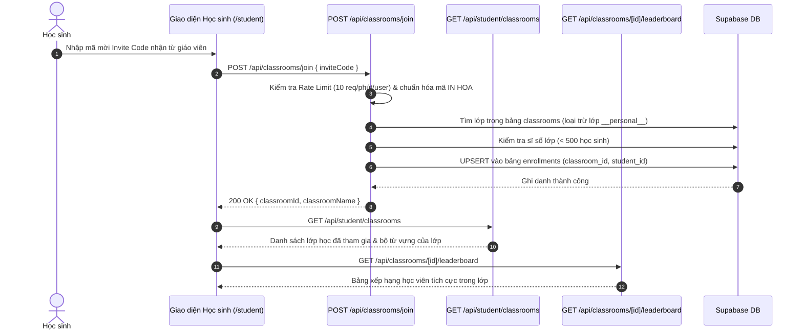

# Tài liệu Đặc tả Ca sử dụng (Use Case Specification)
## Tính năng: Quản lý Lớp học & Cổng Giáo viên (Teacher & Classroom Management)
**Mã tài liệu:** `UC-TEACH-06`  
**File lưu trữ:** `agent/docs/SRS_06_TEACHER_CLASSROOM.md`

---

### 1. Thông tin chung
* **Actor / Role thực hiện:**
  * `Teacher` (Giáo viên / Trung tâm đào tạo).
  * `Student` (Học sinh).
* **Mô tả tóm tắt:** Cung cấp cổng quản lý lớp học B2B: Cho phép giáo viên tạo/xóa lớp học (thông qua Supabase Client RLS / Data Proxy), cấp mã mời (`invite_code`), thêm/xóa học viên, giao bài luyện tập từ vựng trọng tâm (`/api/teacher/assign-drill`), xem chi tiết tiến độ & lỗi sai của từng học sinh (`/api/teacher/student-detail`, `/api/teacher/student-errors`). Cho phép học sinh nhập mã mời để tham gia lớp (`/api/classrooms/join`) và đua top trên bảng xếp hạng lớp (`/api/classrooms/[id]/leaderboard`).
* **Tiền điều kiện (Pre-conditions):**
  * Giáo viên có tài khoản với quyền `role = 'teacher'` hoặc `role = 'admin'`.
  * Học sinh đã đăng nhập tài khoản.
* **Hậu điều kiện (Post-conditions):**
  * Lớp học mới được lưu trong bảng `classrooms`.
  * Học sinh được ghi danh vào lớp trong bảng `enrollments`.
  * Bài luyện tập từ vựng được giao bằng cách cập nhật `next_review_date = TODAY` trong bảng `srs_progress` của học sinh đối với các từ thuộc lớp học.

---

### 2. Danh sách API & Cơ chế Truy xuất Dữ liệu liên quan
| Phương thức | Endpoint / Cơ chế | Chức năng | Quyền hạn |
|---|---|---|---|
| `Client RLS` / `Proxy` | `/api/auth/data/classrooms` & `/api/auth/data/rpc/claim_teacher_role` | Giáo viên kích hoạt quyền `teacher`, truy vấn, tạo mới (`INSERT`) hoặc xóa (`DELETE`) lớp học qua BFF Data Proxy | Teacher sở hữu lớp |
| `POST` | `/api/classrooms/join` | Học sinh nhập mã `inviteCode` để ghi danh vào bảng `enrollments` của lớp | User đã đăng nhập (Rate limit 10/min) |
| `GET` | `/api/student/classrooms` | Lấy danh sách các lớp học mà học sinh đang tham gia | Student đã đăng nhập |
| `POST` | `/api/teacher/assign-drill` | Giáo viên giao bài luyện tập từ vựng cho học sinh (`{ studentId, classroomId, wordIds? }`) bằng cách đặt `next_review_date = TODAY` | Teacher sở hữu lớp |
| `POST` | `/api/teacher/coaching-insight` | Sinh gợi ý sư phạm thông minh bằng AI cho giáo viên dựa trên lỗi sai và tiến độ của học sinh | Teacher / Admin |
| `GET` | `/api/teacher/student-detail?studentId=...&classroomId=...` | Xem chi tiết hồ sơ, tiến độ FSRS, lịch sử quiz và hoạt động 30 ngày của 1 học sinh trong lớp | Teacher sở hữu lớp |
| `GET` | `/api/teacher/student-errors?classroomId=...` | Thống kê danh sách các từ vựng học sinh trong lớp hay làm sai / quên nhiều nhất (`lapses`, `difficulty`) | Teacher sở hữu lớp |
| `GET` | `/api/teacher/stats` & `/api/teacher/analytics` | Tổng hợp số liệu thống kê toàn bộ lớp học và biểu đồ chuyên cần cho Dashboard Giáo viên | Teacher / Admin |
| `POST` | `/api/teacher/students/add` & `/api/teacher/students/remove` | Giáo viên thêm trực tiếp (bằng email) hoặc xóa học sinh khỏi lớp học | Teacher sở hữu lớp |
| `PATCH` | `/api/words/[id]/status` | Giáo viên duyệt (`approved`) hoặc từ chối (`rejected`) từ vựng do học sinh đóng góp vào lớp | Teacher sở hữu lớp |
| `GET` | `/api/classrooms/[id]/leaderboard` | Lấy bảng xếp hạng học sinh xuất sắc nhất trong phạm vi lớp học | Thành viên lớp / Teacher |

---

### 3. Kịch bản chính (Main Flow) & Sơ đồ Luồng hoạt động

#### 3.1 Sơ đồ luồng tổng quan Quản lý Lớp học (Activity Flowchart)
```mermaid
flowchart TD
    Start([Bắt đầu thao tác Lớp học]) --> RoleCheck{Role người dùng?}
    
    %% Nhánh Giáo viên
    RoleCheck -->|Teacher| TeacherAction{Chọn hành động}
    TeacherAction -->|Tạo / Xóa lớp| SupabaseRLS[Supabase Client RLS / Proxy<br/>/api/auth/data/classrooms]
    SupabaseRLS --> SaveClassDB[(INSERT / DELETE bảng classrooms<br/>kèm invite_code duy nhất)]
    SaveClassDB --> ShareCode[Giáo viên gửi Invite Code cho học sinh]
    
    TeacherAction -->|Theo dõi & Giao bài ôn| ViewStudentDetail[GET /api/teacher/student-detail<br/>hoặc GET /api/teacher/student-errors]
    ViewStudentDetail --> AssignDrillAPI[POST /api/teacher/assign-drill<br/>{ studentId, classroomId, wordIds }]
    AssignDrillAPI --> VerifyEnrollment{Kiểm tra Teacher sở hữu lớp<br/>& Student thuộc enrollments?}
    VerifyEnrollment -->|Không hợp lệ| Reject403[Trả về 401/403 Chống IDOR]
    VerifyEnrollment -->|Hợp lệ| ResetReviewDate[(UPDATE srs_progress:<br/>next_review_date = TODAY)]
    ResetReviewDate --> NotifyDrill[Từ vựng xuất hiện ngay trong hàng đợi cần ôn của học sinh]

    %% Nhánh Học sinh
    RoleCheck -->|Student| StudentAction{Chọn hành động}
    StudentAction -->|Tham gia lớp| InputCode[Nhập Invite Code]
    InputCode --> JoinClassAPI[POST /api/classrooms/join { inviteCode }]
    JoinClassAPI --> CheckValidCode{Mã lớp hợp lệ &<br/>Dưới 500 thành viên?}
    CheckValidCode -->|Không hợp lệ| ShowJoinError[Báo lỗi 404 / 403 / 400]
    CheckValidCode -->|Hợp lệ| UpsertEnrollment[(UPSERT vào bảng enrollments:<br/>classroom_id, student_id)]
    UpsertEnrollment --> ViewStudentClass[GET /api/student/classrooms &<br/>GET /api/classrooms/id/leaderboard]
```

#### Ca sử dụng 1: Giáo viên tạo lớp, theo dõi học sinh & giao bài luyện tập (UC-TEACH-06.1)


1. **Bước 1 (Teacher):** Giáo viên truy cập `/teacher`, bấm nút **"Tạo lớp học mới"** và nhập tên lớp.
2. **Bước 2 (Frontend/Supabase RLS):** Ứng dụng tạo mã mời ngẫu nhiên (`invite_code`) và ghi trực tiếp vào bảng `classrooms` qua Supabase Client (được bảo vệ bởi Row-Level Security và Data Proxy `/api/auth/data/classrooms`).
3. **Bước 3 (Frontend):** Hiển thị thẻ lớp học vừa tạo kèm mã mời để giáo viên gửi cho học sinh.
4. **Bước 4 (Teacher):** Giáo viên bấm vào một lớp học để xem bảng xếp hạng (`GET /api/classrooms/[id]/leaderboard`), danh sách lỗi sai phổ biến (`GET /api/teacher/student-errors`) hoặc bấm vào một học sinh cụ thể (`GET /api/teacher/student-detail`).
5. **Bước 5 (Teacher):** Giáo viên chọn các từ vựng học sinh đang yếu (hoặc để hệ thống tự chọn Top 5 từ có `difficulty` cao nhất và `stability` thấp nhất) rồi bấm **"Giao bài ôn tập"**.
6. **Bước 6 (Frontend):** Gửi `POST /api/teacher/assign-drill` với `{ studentId, classroomId, wordIds }`.
7. **Bước 7 (Backend):** Kiểm tra giáo viên là chủ lớp (`cls.teacher_id === auth.userId`), kiểm tra học sinh thực sự thuộc bảng `enrollments` của lớp đó (chống lỗ hổng IDOR), lọc các từ thuộc phạm vi lớp học và cập nhật `next_review_date = TODAY` trong bảng `srs_progress`.
8. **Bước 8 (Frontend):** Thông báo số lượng từ vựng đã được đẩy vào hàng đợi ôn tập bắt buộc trong ngày của học sinh.

#### Ca sử dụng 2: Học sinh tham gia lớp học & Đua top Bảng xếp hạng lớp (UC-TEACH-06.2)


1. **Bước 1 (Student):** Học sinh mở mục Lớp học tại `/student`, nhập mã mời `inviteCode` do giáo viên cung cấp và bấm **"Tham gia"**.
2. **Bước 2 (Frontend):** Gửi `POST /api/classrooms/join` với `{ inviteCode }`.
3. **Bước 3 (Backend):** Kiểm tra Rate Limit (10 lần/phút/user), tìm lớp học khớp với `invite_code` (chặn truy cập vào lớp nội bộ `__personal__` và chặn giáo viên tự join lớp của chính mình).
4. **Bước 4 (Backend):** Kiểm tra giới hạn sĩ số lớp (tối đa 500 học viên/lớp), sau đó thực hiện `upsert` vào bảng `enrollments` với khóa `(classroom_id, student_id)`.
5. **Bước 5 (Frontend):** Tải danh sách lớp học qua `GET /api/student/classrooms` và bảng xếp hạng thi đua của lớp qua `GET /api/classrooms/[id]/leaderboard`.
6. **Bước 6 (Student):** Học sinh học bộ từ vựng của lớp và hoàn thành các lượt ôn tập FSRS do giáo viên giao.

---

### 4. Kịch bản ngoại lệ (Alternative & Exception Flows)

* **E1: Mã mời tham gia lớp không tồn tại hoặc là lớp cá nhân ẩn (Invalid / Personal Classroom)**
  * *Tại Bước 3 của UC-TEACH-06.2:* Không tìm thấy lớp học khớp mã `inviteCode` hoặc mã trỏ tới lớp `__personal__`.
  * *Xử lý:* Tuyến `POST /api/classrooms/join` trả về HTTP 404 (`Classroom not found`) hoặc HTTP 403 (`Cannot join a personal classroom`).
* **E2: Lớp học đã đạt sĩ số tối đa (Classroom Capacity Reached)**
  * *Tại Bước 4 của UC-TEACH-06.2:* Số lượng bản ghi trong `enrollments` của lớp đã đạt 500 học sinh.
  * *Xử lý:* Backend trả về HTTP 403: *"Classroom has reached maximum capacity (500 students)"*.
* **E3: Ngăn chặn tấn công IDOR khi giáo viên giao bài hoặc xem thông tin học sinh**
  * *Tại Bước 7 của UC-TEACH-06.1:* Một giáo viên cố tình truyền `studentId` của người dùng không thuộc lớp mình vào `/api/teacher/assign-drill` hoặc `/api/teacher/student-detail`.
  * *Xử lý:* Backend kiểm tra chéo trong bảng `enrollments` với `(classroom_id, student_id)`. Nếu học sinh không thuộc lớp của giáo viên đó, lập tức từ chối với HTTP 403 Forbidden.

---

### 5. Điểm hạn chế, Rủi ro & Nút thắt trong Luồng hiện tại (Current Limitations & Architectural Bottlenecks)

1. **Lỗ hổng Nghiêm trọng: Học sinh lợi dụng lớp ẩn `__personal__` để Hạ quyền Admin, Đổi tên và Theo dõi lén bất kỳ người dùng nào (`src/app/api/teacher/students/add/route.ts` dòng 24–125 & `src/app/api/teacher/student-detail/route.ts` dòng 17–38):**
   * *Hiện trạng:*
     * Các route `/api/teacher/students/add`, `/api/teacher/students/remove`, `/api/teacher/student-detail`, `/api/teacher/student-errors`, và `/api/teacher/assign-drill` chỉ kiểm tra `classroom.teacher_id === auth.userId`, nhưng **không kiểm tra `callerProfile.role === 'teacher'`** và **không chặn lớp học ẩn `classroom.name === '__personal__'`**! (Riêng `/api/teacher/coaching-insight` thậm chí không kiểm tra `role` lẫn `classroomId`).
     * Trong kiến trúc LingoPro, mọi tài khoản Học sinh đều tự động sở hữu một lớp học ẩn `name = '__personal__'` với `teacher_id = auth.userId`.
     * Hơn nữa, tại `POST /api/teacher/students/add` (dòng 106–113), lệnh `supabase.from('profiles').upsert` (chạy bằng quyền `service_role`) ghi đè `full_name: finalName` và gán cứng `role: existingProfile?.role === 'teacher' ? 'teacher' : 'student'`.
   * *Hệ quả (Chuỗi khai thác 3 bước bởi bất kỳ tài khoản Student nào):*
     1. **Hạ quyền Admin & Đổi tên tài khoản bất kỳ:** Học sinh gọi `POST /api/teacher/students/add` truyền `classroomId` là lớp `__personal__` của chính mình kèm `email` của Admin (hoặc người dùng bất kỳ) và `name` tùy ý $\rightarrow$ quyền `role = 'admin'` của nạn nhân bị hạ xuống `'student'` và tên hiển thị bị ghi đè!
     2. **Ghi danh ép buộc & Nghe lén dữ liệu học tập (IDOR Spying):** Nạn nhân bị thêm vào `enrollments` của lớp `__personal__` do kẻ tấn công làm chủ, từ đó kẻ tấn công gọi hợp lệ `GET /api/teacher/student-detail?studentId=<victimId>&classroomId=<personalClassroomId>` để đọc toàn bộ danh sách từ vựng cá nhân, lịch sử làm bài quiz, điểm thi lộ trình và gói cước của nạn nhân!
     3. **Bơm từ vựng rác vào sổ từ nạn nhân:** Do nạn nhân đã nằm trong `enrollments` của lớp `__personal__` đó, mỗi khi kẻ tấn công ôn từ vựng, hàm `mirrorSrsProgress` sẽ tự động bơm từ sang lớp của nạn nhân.
2. **Vòng lặp quét toàn bộ bảng `auth.users` $O(N)$ & Hủy mật khẩu tạm (`tempPassword`) khi thêm học sinh bằng Email (`src/app/api/teacher/students/add/route.ts` dòng 48–91):**
   * *Hiện trạng:* Khi email học sinh chưa có trong bảng `profiles`, API chạy vòng lặp `while (true)` gọi `supabase.auth.admin.listUsers({ page, perPage: 1000 })` duyệt tuần tự qua **toàn bộ người dùng trong hệ thống**. Nếu không tìm thấy, API tự sinh mật khẩu ngẫu nhiên `const tempPassword = 'LingoPro@' + Math.random()...` và gọi `auth.admin.createUser({ email, password: tempPassword, email_confirm: true })`, nhưng **không gửi email thông báo và cũng không trả `tempPassword` về cho giáo viên**.
   * *Hệ quả:* Gây nghẽn $O(N)$ khi số lượng người dùng lớn, đồng thời học sinh mới được tạo tài khoản không thể biết mật khẩu của mình để đăng nhập.
3. **Lệch múi giờ UTC và thiếu xóa Cache khi giao bài luyện tập (`src/app/api/teacher/assign-drill/route.ts` dòng 102–115):**
   * *Hiện trạng:* `assign-drill` lấy ngày hôm nay bằng `new Date().toISOString().split('T')[0]` (múi giờ UTC thay vì `Asia/Ho_Chi_Minh`) và sau khi cập nhật `srs_progress` thì không gọi `invalidateServerWordSummaryCache(studentId)`.
   * *Hệ quả:* Nếu giáo viên giao bài trong khoảng 00:00–06:59 sáng giờ Việt Nam, `next_review_date` bị đặt lùi về ngày hôm qua; đồng thời học sinh đang mở app có thể không thấy ngay số từ cần ôn mới do SWR cache 45 giây của `/api/words?summary=1` chưa được xóa.


