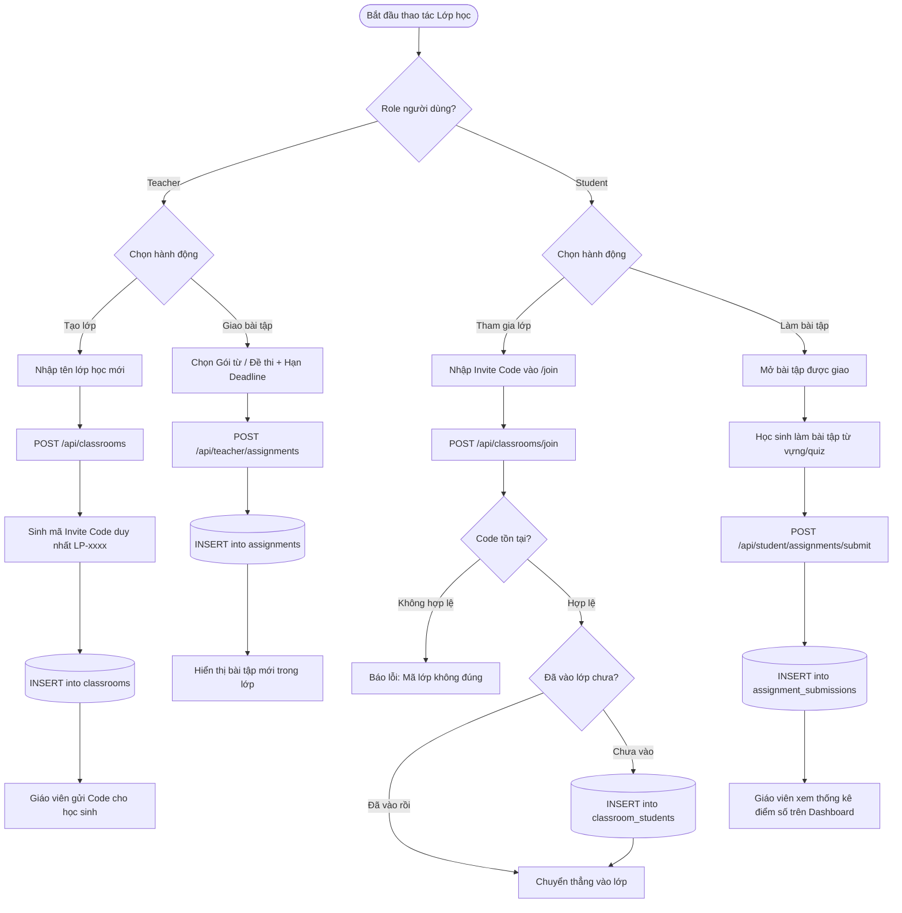
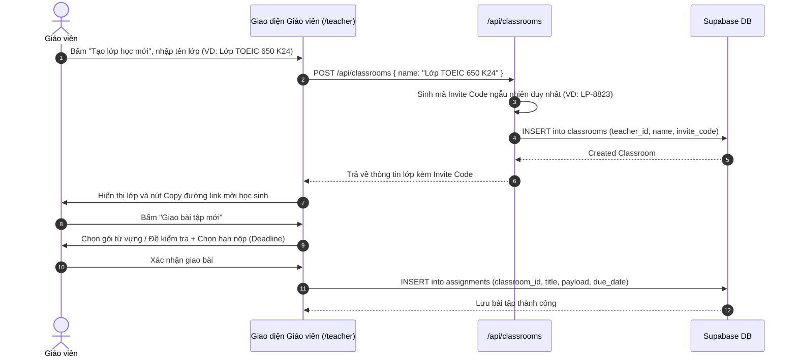
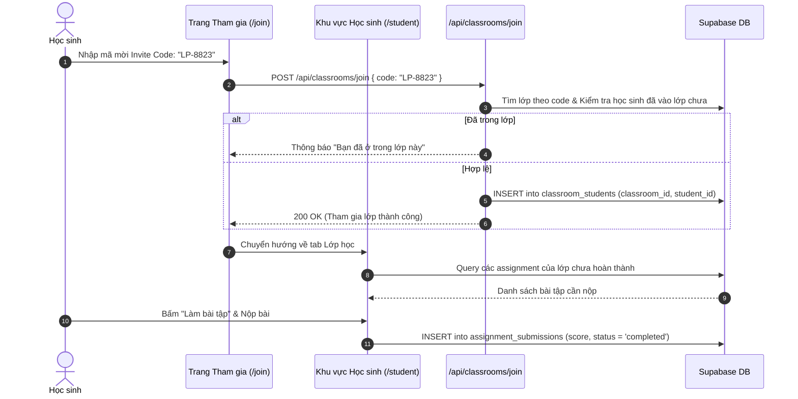

# Tài liệu Đặc tả Ca sử dụng (Use Case Specification)
## Tính năng: Quản lý Lớp học & Cổng Giáo viên (Teacher & Classroom Management)
**Mã tài liệu:** `UC-TEACH-06`  
**File lưu trữ:** `agent/docs/SRS_06_TEACHER_CLASSROOM.md`

---

### 1. Thông tin chung
* **Actor / Role thực hiện:**
  * `Teacher` (Giáo viên / Trung tâm đào tạo).
  * `Student` (Học sinh).
* **Mô tả tóm tắt:** Cung cấp cổng quản lý lớp học B2B: Cho phép giáo viên tạo lớp học, cấp mã mời (Invite Code), giao bài tập (từ vựng, ngữ pháp, đề kiểm tra) có hạn nộp và theo dõi tiến độ hoàn thành của học sinh. Cho phép học sinh nhập mã để vào lớp và nộp bài.
* **Tiền điều kiện (Pre-conditions):**
  * Giáo viên có tài khoản với quyền `role = 'teacher'` hoặc `role = 'admin'`.
  * Học sinh đã đăng nhập tài khoản.
* **Hậu điều kiện (Post-conditions):**
  * Lớp học mới được lưu trong `classrooms`.
  * Học sinh được liên kết vào lớp qua `classroom_students`.
  * Bài nộp được ghi nhận trong `assignment_submissions`.

---

### 2. Danh sách API liên quan
| Phương thức | Endpoint | Chức năng | Quyền hạn |
|---|---|---|---|
| `GET` | `/api/classrooms` | Lấy danh sách lớp học của giáo viên hoặc học sinh | User đã đăng nhập |
| `POST` | `/api/classrooms` | Giáo viên tạo lớp học mới | Teacher / Admin |
| `DELETE` | `/api/classrooms?id=...` | Giáo viên xóa lớp học | Teacher sở hữu lớp |
| `POST` | `/api/classrooms/join` | Học sinh nhập Invite Code để tham gia lớp | Student |
| `POST` | `/api/teacher/assignments` | Giáo viên giao bài tập mới cho lớp | Teacher sở hữu lớp |
| `GET` | `/api/teacher/classrooms/[id]/students` | Lấy danh sách và tiến độ học sinh trong lớp | Teacher sở hữu lớp |

---

### 3. Kịch bản chính (Main Flow) & Sơ đồ Luồng hoạt động

#### 3.1 Sơ đồ luồng tổng quan Quản lý Lớp học (Activity Flowchart)

#### Ca sử dụng 1: Giáo viên tạo lớp học & Giao bài tập (UC-TEACH-06.1)

1. **Bước 1 (Teacher):** Giáo viên truy cập `/teacher`, bấm nút **"Tạo lớp học mới"**.
2. **Bước 2 (Teacher):** Nhập tên lớp (ví dụ: *"Lớp Luyện Thi TOEIC 650 K12"*) và bấm **"Xác nhận"**.
3. **Bước 3 (Frontend):** Gửi `POST /api/classrooms` với `{ name: "..." }`.
4. **Bước 4 (Backend):** Kiểm tra quyền giáo viên; sinh chuỗi Invite Code ngẫu nhiên không trùng lặp (ví dụ: `LP-7892`); lưu vào bảng `classrooms`.
5. **Bước 5 (Frontend):** Hiển thị thẻ lớp học vừa tạo kèm nút **"Sao chép liên kết mời"** hoặc mã code để gửi cho học sinh.
6. **Bước 6 (Teacher):** Bấm nút **"Giao bài tập"** trong thẻ lớp học.
7. **Bước 7 (Teacher):** Chọn gói từ vựng mục tiêu, số lượng câu trắc nghiệm cần làm và hạn chót nộp bài (Deadline), sau đó bấm **"Phát bài"**.
8. **Bước 8 (Backend):** Lưu bản ghi bài tập vào bảng `assignments` liên kết với `classroom_id`.

#### Ca sử dụng 2: Học sinh tham gia lớp học & Nộp bài tập (UC-TEACH-06.2)

1. **Bước 1 (Student):** Học sinh truy cập trang `/join` hoặc bấm vào đường link mời nhận được từ giáo viên.
2. **Bước 2 (Student):** Nhập mã Invite Code `LP-7892` và bấm **"Tham gia ngay"**.
3. **Bước 3 (Frontend):** Gửi `POST /api/classrooms/join` với `{ code: "LP-7892" }`.
4. **Bước 4 (Backend):** Kiểm tra mã lớp: Nếu hợp lệ và học sinh chưa ở trong lớp, thêm bản ghi mới vào bảng `classroom_students`.
5. **Bước 5 (Frontend):** Điều hướng học sinh về trang `/student`, tab Lớp học sẽ hiển thị lớp học vừa tham gia kèm thông báo có bài tập mới.
6. **Bước 6 (Student):** Học sinh bấm vào bài tập để làm bài từ vựng/quiz theo đúng nội dung giáo viên yêu cầu.
7. **Bước 7 (Student):** Hoàn thành bài làm và bấm **"Nộp bài tập"**.
8. **Bước 8 (Backend):** Ghi nhận trạng thái hoàn thành và điểm số vào bảng `assignment_submissions`. Giáo viên có thể xem ngay điểm số trên Dashboard quản lý.

---

### 4. Kịch bản ngoại lệ (Alternative & Exception Flows)

* **E1: Mã mời tham gia lớp không tồn tại hoặc sai (Invalid Invite Code)**
  * *Tại Bước 4 của UC-TEACH-06.2:* Không tìm thấy lớp học nào khớp với mã code học sinh nhập.
  * *Xử lý:* Backend trả về HTTP 404: *"Mã lớp học không chính xác hoặc đã bị đóng."* Giao diện hiển thị cảnh báo đỏ để học sinh kiểm tra lại.
* **E2: Học sinh đã tham gia lớp học từ trước (Duplicate Enrollment)**
  * *Tại Bước 4 của UC-TEACH-06.2:* Học sinh đã có tên trong bảng `classroom_students` của lớp này.
  * *Xử lý:* Backend trả về HTTP 400: *"Bạn đã là thành viên của lớp học này rồi."* Frontend tự động chuyển hướng vào thẳng màn hình lớp học.
* **E3: Người dùng không có quyền Teacher cố tình gọi API tạo lớp**
  * *Tại Bước 4 của UC-TEACH-06.1:* Tài khoản học viên gọi thẳng request `POST /api/classrooms`.
  * *Xử lý:* Backend kiểm tra `profile.role !== 'teacher'`, lập tức từ chối và trả về HTTP 403 Forbidden.
