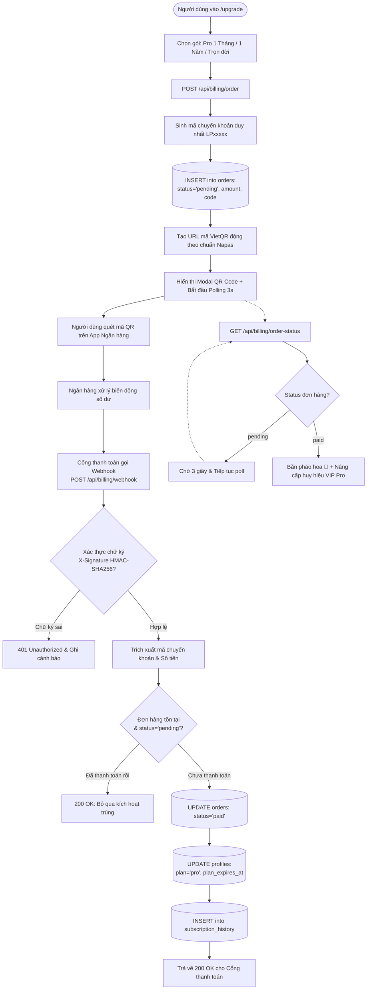
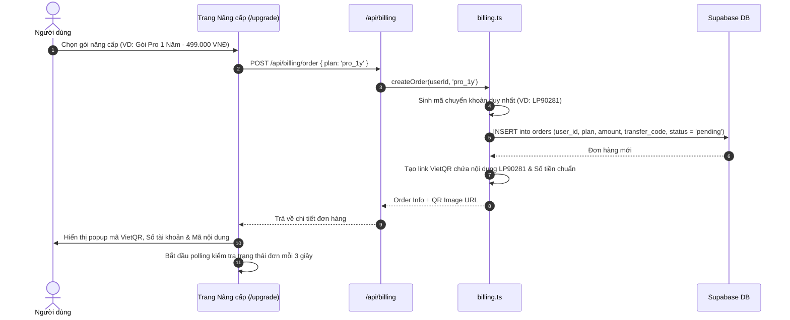
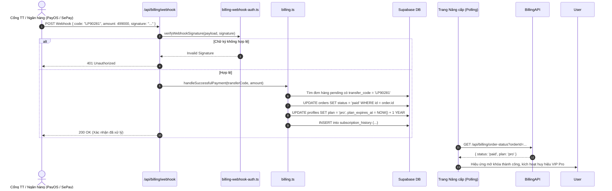

# Tài liệu Đặc tả Ca sử dụng (Use Case Specification)
## Tính năng: Thanh toán & Nâng cấp Gói VIP (Billing, Subscription & Webhook)
**Mã tài liệu:** `UC-BILL-07`  
**File lưu trữ:** `agent/docs/SRS_07_BILLING_SUBSCRIPTION.md`

---

### 1. Thông tin chung
* **Actor / Role thực hiện:**
  * `User` (Người dùng có nhu cầu nâng cấp VIP).
  * `Payment Gateway` (Hệ thống thanh toán / Cổng Webhook ngân hàng như PayOS / SePay).
* **Mô tả tóm tắt:** Cho phép người dùng chọn gói dịch vụ (Pro 1 Tháng, Pro 1 Năm, Trọn Đời), quét mã QR thanh toán ngân hàng tự động (VietQR). Hệ thống tự động lắng nghe Webhook có chữ ký bảo mật để kích hoạt gói VIP tức thì cho người dùng.
* **Tiền điều kiện (Pre-conditions):**
  * Người dùng đã đăng nhập tài khoản.
* **Hậu điều kiện (Post-conditions):**
  * Đơn hàng chuyển sang trạng thái `paid` trong bảng `orders`.
  * Tài khoản được nâng cấp `plan = 'pro'` và cập nhật `plan_expires_at` trong bảng `profiles`.

---

### 2. Danh sách API liên quan
| Phương thức | Endpoint | Chức năng | Quyền hạn |
|---|---|---|---|
| `POST` | `/api/billing/order` | Tạo đơn hàng nâng cấp và lấy mã VietQR | User đã đăng nhập |
| `GET` | `/api/billing/order-status?orderId=...` | Kiểm tra trạng thái thanh toán của đơn hàng (Polling) | User đã đăng nhập |
| `POST` | `/api/billing/webhook` | Nhận thông báo giao dịch thành công từ ngân hàng | Cổng thanh toán (Chữ ký số hợp lệ) |

---

### 3. Kịch bản chính (Main Flow) & Sơ đồ Luồng hoạt động

#### 3.1 Sơ đồ luồng tổng quan Thanh toán & Nâng cấp VIP (Activity Flowchart)

#### Ca sử dụng 1: Tạo đơn hàng & Quét mã VietQR (UC-BILL-07.1)

1. **Bước 1 (User):** Người dùng truy cập trang `/upgrade`, xem so sánh quyền lợi các gói và bấm **"Nâng cấp ngay"** vào gói Pro 1 Năm (499.000 VNĐ).
2. **Bước 2 (Frontend):** Gửi `POST /api/billing/order` với `{ plan: 'pro_1y' }`.
3. **Bước 3 (Backend):** Module `billing.ts` tạo đơn hàng mới:
   * Sinh mã chuyển khoản ngẫu nhiên định danh duy nhất (ví dụ: `LP90281`).
   * Lưu vào bảng `orders` với `status = 'pending'`, số tiền `499000`.
   * Tạo link ảnh mã VietQR chứa đúng số tài khoản nhận, tên chủ tài khoản, số tiền và nội dung chuyển khoản `LP90281`.
4. **Bước 4 (Frontend):** Hiển thị Modal thanh toán gồm: Mã QR chuyển khoản, Thông tin tài khoản, Hướng dẫn quét app ngân hàng và đồng hồ đếm ngược chờ thanh toán.
5. **Bước 5 (Frontend):** Bắt đầu cơ chế polling: Gửi `GET /api/billing/order-status` mỗi 3 giây một lần để lắng nghe trạng thái đơn hàng.

#### Ca sử dụng 2: Tiếp nhận Webhook & Tự động Kích hoạt Gói VIP (UC-BILL-07.2)

1. **Bước 1 (Payment Gateway):** Người dùng chuyển khoản thành công trên App ngân hàng. Cổng thanh toán ghi nhận biến động số dư và gửi `POST /api/billing/webhook` kèm payload giao dịch và header chữ ký điện tử `X-Signature`.
2. **Bước 2 (Backend):** Module `billing-webhook-auth.ts` tính toán mã băm HMAC-SHA256 của payload bằng Secret Key và so sánh thời gian thực (`timingSafeEqual`) với chữ ký nhận được.
3. **Bước 3 (Backend):** Trích xuất nội dung chuyển khoản để lấy mã đơn hàng `LP90281` và số tiền nhận được.
4. **Bước 4 (Backend):** Tìm đơn hàng trong bảng `orders`:
   * Kiểm tra số tiền khớp với giá trị đơn hàng ($\ge 499.000$ VNĐ).
   * Kiểm tra đơn hàng đang ở trạng thái `pending`.
5. **Bước 5 (Backend):** Cập nhật trạng thái đơn hàng:
   * `UPDATE orders SET status = 'paid' WHERE id = order.id`.
   * Cập nhật hồ sơ: `UPDATE profiles SET plan = 'pro', plan_expires_at = NOW() + INTERVAL '1 year' WHERE id = order.user_id`.
   * Ghi log lịch sử vào bảng `subscription_history`.
6. **Bước 6 (Backend):** Trả về HTTP 200 OK cho Cổng thanh toán để xác nhận đã xử lý xong.
7. **Bước 7 (Frontend):** Lượt polling tiếp theo của Frontend nhận được `{ status: 'paid', plan: 'pro' }`.
8. **Bước 8 (Frontend):** Đóng modal thanh toán, hiển thị hiệu ứng chúc mừng thành viên VIP Pro và mở khóa ngay lập tức toàn bộ tính năng cao cấp.

---

### 4. Kịch bản ngoại lệ (Alternative & Exception Flows)

* **E1: Chữ ký Webhook không hợp lệ (Invalid Webhook Signature)**
  * *Tại Bước 2 của UC-BILL-07.2:* Hacker hoặc bên thứ ba giả mạo gửi request webhook đến API nhưng không có chữ ký số hợp lệ.
  * *Xử lý:* Hệ thống từ chối ngay lập tức, trả về HTTP 401 Unauthorized, ghi log cảnh báo an ninh và tuyệt đối không kích hoạt gói.
* **E2: Xử lý trùng lặp Webhook (Webhook Idempotency)**
  * *Tại Bước 4 của UC-BILL-07.2:* Cổng thanh toán retry gửi lại webhook lần thứ hai cho cùng một giao dịch.
  * *Xử lý:* Backend kiểm tra thấy đơn hàng đã có `status = 'paid'`, lập tức trả về HTTP 200 OK mà không cộng thêm ngày sử dụng để tránh sai lệch thời hạn VIP.
* **E3: Người dùng chuyển khoản sai số tiền hoặc sai nội dung**
  * *Tại Bước 4 của UC-BILL-07.2:* Số tiền chuyển khoản nhỏ hơn số tiền đơn hàng hoặc nội dung chuyển khoản bị ghi sai mã `LP90281`.
  * *Xử lý:* Đơn hàng vẫn giữ trạng thái `pending`. Giao dịch được lưu vào bảng cảnh báo ngoại lệ (`order_discrepancies`) để Admin kiểm tra thủ công và hỗ trợ kích hoạt bù cho học viên.
