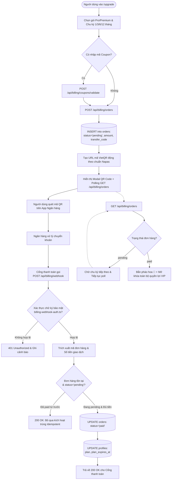
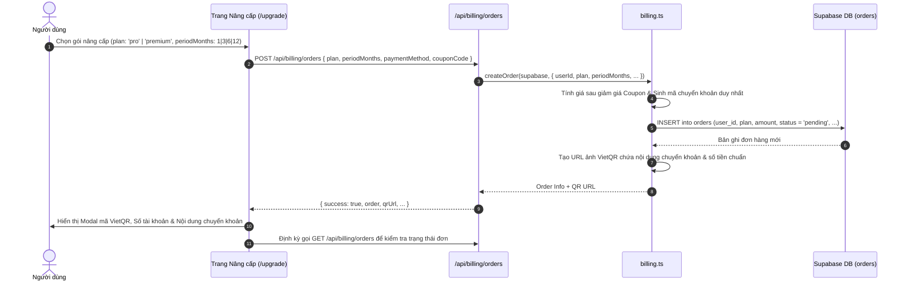
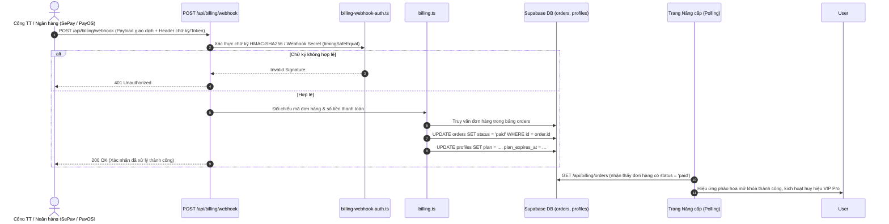

# Tài liệu Đặc tả Ca sử dụng (Use Case Specification)
## Tính năng: Thanh toán & Nâng cấp Gói VIP (Billing, Subscription & Webhook)
**Mã tài liệu:** `UC-BILL-07`  
**File lưu trữ:** `agent/docs/SRS_07_BILLING_SUBSCRIPTION.md`

---

### 1. Thông tin chung
* **Actor / Role thực hiện:**
  * `User` (Người dùng có nhu cầu nâng cấp gói Pro / Premium cá nhân hoặc theo nhóm).
  * `Payment Gateway` (Hệ thống cổng thanh toán / Webhook ngân hàng tự động như SePay / PayOS).
  * `Admin` (Quản trị viên hệ thống đối soát đơn hàng).
* **Mô tả tóm tắt:** Cho phép người dùng chọn gói dịch vụ (`pro` hoặc `premium`, chu kỳ 1, 3, 6, 12 tháng, gói cá nhân hoặc gói nhóm `group`), áp dụng mã giảm giá (`/api/billing/coupons/validate`) và quét mã QR thanh toán ngân hàng tự động (VietQR). Hệ thống lắng nghe Webhook có chữ ký bảo mật (`/api/billing/webhook`) hoặc xác nhận đơn (`/api/billing/orders/[id]/confirm`) để kích hoạt gói VIP tức thì theo cơ chế Idempotent.
* **Tiền điều kiện (Pre-conditions):**
  * Người dùng đã đăng nhập tài khoản.
* **Hậu điều kiện (Post-conditions):**
  * Đơn hàng chuyển sang trạng thái `paid` trong bảng `orders`.
  * Tài khoản người dùng được nâng cấp `plan` (`pro` / `premium`) và cộng dồn `plan_expires_at` trong bảng `profiles`.

---

### 2. Danh sách API liên quan
| Phương thức | Endpoint | Chức năng | Quyền hạn |
|---|---|---|---|
| `POST` | `/api/billing/orders` | Tạo đơn hàng nâng cấp mới (`pending`, gói cá nhân `individual` hoặc nhóm `group`) và sinh URL mã VietQR động | User đã đăng nhập (Rate limit 10/min) |
| `GET` | `/api/billing/orders` | Lấy danh sách và kiểm tra trạng thái đơn hàng của User (Polling) hoặc toàn bộ đơn hàng (Admin) | User đã đăng nhập / Admin |
| `POST` | `/api/billing/orders/[id]/confirm` | Admin duyệt và kích hoạt thủ công đơn hàng chuyển khoản (`authorizeWebAdmin`) | **Admin only** |
| `GET` / `POST` | `/api/billing/webhook` | Health-check (`GET`) và tiếp nhận thông báo biến động số dư từ SePay/Casso (`POST`), xác thực chữ ký số, kích hoạt gói VIP/Group/Challenge và cộng hoa hồng Affiliate | Cổng thanh toán (Chữ ký HMAC / Bearer Secret) |
| `POST` | `/api/billing/coupons/validate` | Kiểm tra tính hợp lệ và mức giảm giá của mã Coupon | User đã đăng nhập |
| `GET` / `POST` / `DELETE` | `/api/billing/coupons` & `/api/billing/stats` | Quản lý mã giảm giá (`GET`, `POST`, `DELETE`) và xem thống kê doanh thu MRR (`GET`) | Admin |
| `GET` / `POST` | `/api/billing/pro-milestone` | Kiểm tra tiến độ (`GET`) và nhận thưởng +30 ngày Pro miễn phí khi đạt mốc 200 từ (`>=100` đã ôn) + Streak 7 ngày (`POST`) | User đã đăng nhập |
| `POST` | `/api/billing/redeem-gift` | Đổi mã quà tặng/voucher (`gift_codes` hoặc `coupons` 100%) để kích hoạt gói Pro trực tiếp | User đã đăng nhập (Rate limit 5/min) |
| `POST` | `/api/billing/claim-upgrade-gift` | Endpoint chiến dịch quà tặng nâng cấp cũ (hiện trả về `410 Gone`) | Deprecated (410 Gone) |

---

### 3. Kịch bản chính (Main Flow) & Sơ đồ Luồng hoạt động

#### 3.1 Sơ đồ luồng tổng quan Thanh toán & Nâng cấp VIP (Activity Flowchart)

#### Ca sử dụng 1: Tạo đơn hàng & Quét mã VietQR (UC-BILL-07.1)

1. **Bước 1 (User):** Người dùng truy cập trang `/upgrade`, chọn gói dịch vụ (`pro` hoặc `premium`, cá nhân hoặc nhóm `orderKind: 'group'`) và chu kỳ thanh toán (`1, 3, 6, 12` tháng).
2. **Bước 2 (Frontend):** Nếu có mã giảm giá, gọi `POST /api/billing/coupons/validate` để kiểm tra. Sau đó gửi `POST /api/billing/orders` với thông tin gói đã chọn.
3. **Bước 3 (Backend):** Tuyến `/api/billing/orders` gọi hàm `createOrder()` trong `src/lib/billing.ts`:
   * Kiểm tra tính hợp lệ của gói, số tháng (`isValidPeriodMonths`) và số lượng thành viên (nếu là gói nhóm từ 2–20 seats).
   * Lưu đơn hàng mới vào bảng `orders` với `status = 'pending'`.
   * Sinh đường dẫn ảnh mã VietQR động chứa đúng số tài khoản nhận, số tiền và mã nội dung chuyển khoản định danh đơn hàng.
4. **Bước 4 (Frontend):** Hiển thị Modal thanh toán gồm: Mã QR chuyển khoản, Thông tin tài khoản ngân hàng và nội dung chuyển khoản tự động.
5. **Bước 5 (Frontend):** Thực hiện polling qua `GET /api/billing/orders` để kiểm tra trạng thái đơn hàng của người dùng.

#### Ca sử dụng 2: Tiếp nhận Webhook & Tự động Kích hoạt Gói VIP (UC-BILL-07.2)

1. **Bước 1 (Payment Gateway):** Người dùng quét mã VietQR và chuyển khoản thành công trên App ngân hàng. Cổng thanh toán ghi nhận biến động số dư và gửi `POST /api/billing/webhook` kèm payload giao dịch và chữ ký bảo mật.
2. **Bước 2 (Backend):** Module `src/lib/billing-webhook-auth.ts` xác thực chữ ký HMAC-SHA256 / Secret Token bằng phép so sánh hằng thời gian (`timingSafeEqual`) để chống giả mạo.
3. **Bước 3 (Backend):** Trích xuất nội dung chuyển khoản để xác định mã đơn hàng và số tiền thực nhận.
4. **Bước 4 (Backend):** Đối chiếu đơn hàng trong bảng `orders`:
   * Kiểm tra số tiền chuyển khoản đáp ứng giá trị đơn hàng.
   * Kiểm tra trạng thái đơn hàng đang là `pending`.
5. **Bước 5 (Backend):** Kích hoạt quyền lợi gói:
   * Cập nhật trạng thái đơn hàng sang `status = 'paid'`.
   * Cập nhật bảng `profiles` của người dùng với `plan` tương ứng và gia hạn `plan_expires_at`.
6. **Bước 6 (Backend):** Trả về HTTP 200 OK cho Cổng thanh toán.
7. **Bước 7 (Frontend):** Lượt gọi `GET /api/billing/orders` tiếp theo trên giao diện nhận thấy đơn hàng đã chuyển sang `paid` (hoặc Admin duyệt qua `POST /api/billing/orders/[id]/confirm`), lập tức đóng modal và mở khóa toàn bộ tính năng VIP.

---

### 4. Kịch bản ngoại lệ (Alternative & Exception Flows)

* **E1: Chữ ký Webhook không hợp lệ (Invalid Webhook Signature)**
  * *Tại Bước 2 của UC-BILL-07.2:* Request gửi tới `/api/billing/webhook` không có chữ ký hợp lệ hoặc sai khóa bí mật.
  * *Xử lý:* Hệ thống từ chối ngay lập tức, trả về HTTP 401 Unauthorized và tuyệt đối không thay đổi trạng thái đơn hàng.
* **E2: Xử lý trùng lặp Webhook (Webhook Idempotency)**
  * *Tại Bước 4 của UC-BILL-07.2:* Cổng thanh toán gửi lại webhook lần thứ hai cho cùng một giao dịch đã được xử lý trước đó.
  * *Xử lý:* Backend nhận thấy đơn hàng đã ở trạng thái `paid`, lập tức trả về HTTP 200 OK mà không cộng dồn thêm thời hạn sử dụng lần hai.
* **E3: Người dùng chuyển khoản sai nội dung hoặc cần xác nhận thủ công**
  * *Tại Bước 4 của UC-BILL-07.2:* Người dùng sửa nhầm nội dung chuyển khoản khiến webhook không tự khớp được mã đơn.
  * *Xử lý:* Đơn hàng giữ trạng thái chờ xác nhận. Admin sử dụng tuyến `POST /api/billing/orders/[id]/confirm` tại `/admin/billing` để kiểm tra đối soát và kích hoạt gói.

---

### 5. Điểm hạn chế, Rủi ro & Nút thắt trong Luồng hiện tại (Current Limitations & Architectural Bottlenecks)

1. **Mã giảm giá Hardcode `'WLU'` giảm 100% cho 12 tháng Pro/Premium ngay trong mã nguồn (`src/lib/billing.ts` dòng 70, 318–331, 356–369):**
   * *Hiện trạng:* Hàm `validateCoupon` và `createOrder` chứa logic hardcode: nếu `couponCode === 'WLU'`, hệ thống tự động ép `periodMonths = 12`, bỏ qua kiểm tra `assertCouponAllowedForOrder` và tự tổng hợp một coupon `discount_pct: 100` ngay cả khi mã `WLU` đã bị xóa hoặc tắt trong bảng `coupons` của DB!
   * *Hệ quả:* Bất kỳ ai biết chuỗi `'WLU'` đều có thể gọi `POST /api/billing/orders { plan: 'premium', periodMonths: 12, couponCode: 'WLU' }` để kích hoạt ngay lập tức 1 năm gói **Premium** miễn phí (`amount = 0` $\rightarrow$ tự động gọi `confirmOrder` ngay khi tạo đơn) mà Admin không thể khóa mã này từ Dashboard.
2. **Đơn hàng bị treo im lặng khi chuyển lệch số tiền hoặc trùng 8 ký tự đầu mã đơn (`src/app/api/billing/webhook/route.ts` dòng 195–265):**
   * *Hiện trạng:* Nội dung chuyển khoản VietQR (`LP <8-hex>`) chỉ lấy 8 ký tự hex đầu của UUID đơn hàng. Khi Webhook nhận giao dịch:
     * Nếu có $>1$ đơn hàng `pending` trùng 8 ký tự đầu (`orders.length > 1`), hoặc
     * Nếu người dùng chuyển thiếu/thừa quá $\pm 1.000\text{đ}$ (`Math.abs(tx.amount - order.amount) > 1000`),
     thì Webhook chỉ đánh dấu bảng `payment_webhook_events` là `ignored` (`ambiguous_prefix` / `amount_mismatch`) rồi trả về `200 OK`, nhưng **không cập nhật cột ghi chú hay trạng thái lỗi lên bảng `orders`**.
   * *Hệ quả:* Giao diện `/upgrade` của người dùng đang poll `GET /api/billing/orders` sẽ quay vòng chờ ở trạng thái `pending` mãi mãi mà không hiển thị được thông báo "Chuyển sai số tiền, vui lòng liên hệ hỗ trợ".
3. **Cơ chế thu hồi gói nhóm (`revertGroupEntitlement`) dựa trên so khớp thời gian dễ gây mất gói cá nhân (`src/lib/billing.ts` dòng 747–762):**
   * *Hiện trạng:* Khi một thành viên rời nhóm hoặc bị chủ nhóm xóa, `revertGroupEntitlement` kiểm tra `Math.abs(exp - groupExpiresAt) < 60_000`. Nếu khớp, nó hạ thẳng người dùng về `plan = 'free', plan_expires_at = null`.
   * *Hệ quả:* Nếu người dùng trước khi vào nhóm đã từng mua gói Pro cá nhân (còn hạn ngắn hơn hạn của nhóm nên bị `grantGroupEntitlement` ghi đè `plan_expires_at = groupExpiresAt`), thì khi rời nhóm họ bị mất luôn thời hạn gói Pro cá nhân cũ và bị hạ thẳng về `free`.
4. **Lỗi Stored Procedure `confirm_paid_order` ném ngoại lệ với đơn `challenge` & Cắt cụt thời hạn khi gia hạn sớm gói Nhóm (`supabase/migrations/20260710_atomic_paid_order_confirmation.sql` dòng 95–125):**
   * *Hiện trạng:*
     * Hàm `confirmOrder()` trong `src/lib/billing.ts` gọi RPC `confirm_paid_order`. Tuy nhiên, RPC này chỉ xử lý `v_order.order_kind IN ('individual', 'group')` và ném thẳng ngoại lệ `raise exception 'Unsupported order kind: %', v_order.order_kind` khi gặp `order_kind = 'challenge'`, khiến `/api/billing/webhook` văng lỗi 500 trước khi kịp chạy tới khối kích hoạt người tham gia thử thách!
     * Khi gia hạn một nhóm đang hoạt động (`v_order.order_kind = 'group'` và `v_existing_group_id is not null`), dòng 95 tính `v_expires_at := v_now + make_interval(months => v_order.period_months)` thay vì cộng nối tiếp vào `greatest(v_group.expires_at, v_now)` như đơn cá nhân (dòng 76).
   * *Hệ quả:* Mọi giao dịch đặt cọc thử thách qua chuyển khoản ngân hàng đều bị lỗi ở tầng RPC; đồng thời nếu trưởng nhóm đóng tiền gia hạn sớm trước khi nhóm hết hạn, toàn bộ số ngày còn dư của chu kỳ cũ bị xóa mất.
5. **Không khóa giới hạn số lượng đơn `pending` mỗi người dùng (`POST /api/billing/orders`):**
   * *Hiện trạng:* Người dùng có thể bấm tạo liên tiếp nhiều đơn hàng `pending` (tối đa 10 đơn/phút theo rate limit) mà hệ thống không tự động hủy (`cancelled`) các đơn `pending` cũ chưa thanh toán của cùng người dùng đó.

