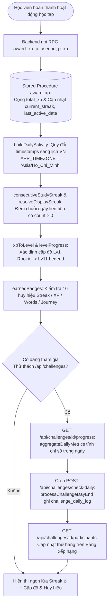
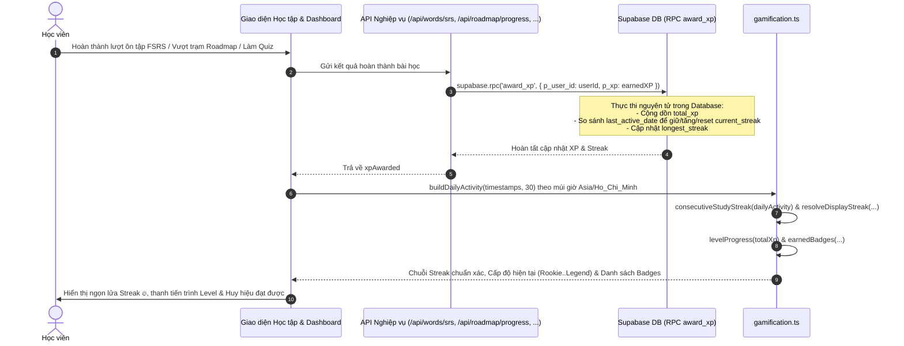
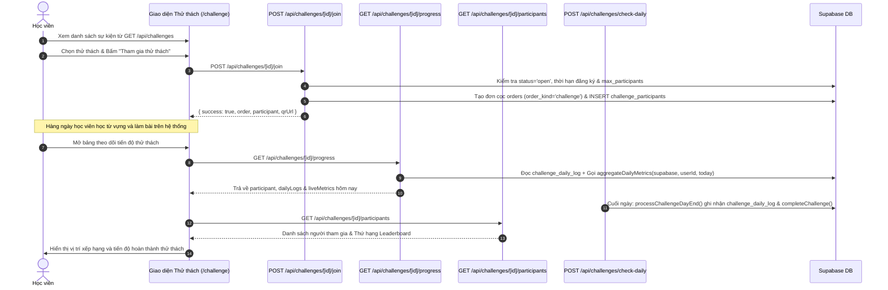

# Tài liệu Đặc tả Ca sử dụng (Use Case Specification)
## Tính năng: Trò chơi hóa, Chuỗi ngày học & Thử thách (Gamification, Streaks & Challenges)
**Mã tài liệu:** `UC-GAME-08`  
**File lưu trữ:** `agent/docs/SRS_08_GAMIFICATION_CHALLENGES.md`

---

### 1. Thông tin chung
* **Actor / Role thực hiện:**
  * `Student` (Học viên).
  * `Cron System` (Hệ thống tác vụ định kỳ tổng kết ngày).
* **Mô tả tóm tắt:** Quản lý cơ chế duy trì động lực học tập hàng ngày qua Chuỗi ngày liên tục (Daily Streaks tính theo múi giờ chuẩn `Asia/Ho_Chi_Minh`), tích lũy điểm kinh nghiệm (XP) qua Stored Procedure `award_xp`, thăng cấp độ danh hiệu (11 cấp từ `Rookie` đến `Legend`, hệ thống huy hiệu `BADGES`) và tham gia các chiến dịch Thử thách học tập (`/api/challenges`) có bảng xếp hạng người tham gia.
* **Tiền điều kiện (Pre-conditions):**
  * Học viên đã đăng nhập tài khoản.
* **Hậu điều kiện (Post-conditions):**
  * Điểm kinh nghiệm (`total_xp`) và chuỗi ngày (`current_streak`, `longest_streak`, `last_active_date`) được cập nhật nguyên tử qua RPC `award_xp`.
  * Tiến độ tham gia thử thách được ghi nhận vào `challenge_participants` và `challenge_daily_log`.

---

### 2. Danh sách API & Thư viện Nghiệp vụ liên quan
| Phương thức | Endpoint / RPC | Chức năng | Quyền hạn |
|---|---|---|---|
| `RPC` | `supabase.rpc('award_xp', { p_user_id, p_xp })` | Stored Procedure cộng điểm XP nguyên tử và cập nhật chuỗi ngày học (`current_streak`, `last_active_date`) trên Server DB | Backend Service Client |
| `GET` | `/api/student/stats` & `/api/profile` | Lấy thông tin XP, Level, Huy hiệu và chuỗi Streak hiển thị (`resolveDisplayStreak` & `consecutiveStudyStreak` từ `dailyActivity`) | User đã đăng nhập |
| `GET` / `POST` | `/api/challenges` & `GET /api/challenges/widget` | Lấy danh sách các chiến dịch thử thách đang mở (`GET`) hoặc tạo chiến dịch thử thách mới (`POST`) | Public (`GET`) / Teacher (`POST`) |
| `GET` / `PATCH` | `/api/challenges/[id]` | Xem thông tin chi tiết thể lệ (`GET`) hoặc cập nhật cấu hình chiến dịch thử thách (`PATCH`) | Public (`GET`) / Teacher (`PATCH`) |
| `POST` | `/api/challenges/[id]/join` | Học viên đăng ký tham gia thử thách (kiểm tra thời hạn, sĩ số tối đa, tạo đơn cọc `order_kind = 'challenge'` và bản ghi `challenge_participants`) | User đã đăng nhập |
| `GET` | `/api/challenges/[id]/progress` | Lấy tiến độ cá nhân hàng ngày (`challenge_daily_log`) và chỉ số học tập trực tiếp trong ngày (`aggregateDailyMetrics`) | User đã đăng nhập |
| `GET` | `/api/challenges/[id]/participants` | Lấy danh sách học viên tham gia và bảng xếp hạng (Leaderboard) của thử thách | Public / User |
| `POST` | `/api/challenges/check-daily` | Cronjob tổng kết nhật ký ngày (`processChallengeDayEnd`) và hoàn tất thử thách khi hết hạn (`completeChallenge`) | Cron Secret Token |
| `POST` | `/api/challenge/lead` | Thu thập thông tin đăng ký tư vấn tại `/challenge-landing` (lưu vào `data/campaign-leads/leads-challenge-landing.jsonl` và `pilot_leads`) | Public (Rate limit 10/min/IP) |
| `POST` | `/api/auth/data/rpc/claim_onboarding_xp` | Nhận thưởng XP khởi đầu sau khi hoàn tất khảo sát Onboarding | User đã đăng nhập |

---

### 3. Kịch bản chính (Main Flow) & Sơ đồ Luồng hoạt động

#### 3.1 Sơ đồ luồng tổng quan Gamification & Thử thách (Activity Flowchart)

#### Ca sử dụng 1: Hoàn thành bài học, Cộng XP qua RPC & Tính chuỗi Streak (UC-GAME-08.1)

1. **Bước 1 (Student):** Học viên hoàn thành một hoạt động học tập (ví dụ: chấm thẻ FSRS qua `/api/words/srs` nhận 2–15 XP, hoàn thành bước lộ trình qua `/api/roadmap/progress` nhận 15–45 XP, hoặc lưu kết quả quiz qua `/api/quiz/save`).
2. **Bước 2 (Backend -> Supabase RPC):** Tuyến API xử lý trên server gọi trực tiếp **Supabase Stored Procedure `award_xp({ p_user_id, p_xp })`** thay vì để client tự cập nhật bảng `profiles`, nhằm ngăn chặn hoàn toàn lỗi race condition và hành vi gian lận điểm số từ phía client.
3. **Bước 3 (Database):** Stored Procedure `award_xp` cộng dồn `total_xp` và đối chiếu `last_active_date` để cập nhật `current_streak` và `longest_streak`.
4. **Bước 4 (Backend/Frontend - Chuẩn hóa hiển thị Streak):** Khi tải trang thống kê hoặc hồ sơ học viên, module `src/lib/gamification.ts` thực hiện:
   * Gọi `buildDailyActivity(timestamps, 30)` để quy đổi toàn bộ lịch sử hoạt động sang khóa ngày `YYYY-MM-DD` theo múi giờ Việt Nam (`APP_TIMEZONE = 'Asia/Ho_Chi_Minh'`).
   * Gọi hàm hồi quy `consecutiveStudyStreak(dailyActivity)` và `resolveDisplayStreak()` để đếm lùi số ngày học liên tiếp từ hôm nay (có cơ chế ân hạn nếu hôm nay chưa học nhưng hôm qua đã học; dừng ngay khi gặp ngày `count === 0`).
5. **Bước 5 (Frontend):** Hàm `levelProgress(totalXp)` ánh xạ tổng XP sang 11 cấp bậc (`Rookie` $\rightarrow$ `Legend`) và hàm `earnedBadges()` mở khóa các huy hiệu tương ứng (Streak 3/7/30 ngày, 100/500/2000 XP, 10/50/100 từ thành thạo, hoàn thành cấp độ A0–B2).

#### Ca sử dụng 2: Tham gia Thử thách & Đua top Bảng xếp hạng (UC-GAME-08.2)

1. **Bước 1 (Student):** Học viên truy cập trang thử thách, hệ thống gọi `GET /api/challenges` để hiển thị các chiến dịch đang mở đăng ký hoặc đang diễn ra.
2. **Bước 2 (Student):** Học viên chọn một chiến dịch và bấm **"Tham gia thử thách"**.
3. **Bước 3 (Frontend -> Backend):** Gửi `POST /api/challenges/[id]/join`. Server kiểm tra chiến dịch đang ở trạng thái `open`, trong khung giờ `registration_opens_at` – `registration_closes_at`, chưa vượt quá `max_participants` và học viên chưa đăng ký trùng.
4. **Bước 4 (Backend):** Khởi tạo đơn hàng đặt cọc cam kết (`order_kind = 'challenge'`) cùng bản ghi trong bảng `challenge_participants` và trả về mã QR thanh toán cọc (`qrUrl`).
5. **Bước 5 (Student & Frontend):** Trong suốt thời gian diễn ra thử thách, học viên theo dõi tiến độ cá nhân qua `GET /api/challenges/[id]/progress`. Tuyến API này kết hợp dữ liệu lịch sử từ `challenge_daily_log` và chỉ số học tập thời gian thực trong ngày hôm đó qua hàm `aggregateDailyMetrics(supabase, userId, today)`.
6. **Bước 6 (Cron System):** Hàng ngày, hệ thống thực thi `POST /api/challenges/check-daily` (được bảo vệ bởi `assertCronAuthorized`) để gọi `processChallengeDayEnd()` chốt sổ `challenge_daily_log` cho từng học viên và gọi `completeChallenge()` khi chiến dịch kết thúc (`now > ends_at`).
7. **Bước 7 (Frontend):** Gọi `GET /api/challenges/[id]/participants` để hiển thị danh sách bảng xếp hạng các học viên tham gia thử thách.

---

### 4. Kịch bản ngoại lệ (Alternative & Exception Flows)

* **E1: Bị gián đoạn chuỗi ngày học (Đứt Streak)**
  * *Tại Bước 4 của UC-GAME-08.1:* Học viên bỏ lỡ cả ngày hôm qua và hôm nay chưa học (`lastActiveDate` cũ hơn ngày hôm qua theo lịch `Asia/Ho_Chi_Minh`).
  * *Xử lý:* Hàm `effectiveCurrentStreak` và `consecutiveStudyStreak` trả về `0` (chuỗi đã gãy, không cộng dồn các ngày học rải rác). Khi học viên hoàn thành bài học mới hôm nay, chuỗi Streak bắt đầu lại từ `1`.
* **E2: Học viên đăng ký thử thách đã đóng hoặc đủ chỗ**
  * *Tại Bước 3 của UC-GAME-08.2:* Chiến dịch có `status !== 'open'`, đã quá `registration_closes_at`, hoặc số người tham gia đã chạm ngưỡng `max_participants`.
  * *Xử lý:* Tuyến `POST /api/challenges/[id]/join` từ chối yêu cầu và trả về thông báo lỗi tương ứng (*"Đã hết thời gian đăng ký"* hoặc *"Đã đủ số lượng người tham gia tối đa"*).
* **E3: Lệch múi giờ giữa Server UTC và người dùng Việt Nam (Timezone Normalization)**
  * *Tại Bước 4 của UC-GAME-08.1 & Bước 6 của UC-GAME-08.2:* Học viên học vào khung giờ 23:00–23:59 giờ Việt Nam (tương ứng 16:00–16:59 UTC).
  * *Xử lý:* Toàn bộ các hàm tính ngày (`dateKeyInTimeZone`, `buildDailyActivity`, `aggregateDailyMetrics`) đều ép chuẩn múi giờ `APP_TIMEZONE = 'Asia/Ho_Chi_Minh'`, đảm bảo hoạt động của học viên luôn được ghi nhận chính xác vào đúng ngày lịch Việt Nam.

---

### 5. Điểm hạn chế, Rủi ro & Nút thắt trong Luồng hiện tại (Current Limitations & Architectural Bottlenecks)

1. **Lỗi Kép làm gãy hoàn toàn luồng thanh toán & kích hoạt Thử thách qua Webhook (`supabase/migrations/20260710_atomic_paid_order_confirmation.sql` dòng 125, `src/app/api/challenges/[id]/join/route.ts` dòng 55–78 & `src/app/api/billing/webhook/route.ts` dòng 285–292):**
   * *Hiện trạng:*
     * **Lỗi tầng 1 (RPC Exception):** Khi Webhook gọi `confirmOrder()`, Stored Procedure `confirm_paid_order` chỉ hỗ trợ `order_kind IN ('individual', 'group')` và ném thẳng ngoại lệ `raise exception 'Unsupported order kind: challenge'`, làm Webhook dừng ngay lập tức với lỗi 500 trước khi chạm tới đoạn mã kích hoạt thử thách!
     * **Lỗi tầng 2 (Thiếu `order_id`):** Ngay cả khi bỏ qua lỗi RPC, tại `POST /api/challenges/[id]/join`, hệ thống thực hiện `INSERT INTO orders` rồi `INSERT INTO challenge_participants` nhưng **không truyền trường `order_id: order.id`** vào `challenge_participants`. Trong khi đó, `/api/billing/webhook` (dòng 288) lại tìm người tham gia bằng `.from('challenge_participants').update({ deposit_status: 'paid', status: 'active' }).eq('order_id', order.id)`.
   * *Hệ quả:* Không một đơn đặt cọc thử thách nào (`order_kind = 'challenge'`) có thể được xác nhận tự động; học viên chuyển khoản xong vẫn bị kẹt vĩnh viễn ở `deposit_status: 'pending', status: 'registered'`.
2. **Chặn nhầm tài khoản Admin tạo/sửa Thử thách & Cho phép Giáo viên sửa Thử thách của người khác (`src/app/api/challenges/route.ts` dòng 54 & `src/app/api/challenges/[id]/route.ts` dòng 62):**
   * *Hiện trạng:* Cả `POST /api/challenges` lẫn `PATCH /api/challenges/[id]` đều kiểm tra cứng `if (profile?.role !== 'teacher') return forbidden('Teacher access required')`, từ chối cả tài khoản `role === 'admin'`. Đồng thời, `PATCH /api/challenges/[id]` không kiểm tra `challenge.created_by === auth.userId`.
   * *Hệ quả:* Quản trị viên (`admin`) không thể tạo hoặc cập nhật chiến dịch thử thách, trong khi bất kỳ tài khoản `teacher` nào cũng có thể chỉnh sửa trái phép thể lệ và tiền cọc của chiến dịch do người khác tạo.
3. **Đếm cả các bản ghi chưa đóng cọc (`pending`) vào giới hạn sĩ số `max_participants` & Thiếu nguồn dữ liệu trong `aggregateDailyMetrics` (`src/app/api/challenges/[id]/join/route.ts` dòng 35–45 & `src/lib/challenge.ts` dòng 130–145):**
   * *Hiện trạng:*
     * Câu lệnh kiểm tra `max_participants` đếm toàn bộ dòng trong `challenge_participants` mà không lọc theo `deposit_status = 'paid'` hay `status = 'active'`.
     * Hàm `aggregateDailyMetrics` (`src/lib/challenge.ts` dòng 130–145) chỉ đếm `reading_sessions` và `listening_sessions` từ bảng `user_toeic_question_history`, bỏ qua hoàn toàn các bài Đọc hiểu hàng ngày (`daily_reading_completions`), Thư viện đọc (`user_reading_library_progress`) và Video luyện nghe (`/api/listening/complete`).
   * *Hệ quả:* Các đơn ảo chưa thanh toán có thể làm đầy `max_participants`; đồng thời học viên luyện đọc/nghe ngoài phân hệ TOEIC không được tính chỉ số hoàn thành mục tiêu ngày của thử thách.
4. **Không đồng bộ tiến độ Ngữ pháp, Đọc hiểu, VSTEP và Foundation vào XP/Streak (`award_xp`) & Giới hạn cửa sổ 30 ngày của `buildDailyActivity`:**
   * *Hiện trạng:* Học viên hoàn thành bài tập Ngữ pháp (`POST /api/grammar/progress`), Đọc hiểu hàng ngày (`POST /api/practice/daily-reading`), đề thi VSTEP/VNU (`POST /api/vstep/submit`), hoặc bài luyện Foundation (`POST /api/foundation/vocabulary-map`) đều **không** gọi RPC `award_xp`; đồng thời `buildDailyActivity(timestamps, 30)` chỉ xét tối đa 30 ngày gần nhất.

