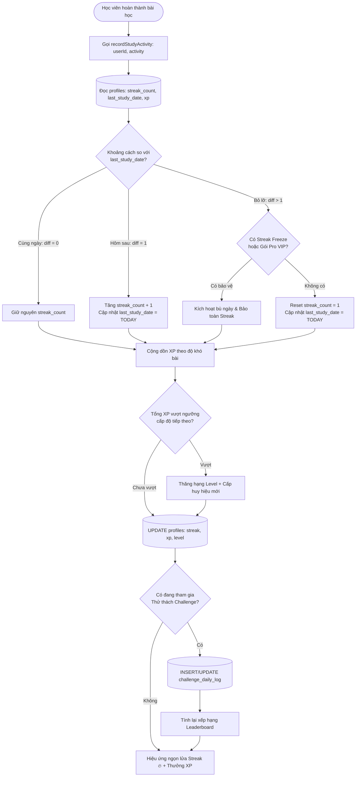
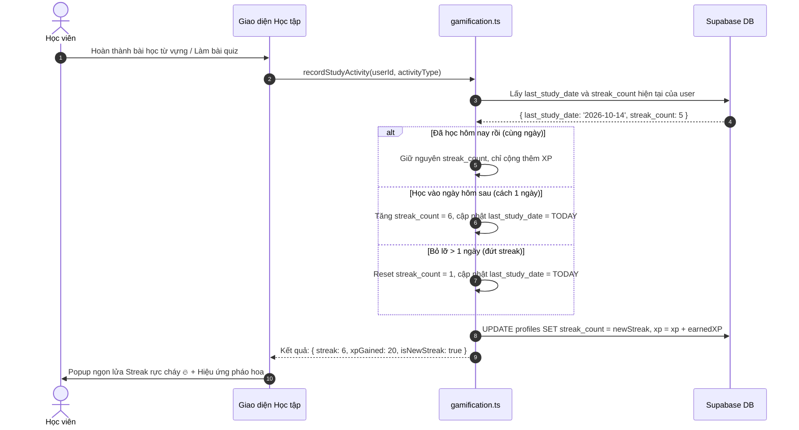
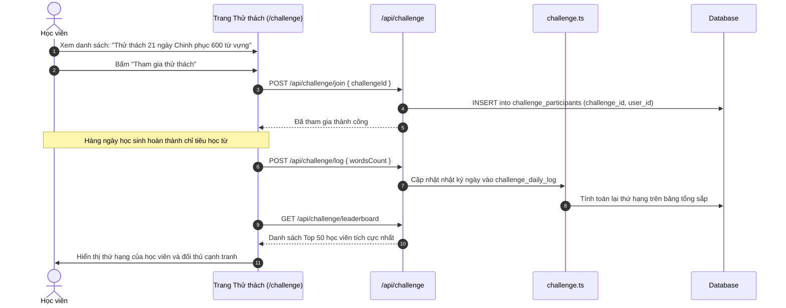

# Tài liệu Đặc tả Ca sử dụng (Use Case Specification)
## Tính năng: Trò chơi hóa, Chuỗi ngày học & Thử thách (Gamification, Streaks & Challenges)
**Mã tài liệu:** `UC-GAME-08`  
**File lưu trữ:** `agent/docs/SRS_08_GAMIFICATION_CHALLENGES.md`

---

### 1. Thông tin chung
* **Actor / Role thực hiện:**
  * `Student` (Học viên).
* **Mô tả tóm tắt:** Quản lý cơ chế duy trì thói quen học tập hàng ngày qua Chuỗi ngày liên tục (Daily Streaks), tích lũy điểm kinh nghiệm (XP), thăng cấp độ danh hiệu (Level/Badges) và tham gia các chiến dịch Thử thách học tập (Challenges) có bảng xếp hạng (Leaderboard) theo mùa.
* **Tiền điều kiện (Pre-conditions):**
  * Học viên đã đăng nhập tài khoản.
* **Hậu điều kiện (Post-conditions):**
  * Cập nhật chỉ số `streak_count`, `last_study_date`, `xp` trong `profiles`.
  * Nhật ký thử thách được lưu trong `challenge_daily_log`.

---

### 2. Danh sách API liên quan
| Phương thức | Endpoint | Chức năng | Quyền hạn |
|---|---|---|---|
| `POST` | `/api/challenge/join` | Học viên tham gia vào một chiến dịch thử thách | User đã đăng nhập |
| `POST` | `/api/challenge/log` | Ghi nhận hoạt động học hàng ngày cho thử thách | User đã đăng nhập |
| `GET` | `/api/challenge/leaderboard?challengeId=...` | Lấy bảng xếp hạng Top học viên chăm chỉ nhất | User đã đăng nhập |
| `GET` | `/api/profile/gamification` | Lấy thông tin Streak, XP, Cấp độ và Danh hiệu | User đã đăng nhập |

---

### 3. Kịch bản chính (Main Flow) & Sơ đồ Luồng hoạt động

#### 3.1 Sơ đồ luồng tổng quan Gamification & Thử thách (Activity Flowchart)

#### Ca sử dụng 1: Hoàn thành bài học & Duy trì chuỗi Streak (UC-GAME-08.1)

1. **Bước 1 (Student):** Học viên hoàn thành bất kỳ một hoạt động học tập nào trong ngày (ví dụ: hoàn thành 1 lượt Flashcard, làm xong 1 bài nghe TOEIC hoặc hoàn tất 1 Unit lộ trình).
2. **Bước 2 (Frontend/Backend):** Kích hoạt hàm ghi nhận hoạt động `recordStudyActivity(userId, activityType)`.
3. **Bước 3 (Backend):** Module `gamification.ts` lấy ngày học gần nhất (`last_study_date`) và số chuỗi ngày hiện tại (`streak_count`) từ bảng `profiles`:
   * **Trường hợp A (Cùng ngày):** Học viên đã học trước đó trong ngày hôm nay $\rightarrow$ Giữ nguyên `streak_count`, chỉ cộng dồn điểm XP nhận được.
   * **Trường hợp B (Ngày tiếp theo liên tiếp):** Ngày học gần nhất là ngày hôm qua $\rightarrow$ Tăng chuỗi ngày: `streak_count = streak_count + 1`, cập nhật `last_study_date = TODAY`.
4. **Bước 4 (Backend):** Tính toán cộng điểm kinh nghiệm XP dựa theo độ khó của bài học (ví dụ: +15 XP cho Flashcard, +50 XP cho bài thi thử).
5. **Bước 5 (Backend):** Kiểm tra điều kiện thăng cấp độ (Level Up): Nếu tổng XP vượt ngưỡng level tiếp theo, cập nhật danh hiệu mới.
6. **Bước 6 (Frontend):** Hiển thị hoạt ảnh ngọn lửa Streak bùng cháy kèm thông báo số ngày học liên tiếp và hiệu ứng âm thanh cổ vũ tích cực.

#### Ca sử dụng 2: Tham gia Thử thách & Đua top Bảng xếp hạng (UC-GAME-08.2)

1. **Bước 1 (Student):** Học viên truy cập `/challenge`, duyệt qua các sự kiện đang diễn ra (ví dụ: *"Thử thách 21 ngày Chinh phục 600 từ vựng"*).
2. **Bước 2 (Student):** Bấm nút **"Tham gia thử thách"**.
3. **Bước 3 (Frontend):** Gửi `POST /api/challenge/join` với `{ challengeId }`.
4. **Bước 4 (Backend):** Lưu thông tin vào bảng `challenge_participants` với `current_streak = 0`, `is_completed = false`.
5. **Bước 5 (Student):** Mỗi ngày học viên vào học, hệ thống tự động ghi số lượng từ học được vào `challenge_daily_log`.
6. **Bước 6 (Frontend):** Gọi `GET /api/challenge/leaderboard` để tải bảng tổng sắp:
   * Backend sắp xếp danh sách học viên theo tổng số từ đã học và chuỗi ngày duy trì trong sự kiện.
7. **Bước 7 (Frontend):** Hiển thị Top 1-3 với huy hiệu Vàng, Bạc, Đồng và vị trí thứ hạng cụ thể của chính học viên.
8. **Bước 8 (Student):** Khi duy trì đủ số ngày yêu cầu (ví dụ: 21 ngày), hệ thống tự động đánh dấu hoàn thành và cấp huy hiệu chứng nhận đặc biệt trên trang cá nhân.

---

### 4. Kịch bản ngoại lệ (Alternative & Exception Flows)

* **E1: Bị gián đoạn chuỗi ngày học (Đứt Streak)**
  * *Tại Bước 3 của UC-GAME-08.1:* Học viên không vào học ngày hôm qua (khoảng cách giữa ngày học gần nhất và hôm nay $> 1$ ngày).
  * *Xử lý:* `streak_count` bị reset về `1`. Nếu học viên có vật phẩm "Bảo vệ Streak" (Streak Freeze) hoặc có gói Pro VIP, hệ thống sẽ kích hoạt tự động bù ngày và bảo lưu chuỗi ngày hiện tại cho học viên.
* **E2: Học viên tham gia thử thách đã kết thúc thời hạn**
  * *Tại Bước 3 của UC-GAME-08.2:* Chiến dịch thử thách đã quá ngày kết thúc (`end_date < NOW()`).
  * *Xử lý:* Backend từ chối tham gia, trả về HTTP 400: *"Thử thách này đã kết thúc thời gian đăng ký."* Frontend hiển thị danh sách các thử thách mới sắp khởi tranh.
* **E3: Lệch múi giờ giữa client và server (Timezone Handling)**
  * *Tại Bước 3 của UC-GAME-08.1:* Học viên học vào lúc 23:55 hoặc sống ở nước ngoài lệch múi giờ.
  * *Xử lý:* Hệ thống chuẩn hóa việc tính mốc ngày theo múi giờ địa phương của người dùng (mặc định GMT+7 - `Asia/Ho_Chi_Minh`), đảm bảo không bị tính nhầm sang ngày mới trước nửa đêm.
