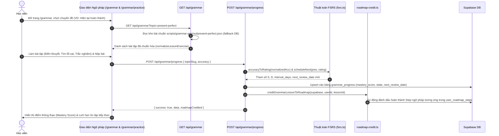

# Tài liệu Đặc tả Ca sử dụng (Use Case Specification)
## Tính năng: Hệ thống Học & Ôn tập Ngữ pháp Thông minh (Grammar Learning, AI Exercise Generation & FSRS Review)
**Mã tài liệu:** `UC-GRAM-09`  
**File lưu trữ:** `agent/docs/SRS_09_GRAMMAR_SYSTEM.md`

---

### 1. Thông tin chung
* **Actor / Role thực hiện:**
  * `Student` (Học viên tự học hoặc học theo lớp).
  * `Teacher` (Giáo viên tạo bài tập ngữ pháp AI cho lớp học).
* **Mô tả tóm tắt:** Cung cấp lộ trình học ngữ pháp từ A1 đến C1 (`UNIFIED_GRAMMAR_TOPICS`), xem lý thuyết trực quan và phân tích cấu trúc câu (`/api/grammar/theory`, `/api/grammar/annotate`), làm bài tập 3 dạng (`multiple_choice`, `fill_blank`, `error_correction`), tính chu kỳ ôn tập ngữ pháp bằng thuật toán FSRS v5 (`/api/grammar/progress`, `/api/grammar/review`), tự động liên thông tín chỉ sang Lộ trình Journey (`creditGrammarLessonToRoadmap`) và hỗ trợ Giáo viên sinh bài tập ngữ pháp bằng AI (`/api/grammar`).
* **Tiền điều kiện (Pre-conditions):**
  * Học viên hoặc Giáo viên đã đăng nhập vào hệ thống.
* **Hậu điều kiện (Post-conditions):**
  * Tiến độ làm bài và độ thông thạo (`mastery_score`, `state`, `next_review_date`) được lưu vào bảng `grammar_progress`.
  * Nếu chủ đề ngữ pháp trùng với một bước (Step) trong lộ trình `/journey`, hệ thống tự động đánh dấu hoàn thành bước đó qua `creditGrammarLessonToRoadmap`.

---

### 2. Danh sách API liên quan
| Phương thức | Endpoint | Chức năng | Quyền hạn |
|---|---|---|---|
| `GET` | `/api/grammar/topics` | Lấy danh sách toàn bộ chủ đề ngữ pháp phân cấp theo trình độ CEFR | Public / User |
| `GET` | `/api/grammar/lessons?topicId=...` | Lấy danh sách bài học thuộc một chủ đề ngữ pháp | Public / User |
| `GET` | `/api/grammar/theory?topic=...` | Lấy nội dung lý thuyết chi tiết, công thức và ví dụ của chủ đề | Public / User |
| `GET` | `/api/grammar?topic=...` hoặc `?lessonId=...` hoặc `?classroomId=...` | Tải bộ bài tập thực hành của chủ đề (ưu tiên kho chuẩn hóa `scripts/grammar-gen/out/${topicSlug}.json` hoặc `grammar_exercises` của lớp) | User / Thành viên lớp |
| `POST` | `/api/grammar` | Giáo viên dùng AI sinh bộ bài tập ngữ pháp mới (3 dạng câu hỏi, bẫy lỗi học viên Việt) và lưu vào `grammar_exercises` của lớp | Teacher sở hữu lớp (Rate limit 5/min) |
| `GET` / `POST` | `/api/grammar/quiz` & `/api/grammar/generate` | Lấy hoặc sinh bài tập trắc nghiệm ngữ pháp nhanh theo trình độ | User đã đăng nhập |
| `POST` | `/api/grammar/annotate` | Phân tích và gắn nhãn thành phần ngữ pháp trực tiếp trên câu | User đã đăng nhập |
| `GET` | `/api/grammar/progress?view=topics` hoặc `?summary=1` | Lấy tiến độ ngữ pháp tổng hợp theo chủ đề (`TopicProgressSummary[]`) hoặc đếm số bài đến hạn ôn (`dueCount`) | User đã đăng nhập |
| `POST` | `/api/grammar/progress` | Ghi nhận độ chính xác (`accuracy`), quy đổi sang FSRS Rating (`accuracyToRating`), cập nhật `grammar_progress` và liên thông lộ trình Journey | User đã đăng nhập |
| `GET` / `POST` | `/api/grammar/review` | Tải hàng đợi các bài ngữ pháp đến hạn ôn tập và lưu kết quả ôn tập ngắt quãng | User đã đăng nhập |

---

### 3. Kịch bản chính (Main Flow) & Sơ đồ Luồng hoạt động

#### 3.1 Sơ đồ luồng tổng quan Học, Luyện tập & Giao bài Ngữ pháp (Activity Flowchart)
```mermaid
flowchart TD
    Start([Truy cập phân hệ Ngữ pháp]) --> RoleMode{Vai trò & Chế độ?}

    %% Nhánh Học viên Tự học & Ôn tập
    RoleMode -->|Student: Học chủ đề| LoadTopics[GET /api/grammar/progress?view=topics<br/>Hiển thị tiến độ từng chuyên đề A1-C1]
    LoadTopics --> PickTopic[Chọn chuyên đề ngữ pháp: VD Present Simple]
    PickTopic --> ReadTheory[GET /api/grammar/theory<br/>Xem công thức, dấu hiệu nhận biết & bẫy thường gặp]
    ReadTheory --> LoadEx[GET /api/grammar?topic=slug<br/>Tải bài tập 3 dạng: Fill Blank, Error Correction, MCQ]
    LoadEx --> DoPractice[Student hoàn thành bài tập & Xem giải thích tiếng Việt]
    DoPractice --> SubmitProgress[POST /api/grammar/progress { topicSlug, accuracy }]
    
    SubmitProgress --> MapFSRS["accuracyToRating: >=90% Easy(4), >=70% Good(3), >=50% Hard(2), <50% Again(1)"]
    MapFSRS --> CalcSchedule[scheduleNext FSRS: Tính stability, difficulty, next_review_date]
    CalcSchedule --> CheckMastery{mastery_score >= 80%?}
    CheckMastery -->|Đạt >= 80%| SetMastered[state = 'mastered']
    CheckMastery -->|Chưa đạt| SetLearning[state = learning / review]
    SetMastered --> UpsertProgress[(Upsert bảng grammar_progress)]
    SetLearning --> UpsertProgress
    UpsertProgress --> CreditJourney[creditGrammarLessonToRoadmap:<br/>Tự động mở khóa Step tương ứng trên /journey]

    %% Nhánh Giáo viên tạo bài tập bằng AI
    RoleMode -->|Teacher: Tạo bài cho lớp| TeacherInput[Chọn Lớp học, Chủ đề, Level & Số câu 1-10]
    TeacherInput --> CallGenAPI[POST /api/grammar { classroomId, topic, level, count, lessonId }]
    CallGenAPI --> CheckTeacherAuth{Kiểm tra Teacher sở hữu lớp<br/>& Rate Limit 5/phút?}
    CheckTeacherAuth -->|Không hợp lệ| RejectGen[Trả về 403 / 429]
    CheckTeacherAuth -->|Hợp lệ| PromptAI[AIRouter sinh câu hỏi bám sát lỗi sai người Việt]
    PromptAI --> NormalizeEx[normalizeExercise: Kiểm tra đủ 4 đáp án & sắp xếp độ khó 1->3]
    NormalizeEx --> SaveClassEx[(INSERT vào bảng grammar_exercises)]
```

#### Ca sử dụng 1: Học viên học chuyên đề ngữ pháp & Tính lịch ôn FSRS (UC-GRAM-09.1)


1. **Bước 1 (Student):** Học viên truy cập `/grammar`. Giao diện gọi `GET /api/grammar/progress?view=topics` để hiển thị danh sách chuyên đề kèm trạng thái đã học (`learnedLessons`) và đã thành thạo (`masteredLessons`).
2. **Bước 2 (Student):** Học viên bấm vào một chuyên đề để đọc lý thuyết (`/api/grammar/theory`) và chuyển sang màn hình luyện tập (`/grammar/practice`).
3. **Bước 3 (Frontend -> Backend):** Gọi `GET /api/grammar?topic=...`. Backend ưu tiên tải bộ bài tập đã kiểm duyệt từ `scripts/grammar-gen/out/${topicSlug}.json` (hoặc fallback sang `grammar_lessons.exercises` trong DB) và chuẩn hóa qua `normalizeLessonExercise`.
4. **Bước 4 (Student):** Học viên trả lời các câu hỏi theo thứ tự từ dễ đến khó (`difficulty: 1 -> 3`), xem giải thích chi tiết bằng tiếng Việt cho cả đáp án đúng lẫn các phương án nhiễu (distractors).
5. **Bước 5 (Frontend):** Sau khi hoàn thành bài tập, gửi `POST /api/grammar/progress` với `{ lessonId / topicSlug, accuracy }`.
6. **Bước 6 (Backend):**
   * Quy đổi tỷ lệ đúng (`accuracy`) sang FSRS Rating: $\ge 90\% \rightarrow \text{Easy (4)}$; $\ge 70\% \rightarrow \text{Good (3)}$; $\ge 50\% \rightarrow \text{Hard (2)}$; $< 50\% \rightarrow \text{Again (1)}$.
   * Tính toán điểm thông thạo `masteryScore` (nếu $\ge 80\%$ sẽ gắn trạng thái `mastered`) và lịch ôn tập tiếp theo qua `scheduleNext()`.
   * Upsert vào bảng `grammar_progress` và gọi `creditGrammarLessonToRoadmap()` để tự động liên thông tiến độ với lộ trình `/journey`.

#### Ca sử dụng 2: Giáo viên dùng AI tạo bài tập ngữ pháp cho Lớp học (UC-GRAM-09.2)
1. **Bước 1 (Teacher):** Giáo viên truy cập `/teacher/grammar/[classroomId]`, nhập chủ đề ngữ pháp (`topic`), chọn trình độ (`beginner | intermediate | advanced`), số lượng câu (`1–10`) và bài học liên kết (`lessonId`).
2. **Bước 2 (Frontend):** Gửi `POST /api/grammar` với `{ classroomId, topic, level, count, lessonId }`.
3. **Bước 3 (Backend):** Kiểm tra Rate Limit (5 req/phút/IP), xác thực người gọi là giáo viên sở hữu lớp (`cls.teacher_id === auth.userId`), và lấy nội dung lý thuyết của bài học (nếu có `lessonId`) làm ngữ cảnh.
4. **Bước 4 (Backend - AI Generation):** Gọi `getRouter().generate(prompt, 'normal', true)` yêu cầu AI sinh bài tập kết hợp 3 dạng (`fill_blank`, `error_correction`, `multiple_choice`), nhấn mạnh từ khóa bằng `**markdown bold**` và thiết kế đáp án nhiễu bám sát lỗi điển hình của người Việt.
5. **Bước 5 (Backend):** Chạy `normalizeExercise()` để loại bỏ câu sai định dạng, kiểm tra `correct_answer` nằm trong 4 `options`, sắp xếp theo độ khó tăng dần và lưu vào bảng `grammar_exercises`.

---

### 4. Kịch bản ngoại lệ (Alternative & Exception Flows)

* **E1: Chuyên đề ngữ pháp mới chưa có bản ghi UUID trong bảng `grammar_lessons`**
  * *Tại Bước 6 của UC-GRAM-09.1:* Học viên học một chuyên đề trong `UNIFIED_GRAMMAR_TOPICS` (ví dụ: `#00 sentence-structure-svo`) khi DB chưa tạo dòng `grammar_lessons` tương ứng.
  * *Xử lý:* Tuyến `POST /api/grammar/progress` tự động lưu tiến độ vào bộ nhớ đệm fallback (`grammar:topic_progress:${userId}`) và hợp nhất (merge) liền mạch khi gọi `GET /api/grammar/progress?view=topics`, không gây lỗi 404 hay mất tiến độ của học viên.
* **E2: Mất kết nối tới Supabase khi tải bài tập tự học**
  * *Tại Bước 3 của UC-GRAM-09.1:* Kết nối DB bị gián đoạn khi học viên gọi `GET /api/grammar?topic=...`.
  * *Xử lý:* Backend bắt ngoại lệ và đọc trực tiếp từ file JSON cục bộ `scripts/grammar-gen/out/${topicSlug}.json`, đảm bảo học viên vẫn làm bài tập bình thường.
* **E3: Người dùng không phải thành viên lớp cố truy cập bài tập ngữ pháp riêng của lớp**
  * *Tại `GET /api/grammar?classroomId=...`:* Tài khoản không phải giáo viên chủ lớp và không có trong bảng `enrollments`.
  * *Xử lý:* Backend trả về HTTP 403 Forbidden (`Not a member of this classroom`).

---

### 5. Điểm hạn chế, Rủi ro & Nút thắt trong Luồng hiện tại (Current Limitations & Architectural Bottlenecks)

1. **Mất dữ liệu tiến độ & hàng đợi câu sai khi Server khởi động lại do lưu trong RAM (`ttl-cache`) (`src/app/api/grammar/progress/route.ts` dòng 339–370 & `src/app/api/grammar/review/route.ts` dòng 157–175):**
   * *Hiện trạng:*
     * Các chuyên đề ngữ pháp mới trong `UNIFIED_GRAMMAR_TOPICS` chưa có bản ghi UUID tương ứng trong bảng `grammar_lessons` của DB sẽ được lưu tiến độ vào bộ nhớ RAM cục bộ (`cacheSet("grammar:topic_progress:${userId}", ...)`).
     * Toàn bộ hàng đợi câu hỏi ngữ pháp làm sai khi tự học (`POST /api/grammar/review` khi không có `classroomId`) cũng chỉ được lưu vào `ttl-cache` trong RAM (`cacheSet("grammar:review_queue:${userId}", ...)` với TTL 30 ngày) vì bảng `grammar_question_srs` trong DB yêu cầu khóa ngoại `exercise_id` thuộc bảng `grammar_exercises` của lớp học.
   * *Hệ quả:* Mỗi khi dịch vụ `lingopro.service` được restart khi deploy bản mới, toàn bộ tiến độ của các chuyên đề chưa có UUID trong DB và toàn bộ danh sách câu ngữ pháp làm sai cần ôn tập của học viên tự học bị xóa sạch!
2. **Không cộng XP / Streak và tin tưởng tuyệt đối `accuracy` từ Client (`src/app/api/grammar/progress/route.ts` dòng 234–335):**
   * *Hiện trạng:* `POST /api/grammar/progress` nhận trực tiếp tỷ lệ `accuracy` từ client (thậm chí nếu gửi `{ isCompleted: true }` mà không truyền `accuracy` thì mặc định gán `accuracy = 1.0` = 100%), không có cơ chế CAS chống ghi đè đồng thời như từ vựng, và **không gọi RPC `award_xp`**.
   * *Hệ quả:* Học viên hoàn thành bài tập ngữ pháp không nhận được XP hay cập nhật Streak từ server, đồng thời client có thể gửi `{ topicSlug, isCompleted: true }` để đánh dấu `mastered` (100%) ngay lập tức và mở khóa bước ngữ pháp trên `/journey`.
3. **Lộ đáp án đúng (`correct_answer`) ngay trong payload tải bài tập (`GET /api/grammar`):**
   * *Hiện trạng:* Tuyến `GET /api/grammar` trả về mảng câu hỏi kèm sẵn `correct_answer` và `explanation_vi` để phục vụ chấm điểm tức thì ở client.
   * *Hệ quả:* Đối với các bài kiểm tra ngữ pháp do giáo viên giao trong lớp (`classroomId`), học sinh có thể nhìn thấy đáp án đúng trong Network DevTools trước khi nộp bài.
4. **Lỗi bỏ sót liên thông tiến độ Ngữ pháp sang lộ trình `toeic` (`src/lib/roadmap-credit.ts` dòng 331):**
   * *Hiện trạng:* Khi `POST /api/grammar/progress` gọi `creditGrammarLessonToRoadmap()`, dòng 331 ánh xạ `const t: RoadmapTrack = en.track === 'thpt' ? 'thpt' : 'cefr'`, biến mọi bản ghi ghi danh `track = 'toeic'` thành `'cefr'`.
   * *Hệ quả:* Học viên hoàn thành chuyên đề ngữ pháp trong `/grammar` không bao giờ được tự động đánh dấu hoàn thành các trạm ngữ pháp tương ứng trên lộ trình `toeic`.


