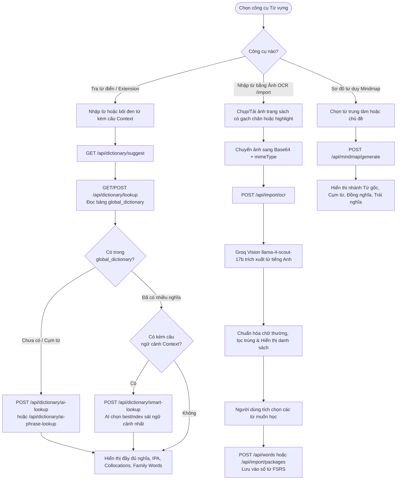
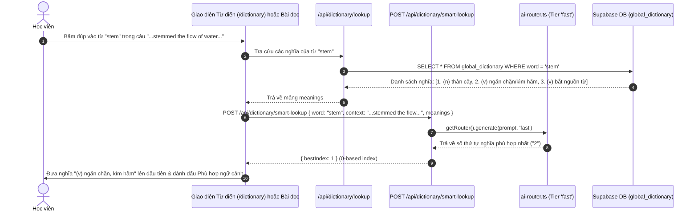
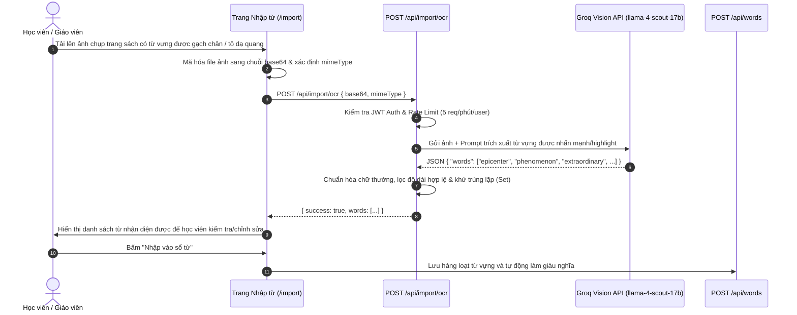

# Tài liệu Đặc tả Ca sử dụng (Use Case Specification)
## Tính năng: Từ điển Thông minh Đa tầng, Quét ảnh OCR & Sơ đồ Tư duy Mindmap (Smart Dictionary, Vision OCR & Lexical Mindmap)
**Mã tài liệu:** `UC-DICT-10`  
**File lưu trữ:** `agent/docs/SRS_10_DICTIONARY_OCR_MINDMAP.md`

---

### 1. Thông tin chung
* **Actor / Role thực hiện:**
  * `Student` / `Teacher` (Người dùng tra cứu từ vựng, nhập từ qua ảnh chụp OCR hoặc mở rộng vốn từ bằng Sơ đồ tư duy Mindmap).
  * `Browser Extension` (Tiện ích mở rộng trình duyệt LingoPro tra từ nhanh trên web bất kỳ).
* **Mô tả tóm tắt:** Cung cấp hệ thống tra cứu từ vựng đa tầng: Tra từ điển chuẩn xác kết hợp chọn nghĩa theo ngữ cảnh bằng AI (`/api/dictionary/lookup`, `/api/dictionary/smart-lookup`, `/api/dictionary/ai-lookup`, `/api/dictionary/ai-phrase-lookup`), gợi ý từ tự động (`/api/dictionary/suggest`), trích xuất từ vựng được gạch chân/tô sáng từ ảnh chụp sách vở bằng mô hình thị giác máy tính Groq LLaMA Vision (`/api/import/ocr`), nhập gói từ hàng loạt (`/api/import/packages`), sinh Sơ đồ tư duy từ vựng liên kết (`/api/mindmap/generate`, `/api/mindmap/nlm`) và cấp token đồng bộ với Chrome Extension (`/api/extension-token`).
* **Tiền điều kiện (Pre-conditions):**
  * Người dùng đã đăng nhập (đối với các tính năng gọi AI, OCR, Mindmap và lưu từ vào sổ).
* **Hậu điều kiện (Post-conditions):**
  * Dữ liệu từ vựng mới tra cứu được làm giàu và lưu đệm vào bảng `global_dictionary`.
  * Danh sách từ trích xuất từ ảnh OCR hoặc gói từ được thêm vào bảng `words` của người dùng để học qua FSRS.

---

### 2. Danh sách API liên quan
| Phương thức | Endpoint | Chức năng | Quyền hạn |
|---|---|---|---|
| `GET` / `POST` | `/api/dictionary/lookup` | Tra cứu từ vựng trong `global_dictionary` (IPA, nghĩa tiếng Việt, ví dụ, từ gia đình, đồng/trái nghĩa) | Public / User |
| `GET` | `/api/dictionary/suggest?q=...` | Gợi ý tự động (Autocomplete) các từ vựng khớp tiền tố khi người dùng đang gõ | Public / User |
| `POST` | `/api/dictionary/smart-lookup` | Dùng AI chọn ra nghĩa phù hợp nhất (`bestIndex`) của một từ đa nghĩa dựa trên câu ngữ cảnh (`context`) | User đã đăng nhập (Rate limit 15/min) |
| `POST` | `/api/dictionary/ai-lookup` & `/api/dictionary/ai-phrase-lookup` | Dùng AI phân tích chuyên sâu từ hiếm hoặc cụm từ/thành ngữ (Idiom / Phrasal Verb / Collocation) chưa có trong từ điển tĩnh | User đã đăng nhập |
| `GET` | `/api/dictionary/external` | Truy vấn bổ sung dữ liệu từ nguồn từ điển chuẩn bên ngoài | Public / User |
| `POST` | `/api/import/ocr` | Quét ảnh chụp trang sách/tài liệu (`base64`, `mimeType`) bằng Groq LLaMA Vision để trích xuất danh sách từ vựng được gạch chân/highlight | User đã đăng nhập (Rate limit 5/min) |
| `POST` | `/api/import/packages` | Nhập hàng loạt gói từ vựng hoặc danh sách từ vào sổ từ cá nhân / lớp học | User đã đăng nhập |
| `POST` | `/api/mindmap/generate` & `/api/mindmap/nlm` | Sinh sơ đồ tư duy từ vựng (Root word, Collocations, Synonyms, Antonyms, Topic network) | User đã đăng nhập |
| `GET` / `POST` / `DELETE` | `/api/extension-token` | Liệt kê (`GET`), cấp mới tối đa 10 token (`POST`) và thu hồi 1 hoặc toàn bộ token (`DELETE ?id=...` / `?all=1`) cho Browser Extension | User đã đăng nhập |
| `GET` / `POST` | `/api/bot/*` (`next-batch`, `save-batch`, `family-batch`, `synant-batch`, `example-vi-batch`, `fill-images`) | Hệ thống worker nội bộ làm giàu hàng loạt kho từ điển `global_dictionary` | Bot Secret Token |

---

### 3. Kịch bản chính (Main Flow) & Sơ đồ Luồng hoạt động

#### 3.1 Sơ đồ luồng tổng quan Tra cứu Thông minh, Quét OCR & Mindmap (Activity Flowchart)

#### Ca sử dụng 1: Tra cứu từ đa nghĩa theo ngữ cảnh (Contextual Smart Lookup) (UC-DICT-10.1)

1. **Bước 1 (Student):** Học viên tra cứu một từ tại `/dictionary` hoặc bấm vào một từ bất kỳ khi đang đọc bài trên hệ thống / qua Browser Extension.
2. **Bước 2 (Frontend):** Gọi `/api/dictionary/lookup` để lấy toàn bộ danh sách nghĩa, phiên âm IPA, từ gia đình (`familyWords`) và ví dụ từ `global_dictionary` (nếu từ chưa có hoặc là cụm từ, gọi `/api/dictionary/ai-lookup` hoặc `/api/dictionary/ai-phrase-lookup`).
3. **Bước 3 (Frontend -> Smart Lookup):** Nếu từ được chọn nằm trong một câu ngữ cảnh (`context`) và có nhiều nghĩa khác nhau, Frontend gọi `POST /api/dictionary/smart-lookup` kèm `{ word, context, meanings }`.
4. **Bước 4 (Backend):** Kiểm tra Rate Limit (15 req/phút/user), làm sạch dữ liệu (`sanitizeForPrompt`) và gọi `getRouter().generate(prompt, 'fast')` để chọn định nghĩa khớp từ loại (POS) và ngữ cảnh nhất.
5. **Bước 5 (Frontend):** Nhận `{ bestIndex }` và tự động đẩy nghĩa sát ngữ cảnh nhất lên vị trí đầu tiên. Học viên có thể bấm **"Lưu từ"** để đưa từ kèm đúng nghĩa đó vào hàng đợi FSRS.

#### Ca sử dụng 2: Quét ảnh sách/tài liệu bằng AI Vision OCR để nhập từ vựng (UC-DICT-10.2)

1. **Bước 1 (Student/Teacher):** Người dùng truy cập `/import`, chọn tính năng **"Quét từ vựng từ ảnh (AI OCR)"** và tải lên ảnh chụp trang sách, đề thi hoặc ghi chú viết tay.
2. **Bước 2 (Frontend):** Đọc file ảnh thành chuỗi `base64` kèm `mimeType` và gửi `POST /api/import/ocr`.
3. **Bước 3 (Backend):** Xác thực người dùng (`getAuthUser`), kiểm tra Rate Limit (5 ảnh/phút/user) và chọn khóa API khả dụng (`pickGroqKey()`).
4. **Bước 4 (Backend -> Groq Vision):** Gửi yêu cầu tới mô hình đa phương thức `meta-llama/llama-4-scout-17b-16e-instruct` với `temperature: 0.1` và `response_format: { type: 'json_object' }` để nhận diện các từ tiếng Anh được gạch chân, in đậm hoặc tô màu highlight.
5. **Bước 5 (Backend):** Trích xuất mảng `words`, chuẩn hóa `toLowerCase().trim()`, loại bỏ từ trùng lặp và trả về cho giao diện.
6. **Bước 6 (Student):** Người dùng duyệt lại danh sách từ và xác nhận lưu vào sổ từ cá nhân hoặc lớp học.

---

### 4. Kịch bản ngoại lệ (Alternative & Exception Flows)

* **E1: AI Smart Lookup bị quá tải hoặc vượt Rate Limit (Graceful Default Index)**
  * *Tại Bước 4 của UC-DICT-10.1:* Người dùng tra từ liên tục vượt 15 lần/phút hoặc AI provider gặp sự cố.
  * *Xử lý:* Tuyến `/api/dictionary/smart-lookup` luôn trả về `{ bestIndex: 0 }` (nghĩa phổ biến nhất mặc định) thay vì báo lỗi làm gián đoạn popup tra từ của học viên.
* **E2: Ảnh chụp mờ hoặc không chứa từ vựng tiếng Anh rõ ràng**
  * *Tại Bước 4 của UC-DICT-10.2:* Ảnh tải lên không có chữ tiếng Anh.
  * *Xử lý:* Mô hình Vision trả về `{"words": []}`. Giao diện thông báo *"Không tìm thấy từ vựng rõ ràng trong ảnh, vui lòng chụp rõ nét hơn hoặc nhập từ thủ công."*
* **E3: Thời gian xử lý ảnh OCR kéo dài (Timeout Handling)**
  * *Tại Bước 4 của UC-DICT-10.2:* Ảnh có độ phân giải lớn khiến request tới Vision API chậm.
  * *Xử lý:* Route `/api/import/ocr` thiết lập `maxDuration = 60` giây và `AbortSignal.timeout(45000)` để tránh treo kết nối vô hạn.

---

### 5. Điểm hạn chế, Rủi ro & Nút thắt trong Luồng hiện tại (Current Limitations & Architectural Bottlenecks)

1. **Không giới hạn kích thước chuỗi `base64` đầu vào tại `POST /api/import/ocr` (`src/app/api/import/ocr/route.ts` dòng 39–62):**
   * *Hiện trạng:* Route nhận `{ base64, mimeType }` từ JSON body nhưng chỉ kiểm tra `!base64 || typeof base64 !== 'string'`, hoàn toàn không kiểm tra `base64.length` (ví dụ giới hạn $\le 4\text{MB}$) và không kiểm tra `mimeType` thuộc danh sách ảnh hợp lệ trước khi nhúng toàn bộ chuỗi vào JSON gửi sang Groq API.
   * *Hệ quả:* Người dùng chụp ảnh độ phân giải cao trên điện thoại (10–15MB ảnh gốc $\rightarrow$ ~20MB chuỗi Base64) sẽ gây tăng đột biến RAM của tiến trình Node.js khi `JSON.parse`/`JSON.stringify` và bị Groq API từ chối với lỗi `413 Payload Too Large`.
2. **Prompt OCR quá rộng dẫn tới trích xuất tràn lan từ không được highlight (`src/app/api/import/ocr/route.ts` dòng 67–75):**
   * *Hiện trạng:* Trong prompt gửi cho `llama-4-scout-17b`, bên cạnh yêu cầu lấy các từ gạch chân/tô sáng, dòng thứ 4 lại dặn thêm: *"- Words that a student might need to learn"*.
   * *Hệ quả:* Ngay cả khi học viên chỉ tô dạ quang 2–3 từ trên một trang sách, mô hình Vision vẫn tự ý nhặt thêm hàng chục từ bất kỳ khác trên trang sách mà nó cho là "học sinh có thể cần học", khiến học viên phải xóa bớt thủ công rất mất thời gian.
3. **Phụ thuộc cứng vào duy nhất nhà cung cấp Groq cho tính năng Vision OCR (`src/app/api/import/ocr/route.ts` dòng 48–62):**
   * *Hiện trạng:* Khác với các tính năng văn bản có `AIRouter` xoay vòng qua Groq $\rightarrow$ Zhipu $\rightarrow$ Gemini, tuyến `/api/import/ocr` gọi trực tiếp `https://api.groq.com/openai/v1/chat/completions` bằng `pickGroqKey()` mà không có cơ chế fallback sang Gemini Flash Vision khi Groq hết quota hoặc lỗi 5xx.
4. **Hạn mức Token Extension (`MAX_ACTIVE_TOKENS_PER_USER = 10`) chặn tạo mới thay vì tự động xoay vòng token cũ nhất (`src/app/api/extension-token/route.ts` dòng 106–115):**
   * *Hiện trạng:* Khi người dùng cài lại trình duyệt hoặc đăng nhập Extension nhiều lần chạm mốc 10 token, `POST /api/extension-token` trả về lỗi `429 Too Many Requests` bắt người dùng phải tự gọi API xóa token cũ thay vì tự động thu hồi token có `last_used_at` cũ nhất (FIFO eviction).
5. **Lỗ hổng Open Redirect & Bỏ qua kiểm tra `.svg` trong `GET /api/image-proxy` (`src/app/api/image-proxy/route.ts` dòng 143–170):**
   * *Hiện trạng:* Nếu tên miền trong `?url=...` thuộc danh sách `directHosts` (`*.r2.dev`, `*.supabase.co`, `*.googleusercontent.com`, `*.cloudinary.com`, ...), route lập tức trả về `NextResponse.redirect(url, 302)` ở dòng 159 **trước khi** gọi `assertSafeImageUrl(url)` ở dòng 170 (hàm chặn phần mở rộng `.svg`).
   * *Hệ quả:* Bất kỳ đường dẫn `.svg` (có thể nhúng mã JavaScript XSS) hoặc trang giả mạo nào được lưu trữ trên một bucket `.r2.dev` / `.supabase.co` bất kỳ đều có thể lợi dụng `https://lingopro.online/api/image-proxy?url=...` để chuyển hướng mở (Open Redirect).
6. **Gọi tiến trình con Python `notebooklm-cli` kéo dài 240 giây và dùng chung 1 Notebook toàn cục tại `POST /api/mindmap/nlm` (`src/app/api/mindmap/nlm/route.ts` dòng 18–145):**
   * *Hiện trạng:* Route khởi chạy các tiến trình con `nlm` (`execFile`) với thời gian chờ lên tới `240.000ms` (4 phút), dùng chung một Notebook duy nhất mang tên `"LingoPro Vocab Mind Maps"` cho mọi người dùng (dòng 37, xóa toàn bộ `source delete` của người dùng trước ở dòng 92), và ghi trực tiếp file kết quả vào thư mục `public/nlm-exports/` trên ổ đĩa máy chủ.
   * *Hệ quả:* Hai người dùng gọi tính năng này cùng lúc sẽ xóa nguồn dữ liệu của nhau (Race Condition), đồng thời làm nghẽn worker xử lý HTTP và phình dung lượng thư mục `public/`.

