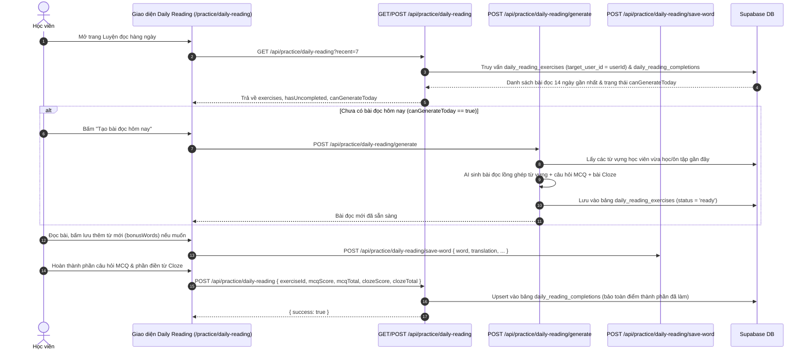

# Tài liệu Đặc tả Ca sử dụng (Use Case Specification)
## Tính năng: Luyện Đọc Hàng ngày Cá nhân hóa, Thư viện Đọc Tương tác & CodeMix (Daily Reading, Interactive Reading Library & CodeMix)
**Mã tài liệu:** `UC-READ-11`  
**File lưu trữ:** `agent/docs/SRS_11_READING_PRACTICE_LIBRARY.md`

---

### 1. Thông tin chung
* **Actor / Role thực hiện:**
  * `Student` (Học viên luyện đọc hiểu và ôn tập từ vựng trong ngữ cảnh bài đọc).
* **Mô tả tóm tắt:** Giúp học viên ghi nhớ sâu các từ vựng đã học thông qua: (1) **Bài đọc hàng ngày cá nhân hóa (Daily Reading)**: Tự động sinh bài đọc hiểu + bài tập trắc nghiệm (MCQ) + bài điền từ (Cloze test) lồng ghép chính những từ vựng trong sổ từ của học viên (`/api/practice/daily-reading`); (2) **Thư viện đọc tương tác (`/library`, `/practice/reading-library`)**: Đọc báo/truyện phân cấp CEFR có tra từ nhanh tại chỗ (`/api/library/gloss`, `/api/reading/articles`); (3) **Đoạn văn theo Gói từ & CodeMix (`/practice/pack-reading`, `/practice/codemix`)**: Chèn từ tiếng Anh vào mạch văn cảnh để tăng phản xạ nhận diện từ.
* **Tiền điều kiện (Pre-conditions):**
  * Học viên đã đăng nhập tài khoản.
  * Sổ từ của học viên có từ vựng đã lưu hoặc đang học (đối với tính năng sinh bài đọc cá nhân hóa).
* **Hậu điều kiện (Post-conditions):**
  * Bài đọc cá nhân hóa được lưu vào bảng `daily_reading_exercises`.
  * Điểm số làm bài đọc hiểu (`mcq_score`, `cloze_score`) được lưu vào `daily_reading_completions`; tiến độ đọc bài báo được lưu vào `user_reading_library_progress`.
  * Các từ mới học viên bấm lưu trong lúc đọc được thêm trực tiếp vào sổ từ FSRS (`/api/practice/daily-reading/save-word`).

---

### 2. Danh sách API liên quan
| Phương thức | Endpoint | Chức năng | Quyền hạn |
|---|---|---|---|
| `GET` | `/api/practice/daily-reading?date=...&recent=...&mode=...` | Lấy bài đọc hiểu hàng ngày của học viên (ưu tiên bài cá nhân hóa `target_user_id`, kèm trạng thái hoàn thành từ `daily_reading_completions`) | User đã đăng nhập |
| `POST` | `/api/practice/daily-reading` | Nộp kết quả làm bài đọc hàng ngày (`{ exerciseId, mcqScore, mcqTotal, clozeScore, clozeTotal }`) | User đã đăng nhập |
| `POST` | `/api/practice/daily-reading/generate` | Kích hoạt AI sinh bài đọc mới cho ngày hôm nay dựa trên các từ vựng học viên đang học trong sổ từ | User đã đăng nhập |
| `POST` | `/api/practice/daily-reading/save-word` | Lưu nhanh một từ mới bắt gặp trong bài đọc (`bonusWords` hoặc từ bất kỳ) vào sổ từ FSRS | User đã đăng nhập |
| `POST` | `/api/practice/pack-passage` | Sinh đoạn văn ngắn (AI hoặc `prebuilt`) lồng ghép các từ vựng thuộc một Gói từ (Vocab Pack) | User đã đăng nhập |
| `POST` | `/api/practice/codemix-upgrade` | Sinh đoạn văn song ngữ Anh-Việt (Code-mixing) nâng cấp theo trình độ từ vựng của học viên | User đã đăng nhập |
| `GET` | `/api/reading/articles` | Lấy danh sách các bài báo/truyện đọc hiểu theo chủ đề và cấp độ CEFR | Public / User |
| `GET` / `POST` | `/api/reading/progress` | Lấy và cập nhật tiến độ đọc hiểu các bài viết trong thư viện (`user_reading_library_progress`) | User đã đăng nhập |
| `POST` | `/api/library/gloss` | Tra cứu nghĩa hàng loạt (`lemmas: string[]`, tối đa 100 từ từ `global_dictionary`) phục vụ xuất/in học liệu PDF tại `/library` | User đã đăng nhập (Rate limit 20/min) |
| `GET` / `POST` | `/api/import/packages` | Lấy danh sách gói từ vựng (`GET`) và nhập gói từ từ `vocab-catalog.ts` + `global_dictionary` vào sổ từ `words` + RPC `import_vocab_pack` (`POST`) | User đã đăng nhập |

---

### 3. Kịch bản chính (Main Flow) & Sơ đồ Luồng hoạt động

#### 3.1 Sơ đồ luồng tổng quan Luyện Đọc Cá nhân hóa & Thư viện Đọc (Activity Flowchart)
```mermaid
flowchart TD
    Start([Truy cập phân hệ Luyện Đọc]) --> ModeChoice{Chọn chế độ đọc}

    %% Nhánh Daily Reading cá nhân hóa
    ModeChoice -->|Daily Reading /practice/daily-reading| FetchDaily[GET /api/practice/daily-reading]
    FetchDaily --> HasExercise{Đã có bài đọc<br/>hôm nay chưa?}
    HasExercise -->|Chưa có & canGenerateToday| GenDaily[POST /api/practice/daily-reading/generate]
    GenDaily --> PickUserWords[Lấy danh sách từ vựng học viên đang học trong srs_progress/words]
    PickUserWords --> AIGenPassage[AI sáng tác bài đọc + Câu hỏi MCQ + Bài điền từ Cloze]
    AIGenPassage --> SaveExercise[(INSERT vào bảng daily_reading_exercises)]
    SaveExercise --> RenderDaily[Hiển thị Bài đọc: Highlight các từ mục tiêu usedWords]
    HasExercise -->|Đã có| RenderDaily

    RenderDaily --> ClickWord{Bấm vào từ mới<br/>trong bài đọc?}
    ClickWord -->|Có| SaveBonusWord[POST /api/practice/daily-reading/save-word<br/>Thêm thẳng vào sổ từ FSRS]
    ClickWord -->|Làm bài tập| DoQuizCloze[Trả lời câu hỏi đọc hiểu MCQ & Điền từ vào chỗ trống Cloze]
    SaveBonusWord --> DoQuizCloze
    DoQuizCloze --> SubmitDaily[POST /api/practice/daily-reading<br/>{ exerciseId, mcqScore, clozeScore }]
    SubmitDaily --> UpsertCompletion[(Upsert bảng daily_reading_completions)]

    %% Nhánh Thư viện đọc & CodeMix
    ModeChoice -->|Thư viện /library| LoadArticles[GET /api/reading/articles]
    LoadArticles --> ReadArticle[Đọc bài, Tra từ nhanh & Xuất bảng từ PDF POST /api/library/gloss]
    ReadArticle --> SaveReadProg[POST /api/reading/progress]

    ModeChoice -->|Đọc theo Gói từ / CodeMix| GenPackOrMix[POST /api/practice/pack-passage<br/>hoặc POST /api/practice/codemix-upgrade]
    GenPackOrMix --> RenderContext[Hiển thị đoạn văn ngữ cảnh hóa từ vựng]
```

#### Ca sử dụng 1: Tạo & Làm bài đọc hiểu hàng ngày từ Sổ từ cá nhân (UC-READ-11.1)


1. **Bước 1 (Student):** Học viên truy cập `/practice/daily-reading`.
2. **Bước 2 (Frontend -> Backend):** Gọi `GET /api/practice/daily-reading`. Hệ thống xác định ngày hiện tại theo múi giờ `Asia/Ho_Chi_Minh` (`todayVN`), ưu tiên tải các bài đọc cá nhân hóa (`target_user_id = auth.userId`) trong vòng 14 ngày gần nhất để không bỏ sót bài chưa làm xong (`hasUncompleted`).
3. **Bước 3 (Student & Backend):** Nếu chưa có bài đọc cho ngày hôm nay và không còn bài tồn đọng (`canGenerateToday = true`), học viên bấm tạo bài đọc mới qua `POST /api/practice/daily-reading/generate`. AI tự động lấy danh sách từ vựng của học viên (`sourceWords`) để dệt thành một bài đọc mạch lạc kèm bản dịch tiếng Việt, câu hỏi đọc hiểu trắc nghiệm (`questions`) và bài tập đục lỗ (`cloze`).
4. **Bước 4 (Student):** Trong khi đọc, các từ vựng mục tiêu (`usedWords`) được tô sáng trong bài. Học viên có thể bấm vào các từ mở rộng (`bonusWords`) để gọi `POST /api/practice/daily-reading/save-word` lưu thẳng vào sổ từ FSRS.
5. **Bước 5 (Student & Backend):** Học viên làm bài tập MCQ và Cloze. Khi nộp từng phần hoặc cả hai phần, giao diện gọi `POST /api/practice/daily-reading`. Server tự động hợp nhất điểm (`finalMcqScore`, `finalClozeScore`) để không làm mất kết quả của phần đã hoàn thành trước đó và lưu vào bảng `daily_reading_completions`.

#### Ca sử dụng 2: Đọc báo tương tác & Xuất học liệu từ vựng trong Thư viện (UC-READ-11.2)
1. **Bước 1 (Student):** Học viên truy cập `/library` hoặc `/practice/reading-library`, lọc bài đọc theo cấp độ CEFR (A1–C1).
2. **Bước 2 (Frontend):** Gọi `GET /api/reading/articles` để hiển thị nội dung bài đọc.
3. **Bước 3 (Student):** Khi gặp từ khó hiểu, học viên tra nghĩa nhanh tại chỗ; khi bấm in bài đọc/xuất bảng từ vựng PDF tại `/library`, giao diện gọi `POST /api/library/gloss` với mảng `lemmas` (tối đa 100 từ) để lấy định nghĩa chuẩn từ `global_dictionary`.
4. **Bước 4 (Frontend):** Khi đọc xong và trả lời câu hỏi cuối bài, gọi `POST /api/reading/progress` để đánh dấu hoàn thành bài đọc trong bảng `user_reading_library_progress`.

---

### 4. Kịch bản ngoại lệ (Alternative & Exception Flows)

* **E1: Học viên còn bài đọc từ những ngày trước chưa hoàn thành (`hasUncompleted = true`)**
  * *Tại Bước 2 của UC-READ-11.1:* Học viên đã tạo bài đọc hôm qua nhưng chưa làm xong bài tập.
  * *Xử lý:* Tuyến `GET /api/practice/daily-reading` luôn bao gồm các bài đọc `ready` trong 14 ngày gần nhất và đặt `canGenerateToday = false` kèm `uncompletedExerciseId`, hướng dẫn học viên hoàn tất bài đọc đang dở trước khi sinh bài mới để tránh lãng phí quota AI.
* **E2: Học viên nộp riêng từng phần MCQ trước, Cloze sau**
  * *Tại Bước 5 của UC-READ-11.1:* Request POST chỉ gửi `clozeScore` mà không truyền `mcqScore`.
  * *Xử lý:* Backend đọc bản ghi `existingComp` trong `daily_reading_completions` và giữ nguyên `mcq_score` / `mcq_total` đã lưu trước đó trước khi thực hiện `upsert`.
* **E3: Chế độ đọc theo Lớp học (`?mode=classroom`)**
  * *Tại Bước 2 của UC-READ-11.1:* Học viên chuyển sang tab bài đọc chung của lớp học.
  * *Xử lý:* Nếu truyền `?mode=classroom`, hệ thống truy vấn các bài đọc có `classroom_id` thuộc danh sách lớp học viên đã ghi danh (`enrollments`) và `target_user_id IS NULL`. Ở chế độ cá nhân mặc định (`mode=personal`), hệ thống tuyệt đối không hiển thị lẫn bài đọc của người dùng khác.

---

### 5. Điểm hạn chế, Rủi ro & Nút thắt trong Luồng hiện tại (Current Limitations & Architectural Bottlenecks)

1. **Khóa cứng quyền tạo bài mới nếu còn bất kỳ bài đọc cũ nào chưa hoàn thành trong 14 ngày (`canGenerateToday = !hasToday && !hasUncompleted`):**
   * *Vị trí mã nguồn:* `src/app/api/practice/daily-reading/route.ts` (dòng 248–272).
   * *Vấn đề:* Nếu học viên từng sinh một bài đọc cách đây 5–10 ngày nhưng bài đọc đó quá khó hoặc không còn phù hợp và học viên bỏ dở (`!e.completed`), cờ `hasUncompleted` sẽ luôn bằng `true` và khóa hoàn toàn khả năng tạo bài đọc mới của ngày hôm nay (`canGenerateToday = false`). Hệ thống hiện cũng không có API cho phép học viên bỏ qua (skip/archive) bài đọc cũ bị kẹt.
2. **Nuốt lỗi ghi DB âm thầm (Silent Error Swallowing) & Không cộng XP khi hoàn thành bài đọc hàng ngày:**
   * *Vị trí mã nguồn:* `src/app/api/practice/daily-reading/route.ts` (dòng 356–383) và `src/app/api/reading/progress/route.ts`.
   * *Vấn đề:* Trong `POST /api/practice/daily-reading`, nếu lệnh `supabase.from('daily_reading_completions').upsert(...)` gặp lỗi DB (ví dụ lỗi khóa ngoại hoặc thiếu cột), server chỉ `console.warn` rồi **vẫn trả về HTTP 200 `{ success: true }`** cho client. Khi học viên tải lại trang, tiến độ làm bài biến mất và bài đọc vẫn ở trạng thái chưa hoàn thành. Ngoài ra, cả hai tuyến nộp bài đọc (`/api/practice/daily-reading` và `/api/reading/progress`) đều **không gọi RPC `award_xp`** và không cập nhật tiến độ FSRS (`srs_progress`) cho các từ mục tiêu (`usedWords`) vừa được học viên ôn luyện trong bài đọc.
3. **Lộ đáp án (`correct_index`, `answer`, `explanation_vi`) trong Payload GET và Tin tưởng điểm số từ Client:**
   * *Vị trí mã nguồn:* `src/app/api/practice/daily-reading/route.ts` (`mapExercise`, dòng 285–323) và `src/app/api/reading/articles/route.ts`.
   * *Vấn đề:* Toàn bộ đáp án đúng của câu hỏi đọc hiểu MCQ và từ điền vào chỗ trống Cloze được trả thẳng về trình duyệt trong `GET /api/practice/daily-reading`. Khi nộp bài (`POST /api/practice/daily-reading`), server nhận trực tiếp `mcqScore` và `clozeScore` do client tự chấm mà không xác thực lại từng câu trả lời trên server.
4. **Trừ lượt Quota gói Free trước khi kiểm tra tham số và cả khi đọc bài dựng sẵn (`prebuilt`) tại `POST /api/practice/pack-passage` (`src/app/api/practice/pack-passage/route.ts` dòng 156–198):**
   * *Vị trí mã nguồn:* `src/app/api/practice/pack-passage/route.ts` (dòng 156).
   * *Vấn đề:* Hàm `checkAndConsumePackReading(supabase, user.id, plan)` (tăng bộ đếm `profiles.pack_reading_count` giới hạn 1 lượt/ngày của gói Free) được gọi **trước khi** kiểm tra tính hợp lệ của `themeId`, kiểm tra số lượng từ (`words.length < 3`) hoặc kiểm tra xem người dùng chỉ đang mở bài đọc dựng sẵn (`mode === 'prebuilt'`, không tốn AI). Nếu request truyền thiếu từ hoặc chỉ mở bài tĩnh có sẵn, học viên Free vẫn bị mất trắng 1 lượt đọc duy nhất trong ngày.
5. **Nhập gói từ (`POST /api/import/packages`) chèn từ thiếu trong `global_dictionary` với nghĩa `'⏳ Analyzing...'` nhưng không kích hoạt `enrichWord`:**
   * *Vị trí mã nguồn:* `src/app/api/import/packages/route.ts` (dòng 77–97).
   * *Vấn đề:* Khi học viên nhập một gói từ vựng từ `vocab-catalog.ts` sang bảng `words`, các từ chưa có sẵn định nghĩa trong `global_dictionary` bị gán `translation: '⏳ Analyzing...'` rồi chèn thẳng vào bảng `words` mà không gọi pipeline làm giàu ngầm (`enrichWord`), khiến các thẻ từ đó bị treo ở trạng thái `'⏳ Analyzing...'` cho đến khi người dùng tự chạy `/api/words/refresh`.


