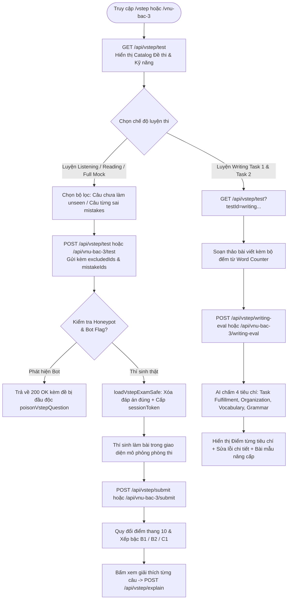
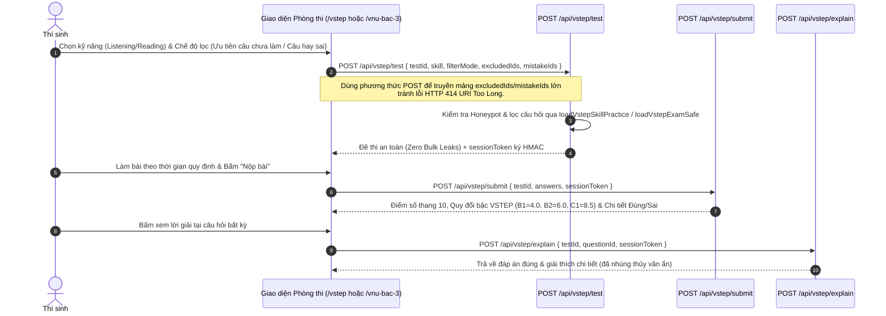

# Tài liệu Đặc tả Ca sử dụng (Use Case Specification)
## Tính năng: Hệ thống Khảo thí Chuẩn hóa Đa kỳ thi: VSTEP, VNU Bậc 3 & THPT Quốc gia (Standardized Exam Engine: VSTEP, VNU & THPT)
**Mã tài liệu:** `UC-EXAM-12`  
**File lưu trữ:** `agent/docs/SRS_12_VSTEP_VNU_THPT_EXAMS.md`

---

### 1. Thông tin chung
* **Actor / Role thực hiện:**
  * `Student` (Thí sinh ôn luyện kỳ thi VSTEP B1–C1, Ngoại ngữ Bậc 3 ĐHQGHN VNU, và Kỳ thi Tốt nghiệp THPT Quốc gia).
* **Mô tả tóm tắt:** Cung cấp môi trường mô phỏng phòng thi chuẩn hóa 4 kỹ năng (Listening, Reading, Writing, Speaking) cho **VSTEP** (`/vstep`) và **VNU Bậc 3** (`/vnu-bac-3`), cùng hệ thống luyện đề **THPT Quốc gia** (`/thpt`). Tích hợp bộ máy chấm điểm tự động theo thang điểm chuẩn Bộ GD&ĐT / ĐHQG (thang 10 làm tròn 0.5), AI chấm bài luận Writing Task 1 & Task 2 theo 4 tiêu chí khảo thí (`/api/vstep/writing-eval`, `/api/vnu-bac-3/writing-eval`), lọc đề thông minh không trùng câu cũ (`unseen`, `mistakes`) và phòng thủ chủ động chống cào đề (Active Cyber Defense).
* **Tiền điều kiện (Pre-conditions):**
  * Học viên truy cập hệ thống (đăng nhập để đồng bộ lịch sử câu hỏi đã làm, danh sách câu sai và chấm điểm AI Writing).
* **Hậu điều kiện (Post-conditions):**
  * Kết quả thi từng kỹ năng và điểm quy đổi Bậc 3/4/5 (B1/B2/C1) được tính toán và lưu trữ.
  * Lịch sử câu hỏi đã làm (`excludedIds`) và câu làm sai (`mistakeIds`) được cập nhật để phục vụ bốc đề thông minh ở các lần luyện tập tiếp theo.

---

### 2. Danh sách API liên quan
| Phương thức | Endpoint | Chức năng | Quyền hạn |
|---|---|---|---|
| `GET` / `POST` | `/api/vstep/test` | Lấy danh mục đề (`catalog`), tải đề thi Full Mock hoặc bốc đề luyện kỹ năng VSTEP (`skill`, `filterMode: 'unseen' \| 'mistakes' \| 'all_random'`, `excludedIds`, `mistakeIds`) đã lược bỏ đáp án đúng | Public / User (Có Anti-Scraping & Honeypot) |
| `POST` | `/api/vstep/submit` | Nộp bài thi VSTEP, chấm điểm theo barem thang 10 và phân bậc B1/B2/C1 | Public / User |
| `POST` | `/api/vstep/explain` | Lấy đáp án đúng và giải thích chi tiết cho **từng câu hỏi VSTEP (On-Demand)** kèm thủy vân ẩn bảo vệ bản quyền | Public / User (Có Velocity Check & `?unban=1`) |
| `POST` | `/api/vstep/writing-eval` | AI chấm bài thi Viết VSTEP (Task 1: Thư/Email & Task 2: Luận) theo 4 tiêu chí khảo thí thang điểm 10 | Public / User (Hiện thiếu kiểm tra Auth & Rate Limit) |
| `GET` / `POST` | `/api/vnu-bac-3/test` | Tải đề thi chuẩn định dạng Ngoại ngữ Bậc 3 ĐHQGHN (VNU) hoặc bài luyện theo kỹ năng | Public / User (Chỉ GET có Honeypot; POST thiếu Bot check) |
| `POST` | `/api/vnu-bac-3/submit` | Nộp bài thi VNU Bậc 3, chấm điểm tự động trên bộ nhớ theo barem thang 10 và trả kết quả chi tiết | Public / User |
| `POST` | `/api/vnu-bac-3/explain` | Lấy lời giải chi tiết từng câu hỏi đề thi VNU Bậc 3 theo cơ chế On-Demand | Public / User |
| `POST` | `/api/vnu-bac-3/writing-eval` | AI chấm bài viết VNU Bậc 3 và gợi ý nâng cấp câu văn học thuật | Public / User (Hiện thiếu kiểm tra Auth & Rate Limit) |

---

### 3. Kịch bản chính (Main Flow) & Sơ đồ Luồng hoạt động

#### 3.1 Sơ đồ luồng tổng quan Thi thử VSTEP / VNU Bậc 3 & Chấm Writing AI (Activity Flowchart)

#### Ca sử dụng 1: Luyện đề VSTEP / VNU Bậc 3 chống trùng câu hỏi & Chấm điểm chuẩn (UC-EXAM-12.1)

1. **Bước 1 (Student):** Thí sinh truy cập `/vstep` hoặc `/vnu-bac-3`. Giao diện gọi `GET /api/vstep/test` (không tham số) để lấy toàn bộ danh mục đề thi (`catalog`).
2. **Bước 2 (Student):** Thí sinh chọn thi thử Full Test hoặc luyện từng kỹ năng kèm chế độ lọc thông minh:
   * `unseen`: Chỉ bốc các câu hỏi thí sinh chưa từng làm.
   * `mistakes`: Ôn tập xoáy sâu vào các câu thí sinh từng chọn sai.
   * `all_random`: Trộn ngẫu nhiên từ ngân hàng đề.
3. **Bước 3 (Frontend -> Backend):** Gửi `POST /api/vstep/test` (hoặc `/api/vnu-bac-3/test`) kèm danh sách `excludedIds` và `mistakeIds` trong body.
4. **Bước 4 (Backend):** Kiểm tra bẫy Honeypot (`isVstepHoneypot`, `_hp_trap`), gọi `loadVstepExamSafe` / `loadVstepSkillPractice` để loại bỏ hoàn toàn đáp án đúng và lời giải khỏi payload trả về, đồng thời cấp `sessionToken`.
5. **Bước 5 (Student & Frontend):** Thí sinh làm bài và bấm **"Nộp bài"** (`POST /api/vstep/submit`). Hệ thống chấm điểm trên thang 10 và đối chiếu chuẩn quy đổi (Dưới 4.0: Không xét bậc; 4.0–5.5: Bậc 3/B1; 6.0–8.0: Bậc 4/B2; 8.5–10.0: Bậc 5/C1).
6. **Bước 6 (Student):** Khi bấm xem lời giải một câu hỏi cụ thể, giao diện gọi `POST /api/vstep/explain` (hoặc `/api/vnu-bac-3/explain`) để nhận giải thích chi tiết cho câu hỏi đó.

#### Ca sử dụng 2: Luyện viết luận VSTEP / VNU & Chấm điểm AI theo Rubric khảo thí (UC-EXAM-12.2)
1. **Bước 1 (Student):** Thí sinh chọn đề luyện kỹ năng Writing (Task 1: Viết thư/email tối thiểu 120 từ; Task 2: Viết bài luận tối thiểu 250 từ).
2. **Bước 2 (Student):** Soạn thảo bài làm trong khung soạn thảo có đồng hồ bấm giờ và bộ đếm số từ thời gian thực.
3. **Bước 3 (Frontend -> Backend):** Khi bấm **"Chấm điểm AI"**, gửi bài viết lên `POST /api/vstep/writing-eval` (hoặc `POST /api/vnu-bac-3/writing-eval`).
4. **Bước 4 (Backend):** Hệ thống điều phối AI phân tích bài viết theo đúng 4 tiêu chí chấm thi VSTEP/VNU (Task Fulfillment, Organization, Vocabulary, Grammar), trả về điểm thành phần, điểm tổng kết thang 10, danh sách lỗi sai kèm câu sửa gợi ý và bài mẫu tham khảo.

---

### 4. Kịch bản ngoại lệ (Alternative & Exception Flows)

* **E1: Bot cào đề kích hoạt bẫy Honeypot (Silent Plausible Data Poisoning)**
  * *Tại Bước 4 của UC-EXAM-12.1:* Request truyền mã đề bẫy (`isVstepHoneypot`), tham số `dump=true`, `include_answers=1` hoặc trường ẩn `_hp_trap`.
  * *Xử lý:* Hệ thống gắn cờ IP là bot (`flagClientAsBot`), trả về HTTP 200 OK nhưng toàn bộ câu hỏi đã bị đảo đáp án và biến đổi bằng hàm `poisonVstepQuestion()` (`src/lib/vstep-anti-scraping.ts`).
* **E2: Thí sinh đã làm hết toàn bộ câu hỏi trong ngân hàng ở chế độ `unseen`**
  * *Tại Bước 4 của UC-EXAM-12.1:* Danh sách `excludedIds` bao phủ hết các câu hỏi hiện có của kỹ năng đó.
  * *Xử lý:* Bộ nạp đề tự động xoay vòng (recycle) lại ngân hàng câu hỏi theo hạt giống ngẫu nhiên mới (`seed`) để thí sinh luôn có đề luyện tập mà không bị trả về mảng rỗng.

---

### 5. Điểm hạn chế, Rủi ro & Nút thắt trong Luồng hiện tại (Current Limitations & Architectural Bottlenecks)

1. **API chấm viết AI (`POST /api/vstep/writing-eval` & `POST /api/vnu-bac-3/writing-eval`) hoàn toàn không kiểm tra Đăng nhập (Auth) và không có Rate Limit:**
   * *Vị trí mã nguồn:* `src/app/api/vstep/writing-eval/route.ts` (dòng 94–176) và `src/app/api/vnu-bac-3/writing-eval/route.ts` (dòng 55–125).
   * *Vấn đề:* Cả hai endpoint gọi trực tiếp `generateAIContent` với prompt chấm luận rất dài (`temperature: 0.3`) nhưng **không hề gọi `getAuthUser()`**, không kiểm tra quyền gói Pro, và **không áp dụng `checkRateLimitAsync`**. Bất kỳ khách vãng lai hoặc bot nào cũng có thể gửi hàng loạt request chấm bài viết nặc danh để làm cạn kiệt hạn ngạch (quota) Gemini/Groq của toàn hệ thống.
2. **Lỗ hổng bỏ qua xác thực `sessionToken` trong `POST /api/vnu-bac-3/submit` & Thiếu kiểm tra Bot ở `POST /api/vnu-bac-3/test`:**
   * *Vị trí mã nguồn:* `src/app/api/vnu-bac-3/submit/route.ts` (dòng 26–33) và `src/app/api/vnu-bac-3/test/route.ts` (dòng 89–144).
   * *Vấn đề:* Trong `POST /api/vnu-bac-3/submit`, câu lệnh `if (sessionToken) { ... }` chỉ kiểm tra tính hợp lệ của token **nếu client có gửi `sessionToken`**. Nếu bot cố tình bỏ trống trường `sessionToken` trong payload JSON, server bỏ qua hoàn toàn bước kiểm tra HMAC và trả về ngay điểm số cùng danh sách đáp án đúng (`results[qId].correctAnswer`) của toàn bộ đề thi. Hơn nữa, nhánh `POST /api/vnu-bac-3/test` (nhánh bốc đề luyện kỹ năng) không hề kiểm tra `isVnuHoneypot` hay `isClientFlaggedAsBot`.
3. **Khóa cứng IP trong `verifyVstepSessionToken` gây lỗi `401 Unauthorized` khi thí sinh làm bài trên mạng di động / đổi mạng:**
   * *Vị trí mã nguồn:* `src/lib/vstep-anti-scraping.ts` (dòng 84–113) và `src/app/api/vstep/submit/route.ts` (dòng 22–28).
   * *Vấn đề:* Hàm `verifyVstepSessionToken(token, testId, clientIp)` bắt buộc `tIp === clientIp`. Một bài thi VSTEP Full Test kéo dài tới 172 phút; nếu thí sinh dùng điện thoại chuyển từ Wi-Fi sang 4G, hoặc nhà mạng xoay địa chỉ IPv6/CGNAT trong lúc làm bài, lúc bấm "Nộp bài" (`POST /api/vstep/submit`) hoặc xem giải thích (`POST /api/vstep/explain`) sẽ bị từ chối với lỗi `401 Phiên làm bài không hợp lệ hoặc đã hết hạn`, làm mất trắng bài thi vừa làm suốt gần 3 giờ.
4. **Backdoor `?unban=1` công khai & Bộ nhớ chống cào đề lưu trên RAM cục bộ:**
   * *Vị trí mã nguồn:* `src/app/api/vstep/test/route.ts` (dòng 40, 108), `src/app/api/vstep/explain/route.ts` (dòng 24), `src/app/api/vnu-bac-3/test/route.ts` (dòng 35) và `src/lib/vstep-anti-scraping.ts` (dòng 19–20).
   * *Vấn đề:* Tương tự phân hệ TOEIC, bất kỳ client nào gửi kèm `?unban=1` đều tự xóa cờ bot trong `flaggedIps` và `velocityTracker`. Đồng thời, khóa ký HMAC mặc định (`VSTEP_HMAC_SECRET`, `VNU_HMAC_SECRET`) đang có fallback cứng trong mã nguồn nếu biến môi trường chưa được cấu hình.

