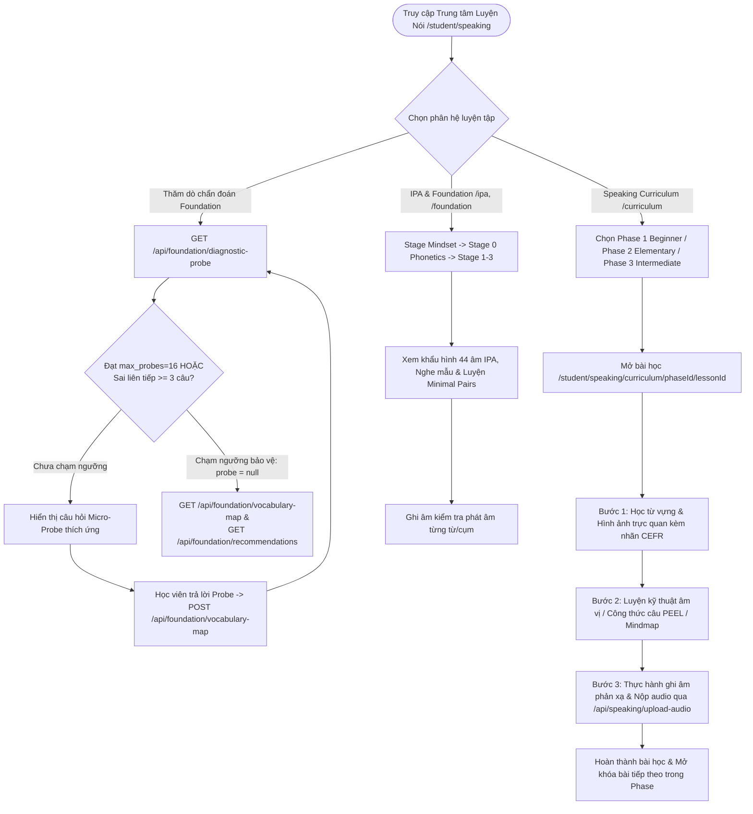
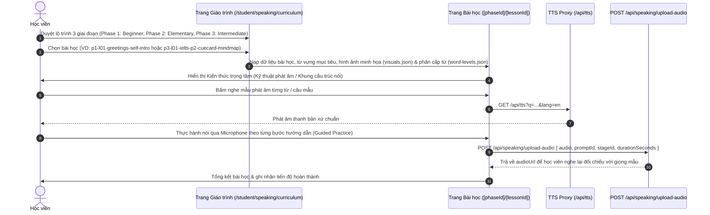

# Tài liệu Đặc tả Ca sử dụng (Use Case Specification)
## Tính năng: Lộ trình Giao tiếp, Ngữ âm Nền tảng IPA & Thăm dò Chẩn đoán (Speaking Curriculum, IPA Foundation & Diagnostic Probe)
**Mã tài liệu:** `UC-SPEAK-13`  
**File lưu trữ:** `agent/docs/SRS_13_SPEAKING_CURRICULUM_FOUNDATION.md`

---

### 1. Thông tin chung
* **Actor / Role thực hiện:**
  * `Student` (Học viên luyện phát âm IPA, học nền tảng Speaking Foundation và giáo trình Speaking Curriculum 3 giai đoạn).
  * `Teacher` (Giáo viên theo dõi kết quả thăm dò chẩn đoán năng lực nền tảng của học viên).
* **Mô tả tóm tắt:** Cung cấp hệ thống huấn luyện kỹ năng Nói từ gốc: (1) **Bảng phiên âm quốc tế IPA & Luyện âm vị (`/ipa`, `/pronunciation/[id]`)** kèm khẩu hình và cặp âm dễ nhầm (Minimal Pairs); (2) **Speaking Foundation (`/student/speaking/foundation/stage-0` $\rightarrow$ `stage-3`, `stage-mindset`)**: Xây dựng phản xạ phát âm và tư duy ghép cụm từ; (3) **Speaking Curriculum 3 Phase (`/student/speaking/curriculum/[phaseId]/[lessonId]`)**: Giáo trình bài bản từ Phase 1 (Beginner: âm cuối, cụm phụ âm, ngắt nhịp 3-beat), Phase 2 (Elementary: từ nối, mở rộng đoạn văn PEEL) đến Phase 3 (Intermediate: IELTS Part 2/3, lập luận phản biện, độc thoại 2 phút); (4) **Diagnostic Probe & Foundation Map (`/api/foundation/*`)**: Thăm dò chẩn đoán thích ứng có cơ chế tự ngắt bảo vệ tâm lý học viên khi sai liên tiếp.
* **Tiền điều kiện (Pre-conditions):**
  * Học viên đã đăng nhập vào hệ thống.
* **Hậu điều kiện (Post-conditions):**
  * Tiến độ hoàn thành từng bài học trong Speaking Foundation / Speaking Curriculum và bản đồ năng lực từ vựng nền tảng được lưu trữ và cập nhật đề xuất học tập tiếp theo.

---

### 2. Danh sách API & Tuyến Giao diện liên quan
| Phương thức | Endpoint / Route | Chức năng | Quyền hạn |
|---|---|---|---|
| `GET` | `/api/foundation/diagnostic-probe?learner_id=...&max_probes=16` | Chọn câu hỏi thăm dò chẩn đoán thích ứng tiếp theo (`fetchNextDiagnosticProbe`), tự động tạm dừng nếu học viên sai liên tiếp quá ngưỡng (`max_unsuccessful=3`) | Student / Teacher được ủy quyền |
| `GET` / `POST` | `/api/foundation/vocabulary-map?learner_id=...` | `GET`: Lấy bản đồ phủ vốn từ vựng nền tảng theo từng dải tần suất (`fetchLearnerVocabularyMap`); `POST`: Ghi nhận sự kiện bằng chứng học từ (`recordLexicalEvidenceEvent`) và suy diễn lại trạng thái nắm vững từ (`deriveVocabularyState`) | Student / Teacher được ủy quyền |
| `GET` | `/api/foundation/recommendations?learner_id=...` | Lấy danh sách bài học và gói từ được đề xuất cá nhân hóa sau khi chẩn đoán (`fetchCurriculumRecommendations`) | Student / Teacher được ủy quyền |
| `POST` | `/api/speaking/upload-audio` | Tải file ghi âm thực hành trong từng bước bài học Speaking lên Supabase Storage | User đã đăng nhập |
| `POST` | `/api/dictionary/ai-speaking` | Phản hồi hội thoại và sửa lỗi diễn đạt trong các bài luyện nói theo chủ đề (`/student/speaking/topics/[topicId]`) | User đã đăng nhập |

---

### 3. Kịch bản chính (Main Flow) & Sơ đồ Luồng hoạt động

#### 3.1 Sơ đồ luồng tổng quan Speaking Foundation, Curriculum & Diagnostic Probe (Activity Flowchart)

#### Ca sử dụng 1: Học bài học trong Giáo trình Speaking Curriculum 3 Phase (UC-SPEAK-13.1)

1. **Bước 1 (Student):** Học viên truy cập `/student/speaking/curriculum` để xem danh sách các bài học được chia thành 3 giai đoạn rõ ràng:
   * **Phase 1 (Beginner - 12 bài):** Làm chủ âm cuối (`-s/-z`, `-ed`), cụm phụ âm (`st/sp`, `pl/gr`), độ dài nguyên âm (`/ɪ/` vs `/iː/`), ngắt nhịp hơi thở 3-beat và giao tiếp phản xạ cơ bản.
   * **Phase 2 (Elementary):** Mở rộng câu theo các chủ đề đời sống, sử dụng từ nối (Discourse Markers) và cấu trúc đoạn văn PEEL.
   * **Phase 3 (Intermediate - 10 bài):** Làm chủ Cue Card IELTS Part 2, chia nhóm lập luận Part 3, cấu trúc nhượng bộ (`While/Although`), câu điều kiện giả định, phân tích nguyên nhân - kết quả và độc thoại 2 phút.
2. **Bước 2 (Frontend):** Khi mở `/student/speaking/curriculum/[phaseId]/[lessonId]`, giao diện hiển thị thẻ từ vựng kèm hình ảnh trực quan (`lesson-visuals.ts`), phiên âm IPA chuẩn và nhãn cấp độ CEFR.
3. **Bước 3 (Student):** Học viên nghe mẫu qua `/api/tts`, luyện đọc theo từng chặng bài học và ghi âm bài nói của mình.
4. **Bước 4 (Frontend -> Backend):** Bản ghi âm được tải lên qua `POST /api/speaking/upload-audio` để học viên tự nghe lại đối chiếu với giọng bản xứ và hoàn thành bài học.

#### Ca sử dụng 2: Thăm dò chẩn đoán năng lực nền tảng thích ứng (Adaptive Diagnostic Probe) (UC-SPEAK-13.2)
1. **Bước 1 (Student/Teacher):** Học viên bắt đầu bài thăm dò chẩn đoán nền tảng. Giao diện gọi `GET /api/foundation/diagnostic-probe?learner_id=...&max_probes=16&max_unsuccessful=3`.
2. **Bước 2 (Backend):** Hàm `fetchNextDiagnosticProbe` kiểm tra quyền truy cập của người gọi (`getFoundationAuthUser` — chỉ chính học viên hoặc giáo viên quản lý học viên đó mới được phép truy cập), sau đó chọn câu hỏi Micro-Probe tiếp theo phù hợp với kết quả các câu vừa trả lời.
3. **Bước 3 (Student -> Backend):** Mỗi khi trả lời một câu hỏi thăm dò hoặc bài tập nền tảng, giao diện gọi `POST /api/foundation/vocabulary-map` (`recordLexicalEvidenceEvent`) để ghi vào bảng `learner_lexical_evidence` và tính toán lại trạng thái nắm vững từ (`learner_lexical_state`: `unseen`, `receptive_emerging`, `receptive_stable`, `productive_Controlled`, `productive_fluent`).
4. **Bước 4 (Backend - Cơ chế Bảo vệ Tâm lý Học viên):** Nếu học viên trả lời sai liên tiếp chạm ngưỡng `maxConsecutiveUnsuccessfulProbesBeforeBreak` (mặc định 3 câu), hoặc đạt đủ `maxProbes` (16 câu), hoặc học viên/giáo viên chủ động bấm dừng (`learner_stop=true` / `teacher_stop=true`), API trả về `probe: null` để kết thúc phiên thăm dò nhẹ nhàng.
5. **Bước 5 (Frontend):** Gọi `GET /api/foundation/vocabulary-map` và `GET /api/foundation/recommendations` để hiển thị bản đồ lỗ hổng kiến thức và gợi ý bài học khởi đầu phù hợp.

---

### 4. Kịch bản ngoại lệ (Alternative & Exception Flows)

* **E1: Truy cập trái phép dữ liệu chẩn đoán của học viên khác (Authorization Guard)**
  * *Tại Bước 2 của UC-SPEAK-13.2:* Người dùng truyền `learner_id` của một tài khoản khác mà mình không phải là giáo viên phụ trách.
  * *Xử lý:* `fetchNextDiagnosticProbe` ném ngoại lệ `AuthorizationError`, tuyến API lập tức bắt và trả về HTTP 403 Forbidden.
* **E2: Tham số `learner_id` sai định dạng UUID**
  * *Tại Bước 1 của UC-SPEAK-13.2:* Tham số `learner_id` không khớp biểu thức chính quy UUID.
  * *Xử lý:* Backend trả về ngay HTTP 400 Bad Request (`Malformed learner ID`).

---

### 5. Điểm hạn chế, Rủi ro & Nút thắt trong Luồng hiện tại (Current Limitations & Architectural Bottlenecks)

1. **Chuỗi 5 truy vấn DB tuần tự & Tải lại toàn bộ lịch sử bằng chứng không có Transaction trong `recordLexicalEvidenceEvent`:**
   * *Vị trí mã nguồn:* `src/lib/foundation-curriculum/data-access.ts` (dòng 168–274).
   * *Vấn đề:* Mỗi lần học viên trả lời 1 câu hỏi nhỏ (`POST /api/foundation/vocabulary-map`), hàm `recordLexicalEvidenceEvent` thực thi **5 truy vấn DB nối tiếp nhau** (1. Kiểm tra ủy quyền giáo viên/học viên; 2. Kiểm tra sự tồn tại của `concept_id`; 3. Kiểm tra `representation_id`; 4. `INSERT` vào `learner_lexical_evidence`; 5. `SELECT *` toàn bộ lịch sử `learner_lexical_evidence` của khái niệm đó để chạy `deriveVocabularyState(history)` rồi `UPSERT` vào `learner_lexical_state`). Việc không dùng Transaction/RPC nguyên tử khiến hai request gửi nhanh liên tiếp có thể ghi đè trạng thái của nhau (Race Condition) và gây độ trễ cao trên mỗi thao tác trả lời.
2. **Quét toàn bộ bảng `foundation_lexical_concepts` không qua bộ nhớ đệm (Uncached Full-Table Scan) trên mọi Request:**
   * *Vị trí mã nguồn:* `src/lib/foundation-curriculum/data-access.ts` (`getFoundationConcepts`, dòng 95–121).
   * *Vấn đề:* Các hàm `fetchLearnerVocabularyMap`, `fetchNextDiagnosticProbe`, và `fetchCurriculumRecommendations` đều gọi `getFoundationConcepts()` — hàm này truy vấn thẳng toàn bộ bảng danh mục `foundation_lexical_concepts` từ Supabase trên mỗi request mà không có lớp cache trên RAM (`ttl-cache`), mặc dù danh mục khái niệm nền tảng là dữ liệu tĩnh hầu như không thay đổi.
3. **Không có API chấm phát âm cấp độ âm vị (Phoneme/Acoustic Scoring) & Thiếu route `/api/speaking/stt-whisper`:**
   * *Vị trí mã nguồn:* `src/lib/speaking/safe-harbor-matcher.ts`, `src/lib/speaking/stt/whisper-provider.ts` (dòng 25), và `src/app/api/speaking/upload-audio/route.ts`.
   * *Vấn đề:* Dù các bài học IPA và Speaking Curriculum tập trung vào âm cuối (`-s/-z`, `-ed`), độ dài nguyên âm (`/ɪ/` vs `/iː/`) và ngắt nhịp 3-beat, bộ chấm điểm `evaluateSafeHarborSpeech()` chỉ so khớp chuỗi chữ cái trên trình duyệt sau khi nhận dạng giọng nói. Nghiêm trọng hơn, `WhisperProvider` trỏ tới endpoint mặc định `/api/speaking/stt-whisper` **không tồn tại trên server**, nên khi trình duyệt không hỗ trợ Web Speech API, client sẽ tự trả về các câu văn mẫu giả định (`MOCK_FALLBACK_TRANSCRIPTS`).
4. **Tách biệt hoàn toàn khỏi Sổ từ FSRS (`words` / `srs_progress`) và Hệ thống XP (`award_xp`):**
   * *Vị trí mã nguồn:* `src/lib/foundation-curriculum/data-access.ts`.
   * *Vấn đề:* Trạng thái từ vựng trong `learner_lexical_state` hoạt động độc lập hoàn toàn với bảng `words` và `srs_progress`. Một học viên đã thuộc lòng 1.000 từ trong sổ từ FSRS vẫn bị hệ thống Foundation coi là `unseen` (chưa biết từ nào), và việc hoàn thành các bài thăm dò / bài học nền tảng không cộng XP hay cập nhật chuỗi ngày học (`streak`).

