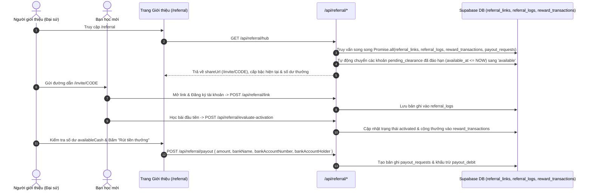

# Tài liệu Đặc tả Ca sử dụng (Use Case Specification)
## Tính năng: Hệ thống Giới thiệu Đại sứ, Nhóm Học tập Pro & Phòng Tự học Trực tuyến (Referral 5-Tier Hub, Pro Study Groups & Live Study Hub)
**Mã tài liệu:** `UC-SOCIAL-14`  
**File lưu trữ:** `agent/docs/SRS_14_REFERRAL_GROUPS_HUB.md`

---

### 1. Thông tin chung
* **Actor / Role thực hiện:**
  * `User` / `Referrer` (Người giới thiệu bạn bè / Đại sứ học tập).
  * `Referee` (Người dùng mới đăng ký qua đường link giới thiệu `/invite/[code]`).
  * `Group Owner` & `Group Member` (Trưởng nhóm mua gói Nhóm Pro và các thành viên tham gia nhóm).
* **Mô tả tóm tắt:** Bao gồm 3 tính năng cộng đồng & tăng trưởng lan tỏa (Viral Growth): (1) **Chương trình Đại sứ Giới thiệu 5 Cấp bậc (`/referral`, `/student/referral`, `/invite/[code]`)**: Cấp mã giới thiệu duy nhất, theo dõi lượt click/đăng ký/kích hoạt, thưởng ngày Pro VIP miễn phí và hoa hồng tiền mặt rút về ngân hàng (`/api/referral/*`); (2) **Nhóm Học tập Pro (`/group`, `/api/groups/*`)**: Cho phép trưởng nhóm chia sẻ mã mời nhóm (2–20 ghế) để các thành viên tham gia nhận ngay quyền lợi Pro; (3) **Phòng Tự học Trực tuyến (`/hub`, `/api/hub/presence`)**: Hiển thị trạng thái những học viên đang cùng học trực tuyến theo thời gian thực.
* **Tiền điều kiện (Pre-conditions):**
  * Người dùng đã đăng nhập tài khoản.
* **Hậu điều kiện (Post-conditions):**
  * Giao dịch thưởng ngày Pro hoặc hoa hồng được ghi vào sổ cái `reward_transactions`, yêu cầu rút tiền được lưu vào `payout_requests`.
  * Thành viên vào nhóm được thêm vào `group_members` và được cấp quyền lợi gói Pro qua `grantGroupEntitlement` (có chốt chặn không bao giờ hạ cấp gói hiện có).

---

### 2. Danh sách API liên quan
| Phương thức | Endpoint | Chức năng | Quyền hạn |
|---|---|---|---|
| `GET` | `/api/referral/hub` | Lấy toàn bộ thông tin trung tâm giới thiệu: mã mời, link `/invite/[code]`, thống kê bạn bè, cấp bậc 5-Tier, số dư hoa hồng (`availableCash`, `pendingCash`) và lịch sử rút tiền | User đã đăng nhập |
| `POST` | `/api/referral/resolve` & `GET` / `POST` `/api/referral/link` | Ghi nhận lượt truy cập từ link `/invite/[code]`, lấy/tạo mã mời và liên kết người được giới thiệu (`referee_id`) với người giới thiệu (`referrer_id`) vào bảng `referral_logs` | Public (`resolve`) / User đã đăng nhập (`link`) |
| `POST` | `/api/referral/evaluate-activation` | Kiểm tra điều kiện kích hoạt của bạn mới (khi có $\ge 10$ từ vựng và streak $\ge 1$) để cộng thưởng cho người giới thiệu | User đã đăng nhập |
| `POST` | `/api/referral/claim` | Đổi/nhận thưởng ngày sử dụng Pro VIP từ chương trình giới thiệu (hoặc qua mã mời trực tiếp) | User đã đăng nhập |
| `GET` / `POST` | `/api/referral/payout` | Xem danh sách yêu cầu rút tiền (`GET`) và gửi yêu cầu rút tiền hoa hồng khả dụng (`availableCash`) về tài khoản ngân hàng cá nhân (`POST`) | User đã đăng nhập |
| `GET` | `/api/groups/mine` | Xem thông tin nhóm học tập mà người dùng đang làm trưởng nhóm (`owner_id`) hoặc thành viên (`group_members`) | User đã đăng nhập |
| `POST` | `/api/groups/join` | Thành viên nhập `inviteCode` để vào nhóm và nhận quyền lợi gói Pro đến ngày hết hạn của nhóm (`grantGroupEntitlement`) | User đã đăng nhập |
| `POST` | `/api/groups/leave` | Thành viên tự rời khỏi nhóm học tập | Thành viên nhóm |
| `POST` | `/api/groups/[id]/remove` | Trưởng nhóm xóa một thành viên ra khỏi nhóm để giải phóng ghế (`seat_limit`) | Trưởng nhóm (`owner_id`) |
| `GET` / `POST` / `DELETE` | `/api/hub/presence` | Cập nhật nhịp tim (`POST`), rời phòng (`DELETE`) và lấy danh sách học viên đang học trực tuyến (`GET`) tại Phòng Tự học `/hub` | User đã đăng nhập |

---

### 3. Kịch bản chính (Main Flow) & Sơ đồ Luồng hoạt động

#### 3.1 Sơ đồ luồng tổng quan Giới thiệu Đại sứ & Nhóm Học tập Pro (Activity Flowchart)
```mermaid
flowchart TD
    Start([Chọn tính năng Cộng đồng]) --> FeatureType{Giới thiệu Bạn bè<br/>hay Nhóm Học tập Pro?}

    %% Nhánh Referral 5-Tier
    FeatureType -->|Chương trình Đại sứ /referral| LoadRefHub[GET /api/referral/hub<br/>Tự sinh mã 6 ký tự vào referral_links nếu chưa có]
    LoadRefHub --> ShareLink[Chia sẻ link /invite/CODE cho bạn bè]
    ShareLink --> FriendClick[Bạn bè truy cập /invite/CODE & Đăng ký tài khoản]
    FriendClick --> LinkReferee[POST /api/referral/link -> Ghi referral_logs status='pending']
    LinkReferee --> FriendStudy[Bạn mới hoàn thành bài học / Nâng cấp gói VIP]
    FriendStudy --> EvalActivation[POST /api/referral/evaluate-activation]
    EvalActivation --> CreditLedger[(INSERT vào reward_transactions:<br/>pro_days hoặc cash_commission)]
    CreditLedger --> RankCheck[Thăng hạng 5-Tier: Người Khởi Xướng -> Đại Sứ Toàn Năng]
    RankCheck --> RequestPayout[POST /api/referral/payout<br/>Yêu cầu rút tiền hoa hồng về Ngân hàng]

    %% Nhánh Nhóm học tập Pro (Groups)
    FeatureType -->|Nhóm Học tập /group| GroupRole{Trưởng nhóm hay Thành viên?}
    GroupRole -->|Trưởng nhóm| ViewMyGroup[GET /api/groups/mine: Lấy mã mời nhóm & Quản lý ghế 2-20 seats]
    ViewMyGroup --> RemoveMember[POST /api/groups/id/remove nếu cần thu hồi ghế]
    GroupRole -->|Thành viên| InputGroupCode[Nhập mã mời nhóm inviteCode]
    InputGroupCode --> CallGroupJoin[POST /api/groups/join { inviteCode }]
    CallGroupJoin --> ValidateGroup{Nhóm active, còn hạn<br/>& chưa đầy seat_limit?}
    ValidateGroup -->|Không hợp lệ| GroupError[Trả về 404 / 403 / 409]
    ValidateGroup -->|Hợp lệ| InsertMember[(INSERT vào group_members)]
    InsertMember --> GrantPro[grantGroupEntitlement: Cấp gói Pro theo thời hạn nhóm]
```

#### Ca sử dụng 1: Giới thiệu bạn bè, Thăng hạng Đại sứ 5-Tier & Rút hoa hồng (UC-SOCIAL-14.1)


1. **Bước 1 (Referrer):** Người dùng truy cập `/referral` (hoặc `/student/referral`). Giao diện gọi `GET /api/referral/hub`.
2. **Bước 2 (Backend):** Tuyến `/api/referral/hub` thực thi đồng thời 4 truy vấn (`Promise.all`) tới `referral_links`, `referral_logs`, `reward_transactions`, `payout_requests`. Nếu người dùng chưa có mã, tự động sinh mã 6 ký tự (`generateRandomCode(6)`) và tạo link chia sẻ `${origin}/invite/${referralCode}`.
3. **Bước 3 (Backend - Tự động kết chuyển hoa hồng đáo hạn):** Kiểm tra các giao dịch `pending_clearance` có `available_at <= Date.now()`, tự động cập nhật hàng loạt sang `status = 'available'` và tính toán bậc danh hiệu theo lộ trình 5 cấp:
   * **Tier 1 (0–2 bạn):** Người Khởi Xướng (Mốc tiếp: 3 bạn nhận +15 ngày Pro).
   * **Tier 2 (3–5 bạn):** Bạn Đồng Hành (Mốc tiếp: 6 bạn nhận +30 ngày Pro).
   * **Tier 3 (6–10 bạn):** Người Dẫn Đường (Mốc tiếp: 11 bạn nhận +60 ngày Pro).
   * **Tier 4 (11–19 bạn):** Thủ Lĩnh Học Tập (Mốc tiếp: 20 bạn nhận 20% hoa hồng trọn đời + 200.000đ).
   * **Tier 5 ($\ge 20$ bạn):** Đại Sứ Toàn Năng.
4. **Bước 4 (Referee):** Bạn mới bấm vào link `/invite/[code]`, đăng ký tài khoản (`/api/referral/link`) và hoàn thành hoạt động học tập đầu tiên (`/api/referral/evaluate-activation`).
5. **Bước 5 (Referrer):** Người giới thiệu nhận ngày Pro miễn phí (`/api/referral/claim`) hoặc gửi yêu cầu rút tiền mặt về ngân hàng qua `POST /api/referral/payout`.

#### Ca sử dụng 2: Tham gia Nhóm Học tập Pro bằng Mã mời (UC-SOCIAL-14.2)
1. **Bước 1 (Group Member):** Người dùng truy cập `/group`, nhập mã mời nhóm (`inviteCode`) do Trưởng nhóm chia sẻ và bấm **"Tham gia nhóm"**.
2. **Bước 2 (Frontend):** Gửi `POST /api/groups/join` với `{ inviteCode }`.
3. **Bước 3 (Backend):** Truy vấn bảng `groups`, kiểm tra nhóm tồn tại, `status === 'active'`, chưa hết hạn (`expires_at > NOW()`), người dùng chưa ở trong nhóm và số lượng thành viên hiện tại trong `group_members` nhỏ hơn `seat_limit`.
4. **Bước 4 (Backend):** Thêm bản ghi vào `group_members` và gọi `grantGroupEntitlement(supabase, user.id, group.plan, group.expires_at)` để nâng cấp tài khoản thành viên lên gói Pro theo thời hạn của nhóm.

---

### 4. Kịch bản ngoại lệ (Alternative & Exception Flows)

* **E1: Nhóm học tập đã đầy ghế hoặc hết hạn sử dụng**
  * *Tại Bước 3 của UC-SOCIAL-14.2:* Số thành viên trong `group_members` đã chạm `group.seat_limit` hoặc `group.expires_at <= Date.now()`.
  * *Xử lý:* Tuyến `POST /api/groups/join` từ chối và trả về HTTP 403 với thông báo rõ ràng: *"Nhóm đã đầy ghế"* hoặc *"Nhóm đã hết hạn"*.
* **E2: Thành viên đã ở trong nhóm bấm tham gia lại**
  * *Tại Bước 3 của UC-SOCIAL-14.2:* Người dùng đã có bản ghi trong `group_members` của nhóm đó.
  * *Xử lý:* Backend trả về HTTP 409 Conflict (`Bạn đã ở trong nhóm này`).
* **E3: Bảo vệ quyền lợi danh tính của bạn bè được giới thiệu (Privacy Masking)**
  * *Tại Bước 2 của UC-SOCIAL-14.1:* Hiển thị danh sách bạn bè đã đăng ký qua link giới thiệu.
  * *Xử lý:* Hàm `maskName()` tự động ẩn một phần họ tên/email (ví dụ: `N*** V*** Minh`) để bảo vệ quyền riêng tư của người được giới thiệu.

---

### 5. Điểm hạn chế, Rủi ro & Nút thắt trong Luồng hiện tại (Current Limitations & Architectural Bottlenecks)

1. **Tăng lượt click ảo không giới hạn & Mất cập nhật đồng thời (Lost Update) trong `POST /api/referral/resolve`:**
   * *Vị trí mã nguồn:* `src/app/api/referral/resolve/route.ts` (dòng 56–62).
   * *Vấn đề:* Endpoint công khai `/api/referral/resolve` không áp dụng Rate Limit theo IP hay chống trùng lặp theo phiên, đồng thời tăng bộ đếm bằng mô hình Read-Modify-Write (`clicks_count: (link.clicks_count || 0) + 1`) thay vì cộng nguyên tử trên DB. Người dùng hoặc bot có thể spam request để làm sai lệch thống kê lượt click, hoặc hai lượt click đồng thời sẽ ghi đè số đếm của nhau.
2. **Tạo mã giới thiệu trong `GET /api/referral/hub` chỉ thử 1 lần duy nhất và không xử lý xung đột (Race Condition / Collision 500):**
   * *Vị trí mã nguồn:* `src/app/api/referral/hub/route.ts` (dòng 69–86).
   * *Vấn đề:* Khác với `/api/referral/link` (có vòng lặp thử lại 5 lần khi trùng mã), khi người dùng mở trang `/referral` lần đầu, `GET /api/referral/hub` chỉ gọi `generateRandomCode(6)` đúng 1 lần rồi `INSERT` thẳng vào `referral_links`. Nếu có 2 request `GET /api/referral/hub` chạy song song (ví dụ React StrictMode hoặc mở 2 tab) hoặc mã 6 ký tự bị trùng, lệnh `INSERT` sẽ ném lỗi Unique Constraint và trả về ngay HTTP 500.
3. **Hai hệ thống Referral chạy song song không đồng nhất giữa `/api/referral/claim` và `/api/referral/link` + `evaluate-activation`:**
   * *Vị trí mã nguồn:* `src/app/api/referral/claim/route.ts` so với `src/app/api/referral/link/route.ts` & `src/app/api/referral/evaluate-activation/route.ts`.
   * *Vấn đề:* Trong `/api/referral/claim`, ngay khi người được giới thiệu gửi mã `referralCode`, hệ thống lập tức gọi RPC `process_referral_claim` (hoặc fallback ghi `referrals` + cộng thẳng ngày Pro cho người giới thiệu ngay lập tức mà **không cần chờ** điều kiện kích hoạt 10 từ vựng & streak $\ge 1$ của `evaluate-activation`). Sự tồn tại song song của hai luồng (`referrals` vs `referral_logs`) tạo kẽ hở để nhận thưởng ngày Pro ngay khi vừa tạo tài khoản phụ.
4. **Điều kiện tranh chấp giới hạn ghế (TOCTOU Seat Limit) trong `POST /api/groups/join`, Mất thời hạn dư khi gia hạn sớm Nhóm (`confirm_paid_order`) & Ghi đè trạng thái phòng học trong `/api/hub/presence`:**
   * *Vị trí mã nguồn:* `src/app/api/groups/join/route.ts` (dòng 55–80), `supabase/migrations/20260710_atomic_paid_order_confirmation.sql` (dòng 95) và `src/app/api/hub/presence/route.ts` (dòng 66–81).
   * *Vấn đề:*
     * Tuyến `/api/groups/join` kiểm tra `count >= group.seat_limit` bằng câu lệnh `SELECT count` tách rời trước khi `INSERT INTO group_members` mà không có khóa dòng (`SELECT ... FOR UPDATE`), cho phép các request đồng thời vượt quá `seat_limit`.
     * Trong RPC `confirm_paid_order`, khi gia hạn một nhóm đang hoạt động (`v_existing_group_id is not null`), `v_expires_at` bị gán lại bằng `v_now + make_interval(months => v_order.period_months)` thay vì cộng nối tiếp vào `greatest(v_group.expires_at, v_now)`, làm mất số ngày còn lại của gói nhóm cũ.
     * Bảng `study_room_presence` dùng khóa duy nhất theo `user_id` (`onConflict: 'user_id'`), nên nếu học viên mở 2 tab ở 2 lớp học khác nhau, heartbeat của tab sau sẽ ghi đè `classroom_id` của tab trước.


