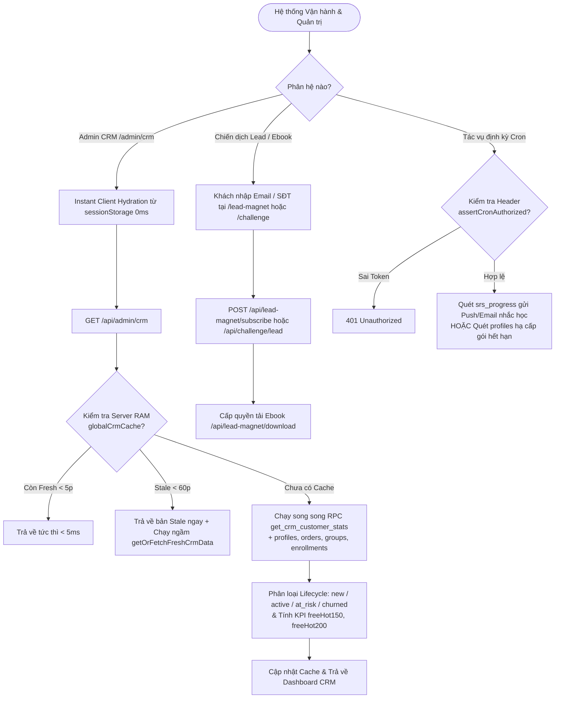
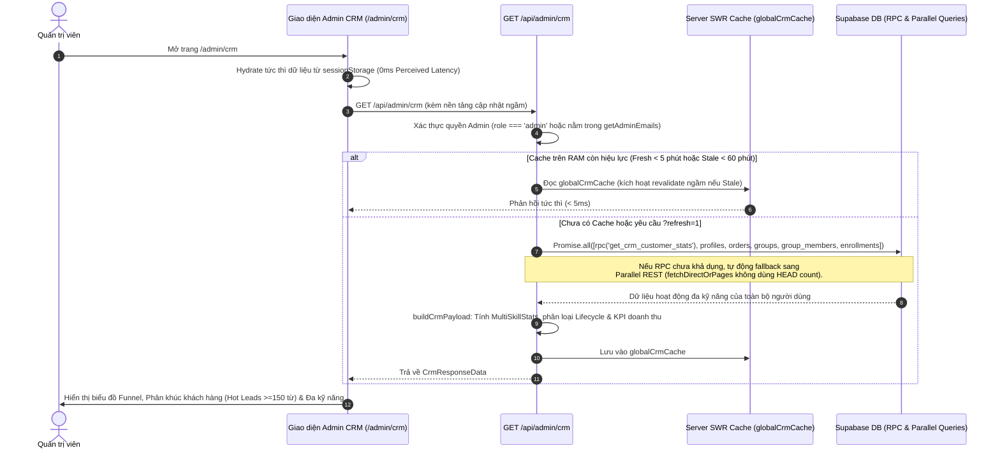

# Tài liệu Đặc tả Ca sử dụng (Use Case Specification)
## Tính năng: Quản trị Admin CRM, Chiến dịch Marketing & Tác vụ Tự động (Admin CRM, Lead Campaigns, Push Notifications & Cron Jobs)
**Mã tài liệu:** `UC-ADMIN-15`  
**File lưu trữ:** `agent/docs/SRS_15_ADMIN_CRM_CAMPAIGNS_CRON.md`

---

### 1. Thông tin chung
* **Actor / Role thực hiện:**
  * `Admin` (Quản trị viên vận hành hệ thống, theo dõi CRM, duyệt đơn và quản lý chiến dịch).
  * `Guest` / `Lead` (Khách hàng tiềm năng đăng ký nhận Ebook / Học liệu hoặc tham gia chiến dịch Khai giảng).
  * `Cron Scheduler` (Hệ thống lập lịch tự động gửi thông báo nhắc ôn tập và quét gói hết hạn).
* **Mô tả tóm tắt:** Bao gồm 3 trụ cột vận hành: (1) **Bảng điều khiển Admin CRM & Telemetry Đa kỹ năng (`/admin`, `/admin/crm`, `/api/admin/*`)**: Phân tích vòng đời khách hàng (`new`, `active`, `at_risk`, `churned`), theo dõi chỉ số học tập đa kỹ năng (Vocab, Grammar, Reading, TOEIC, Streak), doanh thu và danh sách đối tác B2B (`pilot_leads`) với cơ chế SWR Cache tốc độ cao (<5ms); (2) **Chiến dịch Thu hút Học viên & Quà tặng (`/khaigiang`, `/nhan-qua`, `/lead-magnet/*`, `/api/campaign/*`, `/api/lead-magnet/*`)**: Thu thập thông tin học viên tiềm năng, gửi Ebook và tặng quà nâng cấp; (3) **Hệ thống Thông báo Đẩy & Cron Jobs (`/api/push/fcm-register`, `/api/cron/*`)**: Tự động nhắc học viên ôn tập từ đến hạn qua Email / Web Push (FCM) và tự động hạ cấp các gói VIP đã hết hạn.
* **Tiền điều kiện (Pre-conditions):**
  * Đối với Admin CRM: Tài khoản có `role = 'admin'` hoặc email nằm trong danh sách quản trị `getAdminEmails()`.
  * Đối với Cron Jobs: Request phải đính kèm mã khóa xác thực hợp lệ (`assertCronAuthorized`).
* **Hậu điều kiện (Post-conditions):**
  * Dữ liệu tổng hợp CRM được lưu đệm SWR trên RAM server và `sessionStorage` tại client.
  * Thông tin đăng ký chiến dịch/Ebook được lưu vào bảng `leads` / `pilot_leads`.
  * Thông báo nhắc học được gửi tới thiết bị học viên và các tài khoản hết hạn VIP được cập nhật về `free`.

---

### 2. Danh sách API liên quan
| Phương thức | Endpoint | Chức năng | Quyền hạn |
|---|---|---|---|
| `GET` | `/api/admin/crm` | Tổng hợp dữ liệu khách hàng đa kỹ năng (`MultiSkillStats`), phân khúc vòng đời (`lifecycle`), phễu đăng ký 90 ngày và KPI doanh thu (hỗ trợ RPC `get_crm_customer_stats` + SWR Cache) | Admin |
| `GET` | `/api/admin/stats` | Lấy số liệu thống kê tổng quan hệ thống trên trang chủ Admin (`/admin`) | Admin |
| `GET` / `PATCH` | `/api/admin/pilot-leads` & `/api/pilot/leads` | Đăng ký hợp tác trung tâm/giáo viên (B2B Pilot Leads) và quản lý trạng thái chăm sóc khách hàng B2B | Public (POST) / Admin (GET, PATCH) |
| `POST` | `/api/lead-magnet/subscribe`, `/api/challenge/lead` & `GET /api/lead-magnet/ebook`, `/download` | Khách hàng đăng ký nhận tài liệu học tập miễn phí (Lead Magnet / Challenge Lead) và tải Ebook | Public |
| `POST` | `/api/campaign/khaigiang` & `/api/campaign/claim-upgrade-gift` | Các tuyến chiến dịch Khai giảng / Nhận quà nâng cấp (Hiện đã đóng chiến dịch và trả về `410 Gone`) | User / Guest |
| `GET` / `POST` | `/api/push/fcm-register` | Kiểm tra trạng thái (`GET`) và đăng ký Firebase Cloud Messaging (FCM) token của trình duyệt/thiết bị (`POST`) để nhận thông báo đẩy | User đã đăng nhập |
| `GET` | `/api/cron/push-due` & `/api/cron/email-due` | Cronjob quét danh sách học viên có từ vựng đến hạn ôn (`next_review_date <= TODAY`) để gửi Web Push và Email nhắc học | Cron Secret Token |
| `GET` | `/api/cron/check-expired` | Cronjob kiểm tra các tài khoản đã quá hạn `plan_expires_at` để thu hồi quyền Pro | Cron Secret Token |
| `POST` | `/api/test/notify` & `/api/test/push-due` | Gửi thử thông báo đẩy (`/api/test/notify` có khóa `ALLOW_TEST_ROUTES` + Admin; `/api/test/push-due` **đang mở công khai** và ghi đè `srs_progress`) | Admin (`notify`) / User bất kỳ (`push-due` - Lỗ hổng) |
| `GET` | `/api/health` & `/api/cron/auth-check` | Kiểm tra trạng thái sẵn sàng (Health Check) của tiến trình Next.js và kết nối Supabase | Hệ thống vận hành / Cron Secret |

---

### 3. Kịch bản chính (Main Flow) & Sơ đồ Luồng hoạt động

#### 3.1 Sơ đồ luồng tổng quan Admin CRM, Chiến dịch Lead & Cron Tự động (Activity Flowchart)

#### Ca sử dụng 1: Quản trị viên phân tích Vòng đời Học viên trên Admin CRM (UC-ADMIN-15.1)

1. **Bước 1 (Admin):** Quản trị viên truy cập `/admin/crm`. Giao diện lập tức hiển thị dữ liệu từ `sessionStorage` (0ms skeleton delay) trong khi gọi `GET /api/admin/crm` ở hậu cảnh.
2. **Bước 2 (Backend - Bảo mật & SWR Cache):** Tuyến `/api/admin/crm` kiểm tra quyền Admin. Nếu `globalCrmCache` còn trong cửa sổ Fresh (5 phút) hoặc Stale-While-Revalidate (60 phút), server trả về kết quả ngay lập tức dưới 5ms và làm mới dữ liệu ngầm (`getOrFetchFreshCrmData` có cơ chế SingleFlight chống trùng lặp truy vấn).
3. **Bước 3 (Backend - Concurrent DB Pipeline):** Khi nạp dữ liệu mới, server gọi song song (`Promise.all`) Stored Procedure `get_crm_customer_stats` cùng các bảng `profiles`, `orders`, `groups`, `group_members`, `enrollments` bằng hàm `fetchDirectOrPages` (truy vấn thẳng `.range(0, 999)` không phát sinh request `HEAD count` dư thừa).
4. **Bước 4 (Backend - Phân loại Vòng đời & Hot Leads):** Hàm `buildCrmPayload` tổng hợp hoạt động thực tế gần nhất (`trueLastActive`) trên tất cả các kỹ năng (Từ vựng, Ngữ pháp, Đọc hiểu, TOEIC, Lộ trình, Streak) và phân loại:
   * `new`: Mới đăng ký $\le 7$ ngày.
   * `active`: Có hoạt động học tập trong $\le 7$ ngày qua.
   * `at_risk`: Ngừng học từ 8 đến 30 ngày.
   * `churned`: Không hoạt động $> 30$ ngày.
   * Đồng thời lọc ra nhóm khách hàng tiềm năng cao (`freeHot150`, `freeHot200`: người dùng gói Free đã lưu từ 150–200 từ vựng trở lên) để đội ngũ CSKH tư vấn nâng cấp Pro.

#### Ca sử dụng 2: Tự động gửi Thông báo nhắc ôn tập FSRS & Quét gói hết hạn qua Cron (UC-ADMIN-15.2)
1. **Bước 1 (Student):** Khi đăng nhập trên trình duyệt/thiết bị, ứng dụng đăng ký FCM Token qua `POST /api/push/fcm-register`.
2. **Bước 2 (Cron Scheduler):** Đến khung giờ nhắc học hàng ngày, hệ thống lập lịch gọi `GET /api/cron/push-due` và `GET /api/cron/email-due` kèm header xác thực Cron.
3. **Bước 3 (Backend):** Kiểm tra `assertCronAuthorized(req)`, truy vấn danh sách người dùng có từ vựng đến hạn cần ôn (`next_review_date <= TODAY`) và gửi thông báo đẩy (Web Push) hoặc Email nhắc học viên duy trì chuỗi Streak.
4. **Bước 4 (Cron Expired Check):** Định kỳ, `GET /api/cron/check-expired` quét các tài khoản có `plan_expires_at < NOW()` để tự động cập nhật trạng thái hết hạn, đảm bảo tính chặt chẽ của quyền lợi thuê bao.

---

### 4. Kịch bản ngoại lệ (Alternative & Exception Flows)

* **E1: Stored Procedure `get_crm_customer_stats` chưa được khởi tạo hoặc lỗi trên DB**
  * *Tại Bước 3 của UC-ADMIN-15.1:* Lệnh gọi `supabase.rpc('get_crm_customer_stats')` trả về lỗi.
  * *Xử lý:* Tuyến `/api/admin/crm` tự động chuyển sang **Engine B (`rest_parallel`)**, truy vấn song song 11 bảng hoạt động qua `Promise.all` và tổng hợp trên bộ nhớ để Dashboard Admin luôn hoạt động 100% không gián đoạn.
* **E2: Người dùng không phải Admin cố truy cập API quản trị**
  * *Tại Bước 2 của UC-ADMIN-15.1:* Tài khoản học viên/giáo viên thường gọi `/api/admin/crm` hoặc `/api/admin/stats`.
  * *Xử lý:* Backend kiểm tra `role !== 'admin'` và email không nằm trong `getAdminEmails()`, lập tức từ chối truy cập với HTTP 401/403.
* **E3: Gọi đường dẫn `/api/cron/*` mà không có khóa bí mật Cron**
  * *Tại Bước 3 của UC-ADMIN-15.2:* Bên thứ ba gọi trái phép các endpoint trong `/api/cron/*`.
  * *Xử lý:* Hàm `assertCronAuthorized` từ chối ngay lập tức với HTTP 401 Unauthorized.

---

### 5. Điểm hạn chế, Rủi ro & Nút thắt trong Luồng hiện tại (Current Limitations & Architectural Bottlenecks)

1. **Lỗ hổng Lộ Endpoint Test trên Production làm biến đổi dữ liệu FSRS thật (`POST /api/test/push-due` trong `src/app/api/test/push-due/route.ts`):**
   * *Vị trí mã nguồn:* `src/app/api/test/push-due/route.ts` (dòng 14–68).
   * *Vấn đề:* Khác với `/api/test/notify` (được bảo vệ bởi `process.env.ALLOW_TEST_ROUTES === 'true'` và `authorizeWebAdmin`), tuyến `POST /api/test/push-due` **hoàn toàn không kiểm tra biến môi trường và không kiểm tra quyền Admin**! Bất kỳ người dùng đã đăng nhập nào gọi endpoint này trên môi trường Production đều sẽ kích hoạt lệnh `UPDATE srs_progress SET next_review_date = <1 giờ trước>` lên tối đa 5 từ vựng thật của họ và bắn thông báo đẩy ngay lập tức.
2. **Thiếu cơ chế chống gửi trùng (No Cooldown), gửi cả từ `'⏳ Analyzing...'` và N+1 Truy vấn ($5N + 1$) trong `GET /api/cron/email-due`:**
   * *Vị trí mã nguồn:* `src/app/api/cron/email-due/route.ts` (dòng 35–130).
   * *Vấn đề:* Tuyến `/api/cron/email-due` không lưu hay kiểm tra dấu thời gian `last_due_email_at` của học viên (nếu Cron chạy lặp lại sẽ gửi trùng email cho toàn bộ học viên). Ngoài ra, với mỗi học viên trong bảng `profiles` (`role = 'student'`), hàm thực hiện **tới 5 truy vấn DB tuần tự** (`push_subscriptions`, `classrooms`, `enrollments`, `srs_progress`, `words`) và không lọc bỏ các từ đang bị kẹt ở `translation = '⏳ Analyzing...'` khi kết xuất bảng từ vựng trong email.
3. **Hạ cấp tuần tự từng User (`for` loop) và Bỏ sót việc đóng các Nhóm học tập (`groups`) hết hạn trong `GET /api/cron/check-expired`:**
   * *Vị trí mã nguồn:* `src/app/api/cron/check-expired/route.ts` (dòng 24–78).
   * *Vấn đề:* Khi quét các tài khoản hết hạn (`plan_expires_at < now`), hệ thống lặp qua từng user (`for (const user of expiredUsers)`) và chạy `await supabase.from('profiles').update(...)` tuần tự từng dòng một thay vì cập nhật hàng loạt. Nghiêm trọng hơn, cronjob này **chỉ quét bảng `profiles` mà không cập nhật bảng `groups` (`status = 'expired'` khi `expires_at < now`)**, khiến các nhóm đã hết hạn vẫn giữ `status = 'active'` trên DB.
4. **Tải trực tiếp Ebook không cần để lại Email (`/api/lead-magnet/download`, `/ebook`) & Ghi file đồng bộ chặn Event Loop (`fs.appendFileSync`):**
   * *Vị trí mã nguồn:* `src/app/api/lead-magnet/download/route.ts`, `src/app/api/lead-magnet/subscribe/route.ts` (dòng 42–71) và `src/app/api/challenge/lead/route.ts` (dòng 41–68).
   * *Vấn đề:* `/api/lead-magnet/download` và `/api/lead-magnet/ebook` trả về toàn bộ nội dung Ebook công khai mà không kiểm tra token đã điền form. Đồng thời, `/api/lead-magnet/subscribe` và `/api/challenge/lead` **luôn gọi đồng bộ `fs.appendFileSync`** vào `data/campaign-leads/leads-toeic-listening-2026.jsonl` và `data/campaign-leads/leads-challenge-landing.jsonl` trước rồi mới `INSERT` vào bảng `pilot_leads` (và nuốt mọi lỗi DB nhưng vẫn trả về `200 OK`).

