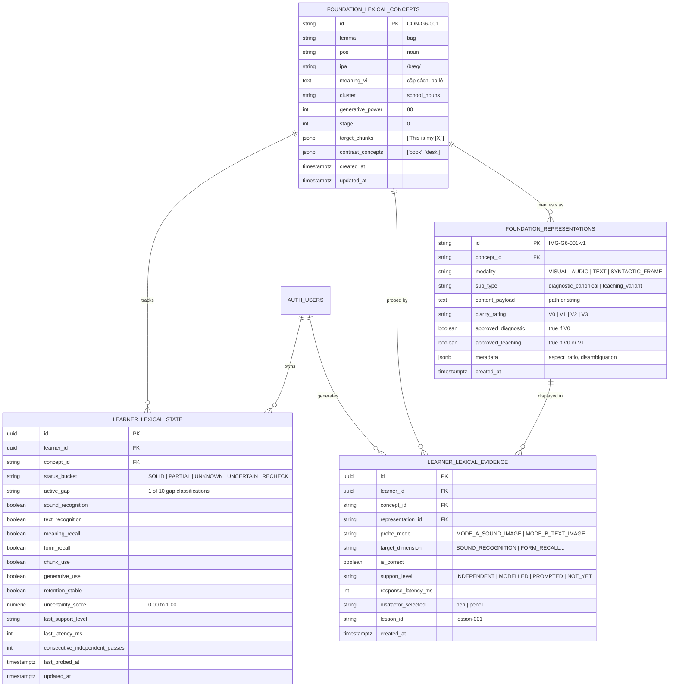

# P2 Data Model & Non-Destructive Storage Specification

> **Project**: English From Zero – Foundation Curriculum (Grade 6 Vietnam, 11–12yo False Beginners, Pre-A1)  
> **Phase**: P2 — Safe Implementation  
> **Target Migration**: `supabase/migrations/20261009_foundation_curriculum_gap_map.sql`  
> **Integrity Guarantee**: 100% Additive, Zero Breaking Changes to Legacy DB Objects

---

## 1. Relational Entity Architecture

The schema establishes four core tables adhering to Layer B (Learner Mastery Map) and Layer C (Multi-Representation Assets) specifications:

---

## 2. Table-by-Table Technical Specifications

### 2.1 `foundation_lexical_concepts`
- **Purpose**: Canonical dictionary of the 130 foundational lexical items required for Grade 6 Pre-A1 mastery.
- **Primary Key**: `id` (`VARCHAR(32)`, e.g. `CON-G6-001`).
- **Columns**:
  - `lemma`: Normalized dictionary headword.
  - `pos`: Syntactic part of speech (`noun`, `verb`, `adj`, `adv`, `pronoun`, `prep`).
  - `ipa`: Broad phonemic transcription highlighting coda stops.
  - `meaning_vi`: Natural Vietnamese translation.
  - `cluster`: Pedagogical thematic cluster (`school_nouns`, `core_verbs`, `food_drink`, `states_emotions`, `classroom_routines`, `functional_questions`).
  - `generative_power`: Integer score ($0$–$100$) reflecting syntactic combinability and chunk utility.
  - `stage`: Curricular stage ($0 = \text{Lessons 1–3 Pilot}$, $1 = \text{Lessons 4–12}$, etc.).
  - `target_chunks`: Array of formulaic syntactic frames anchoring this lemma.
  - `contrast_concepts`: Semantic boundary foils (e.g. `pen` vs `pencil`).

### 2.2 `foundation_representations`
- **Purpose**: Stores multi-representation modalities (Text, Audio, Visual, Syntactic Frames).
- **Primary Key**: `id` (`VARCHAR(64)`).
- **Clarity Governance**:
  - `clarity_rating`: Strict enum (`V0`, `V1`, `V2`, `V3`).
  - `approved_diagnostic`: Boolean constraint — strictly `TRUE` ONLY for `V0` assets.
  - `approved_teaching`: `TRUE` for `V0` and `V1` assets. Prohibits `V2` and `V3` from instructional drills.

### 2.3 `learner_lexical_evidence`
- **Purpose**: High-fidelity, immutable telemetry ledger logging every student observation event.
- **Append-Only Invariant**: Prohibits SQL `UPDATE` and `DELETE`.
- **Fields**:
  - `probe_mode`: Modality channel (`MODE_A_SOUND_IMAGE`, `MODE_B_TEXT_IMAGE`, `MODE_C_FORM_RECALL`, `MODE_D_CHUNK_CLOZE`, `MODE_E_TEACHER_OBSERVATION`).
  - `target_dimension`: Dimension under evaluation.
  - `support_level`: Scaffolding tier (`INDEPENDENT`, `MODELLED`, `PROMPTED`, `NOT_YET`).
  - `response_latency_ms`: Millisecond reaction time for anxiety and hesitation detection.

### 2.4 `learner_lexical_state`
- **Purpose**: Materialized view of the learner's multi-dimensional knowledge profile and active gap classification.
- **Unique Constraint**: `(learner_id, concept_id)`.
- **Dimensions Maintained**:
  - `sound_recognition`, `text_recognition`, `meaning_recall`, `form_recall`, `chunk_use`, `generative_use`, `retention_stable`.
  - `uncertainty_score`: Bayesian/heuristic confidence metric ($0.00 = \text{fully certain}$, $1.00 = \text{unprobed}$).
  - `active_gap`: One of the 10 diagnostic gap types (e.g. `SOUND_FORM_GAP`, `CHUNK_USAGE_GAP`).
  - `status_bucket`: Glanceable teacher category (`SOLID`, `PARTIAL`, `UNKNOWN`, `UNCERTAIN`, `RECHECK`).

---

## 3. Backward Compatibility & Non-Destructive Proof

1. **Zero Impact on Existing Tables**:
   - `words` table remains untouched.
   - `global_dictionary` remains untouched.
   - `srs_progress` remains untouched.
   - `student_progress` view remains untouched.
   - `user_roadmaps` and `user_roadmap_steps` remain untouched.
2. **Coexistence with FSRS**:
   - Existing TOEIC and CEFR spaced repetition queries continue executing without modification.
   - The foundation gap model leverages FSRS stability purely as an optional retention input while maintaining independent multi-dimensional vectors.
3. **Rollback Simplicity**:
   - Dropping the four new tables completely restores the database to its previous state with zero cascading effects on legacy features.
