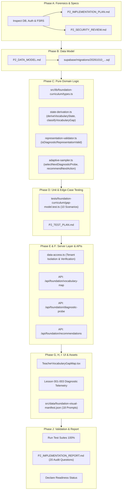

# P2 Implementation Plan: Safe Pedagogical & Technical Execution

> **Project**: English From Zero – Foundation Curriculum (Grade 6 Vietnam, 11–12yo False Beginners, Pre-A1)  
> **Phase**: P2 — Safe Implementation of Vocabulary Gap Map, Multi-Representation System, Adaptive Diagnostics, Teacher Cockpit, and Visual Assets  
> **Repository**: `FengProfessor/Vocab` (LingoPro)  
> **Deployment Policy**: LOCAL IMPLEMENTATION & VERIFICATION ONLY (Strictly ZERO production migrations or server mutations)

---

## 1. Executive Summary & Core Objectives

Phase P2 transitions the architectural patch formulated in Documents 26 through 36 into robust, verifiable, and non-destructive code within the LingoPro repository.

The technical system must accomplish five operational goals:
1. **Multi-Dimensional State Representation**: Track learner lexical knowledge across 8 distinct evidence dimensions (`SOUND_RECOGNITION`, `TEXT_RECOGNITION`, `MEANING_RECALL`, `FORM_RECALL`, `CHUNK_USE`, `GENERATIVE_USE`, `RETENTION`, `UNCERTAINTY`) without ever flattening to a single scalar percentage.
2. **Diagnostic Gap Classification**: Categorize learner failures into 10 deterministic gap types, isolating instrument errors (e.g., ambiguous images) from true linguistic deficiencies.
3. **Multi-Representation Validation & Invalidation**: Reject low-clarity assets (`V2`/`V3`) from unassisted diagnostic probes; automatically invalidate trials and protect learner profiles when flawed assets are encountered.
4. **Adaptive Micro-Diagnostics**: Dynamically sample high Generative Power ($GP$) seed items and recommend in-lesson micro-probes while respecting strict adolescent anxiety stopping rules.
5. **Teacher Explainability**: Provide an inspectable, glanceable dashboard view (< 5s interpretation SLA) that generates deterministic, evidence-backed pedagogical recommendations for the upcoming lesson.

---

## 2. Forensic Analysis of Existing Repository Architecture

### 2.1 Database & Schema Forensics
The repository currently operates several distinct subsystems in PostgreSQL / Supabase:
- **`words`**: Stores user-specific vocabulary entries linked to `classroom_id` and `added_by`.
- **`global_dictionary`**: Shared dictionary catalog (`word`, `data`, `image_url`, `image_source`, `image_confidence`).
- **`srs_progress`**: Tracks memory scheduling via FSRS v5 (`stability`, `difficulty`, `interval_days`, `review_count`, `next_review_date`, `last_reviewed_at`).
- **`student_progress` (View)**: Computes high-level classroom metrics, including legacy VMS (`round((mastered_words / total_words) * 100)`).
- **`user_roadmaps` & `user_roadmap_steps`**: Tracks linear multi-track curricular progress for CEFR (`A0`–`B2`) and THPT (`lop-10`–`lop-12`).

### 2.2 FSRS v5 Interaction Analysis
- **Decoupling Mandate**: FSRS models memory retention and retrievability $R = (1 + t / (9S))^{-1}$. However, pedagogical diagnostic state is multi-dimensional. A high stability card in FSRS does not distinguish whether the student can produce the word in a chunk or merely recognizes the written text.
- **Integration Boundary**: The foundation curriculum utilizes FSRS stability strictly to inform the `RETENTION` dimension ($t \ge 7\text{ days}$ without lapse). The diagnostic gap classification engine operates independently of raw FSRS scalar scores.

### 2.3 Non-Destructive Additive Schema Architecture
To guarantee 100% backward compatibility with existing TOEIC, CEFR, and general classroom tracks:
- **No Existing Columns or Tables Dropped or Altered**: The schema changes are purely additive under the `foundation_` and `learner_lexical_` namespaces.
- **Dedicated Entities**:
  1. `foundation_lexical_concepts`: Represents abstract lexical entries (130 foundation items), semantic clusters, generative power ($GP$), and target chunks.
  2. `foundation_representations`: Stores representation modalities (Text, Audio, Visual, Frames) with clarity ratings (`V0`, `V1`, `V2`, `V3`) and diagnostic eligibility flags.
  3. `learner_lexical_evidence`: Immutable audit ledger recording every observation event with task modality, response latency, support level (`INDEPENDENT`, `MODELLED`, `PROMPTED`, `NOT_YET`), and outcome.
  4. `learner_lexical_state`: Materialized multidimensional profile per learner and concept, tracking the 8 dimensions and active gap classification.

---

## 3. Phased Implementation Roadmap

---

## 4. Key Architectural Safeguards

1. **Pure Function Isolation**: All state derivation, gap classification, and probe selection functions are 100% pure TypeScript functions with zero side effects, making them trivial to test deterministically without spinning up database containers.
2. **Instrument Invalidation**: If an evidence event references a visual representation with clarity rating `V2` or `V3`, the logic guarantees classification as `POSSIBLE_VISUAL_ITEM_ERROR`, invalidates the trial, and prevents any reduction of the learner's vocabulary state.
3. **Support Level Differentiation**: Responses logged with support levels `MODELLED` or `PROMPTED` provide scaffolding credit but explicitly do NOT grant autonomous mastery (`INDEPENDENT` status required).
4. **Adolescent Latency Bounds**: Response latencies $> 8,000\text{ms}$ trigger uncertainty flags, preventing lucky late guesses from being marked as solid mastery. Latencies $> 15,000\text{ms}$ indicate task confusion or severe anxiety.
5. **Generative Power Priority**: Adaptive sampling prioritizes unprobed concepts with high Generative Power ($GP \ge 70$), maximizing communicative leverage in minimal diagnostic trials.
